# Generative Rhythm Game

내 음악 파일을 넣고 키 모드와 난이도를 고르면, 로컬 분석 서버가 곡을 분석해 그 곡만의 채보를 만들어 주고, 그 채보를 **SOUND VOLTEX식 3D 원근 트랙** 위에서 **DJMAX RESPECT V 판정 기준**으로 플레이하는 건반형 리듬게임입니다.

- 개발 명세(프롬프트): [docs/PROMPT.md](docs/PROMPT.md)
- 설계: [docs/ARCHITECTURE.md](docs/ARCHITECTURE.md) · 분석·생성 알고리즘: [docs/GENERATION.md](docs/GENERATION.md) · 채보 포맷: [docs/CHART_FORMAT.md](docs/CHART_FORMAT.md)
- **Windows 설치 파일**: [Actions → Desktop app (Windows)](https://github.com/DreamChaserDeekay/Generative-Rhythm-Game/actions/workflows/desktop-windows.yml)의 최신 실행 → Artifacts · 설치와 확인 순서는 [docs/TESTING.md](docs/TESTING.md)

| | |
|---|---|
| 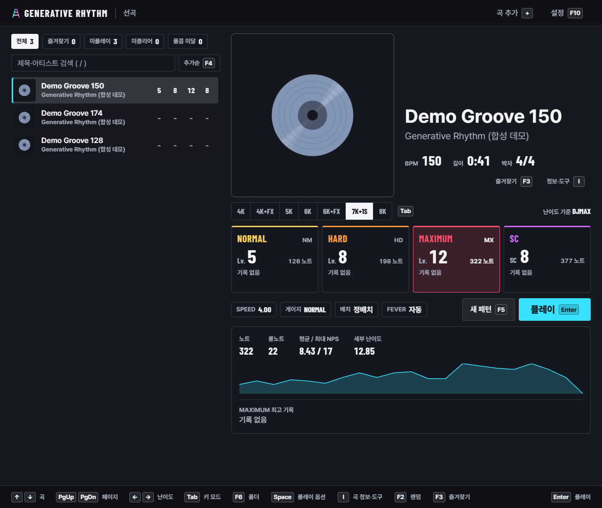 곡 선택 · DJMAX 기준(모든 난이도의 레벨·노트 수, 버튼 아래 MAXIMUM 채보 요약과 NPS 그래프) | 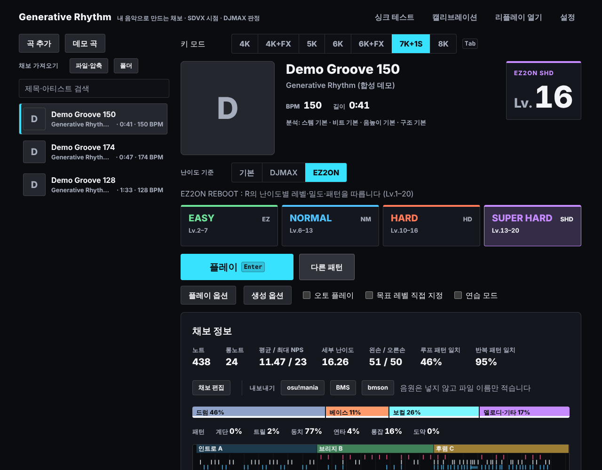 같은 곡을 EZ2ON 기준 SUPER HARD로 (Lv.1–20) |
| 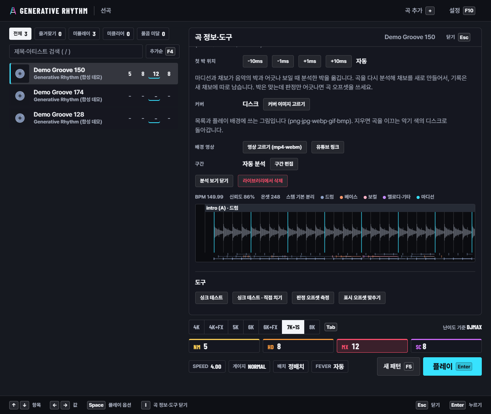 곡 분석(박·마디선, 구간, 스템별 온셋) | 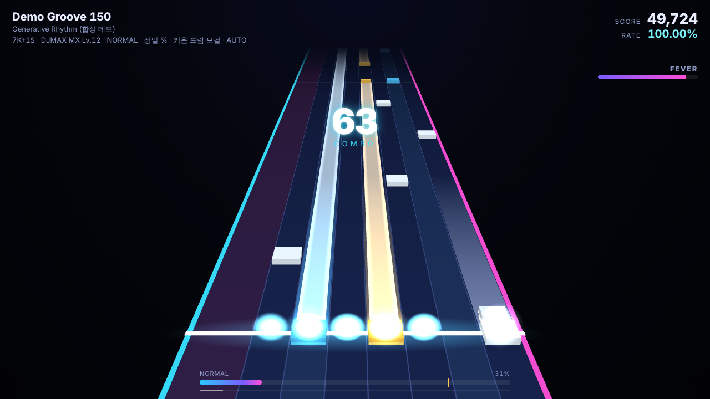 7K+1S (SDVX식 3D 트랙, DJMAX 판정, 키음) |
| 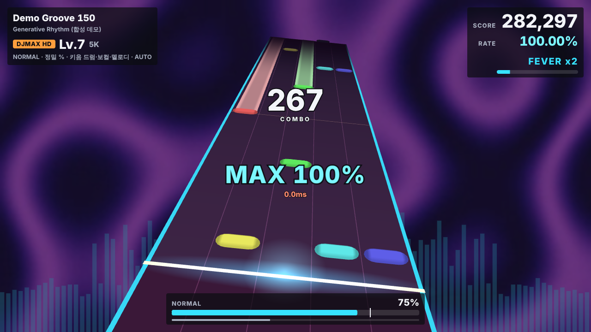 BGA 영상 · 비주얼라이저 · 키음 · 팝 스킨 | 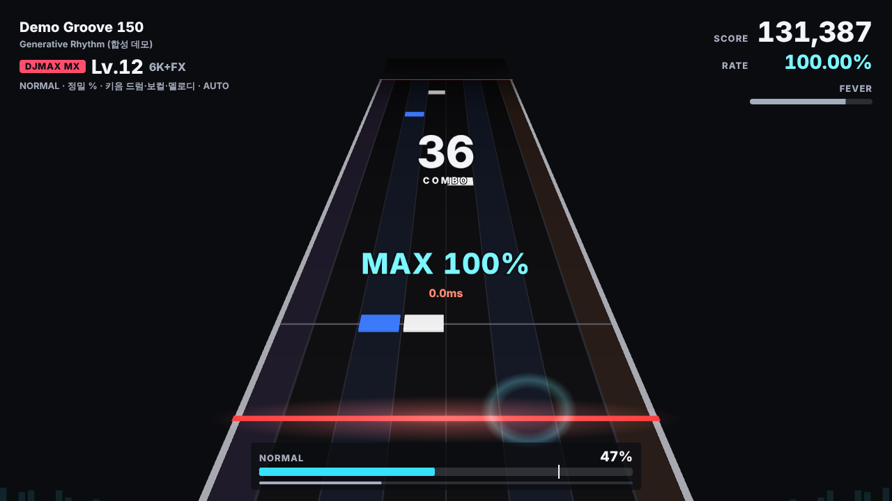 6K+FX 사이드 노트(별도 레인, 롱노트) · SUDDEN+ · 클럽 스킨 |
| 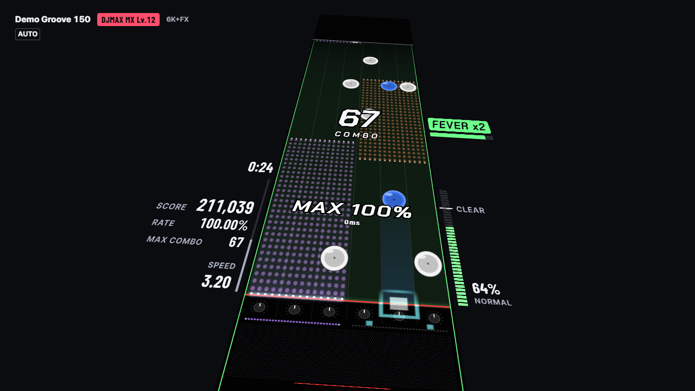 6K+FX 사이드 노트 **반쪽 덮기**(DJMAX식: 건반 레인 절반을 덮는 막대) | 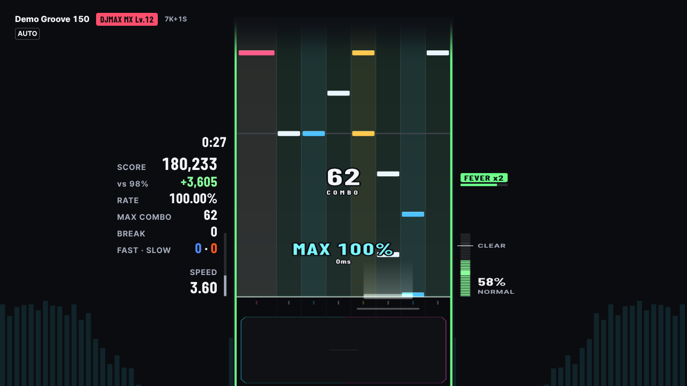 **평면** 카메라(레일이 나란함) · 판정 카운터 · 페이스메이커 · 남은 시간 |
|  결과 화면 (램프 · 등급 · 최고 기록 갱신과 차이 · 램프 갱신 · 다음 등급까지 · 게이지가 그려진 곡 흐름) | 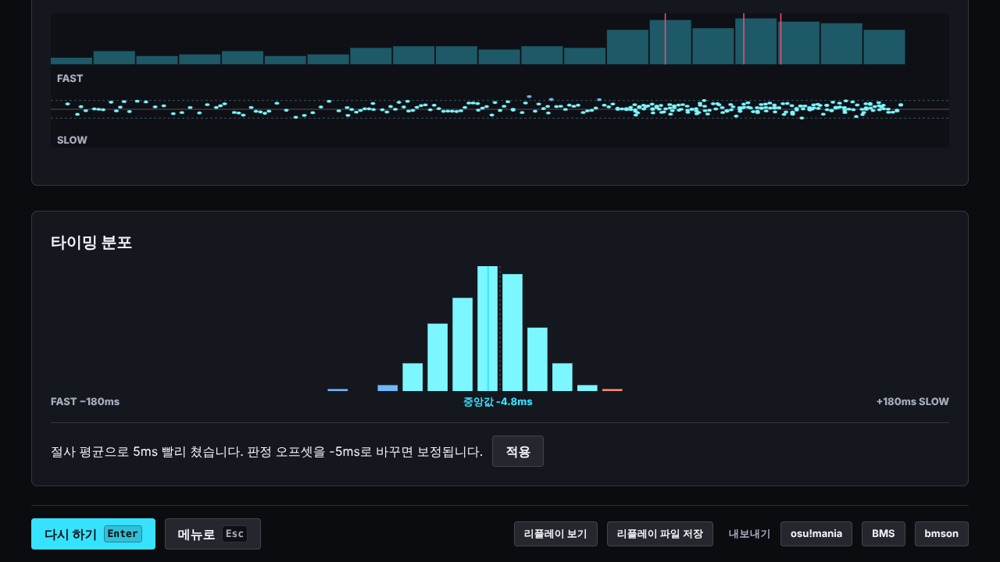 결과 상세(Space) · 그 판정 모드의 타이밍 분포 · 오프셋 추천(전체 / 이 곡에만) · 판정 % · 리플레이 · 내보내기 |
| 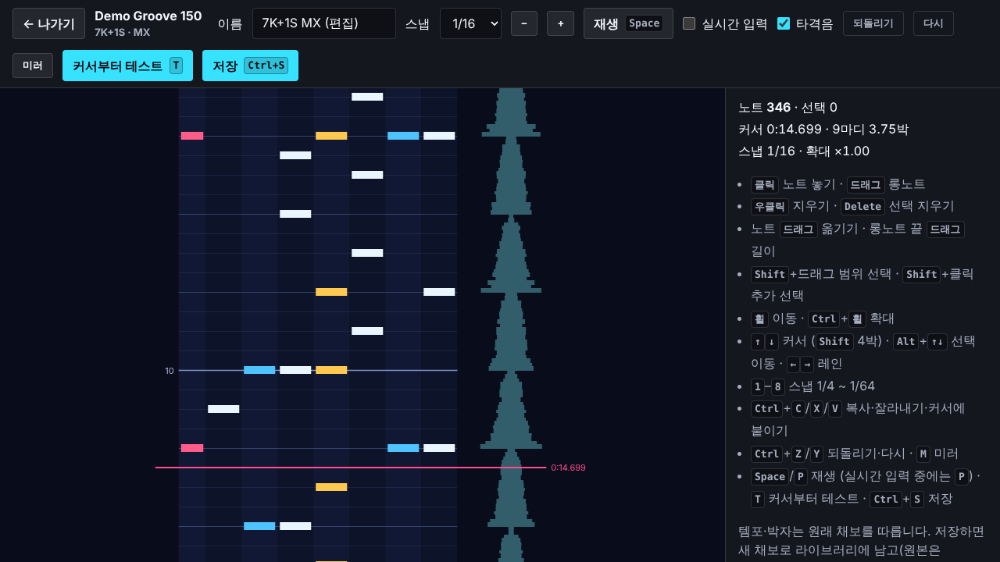 채보 에디터 |  키음 BMS 폴더 가져오기 |
| 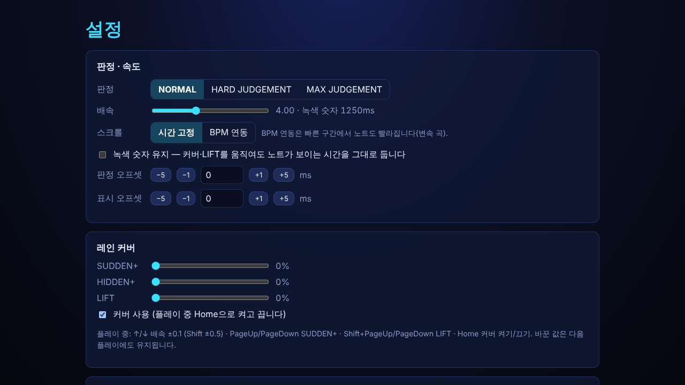 설정 (탭 · 설정 행 · 움직이는 기어 미리보기) | 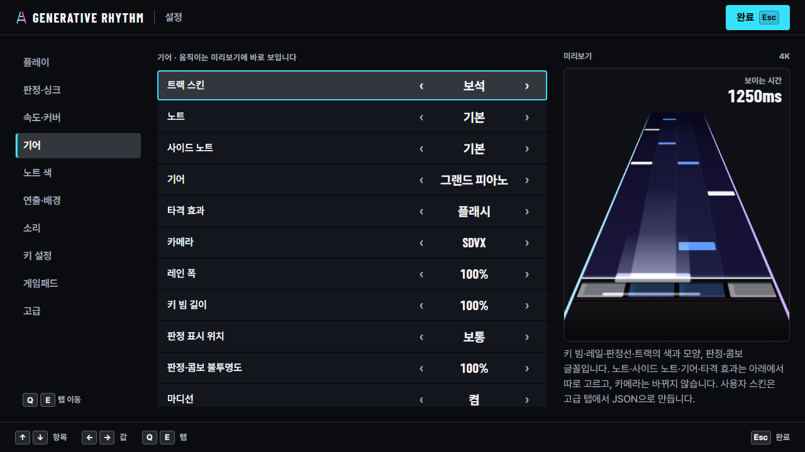 스킨을 바꾸면 미리보기도 바로 바뀜 (보석) |
|  판정 오프셋 측정 (메트로놈을 듣고 치기) |  표시 오프셋 맞추기 (노트를 보며 ←→) |
|  Windows에 설치한 앱 |  Windows에 설치한 앱의 오토 플레이 |
| 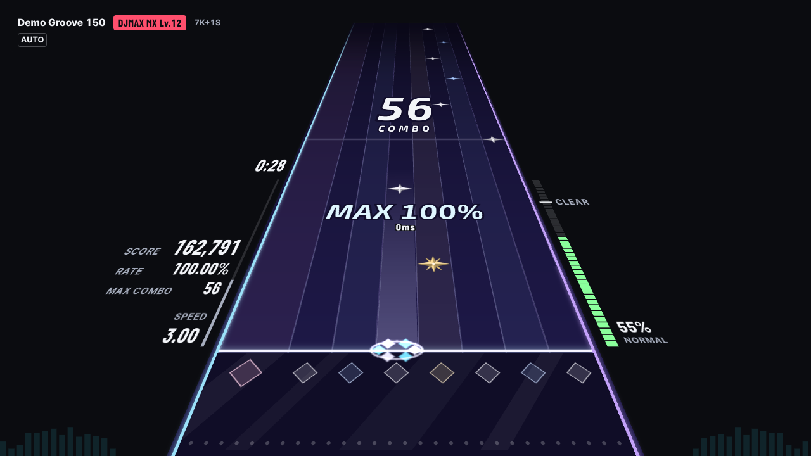 크리스털 스킨 · 7K+1S | 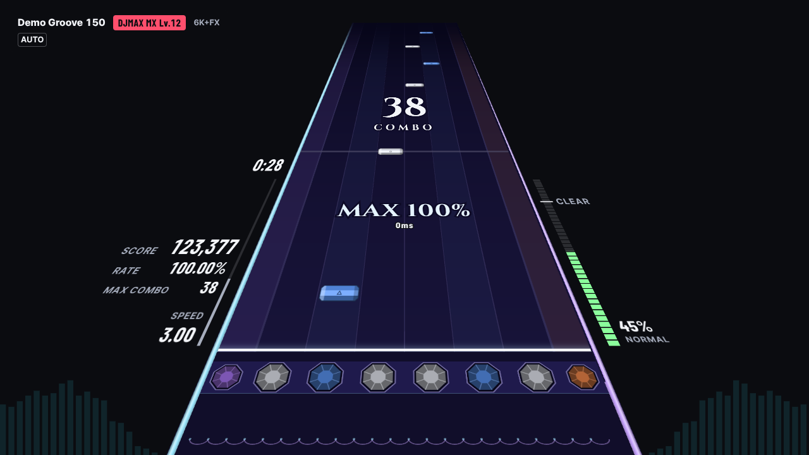 보석(JEWEL) 스킨 · 6K+FX |
| 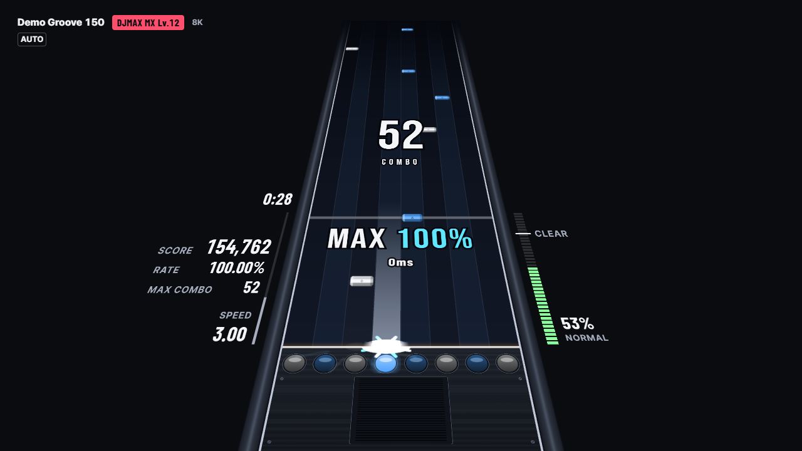 아케이드 스킨 · 8K | 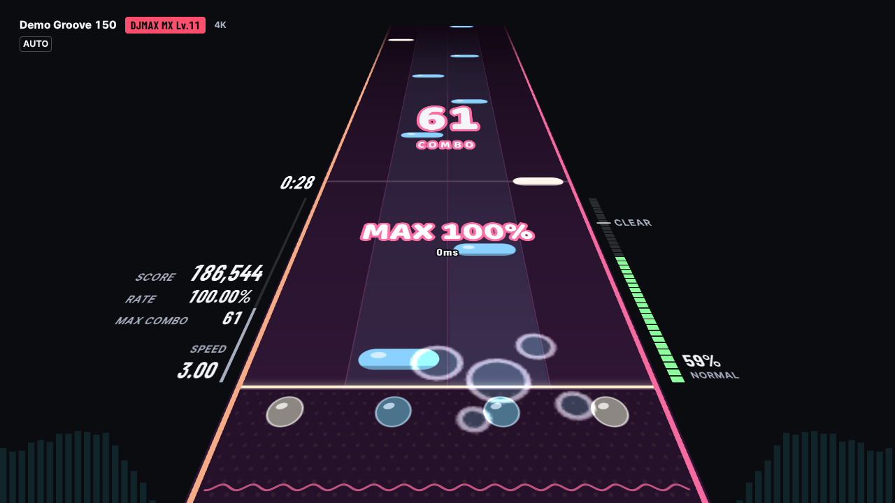 팝 스킨 · 4K |

화면의 곡·키음·영상은 모두 코드로 합성한 것입니다(`client/e2e/screenshots.spec.ts`). 기본 스킨은 코드로 그리고, 보석 스킨의 타격·롱노트 이펙트와 JSON 사용자 스킨이 쓸 수 있는 노트·기어 그림은 이 저장소를 위해 생성했습니다(`assets-src/PROVENANCE.md`).

## 진행 상황

- [x] **Phase 0** — 설계, DJMAX 판정 엔진, 오디오 클럭, SDVX식 3D 트랙, 싱크 테스트, 판정 오프셋 측정
- [x] **Phase 1** — Python 분석 서버(표준 오디오·분석·채보 생성·난이도 산정·기록), 곡 업로드부터 결과까지 전체 흐름 (키 모드 4K · 7K+1S, 난이도 5단계)
- [x] **Phase 2** — 5K·6K·8K·사이드(FX) 레인, 점수 규칙 프리셋(정밀 % · 등급형 · EX-SCORE), FEVER, 게이지 6종·클리어 램프 8종, 배치 옵션, 레인 커버·보이는 시간(녹색 숫자) 유지·BPM 연동 스크롤, 연습 모드(구간 반복·음정 그대로 재생 속도 조절), 결과 분석 그래프, 손별 난이도 산정, 생성 스타일·세부 옵션, 채보 미니맵, 접근성 옵션
- [x] **Phase 3** — 스템 분리(기본 DSP · 선택 설치형 Demucs)와 온셋 악기 태깅, 선택 설치형 ML 백엔드(beat_this 박·다운비트, basic-pitch 음높이, allin1 곡 구조), 악기별 레인 매핑, 반복 구간 패턴 일관성, 스템 키음 모드, SDVX식 카메라 연출(기울기·줌), 배경(흐린 앨범아트·비주얼라이저·BGA 영상·밝기), 스킨 시스템(기본 4종 + JSON 사용자 스킨)
- [x] **Phase 4** — 채보 에디터(생성 결과 수정 + 커서부터 테스트 플레이), BMS·bmson·osu!mania 가져오기/내보내기(BMS 키음·BGM 채널·BPM 변속·STOP), 리플레이, 게임패드·전용 컨트롤러(턴테이블 포함), 데스크톱 앱(Electron + 분석 서버 동봉)
- [x] **그 뒤** — Windows 설치 파일(GitHub Actions에서 빌드·설치 확인), DJMAX RESPECT V · EZ2ON REBOOT : R 난이도 기준(공개 데이터의 레벨별 밀도·동시치기·롱노트·사이드 노트 경향), 생성 채보의 노트별 키음, 누르기 전에도 잘 보이는 롱노트
- [x] **화면 개편** — 선곡(폴더·정렬·곡 그림), 로딩 카드, 코드로 그린 스킨 9종과 기어 위에 눕힌 HUD, EZ2ON 기준 등급, 램프·등급·점수가 한 번에 나오는 결과, 탭으로 나눈 설정과 움직이는 기어 미리보기, 캘리브레이션
- [x] **숙련 플레이어의 점검 반영** — 모든 노트의 한 기준점, 원근 없는 평면 카메라, 모든 기어의 같은 판정선, 타격 효과 크기, HUD(진행 바·남은 시간·BPM·판정 카운터·판정 불투명도), 내 키·보조 키·패드 버튼·곡 오프셋, 키보드·패드로 다 되는 선곡과 바로 보이는 레벨·패턴별 기록·모양으로 구별되는 램프·가져온 채보 항목·커버, 점수 규칙과 판정 모드별 기록, 표시 오프셋 맞추기·직접 치는 싱크 테스트, 되돌릴 수 있는 초기화·화면 모드, 데스크톱 창·설정 기억, 에디터 정리, 서버 자동 재연결, DJMAX식 사이드 노트(반쪽 덮기)

## 준비물

- Python 3.11 이상
- Node.js 20 이상 (클라이언트 빌드용)
- 최신 Chrome 또는 Edge

## 설치와 실행

```bash
# 1) 분석 서버 설치
cd server
python -m venv .venv
.venv/bin/pip install -e ".[dev]"        # Windows: .venv\Scripts\pip install -e ".[dev]"

# 2) 클라이언트 빌드 (한 번만)
cd ../client
npm install
npm run build

# 3) 실행: 서버가 게임 화면과 API를 함께 제공합니다
cd ../server
.venv/bin/python -m rhythm_server        # → http://127.0.0.1:8765
```

### ML 분석 백엔드 (선택)

기본 분석(numpy·scipy)만으로 모든 기능이 동작합니다. 아래 라이브러리를 설치하면 서버가 자동으로 찾아 쓰고, 설정 화면의 **분석 백엔드**에서 상태를 볼 수 있습니다.

```bash
cd server
.venv/bin/pip install torch torchaudio --index-url https://download.pytorch.org/whl/cpu   # CPU용 PyTorch
.venv/bin/pip install -e ".[ml]"                                                        # demucs · beat-this (+ basic-pitch)
```

| 백엔드 | 하는 일 | 없을 때(기본 분석) | 라이선스 |
|---|---|---|---|
| Demucs (htdemucs) | 드럼·베이스·보컬·그 외 4스템 분리 | HPSS + 배음 마스크 분리 | 코드 MIT, 가중치는 라이선스 명시 없음 |
| beat_this | 박·다운비트 → 템포 힌트·박자 | 온셋 자기상관·다운비트 단서 | 코드·가중치 MIT |
| basic-pitch | 멜로디 음높이 | 온셋 배음 분석 | Apache-2.0. TensorFlow 2.15가 필요해 **Python 3.11에서만** 설치됩니다(3.12 이상에서는 자동으로 빠짐) |
| allin1 | 곡 구조 라벨(절·후렴) | 자기유사 행렬 구조 분석 | 코드 MIT, 의존성 madmom의 모델이 비상업 라이선스라 `[ml]`에 넣지 않았습니다. 직접 설치하면 쓰지만 실제 라이브러리로는 검증하지 않았습니다 |

- 모델 가중치는 처음 쓸 때 한 번 내려받습니다(Demucs 약 84MB, beat_this 약 81MB). 음원은 PC 밖으로 나가지 않습니다.
- **느립니다**: 4코어 CPU에서 Demucs · beat_this · basic-pitch를 모두 쓰면 4분 곡 분석이 약 4분(242초) 걸립니다(기본 분석은 약 8초). 분석은 백그라운드 작업이라 진행률을 보며 다른 곡을 플레이할 수 있습니다. 단계별로 끄려면 `config/analysis.json`에서 그 단계의 `backend`를 `null`로 바꾸세요.
- GPU를 쓰려면 pytorch.org 안내대로 CUDA용 PyTorch를 설치하고 `config/analysis.json`의 `ml.device`를 `"cuda"`로 바꾸세요.
- `ml.enabled`를 `false`로 두거나 `GRG_ML=0`으로 서버를 띄우면 ML을 쓰지 않습니다. ML 백엔드가 실패하면 그 단계만 기본 분석으로 대체하고 분석 결과의 `analyzer.errors`에 남깁니다.
- 백엔드를 설치·제거하거나 분석기가 바뀌면, 이미 분석한 곡의 곡 정보에 **다시 분석** 버튼이 나타납니다.

### 데스크톱 앱 (선택)

Windows 설치 파일은 GitHub Actions(`.github/workflows/desktop-windows.yml`)가 코드를 올릴 때마다 Windows 머신에서 만들고, 묶은 서버를 따로 띄워 데모 곡 분석·MP3 업로드·채보 생성을 확인한 뒤, 무인 설치한 앱을 Playwright로 실행해 곡 분석부터 오토 플레이까지 돌려 봅니다. 만들어진 설치 파일과 그때 찍은 화면은 실행 결과의 Artifacts에 30일간 남습니다. 받아서 설치하고 확인하는 순서는 [docs/TESTING.md](docs/TESTING.md)에 있습니다.

브라우저 대신 창 하나로 실행하는 앱을 직접 만들 수도 있습니다. 분석 서버를 PyInstaller로 묶어 Electron 앱에 넣고, 앱이 켜질 때 로컬 포트에 서버를 띄웁니다. 라이브러리는 사용자 앱 데이터 폴더(`Generative Rhythm/library`)에 저장됩니다.

- 처음 실행할 때 고른 포트를 계속 써서, 게임 설정(키·오프셋·스킨·즐겨찾기·화면 모드)이 다음 실행에도 남습니다. 강제로 닫힌 앱의 서버가 그 포트에 남아 있으면 끄고 다시 쓰고, 다른 프로그램이 쓰고 있거나 시스템이 막아 두었으면 이번 실행만 다른 포트로 열고 "저장된 설정을 이번에는 쓸 수 없습니다"라고 알립니다.
- 창은 닫을 때의 크기·위치·최대화·전체 화면으로 다시 열립니다(그 자리가 화면 밖이면 주 화면 가운데). 사용자 앱 데이터 폴더의 `desktop-state.json`에 창 상태와 포트를 둡니다. 설정 → 고급 → **화면 모드**(창 / 전체 화면)는 앱 창을 바꾸고, F11로 바꾼 것도 따라갑니다.

```bash
packaging/build_desktop.sh          # → desktop/dist (Windows: NSIS 설치 파일, macOS: dmg, Linux: AppImage)
packaging/build_desktop.sh --dir    # 설치 파일 없이 실행 폴더만 (desktop/dist/<OS>-unpacked)
cd desktop && npm install && npm start   # 개발용: 저장소의 Python 서버로 실행 (client/dist 빌드 필요)
```

- 빌드하는 OS용 앱만 만들어집니다(Windows 앱은 Windows에서). Windows 설치 파일은 위 워크플로로, Linux는 실행 폴더 빌드와 실행까지 확인했습니다. macOS dmg는 만들어 보지 못했습니다. Windows에서 직접 빌드하려면 워크플로와 같은 순서(클라이언트 빌드 → PyInstaller → `npx electron-builder --win nsis`)를 따르세요. `build_desktop.sh`는 Git Bash용으로 만들었지만 Windows에서 그대로 돌려 보지는 않았습니다.
- 설치 파일은 코드 서명이 없어 처음 실행할 때 SmartScreen 경고가 뜹니다(**추가 정보 → 실행**).
- GPU 드라이버가 없는 PC(가상 머신, 원격 데스크톱)에서도 Chromium의 소프트웨어 렌더러로 화면이 나오게 했습니다(느릴 수 있음).
- 데스크톱 앱에는 기본 분석만 들어갑니다(ML 백엔드는 용량 문제로 빼었습니다). 크기는 압축 전 약 570MB입니다.

### 플레이

브라우저에서 `http://127.0.0.1:8765`를 열고 오른쪽 위 **곡 추가**(+, 또는 파일을 끌어다 놓기)의 **음악 파일**로 mp3 · ogg · wav · flac · m4a를 올리세요. 분석이 끝나면 키 모드와 난이도를 고르고 **플레이**(Enter)를 누르면 바로 시작합니다. 음악 파일이 없으면 곡 추가 메뉴의 **데모 곡**으로 합성 곡을 만들어 볼 수 있습니다. 서버가 꺼져 있으면 선곡 화면이 실행할 명령(위와 같은 명령, 데스크톱 앱에서는 앱을 다시 시작하라는 안내)을 보여 주고 3초마다 저절로 다시 연결합니다.

- **선곡 화면 키**: ↑↓ 곡(끝에서 새로 누르면 반대쪽 끝으로) · PageUp/PageDown 한 화면 · Home/End 처음·끝 · ←→ 난이도(그 키 모드의 가져오거나 편집한 채보까지) · Tab 키 모드 · Shift 또는 F6 폴더(전체 · 즐겨찾기 · 미플레이 · 미클리어 · 풀콤 미달; 레인에 Shift가 있는 키 모드에서는 F6만) · / 또는 Ctrl+F 검색 · Space 플레이 옵션 · I 곡 정보·도구 · F2 랜덤 · F3 즐겨찾기 · F4 정렬(추가순 · 제목순 · 아티스트순 · BPM순 · 레벨순 · 램프순 · RATE순 · 최근 플레이순) · F5 새 패턴 · Shift+F5 기본 패턴 · F10 설정 · + 곡 추가 · Enter 플레이 · Esc 열린 패널 닫기. 힌트 바가 지금 쓸 수 있는 키를 보여 줍니다.
- **패턴과 기록**: 곡에 커서가 머물면 모든 난이도의 레벨·노트 수를 뒤에서 받아 보여 줍니다(받는 동안 "계산 중"). F5로 만든 새 패턴은 곡·키 모드·난이도 기준·난이도마다 기억되고 Enter·연습·카드가 그 패턴을 씁니다. 난이도 카드에는 Enter로 칠 채보의 램프·점수 규칙의 숫자·MAX COMBO가, 곡 정보·도구(I)에는 그 난이도의 기록이 채보(패턴)마다 한 줄씩 나오고 **고르기**로 그 패턴을 이후에 칩니다. 창 높이가 900px 이상이면 플레이 버튼 아래에 채보 요약(노트 · 롱노트 · NPS · 세부 난이도 · NPS 그래프)과 그 난이도의 최고 기록이 나옵니다.
- **곡 목록**: 칸마다 Enter로 칠 채보의 레벨과 램프가 나오고, 램프는 색과 함께 모양으로도 구별합니다(테두리 FAILED · 가는 막대 ASSIST·EASY · 막대 CLEAR · 두 줄 HARD·EX-HARD · 칸 전체 풀콤보, 그 채보 기록이 없으면 다른 패턴의 램프를 흐리게). 커버가 없는 곡에는 가운데에 CD 모양(곡을 이끄는 악기의 색, 분석 전에는 회색)이 나옵니다. 커버는 곡 정보·도구 → 곡 설정의 **커버 이미지 고르기**로 바꿉니다.
- **패드로 선곡**: 십자키 이동 · A 결정 · B 취소 · X 플레이 옵션 · LT 곡 정보·도구 · RT 설정 · LB/RB 목록 페이지(플레이 옵션에서는 탭) · Y 키 모드. 표준 배치 패드를 쓰는 동안 힌트 바가 패드 버튼으로 바뀝니다.

- **난이도 기준**(설정 → 플레이 → 난이도 기준): **DJMAX**(기본, NORMAL · HARD · MAXIMUM · SC, Lv.1–15, SC는 따로 매기는 SC 1–15), **EZ2ON**(EASY · NORMAL · HARD · SUPER HARD, Lv.1–20), **기본**(이 게임의 5단계). DJMAX·EZ2ON은 공개된 채보 정보(DJMAX 12,466개 · EZ2ON 9,612개의 레벨·노트 수·곡 길이)에서 레벨별 밀도를 가져와, 예를 들어 "DJMAX 4B Lv.10"이면 그 게임의 Lv.10 채보와 비슷한 밀도가 되게 만들고, 난이도마다 동시치기·롱노트·사이드 노트·따르는 악기를 그 게임처럼 바꿉니다(NORMAL은 멜로디 위주, 위 난이도일수록 모든 악기, DJMAX 사이드 노트는 롱노트만). 채보 자체를 베끼지는 않습니다. 자세한 내용은 [docs/GENERATION.md](docs/GENERATION.md#8-난이도-기준-djmax--ez2on).

- **미리듣기**: 곡을 고르면 하이라이트가 3초에 걸쳐 커지며 1분씩 반복되고(반복 전 3.5초에 걸쳐 줄어들고, 하이라이트 뒤로 곡이 1분이 안 남으면 곡이 끝나기 전에 줄어듦), 곡을 바꾸거나 플레이를 시작하면 2.3초에 걸쳐 줄어듭니다. **설정**을 열면 멈추지 않고 조금 작고 먹먹하게(벽 너머처럼 낮은 소리만) 이어지고, 곡 선택으로 돌아오면 이어서 원래 소리로 돌아옵니다. 설정에서 음악 볼륨을 바꾸면 바로 따라 바뀝니다.
- **플레이 옵션**(선곡 화면 Space, 패드 X): 열면 첫 줄에 포커스가 가고 ↑↓ 줄 · ←→ 값 · Q/E(PageUp/PageDown, 패드 LB/RB) 탭 · Enter는 버튼·체크면 누르고 그 밖에는 플레이 · Esc 닫기입니다. **플레이 규칙** 탭은 설정과 같은 줄로 배치(미러·랜덤·R-랜덤·S-랜덤·H-랜덤) · 게이지(ASSIST EASY ~ HAZARD) · FEVER(자동·수동·끔) · 페이스메이커 · 판정(NORMAL / HARD / MAX JUDGEMENT) · 점수 규칙(정밀 % / 등급형 / EX-SCORE), 그리고 오토 플레이 · 목표 레벨 · 연습 모드가 있습니다(판정·점수 규칙이 기본이 아니면 난이도 기준 옆에 칩). **속도·기어** 탭에서 SPEED · SUDDEN+ · HIDDEN+ · LIFT · 트랙 스킨 · 카메라 · 키 빔 길이(4K+FX·6K+FX는 사이드 노트까지)를 움직이는 기어 미리보기를 보며 바로 바꿉니다. 설정 → 기어의 **마디선**(기본 켬)은 마디마다 트랙을 가로지르는 선을 그립니다.
- **페이스메이커**: 점수판에 화면의 점수와 같은 단위로 목표와의 차이를 보여 줍니다. EX-SCORE의 목표는 A · AA · AAA · MAX, 그 밖에는 90~100%이고, **내 최고 기록**은 그 판의 리플레이를 판정마다 따라갑니다(리플레이가 없으면 정밀 %에서만 고르게, 다른 점수 규칙에서는 —).
- **설정**(F10, 패드 RT): 탭은 Q/E로 넘기고 ↑↓ 항목 · ←→ 값입니다.
  - **플레이**: 난이도 기준 · 점수 규칙 · 게이지 · FEVER · 배치 · 페이스메이커 · 창을 벗어나면 일시정지(기본 켬: 다른 창으로 옮기거나 창이 가려지면 내 플레이를 멈춤)
  - **판정·싱크**: 판정 · 판정 오프셋과 **판정 오프셋 측정** · 표시 오프셋과 **표시 오프셋 맞추기** · **싱크 테스트 · 오토 / · 직접 치기** · 판정 ms 오차 표시 · **판정 카운터**(기본 끔: 점수판 아래 BREAK 수와 FAST·SLOW 수)
  - **속도·커버**: SPEED · SUDDEN+ · HIDDEN+ · LIFT · 커버 사용 · 보이는 시간 유지 · 스크롤. **보이는 시간**(녹색 숫자)은 노트가 나타나서(SUDDEN+ 가장자리) 판정선에 닿기까지의 시간(ms)입니다.
  - **기어**: 트랙 스킨 · 카메라(평면 · 약한 원근 · SDVX · 강한 원근) · 레인 폭 · 사이드 노트 · 키 빔 길이 · 판정 표시 위치 · **판정·콤보 불투명도**(100 / 70 / 40%) · 마디선 · 색상
  - **연출·배경**: 카메라 연출 · **타격 효과**(보통 / 작게 / 끄기) · 번쩍임 줄이기 · 배경 밝기 · 비주얼라이저 · BGA
  - **소리** · **키 설정**(아래 "조작") · **게임패드**(아래 "리플레이 · 게임패드")
  - **고급**: **화면 모드**(창 / 전체 화면, F11) · 사용자 스킨 · 분석 백엔드 · **모두 초기화**(3초 안에 한 번 더 눌러야 실행되고, 10초 동안 **되돌리기**; 즐겨찾기와 곡마다 정한 패턴·고른 채보·곡 오프셋은 남김)
- **생성 옵션**(플레이 옵션의 탭): 스타일(균형·스트림·동치·연타·롱노트·테크니컬·멜로디), 리듬 기준, 밀도·롱노트 비율·최대 동시 노트·스크래치/사이드 비율. 바꾸면 채보를 새로 만듭니다.
- **연습 모드**: 플레이 옵션 → 플레이 규칙에서 "연습 모드"를 켜고(채보가 없으면 먼저 만듦) 미니맵을 드래그하거나, 미니맵에서 ←→(한 마디씩 옮기기) · Shift+←→(한 마디씩 늘이고 줄이기) · 아래의 구간 이름 버튼으로 구간을 고르면 **재생 속도** ×0.5~×1.5(음정 그대로)로 칩니다. 시작과 반복마다 첫 노트 3초 전과 그 노트가 보이기 1초 전 중 이른 때부터 시작하고, 그동안 READY가 나옵니다. **구간 반복**을 켜면 반복마다 "LOOP n · RATE · FAST · SLOW"가 잠깐 나오고, Esc → 나가기로 끝내면 마지막 반복의 결과를 봅니다. 구간·속도·반복은 채보마다 기억되고, 연습 결과는 기록되지 않습니다.
- **구간 일관성**(생성기 0.5.0, 기본): 곡을 인트로·벌스·프리코러스·후렴·브리지·아웃트로로 나누고, 구간마다 1·2·4마디 루프를 찾습니다. **같은 음악에는 같은 패턴**을 놓습니다.
  - 루프가 되풀이되면 노트와 레인도 그대로 되풀이되고, 두 번째 후렴은 첫 후렴과 같습니다(DJMAX 상급은 좌우 반전).
  - 변화는 필인·빌드업(프리코러스)·마지막 후렴처럼 음악이 바뀌는 곳에서만 생깁니다.
  - 구간마다 성격이 다릅니다: 후렴은 촘촘하고 동치가 많고, 인트로·브리지는 성기고 롱노트 쪽입니다.
  - 곡 정보·도구(I)의 채보 정보에 나오는 **루프 패턴 일치·반복 패턴 일치**가 그 비율이고, 미니맵은 구간을 반복 묶음 색으로 칠합니다(같은 색 = 같은 음악).
  - 구간이 틀리게 잡혔으면 곡 정보·도구(I) → 곡 설정의 **구간 편집**에서 시작 마디·구간 이름·묶음(A–H)을 고칠 수 있습니다. 저장하면 채보를 다시 만듭니다.
  - 기존 곡은 **다시 분석**해야 새 구간 분석을 씁니다. 설계와 측정은 [docs/PATTERN_DESIGN.md](docs/PATTERN_DESIGN.md) 13장.
- **패턴**: 노트를 하나씩 놓지 않고 악구(보통 한 마디)마다 음악의 몸짓을 읽어 모양을 정합니다. 음계는 계단, 두 음 왕복은 트릴, 같은 음 반복은 양손 번갈이, 분산화음은 롤, 페달음은 앵커가 되고, 같은 소리는 같은 키에 둡니다.
  - 난이도가 오를수록 쓰는 패턴이 늘어납니다(꺾인 계단·연타는 상급, 겹계단·동치 연타·중약 트릴은 최상급). 낮은 난이도는 몇 개 레인 안에서 크게 건너뛰지 않습니다.
  - 어려운 채보에서는 드럼·베이스와 선율을 양손에 나눕니다.
  - DJMAX MAXIMUM 이하는 패드로 칠 수 있는 동치만 씁니다. EZ2ON은 드럼 소리마다 곡 내내 같은 키를 씁니다.
  - 채보 정보의 **패턴** 줄에 비율이 나오고, 생성 옵션의 **패턴 배치**에서 **구간·루프**(기본) · **악구·패턴**(0.4) · **이전 방식**을 골라 비교할 수 있습니다. 설계와 측정은 [docs/PATTERN_DESIGN.md](docs/PATTERN_DESIGN.md).
  - DJMAX 패턴 공모전(DPC)의 공개 가이드라인을 따릅니다: 사이드 노트 앞뒤로 같은 손 노트를 비우고, 동치의 노트는 그 소리의 악기를 하나씩 맡습니다(동치 일부만 치면 그 악기만 들림). DPC 채보 자체는 공개되지 않아 학습하지 않았습니다.
  - 리듬게임 커뮤니티의 패턴 제작 조언을 따릅니다(생성기 0.6.0). 자세한 내용은 [docs/PATTERN_DESIGN.md](docs/PATTERN_DESIGN.md) 14장.
    - 같은 음악이 다시 나오면 앞 패턴은 그대로 두고 노트를 조금씩 더해, 뒤로 갈수록 어려워집니다. 후렴으로 시작하는 곡도 앞부분이 더 쉽습니다. 레벨은 그대로 지킵니다.
    - 다른 소리를 한 레인에 연달아 치는 억지 연타를 피하고, 쉬운 난이도에서는 한 레인을 계속 치는 축연타를 짧게 끊습니다.
    - 5K는 가운데 키를 낀 1+3 · 3+5 동치를 번갈아 쓰고, 상급은 양손이 두 번씩 번갈아 치는 재봉틀을 씁니다.
    - 후렴 앞 필인 때문에 후렴 시작을 한 마디 일찍 잡던 구간 분석을 고쳤습니다(분석기 1.2.1). 전에 넣은 곡은 **다시 분석**하면 적용됩니다.
  - 직접 플레이한 피드백을 반영했습니다(생성기 0.7.0, 분석기 1.3.0). 자세한 내용은 [docs/PATTERN_DESIGN.md](docs/PATTERN_DESIGN.md) 15장.
    - 드럼 빌드업·필인의 롤(스네어가 8분·16분으로 몰아치는 곳)을 왼손·오른손이 번갈아 치는 연타로 만듭니다. 가운데 키에서 시작해 바깥으로 벌어지고, NORMAL은 16분 롤을 8분으로 칩니다.
    - 어려운 채보일수록 곡의 엇박·16분을 그대로 따릅니다. 쉬운 채보는 지금처럼 정박 위주입니다.
    - 리듬 기준 **멜로디**·**보컬**과 스타일 **멜로디**는 주선율의 음마다 노트를 둡니다. 분석이 온셋마다 주선율의 새 음인지를 잽니다. 자동 기준도 쉬운 난이도일수록 멜로디를 따릅니다.
    - 롱노트는 정박이나 반박에서 떼고, 대개 멜로디의 다음 음이 나오는 곳에서 뗍니다.
    - 전에 넣은 곡은 **다시 분석**해야 멜로디 판별을 씁니다(곡 목록에 "다시 분석"이 뜹니다).
  - 두 번째 플레이 피드백과 BMS 자료([horieyuuka.github.io](https://horieyuuka.github.io/))를 반영했습니다(생성기 0.8.0, 분석기 1.4.0). 느린 곡의 템포를 두 배로 잡지 않아 구간별 일관성이 돌아오고, 화음이 울리는 동안의 흔들림을 노트로 만들지 않고, 롱노트는 실제로 끄는 소리에만 둡니다. 자세한 내용은 [docs/PATTERN_DESIGN.md](docs/PATTERN_DESIGN.md) 16장.
  - BMS-Generator의 손 규칙을 DJMAX·EZ2ON에 맞게 고쳐 넣었습니다(생성기 0.8.1). 빠른 단타가 한 손에 세 번 넘게 이어지거나, 한 키가 세 번 연속 묶이거나, 바쁜 마디가 한 손에 몰리지 않게 하고, 동치는 한 손의 붙은 두 키보다 양손에 나눕니다. 계단·한 손 트릴·손 분담처럼 패턴이 일부러 한 손에 둔 것은 그대로입니다. 자세한 내용은 [docs/PATTERN_DESIGN.md](docs/PATTERN_DESIGN.md) 16-6장.
  - BMS 곡 645곡의 사람 채보와 같은 곡의 우리 채보를 키음까지 짝지어 비교했습니다(생성기 0.9.0). 정박 곡에서 셋잇단 자리에 노트가 붙지 않게 하고, 기본 기준의 동치는 사람처럼 한 손의 붙은 두 키보다 한 칸 띄운 모양(1+3)과 양손을 씁니다. 분석기의 BPM·박 위치가 곡의 30%쯤에서 틀린다는 것도 이 비교로 찾았습니다. 자세한 내용은 [docs/PATTERN_DESIGN.md](docs/PATTERN_DESIGN.md) 17장.
  - 템포·박·마디 첫 박을 BMS 채보의 정답에 맞췄습니다(분석기 1.5.0). 200–235 BPM 곡을 반으로 잡지 않고(BMS 33곡 중 정답 6 → 23곡), 엇박 베이스 곡의 박이 반 박 밀리지 않으며, 마디 첫 박과 박자(4/4·3/4)를 화음이 바뀌는 곳으로 고릅니다(분석기 1.5.1). BMS 곡에서 템포·박·마디 첫 박이 모두 맞는 곡이 43 → 56%가 되었습니다. 전에 넣은 곡은 **다시 분석**해야 씁니다. 자세한 내용은 [docs/PATTERN_DESIGN.md](docs/PATTERN_DESIGN.md) 18장.
  - 후렴에 동치가 몰리던 것을 고쳤습니다(생성기 0.9.2). 사람 BMS 채보는 구간과 상관없이 한 시각에 누르는 노트 수가 거의 같고, 구간 밀도는 음악의 소리 수를 따릅니다. 후렴 밀도가 곡 평균의 1.6배에서 1.13배(사람 1.07배)가 되었습니다. 자세한 내용은 [docs/PATTERN_DESIGN.md](docs/PATTERN_DESIGN.md) 17-8.
  - 길게 울리는 소리 위의 노트를 줄였습니다(분석기 1.6.0, 생성기 0.9.3). 분석기가 온셋마다 새 소리가 시작되는지 확신을 매기고(BMS 키음에 맞춘 모델), 생성기는 확신이 낮은 온셋(울리는 음의 늦은 저음, 부풀음, 한 소리를 두 번 잡은 것)을 뒤로 미룹니다. 사람 채보와의 노트 시각 일치(F1)가 0.674 → 0.694(레벨 10은 0.693 → 0.735), 키음이 시작되지 않는 시각의 노트가 14.4 → 12.9%가 되었습니다. 전에 넣은 곡은 **다시 분석**해야 씁니다. 자세한 내용은 [docs/PATTERN_DESIGN.md](docs/PATTERN_DESIGN.md) 19장.
  - 빠른 곡의 템포를 2/3이나 반으로 잡던 것을 고쳤습니다(분석기 1.6.1). 3+3+2 강세(점4분 킥·베이스)가 있는 곡에서 그랬는데, 그러면 노트가 셋잇단 자리로 갔습니다. BMS 948곡에서 템포가 맞는 곡이 70.9 → 81.1%(180–200 BPM 곡은 51 → 86%)가 되었습니다. 전에 넣은 곡은 **다시 분석**해야 씁니다. 자세한 내용은 [docs/PATTERN_DESIGN.md](docs/PATTERN_DESIGN.md) 18-6.
  - 기본 기준 채보를 BMS 사람 채보에 더 맞췄습니다(생성기 0.9.4). 같은 소리가 1초 안에 다시 나오면 같은 키에 두어 연타가 나오고(같은 레인 반복 1.7 → 8.9%, 사람 16%), 롱노트는 세게 시작한 긴 소리에만 둡니다(긴 소리 위 롱노트 0.60 → 0.72). EASY·NORMAL도 8분·16분과 스크래치를 조금 쓰고, MASTER는 동시치기가 더 많습니다(레벨 14 동치 비율 0.33 → 0.47, 사람 0.54). 자세한 내용은 [docs/PATTERN_DESIGN.md](docs/PATTERN_DESIGN.md) 20장.
  - 느린 반복을 같은 키에 두게 했습니다(생성기 0.9.5). 사람 BMS 채보는 반 박 넘게 띄어 같은 소리가 다시 나오면 87%를 같은 키에 두는데, 우리는 31%뿐이었습니다(이제 75%). 같은 레인 반복이 8.9 → 12.1%(사람 15.6%), 레벨 2는 8.7 → 18.0%(사람 22.1%)가 되었습니다. 자세한 내용은 [docs/PATTERN_DESIGN.md](docs/PATTERN_DESIGN.md) 21장.
  - 7키 채보가 바깥 키를 쓰게 했습니다(생성기 0.9.6). 사람 BMS 채보는 1번 키를 가장 많이 쓰는데(노트의 19–21%), 우리는 쉬운 난이도에서 1·7번 키가 거의 비고 가운데 키에 21–28%가 몰렸습니다. 이제 1번 키 13–21%, 가운데 키 14–20%이고, 빠른 이동이 가운데 키를 거치는 비율(51 → 30%, 사람 32%)과 한 손 안의 빠른 이동(15 → 27%, 사람 29%)이 사람과 비슷합니다. 자세한 내용은 [docs/PATTERN_DESIGN.md](docs/PATTERN_DESIGN.md) 22장.
  - 7키 채보의 악구가 사람처럼 몇 개의 키에 머물게 했습니다(생성기 0.9.7). 사람 BMS 채보는 4마디 동안 노트의 80%를 3.8–5.4개 키(1·3·5·7, 1·3·4·5 같은 묶음)에 두고 곡 전체로는 모든 키를 쓰는데, 우리는 4마디 안에서도 모든 키를 고르게 썼습니다. 이제 악구마다 사람 채보의 키 묶음 비율대로 묶음을 뽑습니다. EASY·NORMAL도 한 손 동치(1+3)와 셋잇단 곡의 셋잇단 자리를 씁니다. 사람 채보와의 통계 근접도가 64.0 → 71.5%가 되었습니다. 자세한 내용은 [docs/PATTERN_DESIGN.md](docs/PATTERN_DESIGN.md) 23장.
- **악기별 레인 · 반복 구간**(생성 옵션): 드럼 소리마다 자기 키를 지키고(킥은 낮은 쪽, 하이햇은 높은 쪽), 베이스는 왼쪽으로 모으며(세기 0–100%), 같은 후렴·절이 다시 나오면 같은 패턴을 씁니다. 리듬 기준이 드럼·베이스면 분리한 그 스템의 소리를, 멜로디·보컬이면 주선율의 음을 우선합니다.
- **키음**(설정, 기본 켬): 생성 채보도 노트마다 소리가 붙습니다. 노트가 따르는 악기(스템)를 노트부터 그 악기의 다음 노트까지 잘라 그 노트의 키음으로 쓰고, 배경음에서는 그 부분을 뺍니다. 치면 그 소리가 나고 놓치면 빠지며, 전부 맞히면 원곡이 그대로 이어집니다(DJMAX처럼). 키음은 원곡의 그 악기보다 1.2배 크게 나서 친 소리가 곡 위로 조금 드러나고, 그렇게 커진 소리가 출력 한계를 넘는 순간은 출력 직전의 리미터가 부드럽게 눌러 깨지지 않게 합니다(0.9까지는 그대로, 지연 없음). 노트가 없을 때 누르면(고스트 노트) 그 레인의 다음 노트 소리 앞부분이 곡 위에 짧게 납니다. 노트의 10% 이상이 따르는 악기만 키음이 되고(채보 정보의 스템 비율 막대에 밑줄), 나머지는 배경음에 남습니다. 스템은 분석이 끝난 뒤 백그라운드에서 나누어 저장하므로(4분 곡 4코어에서 약 7초, 곡당 디스크 약 100MB) 분석 직후 바로 플레이하면 처음 한 번은 기다릴 수 있습니다. 연습 모드의 재생 속도에서도 함께 스트레치됩니다.
- **배경**: 흐린 앨범아트 위에 음악에 반응하는 스펙트럼을 그립니다. 곡 정보의 **배경 영상**에서 mp4·webm 영상을 고르거나, **유튜브 링크**를 눌러 나오는 칸에 주소를 붙여 넣고 **등록**하면 배경 영상(BGA)이 되어 소리 없이 곡 시간에 맞춰 재생하고, 영상 오프셋을 ±ms로 맞출 수 있습니다. 유튜브 영상은 내려받지 않고 유튜브 플레이어로 재생하므로 인터넷이 필요하고, 퍼가기를 막은 영상은 나오지 않으며, 광고가 먼저 나올 수 있습니다. 배경 밝기·비주얼라이저·BGA는 설정에서 켜고 끕니다.
- **카메라 연출**: 에너지가 크게 오르는 곳(드롭·후렴 시작)에서 줌 펄스, 에너지가 높은 구간마다 트랙이 좌우로 번갈아 기울어집니다. 줌과 기울기는 판정선 가운데를 중심으로 걸려 판정선은 제자리에 있고, 콤보·판정 글자도 트랙과 같이 기울고 움직입니다. 설정에서 세기를 0–100%로 조절하거나 끌 수 있고, "번쩍임 줄이기"를 켜면 절반으로 줄어듭니다. 판정·노트 시간에는 영향이 없습니다.
- **스킨**(설정 → 기어 → 트랙 스킨, 또는 선곡 화면 Space → 속도·기어): 기본(FLAT)·악기색(STEM)·아케이드·클럽·스트리트·네온·크리스털·팝·보석(JEWEL) 9종과 모노(고대비)를 코드로 그리고, JSON으로 붙여 넣는 사용자 스킨도 쓸 수 있습니다. 스킨마다 노트·롱노트·키빔·타격 효과·레일·트랙과 판정·콤보 글꼴, 판정선 색, 그리고 판정선 아래 **기어 하단**이 다릅니다. 판정선은 모든 스킨이 같은 자리(화면 높이의 77%)·두께(6px, 위로 은은한 빛, 모노는 빛 없음)이고, 판정 순간 노트의 가운데가 판정선 가운데에 옵니다. 기어 하단은 스킨 컨셉에 맞춘 패널 위에 레인마다 표시등이 있어 키를 누르면 켜집니다(기본 LED 막대, 악기색 둥근 표시등, 아케이드 돔 버튼·턴테이블, 클럽 DJ 믹서 노브, 스트리트 도로 화살표·경고 띠, 네온 육각형·회로, 크리스털 다이아몬드, 팝 젤리 버튼, 보석 둥근 보석, 모노 삼각형). 카메라는 스킨과 따로 고릅니다(설정 → 기어 → 카메라: **평면** · 약한 원근 · SDVX(기본) · 강한 원근). 평면은 원근이 없어 레일이 나란하고 노트가 화면 위에서 아래까지 같은 빠르기로 내려옵니다. 악기색 스킨은 노트·레인 표시등·키빔·타격 효과를 노트가 따르는 악기 색으로 칠합니다. 보석은 생성한 타격·롱노트 이펙트(플립북)를 쓰고, 그림 파일이 없거나 깨지면 코드로 그린 이펙트로 대신합니다. 설정의 미리보기 기어에서 바로 보입니다. 색각 보정 팔레트를 켜면 레인 색은 팔레트가 우선합니다.
- **타격 효과**(설정 → 연출·배경: 보통 / 작게 / 끄기): 타격·롱노트 효과는 레일 밖으로 나가지 않고, 판정선 위로는 한 레인 안팎에 머뭅니다. 작게는 약 1.2레인 폭 이내입니다.
- **사이드 노트**(4K+FX · 6K+FX, 설정 → 기어 → 사이드 노트 또는 선곡 Space → 속도·기어): **별도 레인**(기본)은 양 끝 좁은 레인에, **반쪽 덮기**는 DJMAX처럼 건반 레인의 절반을 덮는 반투명 막대로 그립니다. 반쪽 덮기에서는 사이드 레인이 폭을 차지하지 않아 건반 레인이 트랙 전체를 쓰고(4K·6K와 같은 자리), 왼쪽 사이드(FXL)는 왼쪽 절반, 오른쪽 사이드(FXR)는 오른쪽 절반을 사이드 레인 색으로 덮으며, 위에 오는 건반 노트는 늘 보입니다. 사이드 타격 효과는 그 절반 폭의 띠(작게면 낮게), 판정선 아래 사이드 표시등은 표시등 줄 아래 절반 폭 막대입니다(꺼져 있으면 양 끝만 보이거나 회색 버튼). 판정·키·배치·점수·리플레이는 같고, 에디터는 늘 별도 레인입니다.
- **플레이 화면**: 왼쪽 위에 곡과 난이도, 그 아래 줄에 AUTO · REPLAY · 연습 · 에디터 테스트와 NORMAL이 아닌 판정이 나옵니다. 기어 왼쪽 SPEED 위에 점수판(SCORE · RATE · MAX COMBO, 페이스메이커, 판정 카운터)과 얇은 진행 바·남은 시간이, 템포가 바뀌는 곡이나 BPM 연동 스크롤이면 SPEED 아래에 지금 BPM이 있습니다. 게이지 숫자와 칸은 내림으로 보여 주므로 클리어 선에 닿아 보이면 정말 닿은 것이고, 클리어 선 위 칸은 다른 색입니다. 플레이 중에 바꾼 값은 판정선 아래에 "SPEED 4.10" · "SUDDEN+ 25.0%"처럼 잠깐 나옵니다. READY는 첫 노트가 보이기 1.5초 전부터 나오고, 첫 노트가 5초 넘게 남으면 Enter로 건너뜁니다(판정은 그대로). 판정·콤보 글자는 설정 → 기어 → 판정·콤보 불투명도로 비치게 할 수 있습니다.

사용자 스킨은 설정 → 고급의 입력란에 JSON을 붙여 넣고 **사용자 스킨 적용**을 누르면 됩니다. 빠지거나 잘못된 값은 기본 스킨(FLAT) 값으로 채우고, 색은 `#rrggbb`만 받습니다.

```json
{
  "label": "내 스킨",
  "noteShape": "round",
  "laneLayout": "rainbow",
  "hitEffect": "ring",
  "colors": {
    "trackNear": "#16224a", "trackFar": "#060a1a", "fog": "#060a1a",
    "railLeft": "#37e2ff", "railRight": "#ff4fd8", "divider": "#3a4c86", "bar": "#9fb4ff",
    "judgeLine": "#ffffff", "judgeGlow": "#5fe7ff", "cover": "#0a1030", "coverEdge": "#5fe7ff",
    "lanes": { "white": "#e8f0ff", "blue": "#4fa3ff", "gold": "#ffcf4a", "scratch": "#ff5470", "sideL": "#7cffb2", "sideR": "#7cffb2" }
  }
}
```

`noteShape`는 `box`(상자) · `flat`(납작) · `round`(캡슐), `laneLayout`은 `mode`(키 모드별 흰·파랑·금색) · `uniform`(모든 건반 레인을 `lanes.white` 색으로) · `rainbow`(무지개), `hitEffect`는 `burst` · `ring` · `sprite`(그림으로 된 타격 이펙트, 없으면 `burst`) · `none`입니다.

`textures`에 부분별로 그림 이름을 넣으면 그 부분만 그림으로 그립니다(예: `"textures": {"note": "gel/note", "floor": "glass/floor", "hitBurst": "fx/hitBurstGlow"}`). 부분은 `note` · `side` · `scratch` · `longBody` · `judgeLine` · `rails` · `floor` · `keyBeam` · `hitBurst` · `hitHold`이고, 쓸 수 있는 그림 이름은 `client/public/media/manifest.json`에 있습니다. 반쪽 덮기의 사이드 노트는 코드로 그리는 막대라 `side`·`longBody` 그림과 `noteShape`(상자·캡슐)를 쓰지 않습니다. 설정 → 고급의 **현재 스킨 JSON 보기**로 지금 고른 스킨의 값을 그대로 가져와 고칠 수 있습니다.

### 채보 에디터

곡 정보·도구(I)의 **채보 편집**으로 엽니다. 시간은 아래에서 위로 흐르고, 빨간 선이 커서입니다. 위쪽 바에 곡·채보 이름과 저장 상태, **← 나가기**(Esc)와 **저장**(Ctrl+S)이 있고, 그 아래 한 줄에 이름 · 스냅 · 확대 · 재생 · 실시간 입력 · 타격음 · **편집** 메뉴(되돌리기 · 다시 · 미러) · **커서부터 테스트**(T)가 있습니다. 캔버스 아래에는 레인마다 키 이름과 레인 색(스크래치·사이드는 SC · FXL · FXR)이, 왼쪽 눈금에는 BPM이 바뀌는 곳이 나옵니다. 아래 힌트 바에 자주 쓰는 키가 있습니다.

- 클릭으로 노트, 위로 드래그로 롱노트, 우클릭으로 삭제, 노트를 드래그해 옮기기, 롱노트 끝을 드래그해 길이 조절, Shift+드래그로 범위 선택.
- 박자 스냅 1/4 ~ 1/64(숫자 키 1–8), 휠 이동·Ctrl+휠 확대, Ctrl+C/X/V(커서 위치에 붙이기), Ctrl+Z/Y, M 미러, ↑↓ 커서, Alt+↑↓·←→ 선택 이동.
- Space·P 재생(타격음 또는 키음). **실시간 입력**을 켜고 재생하면 레인 키를 누른 자리에 노트가 놓입니다(이때 Space가 레인 키면 P로 멈춥니다).
- **T**(커서부터 테스트)는 커서 위치부터 쓴 그대로의 채보를 **에디터 테스트**로 플레이하고(배치 없이 기본 게이지·FEVER로, 기록은 남지 않음), 끝나면 에디터로 돌아옵니다. 테스트 중에 바꾼 SPEED·커버·곡 오프셋은 남습니다.
- **저장**(Ctrl+S)하면 원본은 그대로 두고 새 채보로 저장하고 난이도를 다시 계산합니다. 같은 레인에서 노트가 겹치는 편집은 처음부터 막습니다. 템포·박자는 원래 채보를 따릅니다. 저장한 채보는 그 키 모드의 난이도 줄 끝에 "편집" 항목으로 생깁니다.

### 채보 가져오기 · 내보내기

- **가져오기**: 곡 추가(+) 메뉴의 **채보 가져오기 · 파일**에서 osu!mania(.osz · .osu + 음원), BMS(.bms · .bme · .bml), bmson 파일이나 압축 파일(.zip)을 고르거나, **채보 가져오기 · 폴더**로 키음이 든 BMS·bmson 폴더를 통째로 고릅니다(파일을 화면에 끌어다 놓아도 됩니다). 가져온 채보는 그 키 모드의 난이도 줄에서 난이도 뒤 항목으로 ←→로 고르고(형식 · 이름 · "원본 11 · 추정 9"처럼 파일이 매긴 레벨과 이 게임의 추정 레벨 · 기록), 마지막에 고른 항목을 곡·키 모드마다 기억합니다. 다른 키 모드의 채보는 키 모드 탭에 그 수가 나오고, 지우기는 곡 정보·도구의 **이 채보 지우기**입니다. 커버가 없는 곡은 채보가 이름 붙인 그림(BMS #STAGEFILE·#BANNER, bmson 그림, osu! 배경)을 커버로 씁니다.
  - osu!mania: 들어 있는 음원이 곡이 됩니다. 4·5·6·8키는 같은 키 모드로, 7키는 7K+1S의 1–7번 레인으로(스크래치 없음), SpecialStyle 8키는 7K+1S로 가져옵니다. 속도 변화(SV)는 쓰지 않습니다.
  - BMS·bmson: 키음(#WAV)을 디코딩해 BGM 채널과 노트 소리를 합친 음원을 서버가 만들어 곡으로 등록하고(분석·자동 생성도 가능), 플레이할 때는 BGM을 깔고 **노트를 칠 때만 그 키음이 납니다**(원래 크기의 1.2배, BMS처럼 빈 칸을 누르면 그 레인의 다음 노트 소리). BPM 변속·STOP·마디 길이 변경·롱노트(LNTYPE 1·LNOBJ)·#RANDOM(파일마다 고정된 하나의 분기)·bmson의 이어지는 소리(슬라이스)를 지원합니다. 5키+스크래치는 7K+1S에, DP·PMS(9키)는 지원하지 않습니다. Shift_JIS · EUC-KR · UTF-8 파일 이름과 내용을 자동으로 구분합니다.
- **내보내기**: 곡 정보·도구(I)나 결과 화면 상세(Space)의 osu!mania · BMS · bmson 버튼. osu!mania는 모든 키 모드, BMS·bmson은 5K · 7K+1S만(그 밖의 모드는 BMS 플레이어에 대응하는 배치가 없습니다). **음원은 넣지 않고 파일 이름만 적으므로**, 내보낸 파일을 원래 음원 파일 옆에 두세요. 첫 박이 0ms보다 늦으면 BMS·bmson에는 그 길이만큼의 짧은 첫 마디를 넣어 마디가 맞게 합니다. BMS 파일은 UTF-8로 쓰므로, Shift_JIS만 읽는 플레이어에서는 제목이 깨질 수 있습니다(bmson 권장).

### 리플레이 · 게임패드

- 기록이 저장되는 플레이(오토·연습·싱크 테스트 제외)는 입력이 함께 저장됩니다. 결과 화면 상세(Space)의 **리플레이 보기**, 곡 정보·도구(I)의 **최고 기록 리플레이**로 다시 보고, 결과 화면의 **리플레이 파일로 내보내기**(F7)로 파일을 받아 곡 추가(+) 메뉴의 **리플레이 파일 보기**로 엽니다. 리플레이는 플레이 때의 판정·곡 오프셋도 담고, 그 결과 화면은 오프셋을 추천하지 않고 "녹화 때 판정 오프셋"을 보여 줍니다. 판정 엔진에 들어간 입력을 순서 그대로 다시 넣으므로 점수·판정이 정확히 같게 재현됩니다. 볼 때는 보는 사람의 배속·스킨 설정을 씁니다.
- 게임패드·전용 컨트롤러(IIDX·SDVX식 컨트롤러 포함)는 설정 → **게임패드**에서 레인마다 버튼·스틱 방향·턴테이블(축)을 지정합니다(**차례로 지정**으로 첫 레인부터 하나씩). 키보드 키와 함께 쓸 수 있습니다. 턴테이블은 **감도**(1–4칸)와 **정지 판정**(40–300ms)을 맞춥니다.
  - 메뉴: 십자키·왼쪽 스틱(방향), A·Start(결정), B·Select(취소), Y(Tab, 선곡에서는 키 모드), LB·RB(탭), 선곡 화면에서는 X 플레이 옵션 · LT 곡 정보·도구 · RT 설정 · LB/RB 목록 페이지, 결과 화면에서는 X 다시 하기(R처럼 같은 배치로; X가 레인 버튼이면 결과가 나오고 0.6초 동안은 연출만 넘김).
  - 플레이 중: Start를 짧게 누르면 일시정지, Start를 누른 채 레인 1·2번 버튼은 SPEED −/+, 3·4번은 SUDDEN+ −/+, Select+Start 1초는 다시 하기, 지정한 FEVER 버튼은 수동 FEVER(긴 인트로 건너뛰기). 게임패드 탭의 **플레이 중 버튼**에서 바꿉니다.
  - 표준 배치가 아닌 전용 컨트롤러는 **메뉴 버튼**(결정 · 취소 · 위 · 아래 · 왼쪽 · 오른쪽 · 옵션 · 다시 하기)을 따로 지정하고, 지정하지 않은 것은 레인에서 정합니다(1번 결정, 2번 취소, 3·4번 왼쪽·오른쪽, 턴테이블을 돌리면 위·아래). 옵션(선곡의 플레이 옵션)과 다시 하기(결과·일시정지 메뉴의 R)는 지정한 버튼에만 있습니다.

분석기 1.1.0 · 생성기 0.3.0으로 올라가 Phase 2에서 만든 채보와는 채보 ID가 달라집니다. 이전 기록은 남아 있지만 새 채보의 기록과는 따로 쌓입니다. 예전에 분석한 곡도 그대로 플레이할 수 있고, **다시 분석**하면 악기 정보(악기별 레인·키음·스템 비율)가 생깁니다.

업로드한 음원과 분석 결과·채보·기록은 저장소의 `data/` 폴더(또는 `--data` 경로)에만 저장되고, 서버는 `127.0.0.1`에서만 접속을 받습니다.

### 개발 모드

```bash
cd server && .venv/bin/python -m rhythm_server   # 터미널 1: API (8765)
cd client && npm run dev                         # 터미널 2: http://127.0.0.1:5173 (/api는 8765로 프록시)
```

### 터미널 도구

```bash
cd server
.venv/bin/python -m rhythm_server synth -o demo.wav --bpm 140 --bars 32       # 테스트용 합성 곡
.venv/bin/python -m rhythm_server analyze song.mp3 -o analysis.json            # 분석 결과 JSON
.venv/bin/python -m rhythm_server generate song.mp3 --mode 7K+1S --difficulty HARD -o chart.json
```

## 조작

| 키 모드 | 기본 키 |
|---|---|
| 4K | D F J K |
| 4K+FX | L-Shift(왼쪽 사이드) D F J K R-Shift(오른쪽 사이드) |
| 5K | D F Space J K |
| 6K | S D F K L ; |
| 6K+FX | L-Shift S D F K L ; R-Shift |
| 7K+1S | L-Shift(스크래치) S D F Space J K L — 설정에서 BMS식 Z S X D C F V 배치로 바꿀 수 있음 |
| 8K | A S D F J K L ; |

- 곡 선택: ↑↓ 곡, ←→ 난이도, Tab 키 모드, Enter 플레이(나머지는 위 "선곡 화면 키")
- 플레이 중: Esc 일시정지(일시정지 중 ↑↓로 메뉴), F2 즉시 재시작, ↑/↓ SPEED ±0.1(Shift+↑/↓ ±0.5), PageUp/PageDown SUDDEN+, Alt+PageUp/PageDown LIFT, - / = 곡 오프셋 ±1ms(Shift+- / Shift+= ±5ms), Home 커버 켜기/끄기, Enter 긴 인트로 건너뛰기·FEVER(수동 모드). 바꾼 SPEED·커버는 다음 플레이에도 유지됩니다. 키를 누르고 있어도 다시 하기·커버·FEVER·일시정지는 한 번만 됩니다.
- 키는 물리 키 기준이라 한글 입력 상태와 상관없이 동작합니다. 설정 → **키 설정**에서 모드마다 레인 키와 **보조 키**(레인마다 하나 더, Backspace로 비움)를 바꾸고 **차례로 지정**으로 첫 레인부터 한 번에 지정합니다. 아래 **플레이 중 키** 표에서 위의 기능 키를 Ctrl·Alt·Shift와 함께 다시 지정할 수 있고(Esc는 일시정지로 고정), 레인 키와 겹치면 양쪽에 표시합니다(기본값에서는 Shift+↑↓ · Shift+−/=가 7K+1S 스크래치·FX 사이드 레인의 Shift와 겹침). **동시 입력 테스트**로 키보드가 여러 키를 한꺼번에 인식하는지 확인할 수 있습니다.
- 게임패드: 레인 지정은 설정에서. 패드는 화면 프레임과 따로 짧은 간격으로 읽고, 브라우저가 패드 신호를 받은 시각으로 판정합니다(`config/input.json`).

## 판정 (DJMAX RESPECT V 기준)

| 판정 | NORMAL | HARD | MAX |
|---|---|---|---|
| MAX 100% | ±41.67ms | ±20.83ms | ±10.42ms |
| MAX 90% / 80% | ±60 / ±78ms | ×1/2 | ×1/4 |
| MAX 70% ~ 10% | ±78 ~ ±160ms 보간 | ×1/2 | ×1/4 |
| MAX 1% | ±180ms | ±90ms | ±45ms |

MAX 1%까지는 콤보가 이어지고 게이지도 줄지 않으며, BREAK에서만 콤보가 끊깁니다. 사이드 트랙 노트는 놓쳐도 BREAK가 아니라 MAX 1%입니다. 롱노트는 누르는 동안 콤보가 오르고 끝까지 누르면 MAX 100%입니다. MAX 100%만 커뮤니티 정설 값이고 나머지는 실측 추정·보간값이라 `config/judgement.json`에서 출처와 함께 조정할 수 있습니다.

점수 규칙을 등급형(EZ2ON 참고)이나 EX-SCORE(BMS 참고)로 바꿔도 **판정 범위는 위 DJMAX 표 그대로**이고, 판정을 묶는 방식·점수·콤보 규칙만 바뀝니다(`config/rulesets.json`). EX-SCORE에서는 BAD에서도 콤보가 끊깁니다. 기록은 점수 규칙의 대표 숫자(정밀 %는 RATE, 등급형은 가중 점수, EX-SCORE는 EX-SCORE)로, 같은 판정(NORMAL / HARD / MAX JUDGEMENT)의 플레이끼리 비교합니다.

| 게이지 | 시작 | 클리어 | BREAK | 실패 |
|---|---|---|---|---|
| ASSIST EASY / EASY / NORMAL | 20% | 끝날 때 60 / 80 / 80% 이상 | −2.5 / −4 / −5% | 끝날 때 판정 |
| HARD / EX-HARD / HAZARD | 100% | 끝까지 버티기 | −9 / −18 / −100% | 0%가 되는 순간 곡이 멈춤 |

## 싱크 맞추기

설정 → 판정·싱크(각 오프셋 아래)와 선곡 화면의 곡 정보·도구(I) → 도구에 있습니다. 설정에서 연 도구는 끝나면 그 행으로 돌아옵니다.

1. **싱크 테스트**(오토): 클릭 트랙과 함께 오토 플레이가 돌아갑니다. 모든 노트가 MAX 100%면 판정 경로가 정상입니다. 도는 동안 ←→로 표시 오프셋을 옮길 수 있습니다.
2. **판정 오프셋 측정**: 메트로놈 소리를 듣고 키를 누르면 평균 오차로 판정 오프셋을 맞춥니다(박 링은 번쩍이지 않고 박 번호만 셉니다. 화면을 보고 치면 화면 지연이 섞이기 때문입니다). 적용하면 포커스가 **다음: 표시 오프셋 맞추기**로 갑니다.
3. **표시 오프셋 맞추기**: 클릭마다 내 스킨·카메라·SPEED의 기어로 노트가 내려옵니다. 소리보다 늦게 닿으면 →, 먼저 닿으면 ←(Shift는 5ms)로 바로 옮기고 Enter로 저장합니다. 저장 전에는 "저장 안 됨"이고 Esc는 저장하지 않고 돌아갑니다. Q/E(패드 LB/RB)로 두 단계를 오갑니다.
4. **싱크 테스트 · 직접 치기**: 같은 테스트를 직접 치며 ←→로 표시 오프셋, Shift+←→로 판정 오프셋을 옮깁니다. Shift가 레인인 7K+1S·4K+FX·6K+FX에서는 판정 오프셋이 [ ], ←→가 레인 키면 표시 오프셋이 [ ](그다음 , .)로 가고, 쓰는 키와 두 값이 화면 왼쪽 위에 나옵니다.
5. 플레이 결과 화면 상세(Space)의 오프셋 추천: **전체에 적용**(판정 오프셋)이나 **이 곡에만 적용**(곡 오프셋)을 한 번 누르면 "판정 오프셋 0ms → +4ms 적용됨"과 **되돌리기**가 나옵니다. 플레이 중에 곡 오프셋을 바꿨으면 그 전에 친 노트는 바뀐 만큼 빼고 계산합니다.
6. 한 곡만 어긋나면 **곡 오프셋**: 곡 정보·도구 → 곡 설정(−5 · −1 · +1 · +5ms, 초기화)이나 플레이 중 - / =. 그 곡의 판정과 노트를 함께 옮기고, 채보와 기록은 그대로입니다(박이 어긋나 보이면 곡을 다시 분석하는 **첫 박 위치**).

## 테스트

```bash
cd server && .venv/bin/python -m pytest          # 선곡의 요약 채보(brief, 디스크에 저장 안 함)·채보 기록(최고 MAX COMBO·끝까지 친 판의 최소 BREAK·EX-SCORE·등급 점수·기본 패턴·생성기·판정 모드별 byMode·마지막 플레이)·커버 올리기·지우기·가져온 채보의 커버와 원본 레벨·데스크톱 서버 종료(토큰), 구간 엔진(구조 합성 곡의 경계·묶음·라벨, 루프·반복 레인 일치, 검출 잡음, 고친 구간·구간 API), 커뮤니티 패턴 가이드(기승전결·후렴으로 시작하는 곡·억지 연타·축연타·5K 피벗·재봉틀), 패턴 엔진(몸짓 → 계단·트릴·앵커·레이저, 패드 규칙, 초급 도약, 손 분담, 드럼 자리, 키 모드 습관, 내보내기 이름, DPC 가이드라인), DJMAX·EZ2ON 난이도 기준(레벨별 밀도·SC 척도·사이드 롱노트·악기 비중), 분석 정확도, 스템 분리·악기 태깅(빠른 메디안·역 STFT·블록 동시 분리가 이전과 같은 비트인지), ML 백엔드 대체 경로, 생성기 결정성·린터·난이도 단조성, 악기별 레인·반복 일관성·카메라 연출·키음, 7개 키 모드, 스타일, API(스템·BGA 포함), 채보 포맷 왕복·BMS/bmson/osu! 가져오기·편집 채보·리플레이 저장, 성능, 드럼 롤·엇박·멜로디 기준·롱노트 끝(그루브 합성 곡), 템포 단계·셔플 위상(장르 드럼 패턴)·지속음 흔들림·롱노트를 둘 소리·느린 팝 곡의 구간 일관성, BMS 손 규칙(같은 손 연속·연타 줄기·마디 좌우 균형·붙은 동치) (162개 + ML 4개 건너뜀)
cd client && npm test                            # 판정·롱노트·룰셋·게이지·FEVER·배치 옵션·스크롤(STOP 포함)·타임 스트레치·설정·오디오 클럭·입력·카메라 투영·카메라 연출·스킨·에디터·리플레이 재현·게임패드·생성 채보 키음 조각·고스트 노트 키음·패턴 배치 설정·유튜브 BGA 동기·HUD 기울기·미리듣기 페이드·길이·설정 화면 뒤 재생·구간 색·구간 편집 검사, 게임 미디어(매니페스트 규격·실제 그림 크기·2의 거듭제곱·30MB 예산)와 스킨 그림 불러오기(없거나 깨진 파일), 노트 기준점·평면 카메라·판정선 높이·기어 줄(사이드 막대 포함)·반쪽 덮기 레인 배치, HUD(게이지 내림·SPEED·커버 표기·똑바로 선 점수판)·페이스메이커·리플레이 다시 판정, 플레이 중 키·보조 키·패드 버튼·턴테이블 감도·비표준 패드 메뉴, 선곡 커서·정렬·폴더·패널 줄 이동·채보 저장소·램프 색, 결과 기록 비교·다음 등급·오프셋 제안·판정 모드의 창, 표시 오프셋·싱크 테스트 키, 화살표 이동·초기화·연습 리드인, 오디오 출력(키음 1.2배·리미터 곡선과 연결) (289개)
cd desktop && npm test                           # 데스크톱 창 상태 정리·복원 위치·저장 형식·포트 범위 (node --test, 4개)
cd client && npx playwright test                 # 서버+브라우저 E2E: 싱크 테스트, 업로드→분석→생성→오토 플레이, FX·EX-SCORE·커버, 연습 모드, HAZARD 실패, 키음(1.2배)·BGA·카메라 연출(콤보 기울기)·스킨, 유튜브 BGA, 사용자 스킨, 에디터(테스트 플레이 로딩 중 페이지 응답·일시정지 화면 프레임), BMS 폴더 가져오기·키음 플레이(1.2배), 리플레이 재현, 게임패드, 키음 오프라인 렌더(전부 맞히면 원곡과 같고 놓친 조각만 빠지는지)·출력 리미터(브라우저 렌더: 0.9까지 그대로, 1.6배 소리도 1을 넘지 않는지), DJMAX·EZ2ON·기본 난이도 기준·패턴 줄·이전 배치 비교, 구간 편집·저장·되돌리기, 그림 스킨(그림이 깨지거나 매니페스트가 없으면 기본 모양으로), 설정 화면 뒤 미리듣기(같은 소리가 먹먹하게 이어졌다 돌아오는지), HUD(남은 시간·판정 카운터·페이스메이커·토스트·READY·Enter 건너뛰기·점수판 크기), 플레이 중 키·보조 키·곡 오프셋·창 일시정지·패드 버튼·비표준 패드, 선곡(패널·목록 키·패드·검색·정렬·폴더·레벨 계산·패턴 기억·기록에서 고르기·가져온 채보 항목·커버·분석 실패), 결과(입력 가드·같은/새 배치·패드 X와 컨트롤러의 다시 하기·늦게 친 판의 오프셋 제안과 되돌리기·F7·기록 태그·NOTES), 표시 오프셋 맞추기·직접 치는 싱크 테스트, 설정(두 번 눌러 초기화·되돌리기·2방향 이동·화면 모드·반쪽 덮기), 에디터 메뉴·레인 머리, 서버 오프라인 재연결 (81개, 스크린샷 11개는 건너뜀)
```

README와 테스트 안내의 스크린샷은 `cd client && GRG_SCREENSHOTS=1 npx playwright test e2e/screenshots.spec.ts`로 다시 찍습니다(`docs/screenshots`). 평소 E2E 실행에서는 건너뜁니다. 결과 화면(06·07)은 리플레이가 아니라 키 입력을 곡 시계에 맞춰 보내 두 번 친 판(앞 판보다 나은 판)이라 기록 갱신과 오프셋 추천이 나옵니다. 13·14는 Windows 설치 확인(GitHub Actions)이 찍은 화면입니다.

E2E는 `server/.venv`의 Python을 쓰며, 다른 Python을 쓰려면 `GRG_PYTHON` 환경 변수로 지정하세요(포트는 `GRG_E2E_PORT`·`GRG_E2E_API_PORT`, 기본 5199·8799). `tests/test_ml_integration.py`(4개)는 ML 라이브러리를 설치한 환경에서만 실제 Demucs·beat_this·basic-pitch로 돌고, 없으면 건너뜁니다.

## 구조

```
client/     브라우저 게임 (TypeScript · Vite · React · Three.js)
server/     로컬 분석 서버 (Python · FastAPI · numpy · scipy)
desktop/    데스크톱 앱 (Electron)
packaging/  분석 서버 묶기(PyInstaller), 데스크톱 빌드 스크립트, Windows 설치 확인 스크립트
.github/    Windows 설치 파일 빌드·설치 확인 워크플로
config/     판정 범위 · 점수 규칙(룰셋) · 키 모드 · 게이지 · FEVER · 카메라·연출 · 난이도 프리셋·생성 스타일 · 분석 백엔드 · 악기 매핑·키음 · 게임패드 (서버·클라이언트 공용)
assets-src/ 생성한 게임 그림의 원본과 출처(PROVENANCE.md)
scripts/    원본을 게임용 그림으로 만드는 후처리(scripts/assets, 결과는 client/public/media)
docs/       명세 · 설계 · 알고리즘 · 채보 포맷 · 테스트 안내 · 스크린샷
```

## 라이선스 주의

수록곡과 다른 게임의 에셋은 포함하지 않습니다. 테스트 음원은 코드로 합성합니다. 기본 설치 의존성은 FastAPI(MIT), numpy·scipy(BSD), PyAV(BSD, FFmpeg LGPL), soundfile(BSD), React(MIT), Three.js(MIT)로 모두 허용적 라이선스입니다. 선택 설치형 ML 백엔드는 PyTorch(BSD 계열), Demucs(코드 MIT, 사전학습 가중치는 라이선스 명시 없음 — 재배포 전 확인 필요), beat_this(MIT), basic-pitch(Apache-2.0)입니다. AGPL/GPL·비상업 라이선스(essentia, aubio, madmom 모델 등)는 쓰지 않으며, madmom 모델에 기대는 allin1은 기본 설치에서 뺐습니다. 라이선스 메모는 `config/analysis.json`의 `licenses`에도 있습니다.

노트·기어·타격 이펙트 그림(보석 스킨의 타격·롱노트 이펙트와 사용자 스킨이 쓸 수 있는 글래스·크리스털·메탈·젤 세트)은 ElevenLabs로 이 저장소를 위해 새로 만들었습니다. 유료 플랜에서 생성해 상업적으로 쓸 수 있고, 파일마다 모델·프롬프트 전문·생성 ID·고른 이유·후처리를 `assets-src/PROVENANCE.md`에 적었습니다. 게임용 파일(`client/public/media/`)은 `python scripts/assets/build_p0.py`로 원본에서 다시 만듭니다(Pillow · numpy · scipy · ffmpeg 필요).

BGA 영상과 사용자 스킨은 사용자가 직접 넣는 파일이며 저장소에 포함하지 않습니다. 테스트용 영상도 코드로 합성합니다. 가져오기 테스트의 BMS·osu! 채보와 키음도 코드로 만듭니다. 가져온 채보와 키음은 사용자의 PC(`data/`)에만 저장됩니다.

데스크톱 앱 빌드 도구는 Electron(MIT, Chromium 라이선스 파일 동봉), electron-builder(MIT), PyInstaller(GPL-2.0 + 부트로더 예외 — 묶은 프로그램의 배포 라이선스에는 제약이 없음)입니다.
