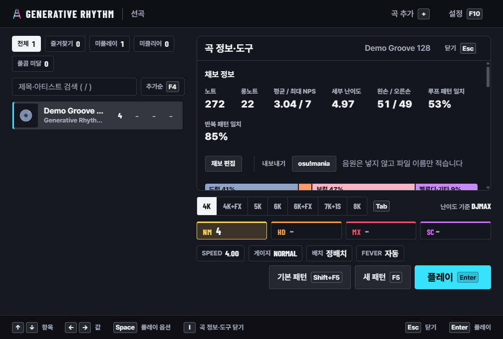
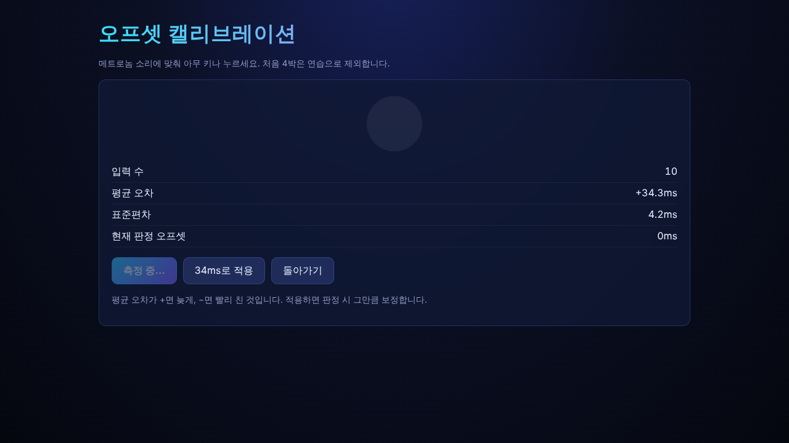
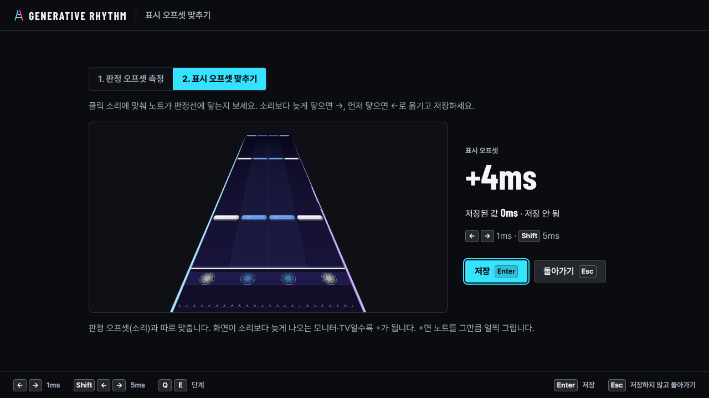
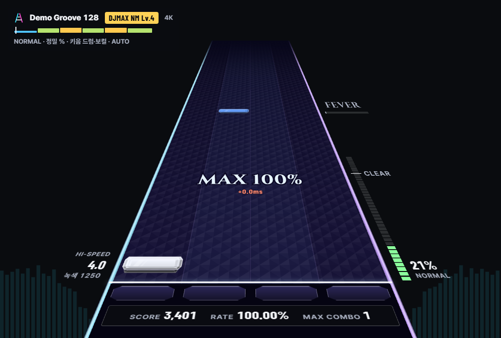
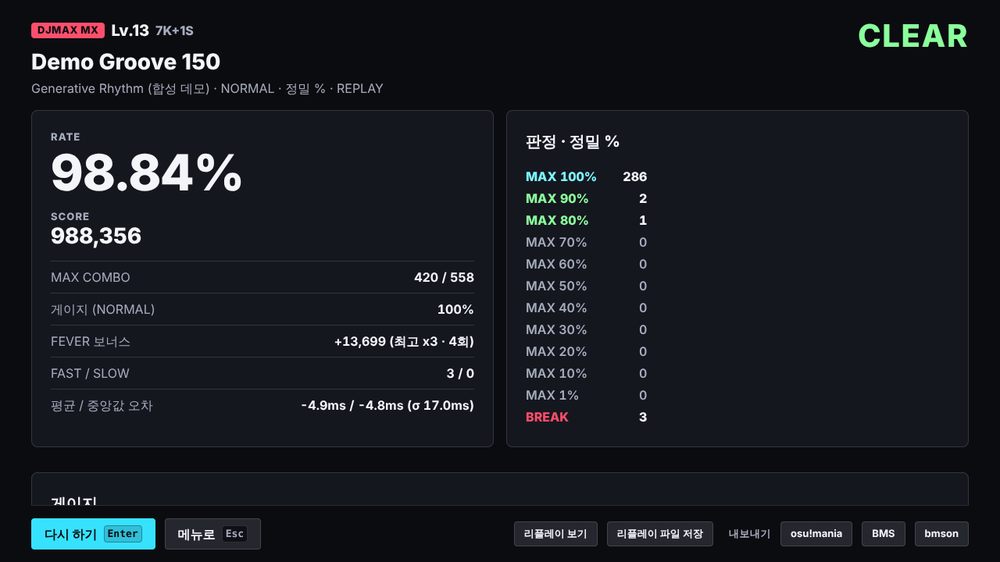
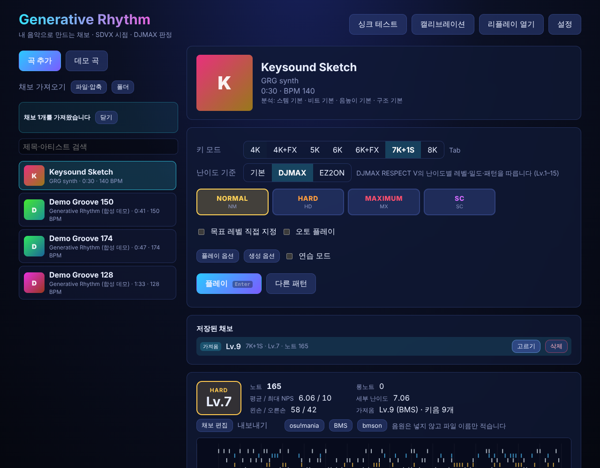

# 집에서 테스트하기 (Windows)

Windows PC에 설치 파일로 설치해서 처음부터 끝까지 확인하는 순서입니다. 전부 하면 1시간쯤 걸립니다. 각 단계에 **기대 결과**를 적어 두었으니, 다르게 나오면 그 단계 번호와 함께 알려 주세요.



## 1. 설치 파일 받기

설치 파일은 GitHub Actions가 코드를 올릴 때마다 Windows 머신에서 새로 만들고, 실제로 설치·실행해 본 뒤 올려 둡니다.

1. GitHub에 로그인한 상태로 [Actions → Desktop app (Windows)](https://github.com/DreamChaserDeekay/Generative-Rhythm-Game/actions/workflows/desktop-windows.yml)를 엽니다.
2. **Branch** 필터에서 `develop`을 고르고, 맨 위의 **초록색 체크**가 붙은 실행을 누릅니다.
3. 아래쪽 **Artifacts**에서 `GenerativeRhythm-Windows-Setup`을 누르면 zip(약 180MB)이 받아집니다.
   - 브라우저가 "일반적으로 다운로드되지 않는 파일"이라고 막으면 `…` → **유지**를 누르세요.
4. 압축을 풀면 `GenerativeRhythm-Setup-0.1.0.exe`가 나옵니다.

Artifacts는 30일 동안 보관됩니다. 기한이 지났거나 새로 만들고 싶으면 같은 페이지의 **Run workflow**에서 브랜치를 `develop`으로 고르고 누르면 5분쯤 뒤에 새 설치 파일이 생깁니다.

## 2. 설치

1. `GenerativeRhythm-Setup-0.1.0.exe`를 실행합니다.
2. **"Windows의 PC 보호"** 창이 뜨면 **추가 정보** → **실행**을 누릅니다. 코드 서명 인증서가 없는 설치 파일이라 뜨는 경고입니다.
3. 언어는 **한국어**, 설치 대상은 **나만**(현재 사용자, 관리자 권한 필요 없음)을 고르고, 폴더는 그대로 두고 설치합니다.
4. 마지막 화면에서 **Generative Rhythm 실행**을 체크한 채 마칩니다. 바탕 화면과 시작 메뉴에도 바로 가기가 생깁니다.

| 항목 | 위치 |
|---|---|
| 프로그램 | `%LOCALAPPDATA%\Programs\Generative Rhythm` |
| 라이브러리(곡·채보·기록·리플레이) | `%APPDATA%\Generative Rhythm\library` |
| 분석 서버 로그 | `%APPDATA%\Generative Rhythm\server.log` |

- 탐색기 주소창에 위 경로를 그대로 붙여 넣으면 열립니다.
- 처음부터 다시 해 보려면 앱을 끄고 `library` 폴더를 지우세요.
- 지우기: 설정 → 앱 → 설치된 앱 → Generative Rhythm → 제거. `%APPDATA%\Generative Rhythm`(라이브러리)은 남으니 필요하면 직접 지우세요.
- 분석 서버는 이 PC 안(127.0.0.1)에서만 열리고, 내 음악은 PC 밖으로 나가지 않습니다. 방화벽 창이 뜨면 취소해도 됩니다.

## 3. 테스트 순서

### 3-1. 첫 실행

- [ ] 앱을 켜면 "분석 서버를 시작하는 중…" 다음에 곡 선택 화면이 나온다.
  - 기대 결과: 보통 몇 초, **첫 실행만** 백신 검사 때문에 길게는 1분쯤 걸릴 수 있습니다. 2분이 넘으면 오류 화면에 로그 위치가 나옵니다.

### 3-2. 싱크와 입력 (먼저 해 주세요)

도구는 설정 → **판정·싱크**(각 오프셋 바로 아래)와 곡 정보·도구(I) → 도구에 있습니다. 설정에서 연 도구는 끝나면 그 행으로 돌아옵니다.

- [ ] **싱크 테스트 · 오토**(곡 정보·도구에서는 **싱크 테스트**): 클릭 소리에 맞춰 오토 플레이가 돌아간다.
  - 기대 결과: 노트가 클릭 소리와 같은 순간에 판정선에 닿고, 결과가 **PERFECT PLAY · 100.00%**. 화면이 끊기지 않는다. 도는 동안 ←→를 누르면 화면 왼쪽 위의 표시 오프셋이 바뀌고 노트가 그만큼 일찍·늦게 그려진다.
- [ ] **판정 오프셋 측정**: 시작 → 메트로놈 소리를 듣고 아무 키나 10번 이상 → 끝나면 **N ms로 적용**(Enter).
  - 기대 결과: 누를 때마다 오차 레일에 점이 찍히고 평균선이 따라 움직인다. 박 링은 박 번호만 바뀌고 번쩍이지 않는다(화면을 보고 치면 화면 지연이 섞이므로 소리를 듣고 치세요). 표준편차가 30ms 안쪽. 평균 오차는 PC·이어폰마다 다릅니다(블루투스 이어폰은 100ms 넘게 나오기도 합니다). 측정 중 Esc는 측정만 멈추고 화면에 남는다. 적용하면 포커스가 **다음: 표시 오프셋 맞추기**로 간다.
- [ ] **표시 오프셋 맞추기**: 클릭마다 내 스킨·카메라·SPEED의 기어로 노트가 내려온다. 노트가 소리보다 늦게 닿으면 →, 먼저 닿으면 ←(Shift는 5ms)로 옮기고 **저장**(Enter).
  - 기대 결과: 누르는 즉시 노트 위치가 바뀌고, 저장 전에는 "저장 안 됨", 힌트 바의 Esc는 "저장하지 않고 돌아가기". Q/E로 판정 오프셋 측정과 오가도 맞추던 값이 남는다. 저장하면 "저장했습니다".
- [ ] **싱크 테스트 · 직접 치기**: 같은 테스트를 직접 친다. ←→ 표시 오프셋, Shift+←→ 판정 오프셋(7K+1S·4K+FX·6K+FX처럼 Shift가 레인이면 [ ]).
  - 기대 결과: 화면 왼쪽 위에 두 오프셋과 지금 쓰는 키가 보이고 누를 때마다 바뀐다. 끝나면 결과 화면 상세의 오프셋 추천이 테스트 중에 바꾼 값까지 따진다.
- [ ] 설정 → 키 설정 → **동시 입력 테스트**: 7K+1S 키(왼쪽 Shift, S D F Space J K L)를 한꺼번에 눌러 본다.
  - 기대 결과: 누른 키가 모두 켜진다(보조 키를 지정했으면 그것도 센다). 일부가 안 켜지면 키보드가 그 조합을 동시에 못 읽는 것이니 다른 키로 바꾸세요.





### 3-3. 데모 곡으로 한 바퀴

- [ ] 곡 추가(+) 메뉴의 **데모 곡** → 분석이 끝나면 키 모드 **4K**, 난이도 **NORMAL** → **플레이**(Enter) → 키보드로 끝까지 친다.
  - 기대 결과: 분석은 10초 안팎. 노트가 소리에 맞게 내려오고, 끝나면 결과 화면이 나온다.
  - 키음이 기본으로 켜져 있어서, 치는 노트마다 그 노트가 따라가는 악기(드럼·보컬 등) 소리가 나고 놓치면 그 소리가 빠진다. 플레이 화면 위쪽 채보 줄에 "키음 드럼·보컬"처럼 키음 악기가 보인다.
  - 롱노트는 시작·끝에 단노트 모양 표시 없이 몸통만 보인다. 몸통 앞 끝이 판정선에 닿을 때 누르고, 뒤 끝이 닿을 때 뗀다.
  - 롱노트는 누르기 전에도 노트 색으로 밝게 보이고(가장자리가 더 밝음), 누르는 동안 더 밝아지고, 놓치면 흐려진다.



### 3-4. 내 노래 (가장 중요)

- [ ] **곡 추가**를 누르거나 창에 음악 파일을 끌어다 놓는다(MP3 · M4A · AAC · FLAC · OGG · OPUS · WAV, 여러 개 가능).
  - 기대 결과: 목록에 바로 생기고 진행률이 오른다. 4분 곡이 20~30초.
- [ ] 곡 정보·도구(I) → **분석 보기**: 파형 위 박자선(노란 선이 마디 첫 박)이 킥·스네어에 맞는지, BPM이 맞는지 본다.
  - 어긋나면 **BPM 보정**(×2, ÷2, 직접 입력)과 **첫 박 위치**로 고칩니다. 고치면 다시 분석하고 채보를 새로 만듭니다(기록은 새 채보에 따로 쌓임). 박은 맞는데 이 곡만 판정이 어긋나면 **곡 오프셋**(−5 · −1 · +1 · +5ms, 플레이 중 - / =)을 쓰세요. 채보·기록은 그대로입니다.
- [ ] 키 모드를 4K → 5K → 6K → 7K+1S → 8K로, 난이도를 바꿔 가며 채보를 만들어 본다.
  - **난이도 기준**: **DJMAX**(기본, NORMAL · HARD · MAXIMUM · SC, Lv.1–15) · **EZ2ON**(EASY · NORMAL · HARD · SUPER HARD, Lv.1–20) · **기본**(EASY → MASTER 5단계).
  - 기대 결과: 곡에 커서가 머물면 모든 난이도 카드에 레벨·노트 수가 저절로 나온다("계산 중" 다음). 난이도가 오를수록 노트 수·레벨이 오른다. 채보 정보에 "DJMAX MX Lv.12"처럼 기준과 레벨이 보이고, SC는 "SC 8"처럼 따로 매긴 레벨로 보인다. 같은 설정이면 같은 채보, **새 패턴**(F5)을 누르면 새 채보가 되고 그 난이도에 기억된다(카드에 "새 패턴", 다른 곡에 갔다 와도 그대로). Shift+F5나 **기본 패턴**으로 돌아간다.
  - 볼 것: DJMAX NORMAL은 멜로디·보컬 위주로 단순하고, MAXIMUM·SC로 갈수록 동시치기와 드럼·베이스 노트가 늘어난다. EZ2ON은 낮은 난이도부터 드럼·베이스를 더 따라간다. DJMAX 4K+FX·6K+FX의 사이드 노트는 롱노트만 나온다.
  - 조용하거나 소리가 적은 곡에서 EZ2ON SUPER HARD 높은 레벨을 고르면, 없는 소리에 노트를 만들지 않기 때문에 목표보다 낮은 레벨이 나오고 곡 정보·도구의 채보 정보에 안내가 뜬다(정상).
- [ ] **패턴**: 곡 정보·도구(I) 채보 정보의 **패턴** 줄(계단·트릴·동치·연타·롱잡·도약 비율)을 보며 몇 개를 쳐 본다.
  - 볼 것: 음계처럼 올라가는 선율은 계단, 두 음을 오가는 선율은 트릴, 같은 음 반복은 양손 번갈이로 나온다. 같은 드럼 소리는 같은 키에 온다.
  - 낮은 난이도(NORMAL 등)는 몇 개 레인 안에서 크게 건너뛰지 않는다.
  - DJMAX MAXIMUM 이하는 패드로 칠 수 없는 동치(6키 1+3·4+6, 5키 1+3+5)가 나오지 않는다(SC에서는 나온다).
  - 어려운 채보(MAXIMUM·SC·EZ2ON HARD 이상)에서 드럼과 선율이 같이 나오는 곳은 한 손은 드럼, 다른 손은 선율을 친다.
  - DJMAX 5키 HARD 이상에서 같은 음이 빠르게 반복되면 가운데 키(Space)에 몰린다. 양손 엄지로 번갈아 치세요(레이저).
  - DJMAX 4K+FX·6K+FX: 사이드 노트 바로 앞뒤에 같은 손 노트가 붙어 나오지 않는다(같이 치는 노트는 나올 수 있다).
  - 키음을 켜고 동치의 한쪽만 쳐 보면 그 노트가 맡은 악기(예: 드럼만, 베이스만)만 들린다.
- [ ] **구간 일관성** (생성기 0.5.0, 이번에 가장 중요):
  - 전에 넣은 곡은 곡 정보·도구(I)의 **다시 분석**을 먼저 누른다. 새 구간 분석(프리코러스·루프 길이)을 쓰려면 다시 분석해야 한다.
  - 곡 정보·도구(I) 채보 정보의 미니맵 위쪽 띠에서 구간 이름(인트로 · 벌스 · 프리코러스 · 후렴 · 브리지 · 아웃트로)과 색을 본다. 같은 색 = 같은 음악(반복 묶음)이다.
  - 볼 것:
    - 후렴처럼 같은 리듬이 되풀이되는 곳에서 노트 모양도 1·2·4마디마다 그대로 되풀이되는지.
    - 두 번째 후렴이 첫 후렴과 같은 패턴인지(생성기 0.6.0부터 뒤 후렴은 노트가 조금 더 있고, DJMAX MAXIMUM 이상은 좌우 반전일 수 있음).
    - 변화가 필인·구간 전환에서만 나오는지.
    - 후렴이 벌스보다 촘촘하고 동치가 많은지, 인트로·브리지는 성긴지.
  - 채보 정보의 **루프 패턴 일치·반복 패턴 일치**가 90% 안팎이면 정상이다.
  - 구간이 틀리게 잡혔으면 곡 설정의 **구간 편집**에서 시작 마디·구간 이름·묶음(같은 음악은 같은 글자)을 고치고 **저장**한다. 채보가 다시 만들어진다. **분석값으로**를 누르면 되돌아간다.
  - **A/B 비교**: **생성 옵션 → 패턴 배치**에서 **구간·루프**(기본)와 **악구·패턴**(0.4)을 번갈아 골라 같은 곡·같은 난이도로 쳐 본다. 노래가 분명한 팝·록(벌스·후렴이 뚜렷한 곡)과, 루프가 반복되는 EDM을 하나씩 해 보면 좋다.
  - 알려 줄 것: 곡 이름·BPM, 어느 구간(예: 1분 20초 두 번째 후렴)에서 일관성이 깨지거나 너무 단조로웠는지, 구간이 틀리게 잡혔다면 실제 구간은 어땠는지.
- [ ] **기승전결·손맛** (생성기 0.6.0, 커뮤니티 패턴 가이드):
  - 전에 넣은 곡은 **다시 분석**을 먼저 누른다(분석기 1.2.1).
  - 같은 후렴이 다시 나오면 앞 후렴의 패턴 그대로에 노트가 조금 더해져 있는지, 마지막 후렴이 가장 어려운지 본다.
  - 후렴으로 시작하는 곡(인트로 없이 바로 후렴)은 첫 후렴이 마지막 후렴보다 쉬운지 본다.
  - 다른 소리를 한 레인에 연달아 치는 연타가 없는지, 쉬운 난이도(NORMAL·NM)에 한 레인을 한 노트 걸러 계속 치는 축연타가 없는지 본다.
  - 5K HD 이상에서 가운데 키를 낀 1+3 · 3+5 동치가 번갈아 나오는 곳이 있는지 본다(드럼이 번갈아 치는 곳).
  - 알려 줄 것: 곡 이름·난이도, 초반이 너무 어렵거나 후반이 밋밋했던 곳, 손이 꼬이거나 불쾌했던 배치의 시각.
- [ ] **빌드업 롤 · 엇박 · 멜로디 · 롱노트 끝** (생성기 0.7.0, 지난 플레이 피드백):
  - 전에 넣은 곡은 **다시 분석**을 먼저 누른다(분석기 1.3.0). 멜로디 판별은 다시 분석해야 쓴다.
  - 드럼 빌드업(후렴 앞에서 스네어가 8분·16분으로 몰아치는 곳)과 2박 이상의 필인에서 왼손·오른손이 번갈아 치는 연타가 나오는지 본다. 롤이 진행할수록 가운데 키에서 바깥 키로 벌어진다. DJMAX NORMAL·기본 NORMAL은 16분 롤을 8분으로 친다.
  - HARD 이상에서 엇박(8분 뒷박)·16분 노트가 곡의 리듬대로 나오는지, 정박에만 몰려 있지 않은지 본다. 쉬운 난이도는 지금처럼 정박 위주다.
  - **생성 옵션 → 리듬 기준**을 **멜로디**로 바꿔 만든 채보와 **드럼**으로 만든 채보를 비교해 본다. 멜로디 쪽은 노래(주선율)의 음마다 노트가 있어야 한다. 리듬 기준을 **자동**에 두고 **스타일 → 멜로디**를 골라도 멜로디를 따른다.
  - 롱노트를 떼는 곳이 박(정박·반박)에 맞는지, 대개 멜로디의 다음 음이 나오는 곳인지 본다.
  - 알려 줄 것: 곡 이름·BPM·난이도, 롤이 안 나오거나 한 손으로 몰린 곳의 시각, 멜로디를 놓친 곳, 떼는 타이밍이 어색했던 롱노트의 시각.
- [ ] **템포 · 롱노트 · 구간 일관성** (생성기 0.8.0, 두 번째 플레이 피드백):
  - 전에 넣은 곡은 **다시 분석**을 먼저 누른다(분석기 1.4.0). 템포와 온셋이 바뀌어서 다시 분석해야 쓴다.
  - 느린 곡(70–105 BPM, 발라드·힙합·느린 K-pop)의 BPM이 곡 정보에 실제 템포로 나오는지 본다. 전에는 두 배(예: 96 → 192)로 잡혔다. 빠른 곡(150–200 BPM)은 그대로인지도 본다. 셔플(스윙) 곡은 노트가 박에 맞는지 본다.
  - 같은 후렴·벌스가 다시 나올 때 같은 패턴인지, 미니맵의 구간 색이 곡 구성(인트로·벌스·후렴…)대로 나뉘는지 본다.
  - 롱노트가 길게 끄는 노래 음이나 신스·패드·피아노 화음에만 나오는지, 드럼 타격(킥·스네어)에 롱노트가 붙지 않는지 본다. 롱노트 수는 곡에 긴 소리가 적으면 전보다 적다.
  - 피아노·기타·패드만 나오는 인트로·브리지·아웃트로에 소리 없이 노트가 몰려 있지 않은지 본다.
  - 알려 줄 것: 곡 이름·BPM(곡 정보에 나온 값과 실제 값), 비는 곳이나 롱노트가 어색한 곳의 시각, 일관성이 깨지는 구간.
- [ ] **손 규칙** (생성기 0.8.1, BMS-Generator의 규칙을 DJMAX·EZ2ON에 맞게):
  - 같은 곡의 채보를 다시 만든다(곡을 고르면 저절로 만든다). 곡을 다시 분석할 필요는 없다.
  - 빠른 단타가 한 손에만 세 번 넘게 이어지는 곳이 줄었는지 본다. 특히 NORMAL에서 8분 단타가 한 손 트릴(1-2-1-2)로 가지 않고 양손을 오가는지 본다. 계단(6K 1-2-3-4-5-6)과 일부러 넣은 트릴·연타·레이저(5K 가운데 키)는 그대로 나와야 한다.
  - 큰 동치가 8분마다 이어지는 곳에서 한 키가 세 동치에 연달아 묶이지 않는지 본다.
  - HARD 이상 동치가 한 손의 붙은 두 키(1+2, 5+6)보다 양손에 나뉘는지 본다. 손 분담(한 손 리듬, 다른 손 선율)이 있는 8K 상급은 한 손 동치가 그대로다.
  - 알려 줄 것: 손이 꼬이거나 한 손에 몰린 곳의 곡·난이도·시각, 오히려 어색해진 패턴.
- [ ] **셋잇단 · 동치 모양** (생성기 0.9.0, BMS 사람 채보와의 짝 비교):
  - 같은 곡의 채보를 다시 만든다(곡을 고르면 저절로 만든다). 곡을 다시 분석할 필요는 없다.
  - 정박 곡(대부분의 팝·EDM)의 HARD 이상에서 16분 자리 노트가 셋잇단(1/3박)으로 어긋나 보이던 곳이 없어졌는지 본다. 셔플·스윙 곡은 셋잇단이 그대로 나와야 한다.
  - 7K+1S·6K·8K 기본 기준에서 2노트 동치가 한 손의 붙은 두 키(1+2, 2+3)보다 1+3 모양이나 양손으로 나오는지 본다.
  - 마지막 후렴이 첫 후렴과 같은 동치 모양인지 본다.
  - 알려 줄 것: 셋잇단이 어색하거나 사라져서는 안 될 곳의 곡·시각, 손이 불편한 동치.
- [ ] **구간 밀도와 동치** (생성기 0.9.2, BMS 사람 채보 비교):
  - 같은 곡의 채보를 다시 만든다(곡을 고르면 저절로 만든다). 곡을 다시 분석할 필요는 없다.
  - 후렴에 동치가 몰리지 않고, 벌스·브리지와 비슷한 크기의 동치가 곡 전체에 고르게 나오는지 본다. 후렴은 소리가 많은 만큼만 조금 더 빽빽하다.
  - 조용한 인트로·아웃트로는 전처럼 성기게 나온다.
  - 알려 줄 것: 후렴이 너무 밋밋하게 느껴지거나, 동치가 어색하게 몰린 곳의 곡·시각.
- [ ] **마디선**: 플레이 화면에 마디마다 트랙을 가로지르는 선이 보이는지 본다. 판정선 가까이부터 트랙 끝까지 같은 두께로 보이고, 노트보다 아래에 그려진다. **설정 → 기어 → 마디선**으로 끄고 켤 수 있다.
  - 선이 마디의 첫 노트(보통 동치나 강한 소리)와 같이 내려오는지 본다. 어긋나면 곡의 마디 첫 박이 틀린 것이니 곡 이름과 시각을 알려 주세요(다시 분석한 곡 기준).
  - 너무 진하거나 흐리면 알려 주세요(지금은 스킨의 마디선 색, 불투명도 70%, 약 2.5px).
- [ ] **템포 · 박 · 마디 첫 박** (분석기 1.7.7, BMS 채보의 정답에 맞춤):
  - 전에 넣은 곡은 **다시 분석**을 먼저 누른다(분석기 1.7.7).
  - 3/4 곡(왈츠 등)의 마디선이 세 박마다 오는지, 4/4 곡의 마디선이 세 박마다 오지 않는지 본다(1.7.4).
  - 빠른 곡(170 BPM 이상)이 반 템포로, 느린 곡(70–100 BPM)이 두 배로 잡히지 않는지 곡 정보의 BPM을 본다. 마디선이 두 마디마다나 반 마디마다 내려오면 그런 경우다(1.7.1). 170–215 BPM 곡(애니송·드럼앤베이스 등)이 반으로, 90–120 BPM 곡이 두 배로 잡히지 않는지 특히 본다(1.7.6).
  - 마디선이 곡의 마디 시작(킥과 함께 화음이 바뀌는 곳)에 오는지, 곡 내내 같은 자리에 오는지 본다. BPM이 하나인 곡인데 곡 정보에 BPM이 여러 개로 나오거나, 마디선이 곡 중간부터 조금씩 밀리면 알려 주세요(1.7.0).
  - 마디선이 박 사이(엇박)에 오거나 마디 중간(2·3·4박)에 오는 곡이 줄었는지 본다(1.7.0).
  - 160–200 BPM 곡(J-pop·J-core·유로비트 등)의 BPM이 곡 정보에 2/3나 반이 아니라 실제 값으로 나오는지, 노트가 셋잇단 자리로 어긋나지 않는지 본다(1.6.1).
  - 200 BPM이 넘는 곡(J-core·하드코어 등)의 BPM이 곡 정보에 반이 아니라 실제 값으로 나오는지 본다. 235 BPM 위는 아직 반으로 잡힐 수 있다.
  - 엇박 베이스가 센 곡(트랜스·유로비트·해피 하드코어)에서 노트와 마디선이 정박에 있는지, 반 박 밀려 있지 않은지 본다.
  - 마디선이 곡의 마디 시작(보통 화음이 바뀌는 곳)에 오는지 본다.
  - 느린 곡(100–140 BPM)이 두 배로 잡히지 않았는지도 본다. 잡혔으면 **곡 설정 → BPM 보정 ÷2**로 고칠 수 있다.
  - 알려 줄 것: 곡 이름, 실제 BPM과 곡 정보의 BPM, 박이나 마디선이 어긋난 곳의 시각.
- [ ] **MASTER 32분 · 곡 끝 화음** (생성기 0.9.35, 채보를 다시 만들면 반영):
  - MASTER에서 32분 몰아치기가 줄었는지, 대신 16분이 너무 많아지지 않았는지 본다.
  - 마지막 화음에 스크래치가 있는 곡의 7키 EXPERT · MASTER 채보, FX 모드 채보가 오류 없이 만들어지는지 본다.
- [ ] **쉬운 롱노트 · 롱노트 잡은 손의 스크래치 · 후렴 동치** (생성기 0.9.34, 채보를 다시 만들면 반영):
  - EASY에서 롱노트를 누르는 동안 다른 노트가 나오지 않는지, NORMAL(DJMAX NM · EZ2ON EZ 포함)에서는 그 사이 노트가 한 박 이상 떨어져 나오는지 본다. 롱노트가 너무 줄었거나 소리보다 일찍 떼는 느낌이 드는지도 알려 주세요.
  - 7키 HARD에서 왼손 롱노트를 잡은 채 스크래치를 돌리는 곳이 없는지 본다(EXPERT부터는 나올 수 있음).
  - 기본 채보에서 후렴이 여전히 가장 신나는지, 벌스 · 인트로가 전보다 덜 휑한지, 후렴에만 동치가 몰리던 느낌이 줄었는지 본다.
- [ ] **기본 난이도의 레벨** (생성기 0.9.33, 채보를 다시 만들면 반영):
  - 하드코어 · EDM처럼 빽빽한 곡에서 기본 HARD · EXPERT 채보의 레벨이 난이도 범위(HARD 7–9, EXPERT 10–12) 안에 나오는지 본다.
  - 같은 레벨의 DJMAX · EZ2ON 채보와 번갈아 쳐 보고, 기본 채보의 중간중간 몰아치기(롤 · 빽빽한 필인)가 전보다 덜한지 본다.
  - 쉬운 난이도(EASY · NORMAL)가 너무 성기지 않은지, 난이도가 오를수록 노트가 늘어나는지 본다.
- [ ] **빌드업 연타 · 구간 나누기** (생성기 0.9.32 · 분석기 1.10.0, 곡을 **다시 분석**한 뒤 채보를 다시 만든다):
  - USAO - RUNAWAY 같은 하드코어 · EDM 곡에서 드롭 직전 스네어 빌드업이 좌우 연타로 나오는지, 빌드업 동안 화면이 마디마다 다가가다가 드롭에서 풀리는지 본다.
  - 곡 정보의 구간이 4마디 조각으로 잘게 나뉘지 않고 큰 덩어리(인트로 · 빌드업 · 드롭 · 브레이크다운 등)로 나오는지 본다.
  - 피아노 · 관현악 곡에 엉뚱한 좌우 연타가 생기지 않는지 본다.
  - 마지막 화음이 롱노트로 끝나는 곡에서 MASTER 채보도 문제없이 만들어지는지 본다.
- [ ] **카메라 연출** (생성기 0.9.31, 채보를 다시 만들면 반영):
  - 드럼이 빠진 브레이크다운 · 조용한 구간에서 시야가 조금 넓어진 채 유지되다가, 다음 구간에서 돌아오는지 본다.
  - 빌드업(후렴 · 드롭 바로 앞)에서 마디마다 조금씩 다가가다가, 후렴 · 드롭이 터질 때 한 번에 풀리며 쿵 하고 줌이 들어가는지 본다.
  - 후렴 · 드롭 동안 센 박(킥 · 스네어)에 맞춰 작게 줌이 들썩이는지, 너무 어지럽지 않은지 본다(세기는 설정 → 화면 → 카메라 연출).
  - 기울기가 노트가 몰린 손 쪽(오른손 쪽에 몰리면 오른쪽이 내려감)이나 멜로디가 오르는 쪽으로 가는지 본다.
- [ ] **하이라이트 구간** (분석기 1.9.0):
  - 전에 넣은 곡은 **다시 분석**을 먼저 누른다.
  - 곡 정보의 구간 이름표에서 가장 신나는 부분(후렴 · 드롭)이 '후렴'으로 잡히는지, 조용한 앞부분이나 빌드업이 '후렴'으로 잡히지 않는지 본다.
  - 후렴이 앞부분(인트로 · 벌스)보다 빽빽한지 본다. 반복이 적은 곡(EDM · 게임 음악)에서도 가장 센 부분이 후렴이 되는지 본다.
  - 알려 줄 것: 곡 이름, 이름표가 틀린 구간의 시각과 실제로 어떤 부분인지.
- [ ] **RUNAWAY 플레이 소감** (생성기 0.9.30 · 분석기 1.8.1, 기본 기준):
  - 전에 넣은 곡은 **다시 분석**을 먼저 누른다(분석기 1.8.1: 구간 이름표). 채보만 다시 만들어도 나머지 규칙은 반영된다.
  - 빌드업(점점 빨라지는 스네어)이 처음부터 끝까지 좌우 연타로 나오고, 동치로 바뀌거나 빈칸으로 끊기지 않는지 본다. 긴 빌드업은 트릴이 몇 마디마다 자리를 옮긴다.
  - 긴 단음에는 롱노트 하나, 패드 · 콰이어 같은 화음에는 HARD 2 · EXPERT 3 · MASTER 최대 6개가 겹쳐 나오는지, 곡이 잔향으로 끝나면 마지막 화음이 그만큼의 롱노트인지 본다.
  - 드럼이 빠진 브레이크다운에서 들리는 음보다 노트가 많지 않은지(메아리 · 잔향에 노트가 없는지), 그리고 후렴 · 드롭이 초반보다 빽빽한지 본다.
  - 곡 정보의 구간 이름표에서 빌드업이 '후렴'으로, 후렴이 '벌스'로 잡히지 않았는지 본다.
- [ ] **6키 EXPERT 플레이 소감** (생성기 0.9.29, 기본 기준):
  - 빌드업·필인의 좌우 연타가 3-4·2-5·1-6만 반복하지 않고, 트릴(양손 한 키씩)·바깥에서 안으로·1-4-2-5-3-6 같은 모양이 섞이는지 본다. EXPERT·MASTER에서는 양손 동시 연타 롤도 가끔 나온다. 같은 필인이 다시 나오면 같은 모양이어야 맞다.
  - 패드·콰이어·현이 길게 깔리는 곳에 롱노트가 전보다 많고, HARD부터는 두 줄 롱노트(양손 하나씩)가 나오는지 본다.
  - 곡이 잔향으로 끝나면 마지막 노트가 잔향 끝까지 롱노트이고, 끝까지 뚜렷한 소리가 있으면 단노트, 바로 조용해지면 그대로 끝나는지 본다.
  - 멜로디·기타 줄기가 16분으로 잘게 쪼개지는 일이 줄었는지, 기타·피아노 솔로 구간이 솔로 라인(과 정박 드럼) 위주인지 본다.
  - 같은 드럼의 빠른 연타가 좌우 교대로, 리드 악기의 빠른 음이 음높이를 따라 오르내리는지 본다.
  - 어색한 곳은 곡 이름·난이도·키 모드·시각을 알려 주세요.
- [ ] **같은 소리는 같은 레인** (분석기 1.8.0, 생성기 0.9.28, 기본 기준):
  - 전에 넣은 곡은 **다시 분석**을 먼저 누른다(분석기 1.8.0). 다시 분석하지 않은 곡은 채보가 전과 같다.
  - 같은 소리(같은 북, 같은 음의 신스·피아노)가 다른 노트를 사이에 두고 다시 나올 때 지난번과 같은 레인에 오는 일이 전보다 잦은지 본다. 반복되는 리프가 매번 비슷한 레인 모양으로 나오면 맞다.
  - 다른 소리가 같은 레인에 몰려 연타가 지나치게 많아진 곳이나, 드럼 롤이 한 손에 몰린 곳이 있으면 곡 이름·난이도·시각을 알려 주세요.
- [ ] **계단** (생성기 0.9.27, 기본 기준 7키 EXPERT·MASTER):
  - 빠른 줄기에서 1-2-3-4처럼 한 칸씩 같은 방향으로 이어지는 계단이 전보다 자주 나오고, 1-2-1-2처럼 왔다 갔다 하는 곳이 줄었는지 본다.
  - 계단이 음악과 따로 노는 것처럼 느껴지거나 손이 꼬이는 곳이 있으면 곡 이름·난이도·시각을 알려 주세요.
- [ ] **셔플 곡의 셋잇단** (생성기 0.9.26, 기본 기준):
  - 셔플·스윙 곡(재즈·블루스·스윙 팝, 셋잇단으로 튀는 리듬)의 EASY·NORMAL에서 2/3박(스윙한 8분) 노트가 전보다 많이 나오고 음악의 튀는 리듬과 맞는지 본다.
  - 곧은 16분 곡(대부분의 팝·EDM)에서 셋잇단 자리(1/3박) 노트가 생기지 않았는지 본다. 특히 200 BPM 넘는 빠른 곡에서 곧은 16분이 셋잇단으로 어긋나 보이면 곡 이름·난이도·시각을 알려 주세요.
- [ ] **새 소리가 시작되는 자리** (분석기 1.6.0, 생성기 0.9.3, BMS 키음 비교):
  - 전에 넣은 곡은 **다시 분석**을 먼저 누른다(분석기 1.6.0 이상). 다시 분석하지 않은 곡은 채보가 그대로다.
  - 패드·현·피아노처럼 길게 울리는 소리 위에서, 새로 치는 소리가 없는데 노트가 나오던 곳이 줄었는지 본다.
  - 높은 난이도에서 한 소리에 노트 두 개가 바짝 붙어 나오던 곳(분석기가 한 소리를 두 번 잡은 것)이 줄었는지 본다.
  - 드럼 루프·노래 구절 안에서 실제로 치는 소리에는 노트가 그대로 나와야 한다.
  - 알려 줄 것: 곡 이름과 시각, 그 노트가 울리는 소리 위의 노트인지, 아니면 빠지면 안 되는 소리가 빠졌는지.
- [ ] **레인 고르게 쓰기의 기억** (생성기 0.9.14, 0.9.15부터 세 기준 모두):
  - 빠른 구간에서 한 키를 연달아 치는 연타 줄기, 같은 키 두 번씩 양손이 번갈아 치는 재봉틀, 두 키 트릴이 전보다 조금 자주 나오는지 본다.
  - 한 마디가 한 손 쪽에 몰리는 곳이 생겨도 괜찮다(사람 채보도 바쁜 마디의 15–16%가 그렇다). 같은 키 연타가 너무 길게 이어지거나 손이 지치는 곳이 있으면 곡 이름·난이도·시각을 알려 주세요.
- [ ] **2개 동치 모양** (생성기 0.9.13, 기본 기준 7키):
  - 두 노트 동치에 가운데 4번 키와 그 옆 키(3+4, 4+5)가 거의 나오지 않는지 본다.
  - EASY·NORMAL에서 한 손 동치(1+3, 가끔 1+2)가 전보다 조금 늘고, MASTER에서는 한 손 한 칸 띄운 동치(1+3, 5+7)가 줄고 양손에 걸친 동치(2+5, 1+6 같은)가 늘었는지 본다.
  - 손이 꼬이거나 치기 불편한 동치가 있으면 곡 이름·난이도·시각을 알려 주세요.
- [ ] **마디마다 셋잇단** (생성기 0.9.12, 기본 기준, 0.9.26부터는 위의 '셔플 곡의 셋잇단'과 함께 본다):
  - 셔플·스윙이 곡의 일부에만 있는 곡의 HARD 이상에서, 곧은 16분 마디의 노트가 셋잇단 자리(1/3박)로 어긋나 보이던 곳이 줄었는지 본다.
  - 실제로 셋잇단을 치는 마디(셔플 리듬, 셋잇단 필인)는 그대로 셋잇단이어야 한다. 셋잇단이어야 할 곳이 곧게 바뀌었으면 곡 이름·난이도·시각을 알려 주세요.
- [ ] **스크래치** (생성기 0.9.11, 기본 기준):
  - 7키 채보(특히 EASY)에 스크래치가 전보다 자주 나오는지 본다(노트의 6–9%). 스크래치끼리 너무 붙거나 손이 바쁠 때 끼어드는 곳이 있으면 곡 이름·난이도·시각을 알려 주세요.
- [ ] **재봉틀과 축연타** (생성기 0.9.10, 기본 기준):
  - 반복되는 드럼·음이 빠르게 이어지는 곳에서 같은 키 두 번씩 양손이 번갈아 치는 재봉틀(예: 1-1-7-7)이 전보다 자주 나오는지 본다.
  - NORMAL 이상에서 한 키를 한 노트 걸러 계속 치는 축연타가 4–6타까지 나온다. EASY는 전처럼 짧다.
  - 느린 반복음(반 박 넘게 띄운 같은 음)은 여전히 같은 키에 머물러야 한다.
  - 재봉틀이나 축연타가 곡과 안 맞게 억지로 느껴지는 곳이 있으면 곡 이름·난이도·시각을 알려 주세요.
- [ ] **노트 고르기 모델** (생성기 0.9.9, 기본 기준):
  - EXPERT·MASTER에서 노트가 곡의 또렷한 소리(드럼 타격, 리드·피아노 같은 멜로디 악기)를 따르는지, 묻힌 소리나 노래의 숨소리 같은 곳에 노트가 덜 나오는지 본다.
  - EASY·NORMAL은 전과 비슷하지만 정박 노트가 조금 늘었다. 지나치게 단조롭게 느껴지면 곡 이름과 난이도를 알려 주세요.
  - 생성 옵션의 리듬 기준(드럼·베이스·멜로디)을 바꾸면 여전히 그 악기를 따라가야 한다.
- [ ] **드럼 자리 · MASTER 동치 · 쉬운 채보 엇박** (생성기 0.9.8, 기본 기준):
  - 같은 드럼 소리(킥·스네어·하이햇)가 곡 내내 대체로 같은 키에 오는지 본다. 전에는 반복 구간마다 손 좌우가 바뀌어 드럼이 반대편으로 옮겨 갔다.
  - MASTER에서 2개 동치가 양손에 하나씩 오는 모양(대칭)이 늘고, 한 손 안의 1+3 같은 동치가 줄었는지 본다.
  - EASY·NORMAL의 엇박 노트가 노래보다 하이햇·리드 같은 소리를 따르는지 본다. 정박 노트 비율은 거의 그대로다.
  - 한 키에 드럼이 너무 오래 몰려 지루하거나 손이 꼬이는 곳이 있으면 곡 이름·난이도·시각을 알려 주세요.
- [ ] **악구별 키 묶음 · 쉬운 단계 동치와 셋잇단** (생성기 0.9.7, 기본 기준):
  - 7키 채보가 한동안 몇 개의 키(예: 1·3·5·7, 1·3·4·5)에 머물다 다른 묶음으로 옮겨 가는지 본다. 곡 전체로는 모든 키를 써야 한다.
  - EASY·NORMAL에 한 손으로 치는 2개 동치(1+3 같은 한 칸 띄운 모양)가 가끔 나온다. 붙은 두 키(1+2) 동치는 드물어야 한다.
  - 셔플·셋잇단 느낌의 곡에서 EASY·NORMAL도 흔들리는 8분(셋잇단 자리)에 노트를 두는지, 곧은 곡에는 셋잇단 자리 노트가 없는지 본다.
  - 한쪽 손에만 노트가 오래 몰리거나 한 키 연타가 지나치게 많은 곳이 있으면 곡 이름·난이도·시각을 알려 주세요.
- [ ] **바깥 키와 도약** (생성기 0.9.6, 기본 기준 7K):
  - 7키 채보가 1번·7번 키도 고르게 쓰는지, 가운데 4번 키에 노트가 몰리지 않는지 본다(전에는 쉬운 난이도에서 1·7번이 거의 비었다).
  - 쉬운 난이도에서도 먼 키로 뛰는 노트가 나온다(사람 BMS 채보처럼). 읽기 너무 어렵거나 손이 꼬이는 곳이 있으면 곡 이름과 시각을 알려 주세요.
- [ ] **느린 반복은 같은 레인에** (생성기 0.9.5, 기본 기준):
  - 느린 곡이나 쉬운 난이도에서 같은 음·같은 드럼이 반 박 넘게 띄어 반복될 때 같은 키를 이어 치는지 본다(전에는 거의 매번 다른 키로 옮겼다).
  - 음이 바뀌는 멜로디는 여전히 음 따라 옮겨 가야 한다. 빠른 연타는 쉬운 난이도에서 조금 늘고, MASTER에서는 조금 줄었다.
  - 한 키를 너무 오래(예: 한 마디 넘게) 이어 치는 곳이 지루하게 느껴지면 곡 이름과 시각을 알려 주세요.
- [ ] **같은 소리 같은 레인 · 롱노트 · 쉬운 채보** (생성기 0.9.4, 기본 기준, BMS 사람 채보 비교):
  - 같은 음이나 같은 드럼이 반복되는 곳에서 같은 키를 두세 번 이어 치는 노트(연타)가 나오는지 본다. 같은 키 네 번 넘게 이어지는 줄기는 드물어야 한다.
  - 롱노트가 실제로 길게 울리는 소리(긴 노래 음·패드·현) 위에만 나오는지, 작게 겹친 소리에 롱노트가 붙던 곳이 줄었는지 본다. 롱노트 수는 전보다 적다.
  - EASY·NORMAL에 8분·16분 노트와 스크래치가 조금 섞여 나온다. 너무 어렵게 느껴지면 알려 주세요.
  - MASTER는 동시치기가 전보다 많다.
  - 알려 줄 것: 곡 이름과 난이도, 어색한 연타·롱노트·박자가 나온 시각.
- [ ] **플레이 화면 배경의 검은 막대**: 지난 피드백의 검은 막대는 여기서 재현되지 않았다. 보이면 어느 곡(유튜브 링크 배경·영상 파일·비주얼라이저 중 무엇)에서, 화면의 어디(위아래·좌우·트랙 뒤)에, 플레이 중 계속인지 잠깐인지 알려 주고, 가능하면 스크린샷을 보내 주세요.
- [ ] **생성 옵션 → 패턴 배치**를 **이전 방식**으로 바꿔(바꾸면 채보를 새로 만든다) 같은 곡을 비교해 본다. 어느 쪽이 더 자연스러운지, 어색한 패턴이 어디였는지 알려 주세요. 끝나면 **구간·루프**로 돌려 놓으세요.
- [ ] 몇 개를 직접 플레이한다.
  - 볼 것: 노트가 소리(드럼·베이스·멜로디)에 붙어 있는지, 손이 꼬이는 배치나 너무 빽빽한 구간이 없는지, 조용한 구간은 쉬는지, 같은 후렴은 같은 패턴인지.
- [ ] **생성 옵션**에서 스타일(롱노트 위주, 연타 등)이나 밀도를 바꿔 다시 만들어 본다.

| 키 모드 | 기본 키 |
|---|---|
| 4K | D F J K |
| 4K+FX | 왼쪽 Shift · D F J K · 오른쪽 Shift |
| 5K | D F Space J K |
| 6K | S D F K L ; |
| 6K+FX | 왼쪽 Shift · S D F K L ; · 오른쪽 Shift |
| 7K+1S | 왼쪽 Shift(스크래치) · S D F Space J K L |
| 8K | A S D F J K L ; |

키는 설정에서 바꿀 수 있고, 한글 입력 상태여도 그대로 동작합니다.

### 3-5. 플레이 중 조작과 옵션

- [ ] 플레이 중 ↑/↓ SPEED(Shift는 0.5씩), PageUp/PageDown 위쪽 가림막(SUDDEN+), Alt+PageUp/PageDown 판정선 올리기(LIFT), - / = 곡 오프셋(Shift는 5ms씩), Home 가림막 켜기/끄기.
  - 기대 결과: 바꾼 값이 판정선 아래에 "SPEED 4.10" · "SUDDEN+ 25.0%" · "곡 오프셋 +3ms"처럼 잠깐 나온다. LIFT는 Alt와 함께라 7K+1S 스크래치·FX 사이드 레인(Shift)을 누르지 않는다.
- [ ] Esc 일시정지 → ↑↓로 계속하기/다시 하기/나가기를 고른다(SPEED는 바뀌지 않음). F2 바로 재시작하면 콤보·판정이 처음 상태로. F2·Home·Esc를 누르고 있어도 한 번만 된다.
- [ ] 플레이 화면: 기어 왼쪽의 얇은 진행 바와 남은 시간, 템포가 바뀌는 곡이면 SPEED 아래 BPM, 왼쪽 위 곡 아래 줄에 AUTO·REPLAY·연습과 NORMAL이 아닌 판정. 게이지가 79.6%면 "79%"(클리어 선 위 칸은 다른 색). 첫 노트가 5초 넘게 남은 곡은 "Enter 건너뛰기"가 나오고 Enter로 READY 직전으로 간다.
- [ ] 플레이 중 다른 창을 누르거나(Alt+Tab) 창을 가린다 → 곡이 일시정지된다(설정 → 플레이 → 창을 벗어나면 일시정지, 기본 켬). 오토·리플레이는 그대로 흐른다.
- [ ] 곡 선택의 **플레이 옵션**(Space) → 플레이 규칙: ↑↓로 줄, ←→로 값. 게이지 HARD 이상(0%가 되면 바로 끝남), MIRROR/RANDOM, FEVER 수동(FEVER 키, 기본 Enter), 판정 NORMAL/HARD/MAX(바꾸면 난이도 기준 옆에 칩), 페이스메이커(EX-SCORE면 A·AA·AAA·MAX). Q/E로 속도·기어·생성 옵션 탭.
  - 기대 결과: 바꾼 SPEED·가림막은 다음 플레이에도 남는다.
- [ ] 설정 → 키 설정: 레인 키 아래 **보조 키** 칸에 다른 키를 지정하고 그 키로 쳐 본다(두 키를 함께 눌러도 한 번). **차례로 지정**으로 모드 전체를 한 번에. **플레이 중 키** 표에서 기능 키를 바꾸면 플레이 중에 그 키가 먹고, 레인 키와 겹치면 양쪽에 표시된다.
- [ ] 설정 → 기어 → **판정·콤보 불투명도** 40%, 판정·싱크 → **판정 카운터** 켬 → 플레이: 판정·콤보 글자가 비치고, 점수판 아래 BREAK 수와 FAST·SLOW 수가 나온다.

### 3-6. 연습 모드

- [ ] 플레이 옵션 → 플레이 규칙의 **연습 모드** 켜기 → 미니맵을 드래그하거나 미니맵에서 ←→(한 마디씩)·Shift+←→(길이)로 구간을 고르고 **재생 속도** ×0.75, **구간 반복** 켜고 플레이.
  - 기대 결과: 첫 노트 3초 전(SPEED가 느리면 노트가 보이기 1초 전)부터 READY, 그 구간만 반복되고 느려져도 음정은 그대로. 반복마다 판정선 아래에 "LOOP 1 · RATE 98.52% · FAST 3 · SLOW 1"처럼 나온다. Esc → 나가기면 마지막 반복의 결과(연습 모드 · n번째 반복 · 기록되지 않습니다)가 나오고, 선곡에 돌아와도 구간·속도가 그대로다.

### 3-7. 결과 화면

- [ ] 램프·등급·점수가 함께 나오고(올라가는 숫자 없음) 0.6초 뒤 기록 변화가 나온다: 숫자 옆에 **최고 기록 갱신** 또는 **첫 기록**("HARD 판정 첫 기록"처럼 그 판정·점수 규칙의 첫 판이면 그렇게), 그 아래 이전 최고와의 차이와 BREAK 차이(좋아지면 높은 판정 색, 나빠지면 낮은 판정 색), 램프가 오르면 램프 아래 "램프 갱신 CLEAR → HARD CLEAR", 등급 아래 "다음 S+++까지 −0.08%". 같은 판정 모드의 기록끼리만 비교한다.
  - 그 0.6초 동안 Enter·Space·Esc·방향키·레인 키는 연출만 넘긴다(패드 A·십자키도, 레인 버튼인 패드 X도). 그 뒤 Enter는 **선곡으로**(에디터 테스트면 **에디터로**).
- [ ] 색별 판정 수, MAX COMBO 아래 NOTES("110 + 롱노트 끝 12 · 틱 +84"), FAST·SLOW·게이지, 곡 흐름 띠(밀도, 게이지 선과 점선 클리어 선, 점수가 깎인 곳이 짧은 눈금·BREAK는 긴 줄, 구간마다 정확도).
- [ ] **상세**(Space): 위에 램프·등급·점수·BREAK 한 줄, 게이지 그래프, 밀도·BREAK·타이밍 그래프, 타이밍 분포(그 판의 판정 모드 범위: NORMAL ±180ms, HARD ±90ms, 막대는 판정 색), 판정 %별 수. 타이밍 분포 아래 오프셋 추천 → **전체에 적용**(판정 오프셋) 또는 **이 곡에만 적용**(곡 오프셋) → "판정 오프셋 0ms → +4ms 적용됨"과 **되돌리기**, 버튼이 꺼지고 Enter를 눌러도 다시 더해지지 않는다. Esc나 Space로 닫힌다.
- [ ] 상세의 **리플레이 보기**: 방금 플레이가 그대로 재생되고 점수가 똑같이 나온다(리플레이 결과에는 오프셋 추천 대신 "녹화 때 판정 오프셋"). **리플레이 파일로 내보내기**(F7)로 파일을 받고 곡 추가(+) → **리플레이 파일 보기**로 열어 본다.
- [ ] R과 F2(패드 X)는 같은 배치로 다시, 랜덤 계열 배치에서는 Shift+R(또는 "새 배치로 다시" 버튼)이 새 배치. Shift가 레인인 4K+FX·6K+FX·7K+1S에서는 Shift를 누른 채 R도 같은 배치이고 새 배치는 버튼으로만.
- [ ] 상세의 **osu!mania / BMS / bmson** 내보내기: 저장 창이 뜨고 파일이 저장된다(음원은 들어가지 않고 파일 이름만 적힙니다).
- [ ] **새 패턴**(F5): 같은 키 모드·난이도로 새 채보를 만들어 바로 플레이한다(페이지가 새로 고쳐지지 않는다). 선곡에 돌아오면 그 난이도가 새 패턴으로 기억되어 있다.



### 3-8. 채보 에디터

- [ ] 곡 선택에서 채보를 만든 뒤 곡 정보·도구(I)의 **채보 편집**.
- [ ] 클릭으로 노트 놓기, 드래그로 롱노트, 우클릭으로 지우기, Ctrl+Z 되돌리기, 휠로 이동.
- [ ] 위쪽 바에 곡·채보 이름과 저장 상태, 도구가 한 줄(1280px 창), 캔버스 아래 레인마다 키 이름(스크래치·사이드는 SC·FXL·FXR), 왼쪽 눈금에 BPM. **편집** 메뉴의 되돌리기·다시·미러(Ctrl+Z·Ctrl+Y·M).
- [ ] **커서부터 테스트**(T) → "에디터 테스트"로 플레이(배치가 랜덤이어도 쓴 그대로) → Esc → 나가기 → 에디터로 돌아오고 고친 내용이 남아 있다.
- [ ] **저장**(Ctrl+S) → 나가면 그 키 모드의 난이도 줄 끝(←→)에 "편집" 항목으로 보이고, 고르면 그 채보로 플레이된다.

### 3-9. 채보 가져오기

직접 가지고 있는 파일로 해 주세요(저작권 있는 곡은 공유하지 말고 내 PC에서만).

- [ ] **파일·압축**: osu!mania 비트맵(.osz), BMS 묶음(.zip), .bms · .bme · .bml · .bmson · .osu 파일.
- [ ] **폴더**: BMS 폴더를 통째로.
  - 기대 결과: "채보 N개를 가져왔습니다". 첫 채보의 키 모드로 바뀌고 난이도 줄 끝에 그 채보 항목(BMS · 이름 · "원본 11 · 추정 9")이 골라진다(다른 키 모드의 채보는 키 모드 탭에 수). 키음 BMS는 누르는 노트마다 그 소리가 난다(오토 플레이로 들어 보세요). #STAGEFILE·#BANNER(osu!는 배경)가 있으면 그 그림이 커버가 된다.



### 3-10. 연출과 꾸미기

- [ ] 설정 → 연출·배경의 **카메라 연출** 세기, **타격 효과**(보통·작게·끄기), **배경 밝기**, **비주얼라이저**, 설정 → 기어의 **트랙 스킨**(기본·악기색·아케이드·클럽·스트리트·네온·크리스털·팝·보석·모노), 그 아래 **노트·사이드 노트 모양·기어·타격 효과 모양**(스킨과 따로 고름, 노트·기어·타격 효과는 기본이 스킨 그대로), **카메라**(평면·약한 원근·SDVX·강한 원근)와 **키 빔 길이**. 값을 바꾸면 오른쪽 미리보기 기어가 바로 바뀌고, 속도·커버 탭에서 SPEED·커버를 바꾸면 노트 속도와 **보이는 시간**(ms)이 같이 바뀐다. 스킨을 바꿔도 카메라는 그대로다.
- [ ] 카메라 **평면**으로 플레이: 레일이 위아래로 나란하고 노트가 화면 위에서 아래까지 같은 빠르기로 내려온다. 4:3 창에서도 왼쪽 위 곡 이름 판이 트랙을 가리지 않는다(카메라 연출로 기울 때도).
- [ ] 4K+FX·6K+FX에서 설정 → 기어 → **사이드 노트**를 **반쪽 덮기**로(이 행에 있으면 미리보기가 6K+FX로 보인다) → 플레이: 사이드 노트가 건반 레인의 왼쪽·오른쪽 절반을 덮는 반투명 막대로 건반 노트 아래에 나오고, 건반 레인이 6K·4K처럼 넓어진다. 판정선 아래 사이드 표시등은 표시등 줄 아래 막대(꺼져 있으면 양 끝만이나 회색). 선곡 Space → 속도·기어에도 이 행이 있다(사이드 레인이 있는 키 모드만). DJMAX처럼 읽기 쉬운지 알려 주세요.
- [ ] 곡 선택에서 Space → **속도·기어** 탭: ←→로 SPEED·트랙 스킨 등을 바꾸면 옆 미리보기가 바로 바뀌고, ↑↓는 곡이 아니라 항목을 옮긴다.
- [ ] 스킨마다 플레이 → 노트·롱노트·키빔·타격 효과·레일·판정선 색·트랙, 판정·콤보 글꼴이 그 스킨대로 나온다. 타격 효과는 레일 밖으로 나가지 않고 판정선 위로는 한 레인 안팎에 머문다. 판정선 아래 **기어 하단**은 스킨마다 다른 패널이고, 키를 누르면 그 레인의 표시등이 켜진다(네모난 키 캡 없음). 판정선은 모든 스킨에서 네온과 같은 자리·두께(위로 은은한 빛, 모노는 빛 없음, 바로 아래 밝은 선 없음)로 화면 높이의 약 77%에 있고, 판정 순간 노트의 가운데가 판정선 가운데에 온다. 표시등은 어느 스킨에서도 네온의 육각형보다 판정선에 가깝지 않다. SCORE·RATE·MAX COMBO는 기어 왼쪽 SPEED 위에, 콤보 숫자는 모든 스킨에서 판정 위에 나온다. 보석은 칠 때 빛 번짐, 롱노트를 누르는 동안 불꽃이 나온다. 노트가 잘 보이고 이펙트가 판정선을 가리지 않는지 봐 주세요.
- [ ] 설정 → 기어에서 **노트**를 메카 챔퍼·원형·별 4각·별 5각으로 바꿔 본다: 노트가 레인 폭에 맞고, 원형은 판정선 가까이에서 둥글고(트랙 위쪽에서는 원근 때문에 조금 납작), 별은 별로 보인다. 메카 챔퍼·원형은 흰 건반 ○, 파란 건반 △, 금색 건반 ◇, 스크래치 //, 별은 파란·금색 건반에 꼭짓점이 더 있다. **롱노트**는 시작·끝에 단노트 없이 몸통만이고 끝이 그 계열의 모양(깎은 모서리·반원·뾰족한 끝)이다. 롱노트를 고르는 줄은 없고, 노트를 바꾸면 롱노트도 같은 계열로 바뀐다.
- [ ] **기어**를 콘크리트 슬래브·에이비오닉스·카세트 데크·그랜드 피아노로 바꿔 본다: 키를 누르면 그 레인의 홈 바닥·스위치·키(아래 틈의 빛)·건반이 레인 색으로 켜지고, 판정선의 자리와 모양은 그대로다. **타격 효과 모양**을 임팩트 웨이브·스파크·LED 그리드·셔터로 바꾸면 효과가 판정선 아래(기어 쪽)에만 그려진다. **사이드 노트 모양**은 노트와 같게 · 도트 매트릭스 둘뿐이고, 도트 매트릭스로 하면 4K+FX·6K+FX의 사이드 노트가 별도 레인·반쪽 덮기 모두 LED 점이다. 노트·기어·타격 효과 모양은 "스킨 (…)"으로 되돌리면 스킨의 모양으로 돌아온다. **번쩍임 줄이기**를 켜면 이펙트가 작고 흐려진다.
- [ ] 설정 → **노트 색**: 프리셋을 오로라·앰버·좌우 손으로 바꾸면 오른쪽 미리보기 기어의 노트·표시등·키 빔 색이 바로 바뀐다. 키 모드를 바꾸면 레인 견본과 미리보기가 그 키 모드다. 레인 견본을 ←→로 고르고 아래 색상·채도·밝기를 ←→(Shift로 크게)로 바꾸거나, 색 상자·색상 막대를 마우스로 끌거나, HEX에 `#ff8800`을 넣으면 고르는 동안 미리보기에 바로 보이고, 놓거나 Enter를 누르면 저장된다. 게임에 든 프리셋을 바꾸면 그 프리셋은 그대로이고 "내 색 1"이 생긴다(도움말이 알려 줌). 내 프리셋은 이름을 바꾸고, 삭제는 3초 안에 두 번 눌러야 지워진다. 플레이 → 노트·롱노트·표시등이 고른 색이고, 에디터의 레인도 같은 색이다. 패드 d-pad로도 레인과 색상·채도·밝기를 바꿀 수 있다. 어두운 트랙에서 색이 잘 구분되는지 봐 주세요.
- [ ] 곡 정보·도구(I)의 **배경 영상**에 mp4·webm을 넣고 플레이 → 배경에서 곡과 같이 재생된다.
- [ ] **배경 영상 → 유튜브 링크**를 누르면 나오는 칸에 유튜브 주소(youtube.com/watch?v=… · youtu.be/… · shorts)를 붙여 넣고 **등록**(또는 Enter) → 플레이 → 소리 없이 곡에 맞춰 재생되고, 일시정지하면 같이 멈춘다. 퍼가기를 막은 영상이면 영상 없이 진행된다. 알아볼 수 없는 주소는 칸이 그대로 남고 오류가 보인다.
- [ ] 카메라 연출이 켜진 채로 트랙이 기울 때, 콤보 숫자·COMBO 글자·판정 글자가 트랙과 같이 기운다.
- [ ] 곡 선택에서 곡을 바꿔 보면 미리듣기가 3초에 걸쳐 커지며 시작하고, 곡을 바꾸거나 플레이를 시작하면 2초 남짓에 걸쳐 줄어든다. 1분쯤 지나면 줄어들었다가 하이라이트 처음부터 다시 나온다.
- [ ] 미리듣기가 나오는 중에 **설정**을 열면 음악이 끊기지 않고 조금 작아지며 먹먹하게(벽 너머처럼) 들린다. 설정 → 소리의 **음악** 볼륨을 움직이면 바로 따라 바뀐다. **완료**(Esc)로 돌아오면 끊기지 않고 원래 소리로 돌아온다. 캘리브레이션·플레이·에디터로 가면 멈춘다.
- [ ] **키음**(설정 → 소리, 기본으로 켜짐): 생성 채보에서 일부러 몇 개 놓쳐 본다 → 놓친 노트부터 그 악기의 다음 노트까지 그 악기 소리만 빠진다. 다 맞히면 원곡이 끊김 없이 이어지고, 키음이 된 악기는 원곡보다 조금(1.2배) 크게 들린다. 음악 볼륨 100%로 크게 녹음된 곡을 쳐도 소리가 지직거리거나 깨지지 않는다. 끄면 원곡이 그대로 나오고 타격음(켜 두었으면)이 난다.
  - 노트가 없을 때 아무 레인이나 눌러 본다(고스트 노트) → 그 레인의 다음 노트 소리 앞부분이 짧게 나고, 곡 소리는 끊기지 않는다. 키음 BMS는 그 레인의 다음 노트 소리가 난다.
  - 곡을 추가하자마자 플레이하면 악기 분리가 끝날 때까지 시작이 조금 늦을 수 있다(분석 뒤 자동으로 분리해 둡니다).

### 3-11. 게임패드·컨트롤러 (있으면)

- [ ] 설정 → **게임패드**: 연결되면 이름이 보인다. 레인 칸을 누르고 패드 버튼(또는 턴테이블)을 움직여 지정. **차례로 지정**은 첫 레인부터 하나씩(턴테이블을 돌리는 동안 다음 레인에 다시 지정되지 않는다).
- [ ] 턴테이블: 한 칸씩 천천히 돌려도 스크래치가 들어가는지, 멈춘 턴테이블이 저절로 눌리지 않는지. 안 맞으면 **턴테이블 감도**(1–4칸)·**정지 판정**(40–300ms)을 바꿔 본다.
- [ ] 메뉴에서 십자키 이동, A 확인, B 뒤로, Y 키 모드 바꾸기. 선곡에서 X 플레이 옵션, LT 곡 정보·도구, RT 설정, LB/RB 목록 페이지. 결과에서 X 다시 하기(X를 레인으로 쓰면 결과가 나온 직후에 눌러도 다시 하지 않는다). 표준 배치 패드를 쓰는 동안 힌트 바가 패드 버튼으로 바뀐다(결과의 선곡으로·다시 하기 버튼도 A·X).
- [ ] 플레이 중 Start 짧게 = 일시정지, Start를 누른 채 레인 1·2번 = SPEED −/+, 3·4번 = SUDDEN+ −/+, Select+Start 1초 = 다시 하기. **플레이 중 버튼**에 FEVER 버튼을 지정하면 수동 FEVER.
- [ ] IIDX·SDVX 전용 컨트롤러: 메뉴가 저절로 움직이지 않고, 지정하지 않은 메뉴 버튼은 레인에서 정해진다(1번 결정, 2번 취소, 3·4번 왼쪽·오른쪽, 턴테이블 위·아래). **메뉴 버튼**에서 바꿀 수 있고, **다시 하기**를 지정하면 결과에서 그 버튼으로 다시 한다.

### 3-12. 끄고 다시 켜기

- [ ] 창을 닫은 뒤 작업 관리자에 `rhythm-server.exe`가 남아 있지 않다.
- [ ] 다시 켜면 곡·채보·기록이 그대로 있고, 설정(키·오프셋·스킨·즐겨찾기)도 그대로다. 창은 닫을 때의 크기·위치로, 최대화나 전체 화면이었으면 그대로 열린다(`%APPDATA%\Generative Rhythm\desktop-state.json`).
- [ ] 설정 → 고급 → **화면 모드**를 전체 화면으로 → 앱이 전체 화면이 되고, F11로 창으로 돌아오면 설정도 "창"으로 바뀐다.
- [ ] 설정 → 고급 → **모두 초기화**: 한 번 누르면 "한 번 더 누르면 초기화", 3초 안에 다시 누르면 초기화되고 10초 동안 **되돌리기**가 나온다. 즐겨찾기와 곡 오프셋·고른 패턴은 남는다.

## 4. 문제가 생기면

| 증상 | 해 볼 것 |
|---|---|
| "분석 서버가 종료되었습니다/응답하지 않습니다" | `server.log` 마지막 부분 확인. 백신이 `rhythm-server.exe`를 격리했으면 복원·예외 등록 후 다시 실행 |
| 화면이 안 나오거나 "WebGL" 오류 | 그래픽 드라이버 업데이트. 드라이버가 없으면 소프트웨어 렌더링으로 돌아 느릴 수 있음 |
| 소리와 노트가 안 맞음 | **판정 오프셋 측정** → **표시 오프셋 맞추기**(설정 → 판정·싱크). 한 곡만 어긋나면 곡 정보·도구의 **곡 오프셋**. 블루투스 이어폰은 지연이 커서 유선 권장. Windows 소리 설정의 "오디오 향상"을 끄면 나아지기도 함 |
| 입력이 밀림 | 전체 화면(설정 → 고급 → 화면 모드, 또는 F11), 화면 녹화·오버레이 프로그램 끄기, 모니터 주사율 확인 |
| Shift 레인을 누를 때 "고정 키" 창이 뜸 | Windows 설정에서 고정 키 바로 가기(Shift 5번)를 끄세요. 키 설정에 Shift·Ctrl·Alt를 쓰는 모드 아래에도 안내가 있습니다 |
| 켰더니 "저장된 설정을 이번에는 쓸 수 없습니다" | 설정이 저장된 포트를 다른 프로그램이 쓰고 있거나 시스템이 막았습니다. 이번 실행에서 바꾼 설정은 남지 않습니다. 그 프로그램을 닫거나 PC를 다시 시작한 뒤 앱을 켜면 돌아옵니다 |
| 곡 분석 실패 | 곡 화면·곡 정보에 나오는 짧은 이유(메모리, 파일, ML 도구, 너무 짧거나 무음 등)를 보고 **다시 분석**. 안 되면 다른 형식으로 바꿔 보고, **자세히**의 원문과 `server.log`를 보내 주세요 |

## 5. 알려 줄 것

- 단계 번호와 증상, 가능하면 화면 캡처(Win+Shift+S)
- `%APPDATA%\Generative Rhythm\server.log`
- 채보가 이상했다면 곡 정보(장르, BPM, 길이), 키 모드·난이도, 어느 부분인지(예: 1분 20초 후렴)
- PC 정보: Windows 버전, CPU, 그래픽 카드, 오디오 장치(유선/블루투스), 모니터 주사율
- 판정 오프셋 측정의 평균 오차와 표준편차, 맞춘 표시 오프셋

## 6. 설치 없이 소스로 실행하기 (선택)

[Python 3.12](https://www.python.org/downloads/)와 [Node.js 22 LTS](https://nodejs.org/)를 설치한 뒤 PowerShell에서:

```powershell
git clone -b develop https://github.com/DreamChaserDeekay/Generative-Rhythm-Game.git
cd Generative-Rhythm-Game\server
py -3.12 -m venv .venv
.venv\Scripts\pip install -e ".[dev]"
cd ..\client
npm install
npm run build
cd ..\server
.venv\Scripts\python -m rhythm_server
```

Chrome이나 Edge에서 <http://127.0.0.1:8765>를 엽니다. 이때 라이브러리는 저장소의 `data` 폴더에 생깁니다.
