# 화면 전환 그래프와 그 검사

`client/audit/graph.audit.ts`가 게임을 직접 눌러 가며 만든 것입니다 (키보드만으로 한 번, 패드만으로 한 번). 원본: `data/graph.kb.json`, `data/graph.pad.json`.

## 키보드

상태 67개, 입력 7034번. 이 가운데 키보드만으로는 가지 못하고 포인터로만 간 상태: 13개.

| 상태 | 가는 길 (처음 찾은 길) | 첫 포커스 | 항목 수 | 포커스가 닿은 항목 | 비고 |
|---|---|---|---|---|---|
| select | (시작) | (none) | 35 | 0 |  |
| play:running | Enter | (none) | 0 | 0 |  |
| select+options:rules | Space | rule-placement | 43 | 10 |  |
| select+info | I | song-info>div[1]:채보 정보노트 42롱노트 5평균 / 최대 N | 54 | 12 | could not get back to it |
| select+search | Slash | song-search | 35 | 1 |  |
| select+add | + | upload-button | 41 | 12 |  |
| settings:speed | F10 | opt-hi-speed | 18 | 18 |  |
| play:paused | Enter Esc | pause-menu>button[0]:계속하기 Esc | 3 | 3 |  |
| result | Enter wait:end | result-back | 7 | 7 |  |
| select+options:generation | Space PgUp | style-balanced | 55 | 15 |  |
| select+options:gear | Space PgDn | quick-speed | 40 | 7 |  |
| select+options:rules+search | Space Slash | song-search | 43 | 1 |  |
| select+options:rules+add | Space + | upload-button | 48 | 1 |  |
| select+options:rules+practice | Space ↓ ↓ ↓ ↓ ↓ ↓ ↓ ↓ ← | practice-toggle | 48 | 15 | could not get back to it |
| select+info+search | I Slash | song-search | 54 | 1 |  |
| select+info+add | I + | upload-button | 59 | 1 |  |
| select+add+search | + ↑ Tab Tab Tab Tab Tab Tab Tab | song-search | 41 | 1 |  |
| settings:judge | F10 PgUp | opt-judgement | 21 | 21 |  |
| settings:gear | F10 PgDn | opt-deck-style | 20 | 20 |  |
| settings:advanced | F10 Shift+Tab Enter | settings-tab-advanced | 13 | 13 |  |
| settings:pad | F10 Shift+Tab Shift+Tab Enter | settings-tab-pad | 92 | 92 |  |
| settings:keys | F10 Shift+Tab Shift+Tab Shift+Tab Enter | settings-tab-keys | 140 | 140 |  |
| settings:sound | F10 Shift+Tab Shift+Tab Shift+Tab Shift+Tab Enter | settings-tab-sound | 15 | 15 |  |
| settings:fx | F10 Shift+Tab Shift+Tab Shift+Tab Shift+Tab Shift+Tab Enter | settings-tab-fx | 16 | 16 |  |
| settings:notes | F10 Shift+Tab Shift+Tab Shift+Tab Shift+Tab Shift+Tab Shift+Tab Enter | settings-tab-notes | 24 | 26 |  |
| settings:play | F10 Shift+Tab Shift+Tab Shift+Tab Shift+Tab Shift+Tab Shift+Tab Shift+Tab Shift+Tab Shift+Tab Shift+Tab Enter | settings-tab-play | 18 | 18 |  |
| result:details | Enter wait:end Space | result-back | 9 | 9 |  |
| select+options:generation+search | Space PgUp Slash | song-search | 55 | 1 |  |
| select+options:generation+add | Space PgUp + | upload-button | 60 | 1 |  |
| select+options:gear+search | Space PgDn Slash | song-search | 40 | 1 |  |
| select+options:gear+add | Space PgDn + | upload-button | 45 | 1 |  |
| select+options:rules+practice+search | Space ↓ ↓ ↓ ↓ ↓ ↓ ↓ ↓ ← Slash | song-search | 48 | 1 | could not get back to it |
| select+options:rules+practice+add | Space ↓ ↓ ↓ ↓ ↓ ↓ ↓ ↓ ← + | upload-button | 53 | 1 | could not get back to it |
| calibration:input | F10 PgUp ↓ ↓ Enter | calib-start | 5 | 5 |  |
| calibration:visual | F10 PgUp ↓ ↓ ↓ ↓ Enter | calib-visual-save | 4 | 4 |  |
| settings:advanced+armed | F10 Shift+Tab Enter ↓ ↓ Enter | reset-all | 13 | 1 | ends by itself |
| settings:pad+capture | F10 Shift+Tab Shift+Tab Enter ↓ ↓ ↓ Enter | pad-4K-0 | 92 | 1 |  |
| settings:keys+capture | F10 Shift+Tab Shift+Tab Shift+Tab Enter ↓ Enter | key-4K-0 | 140 | 1 |  |
| settings:notes+armed | F10 Shift+Tab Shift+Tab Shift+Tab Shift+Tab Shift+Tab Shift+Tab Enter ↓ ↓ ↓ ↓ ↓ ↓ ↓ ↓ ↓ → Enter | color-preset-delete | 26 | 1 | ends by itself |
| calibration:input+running | F10 PgUp ↓ ↓ Enter Enter | (none) | 1 | 0 |  |
| select+first | (시작) | first-upload | 15 | 3 |  |
| select+first+search | Slash | song-search | 15 | 1 |  |
| select+first+add | + | upload-button | 21 | 12 |  |
| select+first+add+search | + ↑ Tab Tab Tab Tab Tab Tab Tab | song-search | 21 | 1 |  |
| select+offline | (시작) | reconnect | 10 | 2 |  |
| select+offline+info | I | song-info>div[1]:도구싱크 테스트싱크 테스트 · 직접 치기판정 | 18 | 5 |  |
| select+offline+search | Slash | song-search | 10 | 1 |  |
| select+offline+options:rules | I Space | rule-placement | 25 | 9 |  |
| select+offline+info+search | I Slash | song-search | 18 | 1 |  |
| select+offline+options:generation | I Space PgUp | style-balanced | 38 | 15 |  |
| select+offline+options:gear | I Space PgDn | quick-speed | 23 | 7 |  |
| select+offline+options:rules+search | I Space Slash | song-search | 25 | 1 |  |
| select+offline+options:generation+search | I Space PgUp Slash | song-search | 38 | 1 |  |
| select+offline+options:gear+search | I Space PgDn Slash | song-search | 23 | 1 |  |
| select+info+youtube | I Slash 클릭 bga-youtube | bga-youtube-input | 54 | 23 | 포인터로만 |
| select+info+analysis+search | I Slash 클릭 toggle-analysis | song-search | 52 | 1 | 포인터로만 |
| select+info+search+armed | I Slash 클릭 remove-song | song-search | 52 | 1 | ends by itself |
| select+info+youtube+add | I + 클릭 bga-youtube | bga-youtube-input | 59 | 1 | 포인터로만 |
| select+info+analysis+add | I + 클릭 toggle-analysis | upload-button | 57 | 1 | 포인터로만 |
| select+info+add+armed | I + 클릭 remove-song | upload-button | 57 | 1 | ends by itself |
| select+info+youtube+search | I Slash 클릭 bga-youtube Ctrl+F | song-search | 54 | 1 | 포인터로만 |
| select+info+youtube+analysis | I Slash 클릭 bga-youtube Tab ↓ ↓ Enter | toggle-analysis | 54 | 23 | 포인터로만 |
| select+info+youtube+armed | I Slash 클릭 bga-youtube Tab ↓ ↓ → Enter | remove-song | 54 | 1 | ends by itself |
| select+info+analysis | I Slash 클릭 toggle-analysis Esc | song-item#fe08 | 52 | 1 | 포인터로만 |
| select+info+youtube+analysis+search | I Slash 클릭 bga-youtube Tab ↓ ↓ Enter Slash | song-search | 54 | 1 | 포인터로만 |
| select+info+youtube+analysis+add | I Slash 클릭 bga-youtube Tab ↓ ↓ Enter + | upload-button | 59 | 1 | 포인터로만 |
| select+info+youtube+analysis+armed | I Slash 클릭 bga-youtube Tab ↓ ↓ Enter → Enter | remove-song | 54 | 1 | ends by itself |

```mermaid
flowchart LR
  n0["select"]
  n1["play:running"]
  n2["select+options:rules"]
  n3["select+info"]
  n4["select+search"]
  n5["select+add"]
  n6["settings:speed"]
  n7["play:paused"]
  n8["result"]
  n9["select+options:generation"]
  n10["select+options:gear"]
  n11["select+options:rules+search"]
  n12["select+options:rules+add"]
  n13["select+options:rules+practice"]
  n14["select+info+search"]
  n15["select+info+add"]
  n16["select+add+search"]
  n17["settings:judge"]
  n18["settings:gear"]
  n19["settings:advanced"]
  n20["settings:pad"]
  n21["settings:keys"]
  n22["settings:sound"]
  n23["settings:fx"]
  n24["settings:notes"]
  n25["settings:play"]
  n26["result:details"]
  n27["select+options:generation+search"]
  n28["select+options:generation+add"]
  n29["select+options:gear+search"]
  n30["select+options:gear+add"]
  n31["select+options:rules+practice+search"]
  n32["select+options:rules+practice+add"]
  n33["calibration:input"]
  n34["calibration:visual"]
  n35["settings:advanced+armed"]
  n36["settings:pad+capture"]
  n37["settings:keys+capture"]
  n38["settings:notes+armed"]
  n39["calibration:input+running"]
  n40["select+first"]
  n41["select+first+search"]
  n42["select+first+add"]
  n43["select+first+add+search"]
  n44["select+offline"]
  n45["select+offline+info"]
  n46["select+offline+search"]
  n47["select+offline+options:rules"]
  n48["select+offline+info+search"]
  n49["select+offline+options:generation"]
  n50["select+offline+options:gear"]
  n51["select+offline+options:rules+search"]
  n52["select+offline+options:generation+search"]
  n53["select+offline+options:gear+search"]
  n54["select+info+youtube"]
  n55["select+info+analysis+search"]
  n56["select+info+search+armed"]
  n57["select+info+youtube+add"]
  n58["select+info+analysis+add"]
  n59["select+info+add+armed"]
  n60["select+info+youtube+search"]
  n61["select+info+youtube+analysis"]
  n62["select+info+youtube+armed"]
  n63["select+info+analysis"]
  n64["select+info+youtube+analysis+search"]
  n65["select+info+youtube+analysis+add"]
  n66["select+info+youtube+analysis+armed"]
  n0 -->|"Enter, Shift+Enter"| n1
  n0 -->|"Space, 클릭 play-options-button ((none))"| n2
  n0 -->|"I, 클릭 open-song-info ((none))"| n3
  n0 -->|"Slash, Ctrl+F"| n4
  n0 -->|"+, 클릭 add-menu ((none))"| n5
  n0 -->|"F10, 클릭 open-settings ((none))"| n6
  n1 -->|"Esc"| n7
  n1 -->|"wait:end"| n8
  n2 -->|"Esc, Space, 클릭 play-options>button[0]:닫기 Esc (rule-placement) 외 1"| n0
  n2 -->|"Enter, Shift+Enter, Enter (toggle-rules) 외 8"| n1
  n2 -->|"PgUp, Q, ← (toggle-rules) 외 1"| n9
  n2 -->|"PgDn, E, → (toggle-rules) 외 1"| n10
  n2 -->|"I"| n3
  n2 -->|"Slash, Ctrl+F"| n11
  n2 -->|"+, 클릭 add-menu (rule-placement)"| n12
  n2 -->|"F10, 클릭 open-settings (rule-placement)"| n6
  n2 -->|"← (practice-toggle), → (practice-toggle)"| n13
  n3 -->|"Esc, I"| n0
  n3 -->|"Enter, Shift+Enter"| n1
  n3 -->|"Space"| n2
  n3 -->|"Slash, Ctrl+F"| n14
  n3 -->|"+"| n15
  n3 -->|"F10"| n6
  n4 -->|"Esc, Enter, Tab 외 4"| n0
  n4 -->|"F10, 클릭 open-settings (song-search)"| n6
  n5 -->|"Esc, Enter, Enter (open-replay) 외 3"| n0
  n5 -->|"Slash, Ctrl+F"| n4
  n5 -->|"F10, Enter (open-settings)"| n6
  n5 -->|"Tab (folder-noFullCombo)"| n16
  n6 -->|"Esc, Enter (settings-screen>button[0]:완료 Esc)"| n0
  n6 -->|"PgUp, Q, Enter (settings-tab-judge)"| n17
  n6 -->|"PgDn, E, Enter (settings-tab-gear)"| n18
  n6 -->|"Enter (settings-tab-advanced)"| n19
  n6 -->|"Enter (settings-tab-pad)"| n20
  n6 -->|"Enter (settings-tab-keys)"| n21
  n6 -->|"Enter (settings-tab-sound)"| n22
  n6 -->|"Enter (settings-tab-fx)"| n23
  n6 -->|"Enter (settings-tab-notes)"| n24
  n6 -->|"Enter (settings-tab-play)"| n25
  n7 -->|"Esc, Enter, Space 외 5"| n1
  n7 -->|"Q, Enter (pause-menu>button[2]:나가기 Q)"| n0
  n8 -->|"Esc, Enter, Shift+Enter"| n0
  n8 -->|"Space, Enter (result-details), Enter (hint-details)"| n26
  n8 -->|"R, Shift+R, F2 외 4"| n1
  n9 -->|"Esc, Space, 클릭 play-options>button[0]:닫기 Esc (style-balanced) 외 1"| n0
  n9 -->|"Enter, Shift+Enter, Enter (toggle-generation) 외 6"| n1
  n9 -->|"PgUp, Q, ← (toggle-generation) 외 1"| n10
  n9 -->|"PgDn, E, → (toggle-generation) 외 1"| n2
  n9 -->|"I"| n3
  n9 -->|"Slash, Ctrl+F"| n27
  n9 -->|"+, 클릭 add-menu (style-balanced)"| n28
  n9 -->|"F10, 클릭 open-settings (style-balanced)"| n6
  n10 -->|"Esc, Space, 클릭 play-options>button[0]:닫기 Esc (quick-speed) 외 1"| n0
  n10 -->|"Enter, Shift+Enter, Enter (toggle-gear) 외 5"| n1
  n10 -->|"PgUp, Q, ← (toggle-gear) 외 1"| n2
  n10 -->|"PgDn, E, → (toggle-gear) 외 1"| n9
  n10 -->|"I"| n3
  n10 -->|"Slash, Ctrl+F"| n29
  n10 -->|"+, 클릭 add-menu (quick-speed)"| n30
  n10 -->|"F10, 클릭 open-settings (quick-speed)"| n6
  n11 -->|"Esc, Enter, Tab 외 2"| n2
  n11 -->|"F10, 클릭 open-settings (song-search)"| n6
  n12 -->|"Esc, Enter, 클릭 add-menu (upload-button) 외 3"| n2
  n12 -->|"Slash, Ctrl+F"| n11
  n12 -->|"F10, 클릭 open-settings (upload-button)"| n6
  n13 -->|"Esc, Space"| n0
  n13 -->|"Enter, Shift+Enter, Enter (target-level) 외 11"| n1
  n13 -->|"Tab, Shift+Tab, ← 외 37"| n2
  n13 -->|"PgUp, Q, ← (toggle-rules)"| n9
  n13 -->|"PgDn, E, → (toggle-rules)"| n10
  n13 -->|"I"| n3
  n13 -->|"Slash, Ctrl+F"| n31
  n13 -->|"+"| n32
  n13 -->|"F10"| n6
  n14 -->|"Esc, Enter, Tab 외 2"| n3
  n14 -->|"F10, 클릭 open-settings (song-search)"| n6
  n15 -->|"Esc, Enter, 클릭 add-menu (upload-button) 외 3"| n3
  n15 -->|"Slash, Ctrl+F"| n14
  n15 -->|"F10, 클릭 open-settings (upload-button)"| n6
  n16 -->|"Esc, Enter, Tab 외 4"| n5
  n16 -->|"Ctrl+F, 클릭 add-menu (song-search), 클릭 upload-button (song-search) 외 3"| n4
  n16 -->|"F10, 클릭 open-settings (song-search)"| n6
  n17 -->|"Esc, Enter (settings-screen>button[0]:완료 Esc)"| n0
  n17 -->|"PgUp, Q, Enter (settings-tab-play)"| n25
  n17 -->|"PgDn, E, Enter (settings-tab-speed)"| n6
  n17 -->|"Enter (settings-tab-advanced)"| n19
  n17 -->|"Enter (open-calibration-settings)"| n33
  n17 -->|"Enter (settings-tab-pad)"| n20
  n17 -->|"Enter (settings-tab-keys)"| n21
  n17 -->|"Enter (open-visual-calibration-settings)"| n34
  n17 -->|"Enter (settings-tab-sound)"| n22
  n17 -->|"Enter (settings-sync-auto), Enter (settings-sync-play)"| n1
  n17 -->|"Enter (settings-tab-fx)"| n23
  n17 -->|"Enter (settings-tab-notes)"| n24
  n17 -->|"Enter (settings-tab-gear)"| n18
  n18 -->|"Esc, Enter (settings-screen>button[0]:완료 Esc)"| n0
  n18 -->|"PgUp, Q, Enter (settings-tab-speed)"| n6
  n18 -->|"PgDn, E, Enter (settings-tab-notes)"| n24
  n18 -->|"Enter (settings-tab-advanced)"| n19
  n18 -->|"Enter (settings-tab-pad)"| n20
  n18 -->|"Enter (settings-tab-keys)"| n21
  n18 -->|"Enter (settings-tab-sound)"| n22
  n18 -->|"Enter (settings-tab-fx)"| n23
  n18 -->|"Enter (settings-tab-judge)"| n17
  n18 -->|"Enter (settings-tab-play)"| n25
  n19 -->|"Esc, Enter (settings-screen>button[0]:완료 Esc)"| n0
  n19 -->|"PgUp, Q, Enter (settings-tab-pad)"| n20
  n19 -->|"PgDn, E, Enter (settings-tab-play)"| n25
  n19 -->|"Enter (reset-all)"| n35
  n19 -->|"Enter (settings-tab-keys)"| n21
  n19 -->|"Enter (settings-tab-sound)"| n22
  n19 -->|"Enter (settings-tab-fx)"| n23
  n19 -->|"Enter (settings-tab-notes)"| n24
  n19 -->|"Enter (settings-tab-gear)"| n18
  n19 -->|"Enter (settings-tab-speed)"| n6
  n19 -->|"Enter (settings-tab-judge)"| n17
  n20 -->|"Esc, Enter (settings-screen>button[0]:완료 Esc)"| n0
  n20 -->|"PgUp, Q, Enter (settings-tab-keys)"| n21
  n20 -->|"PgDn, E, Enter (settings-tab-advanced)"| n19
  n20 -->|"Enter (settings-tab-sound)"| n22
  n20 -->|"Enter (pad-4K-0), Enter (pad-run-4K), Enter (pad-4K-1) 외 60"| n36
  n20 -->|"Enter (settings-tab-fx)"| n23
  n20 -->|"Enter (settings-tab-notes)"| n24
  n20 -->|"Enter (settings-tab-gear)"| n18
  n20 -->|"Enter (settings-tab-speed)"| n6
  n20 -->|"Enter (settings-tab-judge)"| n17
  n20 -->|"Enter (settings-tab-play)"| n25
  n21 -->|"Esc, Enter (settings-screen>button[0]:완료 Esc)"| n0
  n21 -->|"PgUp, Q, Enter (settings-tab-sound)"| n22
  n21 -->|"PgDn, E, Enter (settings-tab-pad)"| n20
  n21 -->|"Enter (key-4K-0), Enter (key2-4K-0), Enter (key-4K-1) 외 110"| n37
  n21 -->|"Enter (settings-tab-advanced)"| n19
  n21 -->|"Enter (settings-tab-fx)"| n23
  n21 -->|"Enter (settings-tab-notes)"| n24
  n21 -->|"Enter (settings-tab-gear)"| n18
  n21 -->|"Enter (settings-tab-speed)"| n6
  n21 -->|"Enter (settings-tab-judge)"| n17
  n21 -->|"Enter (settings-tab-play)"| n25
  n22 -->|"Esc, Enter (settings-screen>button[0]:완료 Esc)"| n0
  n22 -->|"PgUp, Q, Enter (settings-tab-fx)"| n23
  n22 -->|"PgDn, E, Enter (settings-tab-keys)"| n21
  n22 -->|"Enter (settings-tab-advanced)"| n19
  n22 -->|"Enter (settings-tab-pad)"| n20
  n22 -->|"Enter (settings-tab-notes)"| n24
  n22 -->|"Enter (settings-tab-gear)"| n18
  n22 -->|"Enter (settings-tab-speed)"| n6
  n22 -->|"Enter (settings-tab-judge)"| n17
  n22 -->|"Enter (settings-tab-play)"| n25
  n23 -->|"Esc, Enter (settings-screen>button[0]:완료 Esc)"| n0
  n23 -->|"PgUp, Q, Enter (settings-tab-notes)"| n24
  n23 -->|"PgDn, E, Enter (settings-tab-sound)"| n22
  n23 -->|"Enter (settings-tab-advanced)"| n19
  n23 -->|"Enter (settings-tab-keys)"| n21
  n23 -->|"Enter (settings-tab-gear)"| n18
  n23 -->|"Enter (settings-tab-pad)"| n20
  n23 -->|"Enter (settings-tab-speed)"| n6
  n23 -->|"Enter (settings-tab-judge)"| n17
  n23 -->|"Enter (settings-tab-play)"| n25
  n24 -->|"Esc, Enter (settings-screen>button[0]:완료 Esc)"| n0
  n24 -->|"PgUp, Q, Enter (settings-tab-gear)"| n18
  n24 -->|"PgDn, E, Enter (settings-tab-fx)"| n23
  n24 -->|"Enter (settings-tab-advanced)"| n19
  n24 -->|"Enter (settings-tab-sound)"| n22
  n24 -->|"Enter (settings-tab-speed)"| n6
  n24 -->|"Enter (settings-tab-pad)"| n20
  n24 -->|"Enter (settings-tab-keys)"| n21
  n24 -->|"Enter (settings-tab-judge)"| n17
  n24 -->|"Enter (settings-tab-play)"| n25
  n24 -->|"Enter (color-preset-delete)"| n38
  n25 -->|"Esc, Enter (settings-screen>button[0]:완료 Esc)"| n0
  n25 -->|"PgUp, Q, Enter (settings-tab-advanced)"| n19
  n25 -->|"PgDn, E, Enter (settings-tab-judge)"| n17
  n25 -->|"Enter (settings-tab-speed)"| n6
  n25 -->|"Enter (settings-tab-pad)"| n20
  n25 -->|"Enter (settings-tab-gear)"| n18
  n25 -->|"Enter (settings-tab-keys)"| n21
  n25 -->|"Enter (settings-tab-notes)"| n24
  n25 -->|"Enter (settings-tab-sound)"| n22
  n25 -->|"Enter (settings-tab-fx)"| n23
  n26 -->|"Esc, Space, Enter (result-details) 외 1"| n8
  n26 -->|"Enter, Shift+Enter"| n0
  n26 -->|"R, Shift+R, F2 외 5"| n1
  n27 -->|"Esc, Enter, Tab 외 2"| n9
  n27 -->|"F10, 클릭 open-settings (song-search)"| n6
  n28 -->|"Esc, Enter, 클릭 add-menu (upload-button) 외 3"| n9
  n28 -->|"Slash, Ctrl+F"| n27
  n28 -->|"F10, 클릭 open-settings (upload-button)"| n6
  n29 -->|"Esc, Enter, Tab 외 2"| n10
  n29 -->|"F10, 클릭 open-settings (song-search)"| n6
  n30 -->|"Esc, Enter, 클릭 add-menu (upload-button) 외 3"| n10
  n30 -->|"Slash, Ctrl+F"| n29
  n30 -->|"F10, 클릭 open-settings (upload-button)"| n6
  n31 -->|"Esc, Enter, Tab 외 2"| n13
  n31 -->|"↑, ↓, PgDn 외 7"| n11
  n31 -->|"F10"| n6
  n32 -->|"Esc, Enter"| n13
  n32 -->|"Slash, Ctrl+F"| n31
  n32 -->|"F6"| n12
  n32 -->|"F10"| n6
  n33 -->|"Esc, Enter (calib-back)"| n17
  n33 -->|"Enter, Space, Shift+Enter"| n39
  n33 -->|"PgUp, PgDn, Q 외 3"| n34
  n34 -->|"Esc, Enter (calib-back)"| n17
  n34 -->|"PgUp, PgDn, Q 외 2"| n33
  n36 -->|"Esc"| n20
  n37 -->|"Esc, Backspace"| n21
  n39 -->|"Esc"| n33
  n40 -->|"Space"| n2
  n40 -->|"I"| n3
  n40 -->|"Slash, Ctrl+F"| n41
  n40 -->|"+, 클릭 add-menu (first-upload)"| n42
  n40 -->|"F10, 클릭 open-settings (first-upload)"| n6
  n40 -->|"Enter (first-calibrate)"| n33
  n41 -->|"Esc, Enter, Tab 외 4"| n40
  n41 -->|"F10, 클릭 open-settings (song-search)"| n6
  n42 -->|"Esc, Enter, Enter (open-replay) 외 3"| n40
  n42 -->|"Slash, Ctrl+F"| n41
  n42 -->|"F10, Enter (open-settings)"| n6
  n42 -->|"Tab (folder-noFullCombo)"| n43
  n43 -->|"Esc, Enter, Tab 외 4"| n42
  n43 -->|"Ctrl+F, 클릭 add-menu (song-search), 클릭 upload-button (song-search) 외 3"| n41
  n43 -->|"F10, 클릭 open-settings (song-search)"| n6
  n44 -->|"I"| n45
  n44 -->|"Slash, Ctrl+F"| n46
  n44 -->|"F10, 클릭 open-settings (reconnect)"| n6
  n44 -->|"Enter (offline-sync-test)"| n1
  n45 -->|"Esc, I, 클릭 song-info>button[0]:닫기 Esc (song-info>div[1]:도구싱크 테스트싱크 테스트 · 직접 치기판정)"| n44
  n45 -->|"Space"| n47
  n45 -->|"Slash, Ctrl+F"| n48
  n45 -->|"F10, 클릭 open-settings (song-info>div[1]:도구싱크 테스트싱크 테스트 · 직접 치기판정)"| n6
  n45 -->|"Enter (sync-auto), Enter (sync-play), 클릭 offline-sync-test (song-info>div[1]:도구싱크 테스트싱크 테스트 · 직접 치기판정)"| n1
  n45 -->|"Enter (open-calibration)"| n33
  n45 -->|"Enter (open-visual-calibration)"| n34
  n46 -->|"Esc, Enter, Tab 외 5"| n44
  n46 -->|"F10, 클릭 open-settings (song-search)"| n6
  n47 -->|"Esc, Space, 클릭 play-options>button[0]:닫기 Esc (rule-placement)"| n44
  n47 -->|"PgUp, Q, ← (toggle-rules) 외 1"| n49
  n47 -->|"PgDn, E, → (toggle-rules) 외 1"| n50
  n47 -->|"I"| n45
  n47 -->|"Slash, Ctrl+F"| n51
  n47 -->|"F10, 클릭 open-settings (rule-placement)"| n6
  n48 -->|"Esc, Enter, Tab 외 3"| n45
  n48 -->|"F10, 클릭 open-settings (song-search)"| n6
  n49 -->|"Esc, Space, 클릭 play-options>button[0]:닫기 Esc (style-balanced)"| n44
  n49 -->|"PgUp, Q, ← (toggle-generation) 외 1"| n50
  n49 -->|"PgDn, E, → (toggle-generation) 외 1"| n47
  n49 -->|"I"| n45
  n49 -->|"Slash, Ctrl+F"| n52
  n49 -->|"F10, 클릭 open-settings (style-balanced)"| n6
  n50 -->|"Esc, Space, 클릭 play-options>button[0]:닫기 Esc (quick-speed)"| n44
  n50 -->|"PgUp, Q, ← (toggle-gear) 외 1"| n47
  n50 -->|"PgDn, E, → (toggle-gear) 외 1"| n49
  n50 -->|"I"| n45
  n50 -->|"Slash, Ctrl+F"| n53
  n50 -->|"F10, 클릭 open-settings (quick-speed)"| n6
  n51 -->|"Esc, Enter, Tab 외 3"| n47
  n51 -->|"F10, 클릭 open-settings (song-search)"| n6
  n52 -->|"Esc, Enter, Tab 외 3"| n49
  n52 -->|"F10, 클릭 open-settings (song-search)"| n6
  n53 -->|"Esc, Enter, Tab 외 3"| n50
  n53 -->|"F10, 클릭 open-settings (song-search)"| n6
  n4 -->|"클릭 add-menu (song-search)"| n5
  n4 -->|"클릭 open-song-info (song-search)"| n3
  n4 -->|"클릭 play-options-button (song-search)"| n2
  n5 -->|"클릭 open-song-info (upload-button)"| n15
  n5 -->|"클릭 play-options-button (upload-button)"| n12
  n11 -->|"클릭 add-menu (song-search)"| n12
  n11 -->|"클릭 toggle-gear (song-search)"| n10
  n11 -->|"클릭 toggle-generation (song-search)"| n9
  n11 -->|"클릭 play-options>button[0]:닫기 Esc (song-search)"| n0
  n11 -->|"클릭 play-options-button (song-search)"| n4
  n12 -->|"클릭 toggle-gear (upload-button)"| n30
  n12 -->|"클릭 toggle-generation (upload-button)"| n28
  n12 -->|"클릭 play-options>button[0]:닫기 Esc (upload-button), 클릭 play-options-button (upload-button)"| n5
  n14 -->|"클릭 add-menu (song-search)"| n15
  n14 -->|"클릭 song-info>button[0]:닫기 Esc (song-search)"| n0
  n14 -->|"클릭 bga-youtube (song-search)"| n54
  n14 -->|"클릭 toggle-analysis (song-search)"| n55
  n14 -->|"클릭 remove-song (song-search)"| n56
  n14 -->|"클릭 sync-auto (song-search), 클릭 sync-play (song-search)"| n1
  n14 -->|"클릭 open-calibration (song-search)"| n33
  n14 -->|"클릭 open-visual-calibration (song-search)"| n34
  n14 -->|"클릭 play-options-button (song-search)"| n2
  n15 -->|"클릭 song-info>button[0]:닫기 Esc (upload-button)"| n5
  n15 -->|"클릭 bga-youtube (upload-button)"| n57
  n15 -->|"클릭 toggle-analysis (upload-button)"| n58
  n15 -->|"클릭 remove-song (upload-button)"| n59
  n15 -->|"클릭 sync-auto (upload-button), 클릭 sync-play (upload-button)"| n1
  n15 -->|"클릭 open-calibration (upload-button)"| n33
  n15 -->|"클릭 open-visual-calibration (upload-button)"| n34
  n15 -->|"클릭 play-options-button (upload-button)"| n12
  n16 -->|"클릭 open-song-info (song-search)"| n15
  n16 -->|"클릭 play-options-button (song-search)"| n12
  n27 -->|"클릭 add-menu (song-search)"| n28
  n27 -->|"클릭 toggle-rules (song-search)"| n2
  n27 -->|"클릭 toggle-gear (song-search)"| n10
  n27 -->|"클릭 play-options>button[0]:닫기 Esc (song-search)"| n0
  n27 -->|"클릭 play-options-button (song-search)"| n4
  n28 -->|"클릭 toggle-rules (upload-button)"| n12
  n28 -->|"클릭 toggle-gear (upload-button)"| n30
  n28 -->|"클릭 play-options>button[0]:닫기 Esc (upload-button), 클릭 play-options-button (upload-button)"| n5
  n29 -->|"클릭 add-menu (song-search)"| n30
  n29 -->|"클릭 toggle-rules (song-search)"| n2
  n29 -->|"클릭 toggle-generation (song-search)"| n9
  n29 -->|"클릭 play-options>button[0]:닫기 Esc (song-search)"| n0
  n29 -->|"클릭 play-options-button (song-search)"| n4
  n30 -->|"클릭 toggle-rules (upload-button)"| n12
  n30 -->|"클릭 toggle-generation (upload-button)"| n28
  n30 -->|"클릭 play-options>button[0]:닫기 Esc (upload-button), 클릭 play-options-button (upload-button)"| n5
  n41 -->|"클릭 add-menu (song-search)"| n42
  n41 -->|"클릭 first-calibrate (song-search)"| n33
  n42 -->|"클릭 first-calibrate (upload-button)"| n33
  n43 -->|"클릭 first-calibrate (song-search)"| n33
  n46 -->|"클릭 offline-sync-test (song-search)"| n1
  n47 -->|"클릭 offline-sync-test (rule-placement)"| n1
  n48 -->|"클릭 offline-sync-test (song-search), 클릭 sync-auto (song-search), 클릭 sync-play (song-search)"| n1
  n48 -->|"클릭 song-info>button[0]:닫기 Esc (song-search)"| n44
  n48 -->|"클릭 open-calibration (song-search)"| n33
  n48 -->|"클릭 open-visual-calibration (song-search)"| n34
  n49 -->|"클릭 offline-sync-test (style-balanced)"| n1
  n50 -->|"클릭 offline-sync-test (quick-speed)"| n1
  n51 -->|"클릭 offline-sync-test (song-search)"| n1
  n51 -->|"클릭 toggle-gear (song-search)"| n50
  n51 -->|"클릭 toggle-generation (song-search)"| n49
  n51 -->|"클릭 play-options>button[0]:닫기 Esc (song-search)"| n44
  n52 -->|"클릭 offline-sync-test (song-search)"| n1
  n52 -->|"클릭 toggle-rules (song-search)"| n47
  n52 -->|"클릭 toggle-gear (song-search)"| n50
  n52 -->|"클릭 play-options>button[0]:닫기 Esc (song-search)"| n44
  n53 -->|"클릭 offline-sync-test (song-search)"| n1
  n53 -->|"클릭 toggle-rules (song-search)"| n47
  n53 -->|"클릭 toggle-generation (song-search)"| n49
  n53 -->|"클릭 play-options>button[0]:닫기 Esc (song-search)"| n44
  n54 -->|"Esc, F6, Enter (bga-youtube)"| n3
  n54 -->|"Ctrl+F"| n60
  n54 -->|"F10"| n6
  n54 -->|"Enter (toggle-analysis)"| n61
  n54 -->|"Enter (sync-auto), Enter (sync-play)"| n1
  n54 -->|"Enter (remove-song)"| n62
  n54 -->|"Enter (open-calibration)"| n33
  n54 -->|"Enter (open-visual-calibration)"| n34
  n55 -->|"Esc, Enter, Tab 외 2"| n63
  n55 -->|"↑, ↓, PgDn 외 7"| n14
  n55 -->|"F10"| n6
  n57 -->|"Esc, F6"| n15
  n57 -->|"Ctrl+F"| n60
  n57 -->|"F10"| n6
  n58 -->|"Esc, Enter"| n63
  n58 -->|"Slash, Ctrl+F"| n55
  n58 -->|"F6"| n15
  n58 -->|"F10"| n6
  n60 -->|"Esc, Enter, Tab 외 2"| n54
  n60 -->|"↑, ↓, PgDn 외 7"| n14
  n60 -->|"F10"| n6
  n61 -->|"Esc, I"| n0
  n61 -->|"Enter"| n54
  n61 -->|"Space"| n2
  n61 -->|"Slash, Ctrl+F"| n64
  n61 -->|"+"| n65
  n61 -->|"Shift(단독), F6"| n3
  n61 -->|"F10"| n6
  n61 -->|"Enter (sync-auto), Enter (sync-play)"| n1
  n61 -->|"Enter (remove-song)"| n66
  n61 -->|"Enter (bga-youtube)"| n63
  n61 -->|"Enter (open-calibration)"| n33
  n61 -->|"Enter (open-visual-calibration)"| n34
  n63 -->|"Esc, I"| n0
  n63 -->|"Space"| n2
  n63 -->|"↑, ↓, PgDn 외 6"| n3
  n63 -->|"Slash, Ctrl+F"| n55
  n63 -->|"+"| n58
  n63 -->|"F10"| n6
  n64 -->|"Esc, Enter, Tab 외 2"| n61
  n64 -->|"↑, ↓, PgDn 외 7"| n14
  n64 -->|"F10"| n6
  n65 -->|"Esc, Enter"| n61
  n65 -->|"Slash, Ctrl+F"| n64
  n65 -->|"F6"| n15
  n65 -->|"F10"| n6
```

### 막다른 곳

없음: 걸어 본 상태 57개 모두 키보드 입력으로 나갈 수 있습니다.

### 키보드로 닿지 않는 항목

걸어 본 상태의 항목 2003개 가운데 포커스가 닿지도 않고 같은 일을 하는 키도 없는 것: **1319개**. (포인터로 누른 결과와 같은 결과를 내는 키가 그 상태에 있으면 닿는 것으로 셉니다.)

| 상태 | 항목 | 키 | 포인터로 누르면 |
|---|---|---|---|
| select | 곡 추가 + | add-menu | → select+add |
| select | 전체 3 | folder-all | (눌러도 변화 없음) |
| select | 미플레이 3 | folder-unplayed | 설정 songFolder |
| select | 미클리어 0 | folder-uncleared | 설정 songFolder |
| select | 풀콤 미달 0 | folder-noFullCombo | 설정 songFolder |
| select | 곡 검색 | song-search | (눌러도 변화 없음) |
| select | 추가순 F4 | song-sort | 설정 songSort |
| select | Demo Groove 100Generative Rhythm (합성 데모)2591214 | song-item#fe08 | (눌러도 변화 없음) |
| select | Demo Groove 150Generative Rhythm (합성 데모)––––– | song-item#79ce | 화면 바뀜 |
| select | Demo Groove 128Generative Rhythm (합성 데모)––––– | song-item#0bb5 | 화면 바뀜 |
| select | 오토 플레이 Shift+Enter | autoplay-button | 화면 바뀜 |
| select | 즐겨찾기 F3 | favorite-toggle | 설정 favorites |
| select | 정보·도구 I | open-song-info | → select+info |
| select | 4K | body>button[0]:4K | (눌러도 변화 없음) |
| select | 5K | body>button[2]:5K | 설정 lastKeyMode |
| select | 6K | body>button[3]:6K | 설정 lastKeyMode |
| select | 6K+FX | body>button[4]:6K+FX | 설정 lastKeyMode |
| select | 7K+1S | body>button[5]:7K+1S | 설정 lastKeyMode |
| select | EASYEZLv.234 노트기록 없음 | difficulty-row>button[0]:EASYEZLv.234 노트기록 없음 | (눌러도 변화 없음) |
| select | NORMALNMLv.542 노트기록 없음 | difficulty-row>button[1]:NORMALNMLv.542 노트기록 없음 | (눌러도 변화 없음) |
| select | HARDHDLv.997 노트기록 없음 | difficulty-row>button[2]:HARDHDLv.997 노트기록 없음 | (눌러도 변화 없음) |
| select | EXPERTEXLv.12137 노트기록 없음 | difficulty-row>button[3]:EXPERTEXLv.12137 노트기록 없음 | (눌러도 변화 없음) |
| select | MASTERMXLv.14187 노트기록 없음 | difficulty-row>button[4]:MASTERMXLv.14187 노트기록 없음 | (눌러도 변화 없음) |
| select | 플레이 옵션 | play-options-button | → select+options:rules |
| select | 새 패턴 F5 | generate-button | 화면 바뀜 |
| select | 플레이 Enter | play-button | 화면 바뀜 |
| select+options:rules | 곡 추가 + | add-menu | → select+options:rules+add |
| select+options:rules | 전체 3 | folder-all | (눌러도 변화 없음) |
| select+options:rules | 미플레이 3 | folder-unplayed | 설정 songFolder |
| select+options:rules | 미클리어 0 | folder-uncleared | 설정 songFolder |
| select+options:rules | 풀콤 미달 0 | folder-noFullCombo | 설정 songFolder |
| select+options:rules | 곡 검색 | song-search | (눌러도 변화 없음) |
| select+options:rules | 추가순 F4 | song-sort | 설정 songSort |
| select+options:rules | Demo Groove 100Generative Rhythm (합성 데모)2591214 | song-item#fe08 | (눌러도 변화 없음) |
| select+options:rules | Demo Groove 150Generative Rhythm (합성 데모)––––– | song-item#79ce | 화면 바뀜 |
| select+options:rules | Demo Groove 128Generative Rhythm (합성 데모)––––– | song-item#0bb5 | 화면 바뀜 |
| select+options:rules | 속도·기어 | toggle-gear | → select+options:gear |
| select+options:rules | 생성 옵션 | toggle-generation | → select+options:generation |
| select+options:rules | 닫기 Esc | play-options>button[0]:닫기 Esc | → select |
| select+options:rules | 4K | body>button[19]:4K | (눌러도 변화 없음) |
| select+options:rules | 5K | body>button[21]:5K | 설정 lastKeyMode |
| select+options:rules | 6K | body>button[22]:6K | 설정 lastKeyMode |
| select+options:rules | 6K+FX | body>button[23]:6K+FX | 설정 lastKeyMode |
| select+options:rules | 7K+1S | body>button[24]:7K+1S | 설정 lastKeyMode |
| select+options:rules | EASY Lv.2 | difficulty-row>button[0]:EASY Lv.2 | (눌러도 변화 없음) |
| select+options:rules | NORMAL Lv.5 | difficulty-row>button[1]:NORMAL Lv.5 | (눌러도 변화 없음) |
| select+options:rules | HARD Lv.9 | difficulty-row>button[2]:HARD Lv.9 | (눌러도 변화 없음) |
| select+options:rules | EXPERT Lv.12 | difficulty-row>button[3]:EXPERT Lv.12 | (눌러도 변화 없음) |
| select+options:rules | MASTER Lv.14 | difficulty-row>button[4]:MASTER Lv.14 | (눌러도 변화 없음) |
| select+options:rules | 플레이 옵션 | play-options-button | → select |
| select+options:rules | 새 패턴 F5 | generate-button | 화면 바뀜 |
| select+options:rules | 플레이 Enter | play-button | 화면 바뀜 |
| select+search | 곡 추가 + | add-menu | → select+add |
| select+search | 전체 3 | folder-all | (눌러도 변화 없음) |
| select+search | 미플레이 3 | folder-unplayed | 설정 songFolder |
| select+search | 미클리어 0 | folder-uncleared | 설정 songFolder |
| select+search | 풀콤 미달 0 | folder-noFullCombo | 설정 songFolder |
| select+search | 추가순 F4 | song-sort | 설정 songSort |
| select+search | Demo Groove 100Generative Rhythm (합성 데모)2591214 | song-item#fe08 | (눌러도 변화 없음) |
| select+search | Demo Groove 150Generative Rhythm (합성 데모)––––– | song-item#79ce | 화면 바뀜 |
| select+search | Demo Groove 128Generative Rhythm (합성 데모)––––– | song-item#0bb5 | 화면 바뀜 |
| select+search | 오토 플레이 Shift+Enter | autoplay-button | 화면 바뀜 |
| select+search | 즐겨찾기 F3 | favorite-toggle | 설정 favorites |
| select+search | 정보·도구 I | open-song-info | → select+info |
| select+search | 4K | body>button[0]:4K | (눌러도 변화 없음) |
| select+search | 4K+FX | body>button[1]:4K+FX | 설정 lastKeyMode |
| select+search | 5K | body>button[2]:5K | 설정 lastKeyMode |
| select+search | 6K | body>button[3]:6K | 설정 lastKeyMode |
| select+search | 6K+FX | body>button[4]:6K+FX | 설정 lastKeyMode |
| select+search | 7K+1S | body>button[5]:7K+1S | 설정 lastKeyMode |
| select+search | 8K | body>button[6]:8K | 설정 lastKeyMode |
| select+search | EASYEZLv.234 노트기록 없음 | difficulty-row>button[0]:EASYEZLv.234 노트기록 없음 | (눌러도 변화 없음) |
| select+search | NORMALNMLv.542 노트기록 없음 | difficulty-row>button[1]:NORMALNMLv.542 노트기록 없음 | (눌러도 변화 없음) |
| select+search | HARDHDLv.997 노트기록 없음 | difficulty-row>button[2]:HARDHDLv.997 노트기록 없음 | (눌러도 변화 없음) |
| select+search | EXPERTEXLv.12137 노트기록 없음 | difficulty-row>button[3]:EXPERTEXLv.12137 노트기록 없음 | (눌러도 변화 없음) |
| select+search | MASTERMXLv.14187 노트기록 없음 | difficulty-row>button[4]:MASTERMXLv.14187 노트기록 없음 | (눌러도 변화 없음) |
| select+search | 플레이 옵션 | play-options-button | → select+options:rules |
| select+search | 새 패턴 F5 | generate-button | 화면 바뀜 |
| select+search | 플레이 Enter | play-button | 화면 바뀜 |
| select+add | 곡 검색 | song-search | (눌러도 변화 없음) |
| select+add | 추가순 F4 | song-sort | 설정 songSort |
| select+add | Demo Groove 100Generative Rhythm (합성 데모)2591214 | song-item#fe08 | (눌러도 변화 없음) |
| select+add | Demo Groove 150Generative Rhythm (합성 데모)––––– | song-item#79ce | 화면 바뀜 |
| select+add | Demo Groove 128Generative Rhythm (합성 데모)––––– | song-item#0bb5 | 화면 바뀜 |
| select+add | 오토 플레이 Shift+Enter | autoplay-button | 화면 바뀜 |
| select+add | 즐겨찾기 F3 | favorite-toggle | 설정 favorites |
| select+add | 정보·도구 I | open-song-info | → select+info+add |
| select+add | 4K | body>button[0]:4K | (눌러도 변화 없음) |
| select+add | 4K+FX | body>button[1]:4K+FX | 설정 lastKeyMode |
| select+add | 5K | body>button[2]:5K | 설정 lastKeyMode |
| select+add | 6K | body>button[3]:6K | 설정 lastKeyMode |
| select+add | 6K+FX | body>button[4]:6K+FX | 설정 lastKeyMode |
| select+add | 7K+1S | body>button[5]:7K+1S | 설정 lastKeyMode |
| select+add | 8K | body>button[6]:8K | 설정 lastKeyMode |
| select+add | EASYEZLv.234 노트기록 없음 | difficulty-row>button[0]:EASYEZLv.234 노트기록 없음 | (눌러도 변화 없음) |
| select+add | NORMALNMLv.542 노트기록 없음 | difficulty-row>button[1]:NORMALNMLv.542 노트기록 없음 | (눌러도 변화 없음) |
| select+add | HARDHDLv.997 노트기록 없음 | difficulty-row>button[2]:HARDHDLv.997 노트기록 없음 | (눌러도 변화 없음) |
| select+add | EXPERTEXLv.12137 노트기록 없음 | difficulty-row>button[3]:EXPERTEXLv.12137 노트기록 없음 | (눌러도 변화 없음) |
| select+add | MASTERMXLv.14187 노트기록 없음 | difficulty-row>button[4]:MASTERMXLv.14187 노트기록 없음 | (눌러도 변화 없음) |
| select+add | 플레이 옵션 | play-options-button | → select+options:rules+add |
| select+add | 새 패턴 F5 | generate-button | 화면 바뀜 |
| select+add | 플레이 Enter | play-button | 화면 바뀜 |
| select+options:generation | 곡 추가 + | add-menu | → select+options:generation+add |
| select+options:generation | 전체 3 | folder-all | (눌러도 변화 없음) |
| select+options:generation | 미플레이 3 | folder-unplayed | 설정 songFolder |
| select+options:generation | 미클리어 0 | folder-uncleared | 설정 songFolder |
| select+options:generation | 풀콤 미달 0 | folder-noFullCombo | 설정 songFolder |
| select+options:generation | 곡 검색 | song-search | (눌러도 변화 없음) |
| select+options:generation | 추가순 F4 | song-sort | 설정 songSort |
| select+options:generation | Demo Groove 100Generative Rhythm (합성 데모)2591214 | song-item#fe08 | (눌러도 변화 없음) |
| select+options:generation | Demo Groove 150Generative Rhythm (합성 데모)––––– | song-item#79ce | 화면 바뀜 |
| select+options:generation | Demo Groove 128Generative Rhythm (합성 데모)––––– | song-item#0bb5 | 화면 바뀜 |
| select+options:generation | 플레이 규칙 | toggle-rules | → select+options:rules |
| select+options:generation | 속도·기어 | toggle-gear | → select+options:gear |
| select+options:generation | 닫기 Esc | play-options>button[0]:닫기 Esc | → select |
| select+options:generation | 동치 | style-chord | 설정 generation |
| select+options:generation | 연타 | style-jack | 설정 generation |
| select+options:generation | 롱노트 | style-longnote | 설정 generation |
| select+options:generation | 테크니컬 | style-technical | 설정 generation |
| select+options:generation | 드럼 | generation-options>button[1]:드럼 | 설정 generation |
| select+options:generation | 베이스 | generation-options>button[2]:베이스 | 설정 generation |
| select+options:generation | 멜로디 | generation-options>button[3]:멜로디 | 설정 generation |
| select+options:generation | 악구·패턴 | pattern-engine-designer | 설정 generation |
| select+options:generation | 4K | body>button[11]:4K | (눌러도 변화 없음) |
| select+options:generation | 6K | body>button[14]:6K | 설정 lastKeyMode |
| select+options:generation | 6K+FX | body>button[15]:6K+FX | 설정 lastKeyMode |
| select+options:generation | 7K+1S | body>button[16]:7K+1S | 설정 lastKeyMode |
| select+options:generation | EASY Lv.2 | difficulty-row>button[0]:EASY Lv.2 | (눌러도 변화 없음) |
| select+options:generation | NORMAL Lv.5 | difficulty-row>button[1]:NORMAL Lv.5 | (눌러도 변화 없음) |
| select+options:generation | HARD Lv.9 | difficulty-row>button[2]:HARD Lv.9 | (눌러도 변화 없음) |
| select+options:generation | EXPERT Lv.12 | difficulty-row>button[3]:EXPERT Lv.12 | (눌러도 변화 없음) |
| select+options:generation | MASTER Lv.14 | difficulty-row>button[4]:MASTER Lv.14 | (눌러도 변화 없음) |
| select+options:generation | 플레이 옵션 | play-options-button | → select |
| select+options:generation | 새 패턴 F5 | generate-button | 화면 바뀜 |
| select+options:generation | 플레이 Enter | play-button | 화면 바뀜 |
| select+options:gear | 곡 추가 + | add-menu | → select+options:gear+add |
| select+options:gear | 전체 3 | folder-all | (눌러도 변화 없음) |
| select+options:gear | 미플레이 3 | folder-unplayed | 설정 songFolder |
| select+options:gear | 미클리어 0 | folder-uncleared | 설정 songFolder |
| select+options:gear | 풀콤 미달 0 | folder-noFullCombo | 설정 songFolder |
| select+options:gear | 곡 검색 | song-search | (눌러도 변화 없음) |
| select+options:gear | 추가순 F4 | song-sort | 설정 songSort |
| select+options:gear | Demo Groove 100Generative Rhythm (합성 데모)2591214 | song-item#fe08 | (눌러도 변화 없음) |
| select+options:gear | Demo Groove 150Generative Rhythm (합성 데모)––––– | song-item#79ce | 화면 바뀜 |
| select+options:gear | Demo Groove 128Generative Rhythm (합성 데모)––––– | song-item#0bb5 | 화면 바뀜 |
| select+options:gear | 플레이 규칙 | toggle-rules | → select+options:rules |
| select+options:gear | 생성 옵션 | toggle-generation | → select+options:generation |
| select+options:gear | 닫기 Esc | play-options>button[0]:닫기 Esc | → select |
| select+options:gear | 4K | body>button[13]:4K | (눌러도 변화 없음) |
| select+options:gear | 5K | body>button[15]:5K | 설정 lastKeyMode |
| select+options:gear | 6K | body>button[16]:6K | 설정 lastKeyMode |
| select+options:gear | 6K+FX | body>button[17]:6K+FX | 설정 lastKeyMode |
| select+options:gear | 7K+1S | body>button[18]:7K+1S | 설정 lastKeyMode |
| select+options:gear | EASY Lv.2 | difficulty-row>button[0]:EASY Lv.2 | (눌러도 변화 없음) |
| select+options:gear | NORMAL Lv.5 | difficulty-row>button[1]:NORMAL Lv.5 | (눌러도 변화 없음) |
| select+options:gear | HARD Lv.9 | difficulty-row>button[2]:HARD Lv.9 | (눌러도 변화 없음) |
| select+options:gear | EXPERT Lv.12 | difficulty-row>button[3]:EXPERT Lv.12 | (눌러도 변화 없음) |
| select+options:gear | MASTER Lv.14 | difficulty-row>button[4]:MASTER Lv.14 | (눌러도 변화 없음) |
| select+options:gear | 플레이 옵션 | play-options-button | → select |
| select+options:gear | 새 패턴 F5 | generate-button | 화면 바뀜 |
| select+options:gear | 플레이 Enter | play-button | 화면 바뀜 |
| select+options:rules+search | 곡 추가 + | add-menu | → select+options:rules+add |
| select+options:rules+search | 전체 3 | folder-all | (눌러도 변화 없음) |
| select+options:rules+search | 미플레이 3 | folder-unplayed | 설정 songFolder |
| select+options:rules+search | 미클리어 0 | folder-uncleared | 설정 songFolder |
| select+options:rules+search | 풀콤 미달 0 | folder-noFullCombo | 설정 songFolder |
| select+options:rules+search | 추가순 F4 | song-sort | 설정 songSort |
| select+options:rules+search | Demo Groove 100Generative Rhythm (합성 데모)2591214 | song-item#fe08 | (눌러도 변화 없음) |
| select+options:rules+search | Demo Groove 150Generative Rhythm (합성 데모)––––– | song-item#79ce | 화면 바뀜 |
| select+options:rules+search | Demo Groove 128Generative Rhythm (합성 데모)––––– | song-item#0bb5 | 화면 바뀜 |
| select+options:rules+search | 플레이 규칙 | toggle-rules | (눌러도 변화 없음) |
| select+options:rules+search | 속도·기어 | toggle-gear | → select+options:gear |
| select+options:rules+search | 생성 옵션 | toggle-generation | → select+options:generation |
| select+options:rules+search | 닫기 Esc | play-options>button[0]:닫기 Esc | → select |
| select+options:rules+search | 배치 | rule-placement | (눌러도 변화 없음) |
| select+options:rules+search | 게이지 | rule-gauge | (눌러도 변화 없음) |
| select+options:rules+search | FEVER | rule-fever | (눌러도 변화 없음) |
| select+options:rules+search | 페이스메이커 | rule-pacemaker | (눌러도 변화 없음) |
| select+options:rules+search | 판정 | rule-judgement | (눌러도 변화 없음) |
| select+options:rules+search | 점수 규칙 | rule-ruleset | (눌러도 변화 없음) |
| select+options:rules+search | 오토 플레이 | autoplay-toggle | 화면 바뀜 |
| select+options:rules+search | 목표 레벨 | target-level | (눌러도 변화 없음) |
| select+options:rules+search | 연습 모드 | practice-toggle | 화면 바뀜 |
| select+options:rules+search | 4K | body>button[19]:4K | (눌러도 변화 없음) |
| select+options:rules+search | 4K+FX | body>button[20]:4K+FX | 설정 lastKeyMode |
| select+options:rules+search | 5K | body>button[21]:5K | 설정 lastKeyMode |
| select+options:rules+search | 6K | body>button[22]:6K | 설정 lastKeyMode |
| select+options:rules+search | 6K+FX | body>button[23]:6K+FX | 설정 lastKeyMode |
| select+options:rules+search | 7K+1S | body>button[24]:7K+1S | 설정 lastKeyMode |
| select+options:rules+search | 8K | body>button[25]:8K | 설정 lastKeyMode |
| select+options:rules+search | EASY Lv.2 | difficulty-row>button[0]:EASY Lv.2 | (눌러도 변화 없음) |
| select+options:rules+search | NORMAL Lv.5 | difficulty-row>button[1]:NORMAL Lv.5 | (눌러도 변화 없음) |
| select+options:rules+search | HARD Lv.9 | difficulty-row>button[2]:HARD Lv.9 | (눌러도 변화 없음) |
| select+options:rules+search | EXPERT Lv.12 | difficulty-row>button[3]:EXPERT Lv.12 | (눌러도 변화 없음) |
| select+options:rules+search | MASTER Lv.14 | difficulty-row>button[4]:MASTER Lv.14 | (눌러도 변화 없음) |
| select+options:rules+search | 플레이 옵션 | play-options-button | → select+search |
| select+options:rules+search | 새 패턴 F5 | generate-button | 화면 바뀜 |
| select+options:rules+search | 플레이 Enter | play-button | 화면 바뀜 |
| select+options:rules+add | 곡 추가 + | add-menu | → select+options:rules |
| select+options:rules+add | 데모 곡합성한 128 BPM 곡 | demo-button | (누르지 않음: 라이브러리를 바꾸거나 파일을 받음) |
| select+options:rules+add | 채보 가져오기 · 파일.osz · .zip · .osu · .bms · .bmson | import-button | → select+options:rules |
| select+options:rules+add | 채보 가져오기 · 폴더BMS · bmson 폴더 (키음 포함) | import-folder-button | → select+options:rules |
| select+options:rules+add | 리플레이 파일 보기결과 화면에서 내보낸 .grgreplay.json | open-replay | → select+options:rules |
| select+options:rules+add | 전체 3 | folder-all | (눌러도 변화 없음) |
| select+options:rules+add | 미플레이 3 | folder-unplayed | 설정 songFolder |
| select+options:rules+add | 미클리어 0 | folder-uncleared | 설정 songFolder |
| select+options:rules+add | 풀콤 미달 0 | folder-noFullCombo | 설정 songFolder |
| select+options:rules+add | 곡 검색 | song-search | (눌러도 변화 없음) |
| select+options:rules+add | 추가순 F4 | song-sort | 설정 songSort |
| select+options:rules+add | Demo Groove 100Generative Rhythm (합성 데모)2591214 | song-item#fe08 | (눌러도 변화 없음) |
| select+options:rules+add | Demo Groove 150Generative Rhythm (합성 데모)––––– | song-item#79ce | 화면 바뀜 |
| select+options:rules+add | Demo Groove 128Generative Rhythm (합성 데모)––––– | song-item#0bb5 | 화면 바뀜 |
| select+options:rules+add | 플레이 규칙 | toggle-rules | (눌러도 변화 없음) |
| select+options:rules+add | 속도·기어 | toggle-gear | → select+options:gear+add |
| select+options:rules+add | 생성 옵션 | toggle-generation | → select+options:generation+add |
| select+options:rules+add | 닫기 Esc | play-options>button[0]:닫기 Esc | → select+add |
| select+options:rules+add | 배치 | rule-placement | (눌러도 변화 없음) |
| select+options:rules+add | 게이지 | rule-gauge | (눌러도 변화 없음) |
| select+options:rules+add | FEVER | rule-fever | (눌러도 변화 없음) |
| select+options:rules+add | 페이스메이커 | rule-pacemaker | (눌러도 변화 없음) |
| select+options:rules+add | 판정 | rule-judgement | (눌러도 변화 없음) |
| select+options:rules+add | 점수 규칙 | rule-ruleset | (눌러도 변화 없음) |
| select+options:rules+add | 오토 플레이 | autoplay-toggle | 화면 바뀜 |
| select+options:rules+add | 목표 레벨 | target-level | (눌러도 변화 없음) |
| select+options:rules+add | 연습 모드 | practice-toggle | 화면 바뀜 |
| select+options:rules+add | 4K | body>button[19]:4K | (눌러도 변화 없음) |
| select+options:rules+add | 4K+FX | body>button[20]:4K+FX | 설정 lastKeyMode |
| select+options:rules+add | 5K | body>button[21]:5K | 설정 lastKeyMode |
| select+options:rules+add | 6K | body>button[22]:6K | 설정 lastKeyMode |
| select+options:rules+add | 6K+FX | body>button[23]:6K+FX | 설정 lastKeyMode |
| select+options:rules+add | 7K+1S | body>button[24]:7K+1S | 설정 lastKeyMode |
| select+options:rules+add | 8K | body>button[25]:8K | 설정 lastKeyMode |
| select+options:rules+add | EASY Lv.2 | difficulty-row>button[0]:EASY Lv.2 | (눌러도 변화 없음) |
| select+options:rules+add | NORMAL Lv.5 | difficulty-row>button[1]:NORMAL Lv.5 | (눌러도 변화 없음) |
| select+options:rules+add | HARD Lv.9 | difficulty-row>button[2]:HARD Lv.9 | (눌러도 변화 없음) |
| select+options:rules+add | EXPERT Lv.12 | difficulty-row>button[3]:EXPERT Lv.12 | (눌러도 변화 없음) |
| select+options:rules+add | MASTER Lv.14 | difficulty-row>button[4]:MASTER Lv.14 | (눌러도 변화 없음) |
| select+options:rules+add | 플레이 옵션 | play-options-button | → select+add |
| select+options:rules+add | 새 패턴 F5 | generate-button | 화면 바뀜 |
| select+options:rules+add | 플레이 Enter | play-button | 화면 바뀜 |
| select+info+search | 곡 추가 + | add-menu | → select+info+add |
| select+info+search | 전체 3 | folder-all | (눌러도 변화 없음) |
| select+info+search | 미플레이 3 | folder-unplayed | 설정 songFolder |
| select+info+search | 미클리어 0 | folder-uncleared | 설정 songFolder |
| select+info+search | 풀콤 미달 0 | folder-noFullCombo | 설정 songFolder |
| select+info+search | 추가순 F4 | song-sort | 설정 songSort |
| select+info+search | Demo Groove 100Generative Rhythm (합성 데모)2591214 | song-item#fe08 | (눌러도 변화 없음) |
| select+info+search | Demo Groove 150Generative Rhythm (합성 데모)––––– | song-item#79ce | 화면 바뀜 |
| select+info+search | Demo Groove 128Generative Rhythm (합성 데모)––––– | song-item#0bb5 | 화면 바뀜 |
| select+info+search | 닫기 Esc | song-info>button[0]:닫기 Esc | → select |
| select+info+search | 채보 편집 | edit-chart | (눌러도 변화 없음) |
| select+info+search | osu!mania | export-osu | (누르지 않음: 라이브러리를 바꾸거나 파일을 받음) |
| select+info+search | ×2 | song-info>button[2]:×2 | (누르지 않음: 라이브러리를 바꾸거나 파일을 받음) |
| select+info+search | ÷2 | song-info>button[3]:÷2 | (누르지 않음: 라이브러리를 바꾸거나 파일을 받음) |
| select+info+search | BPM | song-info>input[4]:BPM | (누르지 않음: 라이브러리를 바꾸거나 파일을 받음) |
| select+info+search | -5ms | song-offset-minus5 | 설정 songOffsets |
| select+info+search | -1ms | song-offset-minus1 | 설정 songOffsets |
| select+info+search | +1ms | song-offset-plus1 | 설정 songOffsets |
| select+info+search | +5ms | song-offset-plus5 | 설정 songOffsets |
| select+info+search | -10ms | song-info>button[6]:-10ms | (누르지 않음: 라이브러리를 바꾸거나 파일을 받음) |
| select+info+search | -1ms | song-info>button[7]:-1ms | (누르지 않음: 라이브러리를 바꾸거나 파일을 받음) |
| select+info+search | +1ms | song-info>button[8]:+1ms | (누르지 않음: 라이브러리를 바꾸거나 파일을 받음) |
| select+info+search | +10ms | song-info>button[9]:+10ms | (누르지 않음: 라이브러리를 바꾸거나 파일을 받음) |
| select+info+search | 커버 이미지 고르기 | cover-upload | (누르지 않음: 라이브러리를 바꾸거나 파일을 받음) |
| select+info+search | 영상 고르기 (mp4·webm) | bga-upload | (누르지 않음: 라이브러리를 바꾸거나 파일을 받음) |
| select+info+search | 유튜브 링크 | bga-youtube | → select+info+youtube |
| select+info+search | 구간 편집 | edit-sections | 화면 바뀜 |
| select+info+search | 분석 보기 | toggle-analysis | → select+info+analysis+search |
| select+info+search | 라이브러리에서 삭제 | remove-song | → select+info+search+armed |
| select+info+search | 싱크 테스트 | sync-auto | → play:running |
| select+info+search | 싱크 테스트 · 직접 치기 | sync-play | → play:running |
| select+info+search | 판정 오프셋 측정 | open-calibration | → calibration:input |
| select+info+search | 표시 오프셋 맞추기 | open-visual-calibration | → calibration:visual |
| select+info+search | 4K | body>button[10]:4K | (눌러도 변화 없음) |
| select+info+search | 4K+FX | body>button[11]:4K+FX | 설정 lastKeyMode |
| select+info+search | 5K | body>button[12]:5K | 설정 lastKeyMode |
| select+info+search | 6K | body>button[13]:6K | 설정 lastKeyMode |
| select+info+search | 6K+FX | body>button[14]:6K+FX | 설정 lastKeyMode |
| select+info+search | 7K+1S | body>button[15]:7K+1S | 설정 lastKeyMode |
| select+info+search | 8K | body>button[16]:8K | 설정 lastKeyMode |
| select+info+search | EASY Lv.2 | difficulty-row>button[0]:EASY Lv.2 | (눌러도 변화 없음) |
| select+info+search | NORMAL Lv.5 | difficulty-row>button[1]:NORMAL Lv.5 | (눌러도 변화 없음) |
| select+info+search | HARD Lv.9 | difficulty-row>button[2]:HARD Lv.9 | (눌러도 변화 없음) |
| select+info+search | EXPERT Lv.12 | difficulty-row>button[3]:EXPERT Lv.12 | (눌러도 변화 없음) |
| select+info+search | MASTER Lv.14 | difficulty-row>button[4]:MASTER Lv.14 | (눌러도 변화 없음) |
| select+info+search | 플레이 옵션 | play-options-button | → select+options:rules |
| select+info+search | 새 패턴 F5 | generate-button | 화면 바뀜 |
| select+info+search | 플레이 Enter | play-button | 화면 바뀜 |
| select+info+add | 곡 추가 + | add-menu | → select+info |
| select+info+add | 데모 곡합성한 128 BPM 곡 | demo-button | (누르지 않음: 라이브러리를 바꾸거나 파일을 받음) |
| select+info+add | 채보 가져오기 · 파일.osz · .zip · .osu · .bms · .bmson | import-button | → select+info |
| select+info+add | 채보 가져오기 · 폴더BMS · bmson 폴더 (키음 포함) | import-folder-button | → select+info |
| select+info+add | 리플레이 파일 보기결과 화면에서 내보낸 .grgreplay.json | open-replay | → select+info |
| select+info+add | 전체 3 | folder-all | (눌러도 변화 없음) |
| select+info+add | 미플레이 3 | folder-unplayed | 설정 songFolder |
| select+info+add | 미클리어 0 | folder-uncleared | 설정 songFolder |
| select+info+add | 풀콤 미달 0 | folder-noFullCombo | 설정 songFolder |
| select+info+add | 곡 검색 | song-search | (눌러도 변화 없음) |
| select+info+add | 추가순 F4 | song-sort | 설정 songSort |
| select+info+add | Demo Groove 100Generative Rhythm (합성 데모)2591214 | song-item#fe08 | (눌러도 변화 없음) |
| select+info+add | Demo Groove 150Generative Rhythm (합성 데모)––––– | song-item#79ce | 화면 바뀜 |
| select+info+add | Demo Groove 128Generative Rhythm (합성 데모)––––– | song-item#0bb5 | 화면 바뀜 |
| select+info+add | 닫기 Esc | song-info>button[0]:닫기 Esc | → select+add |
| select+info+add | 채보 편집 | edit-chart | (눌러도 변화 없음) |
| select+info+add | osu!mania | export-osu | (누르지 않음: 라이브러리를 바꾸거나 파일을 받음) |
| select+info+add | ×2 | song-info>button[2]:×2 | (누르지 않음: 라이브러리를 바꾸거나 파일을 받음) |
| select+info+add | ÷2 | song-info>button[3]:÷2 | (누르지 않음: 라이브러리를 바꾸거나 파일을 받음) |
| select+info+add | BPM | song-info>input[4]:BPM | (누르지 않음: 라이브러리를 바꾸거나 파일을 받음) |
| select+info+add | -5ms | song-offset-minus5 | 설정 songOffsets |
| select+info+add | -1ms | song-offset-minus1 | 설정 songOffsets |
| select+info+add | +1ms | song-offset-plus1 | 설정 songOffsets |
| select+info+add | +5ms | song-offset-plus5 | 설정 songOffsets |
| select+info+add | -10ms | song-info>button[6]:-10ms | (누르지 않음: 라이브러리를 바꾸거나 파일을 받음) |
| select+info+add | -1ms | song-info>button[7]:-1ms | (누르지 않음: 라이브러리를 바꾸거나 파일을 받음) |
| select+info+add | +1ms | song-info>button[8]:+1ms | (누르지 않음: 라이브러리를 바꾸거나 파일을 받음) |
| select+info+add | +10ms | song-info>button[9]:+10ms | (누르지 않음: 라이브러리를 바꾸거나 파일을 받음) |
| select+info+add | 커버 이미지 고르기 | cover-upload | (누르지 않음: 라이브러리를 바꾸거나 파일을 받음) |
| select+info+add | 영상 고르기 (mp4·webm) | bga-upload | (누르지 않음: 라이브러리를 바꾸거나 파일을 받음) |
| select+info+add | 유튜브 링크 | bga-youtube | → select+info+youtube+add |
| select+info+add | 구간 편집 | edit-sections | 화면 바뀜 |
| select+info+add | 분석 보기 | toggle-analysis | → select+info+analysis+add |
| select+info+add | 라이브러리에서 삭제 | remove-song | → select+info+add+armed |
| select+info+add | 싱크 테스트 | sync-auto | → play:running |
| select+info+add | 싱크 테스트 · 직접 치기 | sync-play | → play:running |
| select+info+add | 판정 오프셋 측정 | open-calibration | → calibration:input |
| select+info+add | 표시 오프셋 맞추기 | open-visual-calibration | → calibration:visual |
| select+info+add | 4K | body>button[10]:4K | (눌러도 변화 없음) |
| select+info+add | 4K+FX | body>button[11]:4K+FX | 설정 lastKeyMode |
| select+info+add | 5K | body>button[12]:5K | 설정 lastKeyMode |
| select+info+add | 6K | body>button[13]:6K | 설정 lastKeyMode |
| select+info+add | 6K+FX | body>button[14]:6K+FX | 설정 lastKeyMode |
| select+info+add | 7K+1S | body>button[15]:7K+1S | 설정 lastKeyMode |
| select+info+add | 8K | body>button[16]:8K | 설정 lastKeyMode |
| select+info+add | EASY Lv.2 | difficulty-row>button[0]:EASY Lv.2 | (눌러도 변화 없음) |
| select+info+add | NORMAL Lv.5 | difficulty-row>button[1]:NORMAL Lv.5 | (눌러도 변화 없음) |
| select+info+add | HARD Lv.9 | difficulty-row>button[2]:HARD Lv.9 | (눌러도 변화 없음) |
| select+info+add | EXPERT Lv.12 | difficulty-row>button[3]:EXPERT Lv.12 | (눌러도 변화 없음) |
| select+info+add | MASTER Lv.14 | difficulty-row>button[4]:MASTER Lv.14 | (눌러도 변화 없음) |
| select+info+add | 플레이 옵션 | play-options-button | → select+options:rules+add |
| select+info+add | 새 패턴 F5 | generate-button | 화면 바뀜 |
| select+info+add | 플레이 Enter | play-button | 화면 바뀜 |
| select+add+search | 곡 추가 + | add-menu | → select+search |
| select+add+search | 음악 파일mp3 · ogg · wav · flac · m4a | upload-button | → select+search |
| select+add+search | 데모 곡합성한 128 BPM 곡 | demo-button | (누르지 않음: 라이브러리를 바꾸거나 파일을 받음) |
| select+add+search | 채보 가져오기 · 파일.osz · .zip · .osu · .bms · .bmson | import-button | → select+search |
| select+add+search | 채보 가져오기 · 폴더BMS · bmson 폴더 (키음 포함) | import-folder-button | → select+search |
| select+add+search | 리플레이 파일 보기결과 화면에서 내보낸 .grgreplay.json | open-replay | → select+search |
| select+add+search | 전체 3 | folder-all | (눌러도 변화 없음) |
| select+add+search | 미플레이 3 | folder-unplayed | 설정 songFolder |
| select+add+search | 미클리어 0 | folder-uncleared | 설정 songFolder |
| select+add+search | 풀콤 미달 0 | folder-noFullCombo | 설정 songFolder |
| select+add+search | 추가순 F4 | song-sort | 설정 songSort |
| select+add+search | Demo Groove 100Generative Rhythm (합성 데모)2591214 | song-item#fe08 | (눌러도 변화 없음) |
| select+add+search | Demo Groove 150Generative Rhythm (합성 데모)––––– | song-item#79ce | 화면 바뀜 |
| select+add+search | Demo Groove 128Generative Rhythm (합성 데모)––––– | song-item#0bb5 | 화면 바뀜 |
| select+add+search | 오토 플레이 Shift+Enter | autoplay-button | 화면 바뀜 |
| select+add+search | 즐겨찾기 F3 | favorite-toggle | 설정 favorites |
| select+add+search | 정보·도구 I | open-song-info | → select+info+add |
| select+add+search | 4K | body>button[0]:4K | (눌러도 변화 없음) |
| select+add+search | 4K+FX | body>button[1]:4K+FX | 설정 lastKeyMode |
| select+add+search | 5K | body>button[2]:5K | 설정 lastKeyMode |
| select+add+search | 6K | body>button[3]:6K | 설정 lastKeyMode |
| select+add+search | 6K+FX | body>button[4]:6K+FX | 설정 lastKeyMode |
| select+add+search | 7K+1S | body>button[5]:7K+1S | 설정 lastKeyMode |
| select+add+search | 8K | body>button[6]:8K | 설정 lastKeyMode |
| select+add+search | EASYEZLv.234 노트기록 없음 | difficulty-row>button[0]:EASYEZLv.234 노트기록 없음 | (눌러도 변화 없음) |
| select+add+search | NORMALNMLv.542 노트기록 없음 | difficulty-row>button[1]:NORMALNMLv.542 노트기록 없음 | (눌러도 변화 없음) |
| select+add+search | HARDHDLv.997 노트기록 없음 | difficulty-row>button[2]:HARDHDLv.997 노트기록 없음 | (눌러도 변화 없음) |
| select+add+search | EXPERTEXLv.12137 노트기록 없음 | difficulty-row>button[3]:EXPERTEXLv.12137 노트기록 없음 | (눌러도 변화 없음) |
| select+add+search | MASTERMXLv.14187 노트기록 없음 | difficulty-row>button[4]:MASTERMXLv.14187 노트기록 없음 | (눌러도 변화 없음) |
| select+add+search | 플레이 옵션 | play-options-button | → select+options:rules+add |
| select+add+search | 새 패턴 F5 | generate-button | 화면 바뀜 |
| select+add+search | 플레이 Enter | play-button | 화면 바뀜 |
| select+options:generation+search | 곡 추가 + | add-menu | → select+options:generation+add |
| select+options:generation+search | 전체 3 | folder-all | (눌러도 변화 없음) |
| select+options:generation+search | 미플레이 3 | folder-unplayed | 설정 songFolder |
| select+options:generation+search | 미클리어 0 | folder-uncleared | 설정 songFolder |
| select+options:generation+search | 풀콤 미달 0 | folder-noFullCombo | 설정 songFolder |
| select+options:generation+search | 추가순 F4 | song-sort | 설정 songSort |
| select+options:generation+search | Demo Groove 100Generative Rhythm (합성 데모)2591214 | song-item#fe08 | (눌러도 변화 없음) |
| select+options:generation+search | Demo Groove 150Generative Rhythm (합성 데모)––––– | song-item#79ce | 화면 바뀜 |
| select+options:generation+search | Demo Groove 128Generative Rhythm (합성 데모)––––– | song-item#0bb5 | 화면 바뀜 |
| select+options:generation+search | 플레이 규칙 | toggle-rules | → select+options:rules |
| select+options:generation+search | 속도·기어 | toggle-gear | → select+options:gear |
| select+options:generation+search | 생성 옵션 | toggle-generation | (눌러도 변화 없음) |
| select+options:generation+search | 닫기 Esc | play-options>button[0]:닫기 Esc | → select |
| select+options:generation+search | 균형 | style-balanced | (눌러도 변화 없음) |
| select+options:generation+search | 스트림 | style-stream | 설정 generation |
| select+options:generation+search | 동치 | style-chord | 설정 generation |
| select+options:generation+search | 연타 | style-jack | 설정 generation |
| select+options:generation+search | 롱노트 | style-longnote | 설정 generation |
| select+options:generation+search | 테크니컬 | style-technical | 설정 generation |
| select+options:generation+search | 멜로디 | style-melody | 설정 generation |
| select+options:generation+search | 자동 | generation-options>button[0]:자동 | (눌러도 변화 없음) |
| select+options:generation+search | 드럼 | generation-options>button[1]:드럼 | 설정 generation |
| select+options:generation+search | 베이스 | generation-options>button[2]:베이스 | 설정 generation |
| select+options:generation+search | 멜로디 | generation-options>button[3]:멜로디 | 설정 generation |
| select+options:generation+search | 보컬 | generation-options>button[4]:보컬 | 설정 generation |
| select+options:generation+search | 자동 | generation-options>input[5]:자동 | 설정 generation |
| select+options:generation+search | 자동 | generation-options>input[6]:자동 | 설정 generation |
| select+options:generation+search | 자동 | generation-options>input[7]:자동 | 설정 generation |
| select+options:generation+search | range | instrument-mapping | (눌러도 변화 없음) |
| select+options:generation+search | 구간·루프 | pattern-engine-sectioned | 설정 generation |
| select+options:generation+search | 악구·패턴 | pattern-engine-designer | 설정 generation |
| select+options:generation+search | 이전 방식 | pattern-engine-classic | 설정 generation |
| select+options:generation+search | 같은 후렴·절이 다시 나오면 같은 패턴을 씁니다 | generation-options>input[8]:같은 후렴·절이 다시 나오면 같은 패턴을 씁 | 설정 generation |
| select+options:generation+search | 생성 옵션 초기화 | generation-options>button[9]:생성 옵션 초기화 | (눌러도 변화 없음) |
| select+options:generation+search | 4K | body>button[11]:4K | (눌러도 변화 없음) |
| select+options:generation+search | 4K+FX | body>button[12]:4K+FX | 설정 lastKeyMode |
| select+options:generation+search | 5K | body>button[13]:5K | 설정 lastKeyMode |
| select+options:generation+search | 6K | body>button[14]:6K | 설정 lastKeyMode |
| select+options:generation+search | 6K+FX | body>button[15]:6K+FX | 설정 lastKeyMode |
| select+options:generation+search | 7K+1S | body>button[16]:7K+1S | 설정 lastKeyMode |
| select+options:generation+search | 8K | body>button[17]:8K | 설정 lastKeyMode |
| select+options:generation+search | EASY Lv.2 | difficulty-row>button[0]:EASY Lv.2 | (눌러도 변화 없음) |
| select+options:generation+search | NORMAL Lv.5 | difficulty-row>button[1]:NORMAL Lv.5 | (눌러도 변화 없음) |
| select+options:generation+search | HARD Lv.9 | difficulty-row>button[2]:HARD Lv.9 | (눌러도 변화 없음) |
| select+options:generation+search | EXPERT Lv.12 | difficulty-row>button[3]:EXPERT Lv.12 | (눌러도 변화 없음) |
| select+options:generation+search | MASTER Lv.14 | difficulty-row>button[4]:MASTER Lv.14 | (눌러도 변화 없음) |
| select+options:generation+search | 플레이 옵션 | play-options-button | → select+search |
| select+options:generation+search | 새 패턴 F5 | generate-button | 화면 바뀜 |
| select+options:generation+search | 플레이 Enter | play-button | 화면 바뀜 |
| select+options:generation+add | 곡 추가 + | add-menu | → select+options:generation |
| select+options:generation+add | 데모 곡합성한 128 BPM 곡 | demo-button | (누르지 않음: 라이브러리를 바꾸거나 파일을 받음) |
| select+options:generation+add | 채보 가져오기 · 파일.osz · .zip · .osu · .bms · .bmson | import-button | → select+options:generation |
| select+options:generation+add | 채보 가져오기 · 폴더BMS · bmson 폴더 (키음 포함) | import-folder-button | → select+options:generation |
| select+options:generation+add | 리플레이 파일 보기결과 화면에서 내보낸 .grgreplay.json | open-replay | → select+options:generation |
| select+options:generation+add | 전체 3 | folder-all | (눌러도 변화 없음) |
| select+options:generation+add | 미플레이 3 | folder-unplayed | 설정 songFolder |
| select+options:generation+add | 미클리어 0 | folder-uncleared | 설정 songFolder |
| select+options:generation+add | 풀콤 미달 0 | folder-noFullCombo | 설정 songFolder |
| select+options:generation+add | 곡 검색 | song-search | (눌러도 변화 없음) |
| select+options:generation+add | 추가순 F4 | song-sort | 설정 songSort |
| select+options:generation+add | Demo Groove 100Generative Rhythm (합성 데모)2591214 | song-item#fe08 | (눌러도 변화 없음) |
| select+options:generation+add | Demo Groove 150Generative Rhythm (합성 데모)––––– | song-item#79ce | 화면 바뀜 |
| select+options:generation+add | Demo Groove 128Generative Rhythm (합성 데모)––––– | song-item#0bb5 | 화면 바뀜 |
| select+options:generation+add | 플레이 규칙 | toggle-rules | → select+options:rules+add |
| select+options:generation+add | 속도·기어 | toggle-gear | → select+options:gear+add |
| select+options:generation+add | 생성 옵션 | toggle-generation | (눌러도 변화 없음) |
| select+options:generation+add | 닫기 Esc | play-options>button[0]:닫기 Esc | → select+add |
| select+options:generation+add | 균형 | style-balanced | (눌러도 변화 없음) |
| select+options:generation+add | 스트림 | style-stream | 설정 generation |
| select+options:generation+add | 동치 | style-chord | 설정 generation |
| select+options:generation+add | 연타 | style-jack | 설정 generation |
| select+options:generation+add | 롱노트 | style-longnote | 설정 generation |
| select+options:generation+add | 테크니컬 | style-technical | 설정 generation |
| select+options:generation+add | 멜로디 | style-melody | 설정 generation |
| select+options:generation+add | 자동 | generation-options>button[0]:자동 | (눌러도 변화 없음) |
| select+options:generation+add | 드럼 | generation-options>button[1]:드럼 | 설정 generation |
| select+options:generation+add | 베이스 | generation-options>button[2]:베이스 | 설정 generation |
| select+options:generation+add | 멜로디 | generation-options>button[3]:멜로디 | 설정 generation |
| select+options:generation+add | 보컬 | generation-options>button[4]:보컬 | 설정 generation |
| select+options:generation+add | 자동 | generation-options>input[5]:자동 | 설정 generation |
| select+options:generation+add | 자동 | generation-options>input[6]:자동 | 설정 generation |
| select+options:generation+add | 자동 | generation-options>input[7]:자동 | 설정 generation |
| select+options:generation+add | range | instrument-mapping | (눌러도 변화 없음) |
| select+options:generation+add | 구간·루프 | pattern-engine-sectioned | 설정 generation |
| select+options:generation+add | 악구·패턴 | pattern-engine-designer | 설정 generation |
| select+options:generation+add | 이전 방식 | pattern-engine-classic | 설정 generation |
| select+options:generation+add | 같은 후렴·절이 다시 나오면 같은 패턴을 씁니다 | generation-options>input[8]:같은 후렴·절이 다시 나오면 같은 패턴을 씁 | 설정 generation |
| select+options:generation+add | 생성 옵션 초기화 | generation-options>button[9]:생성 옵션 초기화 | (눌러도 변화 없음) |
| select+options:generation+add | 4K | body>button[11]:4K | (눌러도 변화 없음) |
| select+options:generation+add | 4K+FX | body>button[12]:4K+FX | 설정 lastKeyMode |
| select+options:generation+add | 5K | body>button[13]:5K | 설정 lastKeyMode |
| select+options:generation+add | 6K | body>button[14]:6K | 설정 lastKeyMode |
| select+options:generation+add | 6K+FX | body>button[15]:6K+FX | 설정 lastKeyMode |
| select+options:generation+add | 7K+1S | body>button[16]:7K+1S | 설정 lastKeyMode |
| select+options:generation+add | 8K | body>button[17]:8K | 설정 lastKeyMode |
| select+options:generation+add | EASY Lv.2 | difficulty-row>button[0]:EASY Lv.2 | (눌러도 변화 없음) |
| select+options:generation+add | NORMAL Lv.5 | difficulty-row>button[1]:NORMAL Lv.5 | (눌러도 변화 없음) |
| select+options:generation+add | HARD Lv.9 | difficulty-row>button[2]:HARD Lv.9 | (눌러도 변화 없음) |
| select+options:generation+add | EXPERT Lv.12 | difficulty-row>button[3]:EXPERT Lv.12 | (눌러도 변화 없음) |
| select+options:generation+add | MASTER Lv.14 | difficulty-row>button[4]:MASTER Lv.14 | (눌러도 변화 없음) |
| select+options:generation+add | 플레이 옵션 | play-options-button | → select+add |
| select+options:generation+add | 새 패턴 F5 | generate-button | 화면 바뀜 |
| select+options:generation+add | 플레이 Enter | play-button | 화면 바뀜 |
| select+options:gear+search | 곡 추가 + | add-menu | → select+options:gear+add |
| select+options:gear+search | 전체 3 | folder-all | (눌러도 변화 없음) |
| select+options:gear+search | 미플레이 3 | folder-unplayed | 설정 songFolder |
| select+options:gear+search | 미클리어 0 | folder-uncleared | 설정 songFolder |
| select+options:gear+search | 풀콤 미달 0 | folder-noFullCombo | 설정 songFolder |
| select+options:gear+search | 추가순 F4 | song-sort | 설정 songSort |
| select+options:gear+search | Demo Groove 100Generative Rhythm (합성 데모)2591214 | song-item#fe08 | (눌러도 변화 없음) |
| select+options:gear+search | Demo Groove 150Generative Rhythm (합성 데모)––––– | song-item#79ce | 화면 바뀜 |
| select+options:gear+search | Demo Groove 128Generative Rhythm (합성 데모)––––– | song-item#0bb5 | 화면 바뀜 |
| select+options:gear+search | 플레이 규칙 | toggle-rules | → select+options:rules |
| select+options:gear+search | 속도·기어 | toggle-gear | (눌러도 변화 없음) |
| select+options:gear+search | 생성 옵션 | toggle-generation | → select+options:generation |
| select+options:gear+search | 닫기 Esc | play-options>button[0]:닫기 Esc | → select |
| select+options:gear+search | 노트 속도 | quick-speed | (눌러도 변화 없음) |
| select+options:gear+search | 노트 등장 위치 | quick-sudden | (눌러도 변화 없음) |
| select+options:gear+search | 노트 사라짐 위치 | quick-hidden | (눌러도 변화 없음) |
| select+options:gear+search | 판정선 위치 | quick-lift | (눌러도 변화 없음) |
| select+options:gear+search | 카메라 | quick-camera | (눌러도 변화 없음) |
| select+options:gear+search | 키 빔 길이 | quick-key-beam | (눌러도 변화 없음) |
| select+options:gear+search | 4K | body>button[13]:4K | (눌러도 변화 없음) |
| select+options:gear+search | 4K+FX | body>button[14]:4K+FX | 설정 lastKeyMode |
| select+options:gear+search | 5K | body>button[15]:5K | 설정 lastKeyMode |
| select+options:gear+search | 6K | body>button[16]:6K | 설정 lastKeyMode |
| select+options:gear+search | 6K+FX | body>button[17]:6K+FX | 설정 lastKeyMode |
| select+options:gear+search | 7K+1S | body>button[18]:7K+1S | 설정 lastKeyMode |
| select+options:gear+search | 8K | body>button[19]:8K | 설정 lastKeyMode |
| select+options:gear+search | EASY Lv.2 | difficulty-row>button[0]:EASY Lv.2 | (눌러도 변화 없음) |
| select+options:gear+search | NORMAL Lv.5 | difficulty-row>button[1]:NORMAL Lv.5 | (눌러도 변화 없음) |
| select+options:gear+search | HARD Lv.9 | difficulty-row>button[2]:HARD Lv.9 | (눌러도 변화 없음) |
| select+options:gear+search | EXPERT Lv.12 | difficulty-row>button[3]:EXPERT Lv.12 | (눌러도 변화 없음) |
| select+options:gear+search | MASTER Lv.14 | difficulty-row>button[4]:MASTER Lv.14 | (눌러도 변화 없음) |
| select+options:gear+search | 플레이 옵션 | play-options-button | → select+search |
| select+options:gear+search | 새 패턴 F5 | generate-button | 화면 바뀜 |
| select+options:gear+search | 플레이 Enter | play-button | 화면 바뀜 |
| select+options:gear+add | 곡 추가 + | add-menu | → select+options:gear |
| select+options:gear+add | 데모 곡합성한 128 BPM 곡 | demo-button | (누르지 않음: 라이브러리를 바꾸거나 파일을 받음) |
| select+options:gear+add | 채보 가져오기 · 파일.osz · .zip · .osu · .bms · .bmson | import-button | → select+options:gear |
| select+options:gear+add | 채보 가져오기 · 폴더BMS · bmson 폴더 (키음 포함) | import-folder-button | → select+options:gear |
| select+options:gear+add | 리플레이 파일 보기결과 화면에서 내보낸 .grgreplay.json | open-replay | → select+options:gear |
| select+options:gear+add | 전체 3 | folder-all | (눌러도 변화 없음) |
| select+options:gear+add | 미플레이 3 | folder-unplayed | 설정 songFolder |
| select+options:gear+add | 미클리어 0 | folder-uncleared | 설정 songFolder |
| select+options:gear+add | 풀콤 미달 0 | folder-noFullCombo | 설정 songFolder |
| select+options:gear+add | 곡 검색 | song-search | (눌러도 변화 없음) |
| select+options:gear+add | 추가순 F4 | song-sort | 설정 songSort |
| select+options:gear+add | Demo Groove 100Generative Rhythm (합성 데모)2591214 | song-item#fe08 | (눌러도 변화 없음) |
| select+options:gear+add | Demo Groove 150Generative Rhythm (합성 데모)––––– | song-item#79ce | 화면 바뀜 |
| select+options:gear+add | Demo Groove 128Generative Rhythm (합성 데모)––––– | song-item#0bb5 | 화면 바뀜 |
| select+options:gear+add | 플레이 규칙 | toggle-rules | → select+options:rules+add |
| select+options:gear+add | 속도·기어 | toggle-gear | (눌러도 변화 없음) |
| select+options:gear+add | 생성 옵션 | toggle-generation | → select+options:generation+add |
| select+options:gear+add | 닫기 Esc | play-options>button[0]:닫기 Esc | → select+add |
| select+options:gear+add | 노트 속도 | quick-speed | (눌러도 변화 없음) |
| select+options:gear+add | 노트 등장 위치 | quick-sudden | (눌러도 변화 없음) |
| select+options:gear+add | 노트 사라짐 위치 | quick-hidden | (눌러도 변화 없음) |
| select+options:gear+add | 판정선 위치 | quick-lift | (눌러도 변화 없음) |
| select+options:gear+add | 카메라 | quick-camera | (눌러도 변화 없음) |
| select+options:gear+add | 키 빔 길이 | quick-key-beam | (눌러도 변화 없음) |
| select+options:gear+add | 4K | body>button[13]:4K | (눌러도 변화 없음) |
| select+options:gear+add | 4K+FX | body>button[14]:4K+FX | 설정 lastKeyMode |
| select+options:gear+add | 5K | body>button[15]:5K | 설정 lastKeyMode |
| select+options:gear+add | 6K | body>button[16]:6K | 설정 lastKeyMode |
| select+options:gear+add | 6K+FX | body>button[17]:6K+FX | 설정 lastKeyMode |
| select+options:gear+add | 7K+1S | body>button[18]:7K+1S | 설정 lastKeyMode |
| select+options:gear+add | 8K | body>button[19]:8K | 설정 lastKeyMode |
| select+options:gear+add | EASY Lv.2 | difficulty-row>button[0]:EASY Lv.2 | (눌러도 변화 없음) |
| select+options:gear+add | NORMAL Lv.5 | difficulty-row>button[1]:NORMAL Lv.5 | (눌러도 변화 없음) |
| select+options:gear+add | HARD Lv.9 | difficulty-row>button[2]:HARD Lv.9 | (눌러도 변화 없음) |
| select+options:gear+add | EXPERT Lv.12 | difficulty-row>button[3]:EXPERT Lv.12 | (눌러도 변화 없음) |
| select+options:gear+add | MASTER Lv.14 | difficulty-row>button[4]:MASTER Lv.14 | (눌러도 변화 없음) |
| select+options:gear+add | 플레이 옵션 | play-options-button | → select+add |
| select+options:gear+add | 새 패턴 F5 | generate-button | 화면 바뀜 |
| select+options:gear+add | 플레이 Enter | play-button | 화면 바뀜 |
| settings:pad+capture | 완료 Esc | settings-screen>button[0]:완료 Esc | (누르지 않음: 라이브러리를 바꾸거나 파일을 받음) |
| settings:pad+capture | 플레이 | settings-tab-play | (누르지 않음: 라이브러리를 바꾸거나 파일을 받음) |
| settings:pad+capture | 판정·싱크 | settings-tab-judge | (누르지 않음: 라이브러리를 바꾸거나 파일을 받음) |
| settings:pad+capture | 속도·커버 | settings-tab-speed | (누르지 않음: 라이브러리를 바꾸거나 파일을 받음) |
| settings:pad+capture | 기어 | settings-tab-gear | (누르지 않음: 라이브러리를 바꾸거나 파일을 받음) |
| settings:pad+capture | 노트 | settings-tab-notes | (누르지 않음: 라이브러리를 바꾸거나 파일을 받음) |
| settings:pad+capture | 연출·배경 | settings-tab-fx | (누르지 않음: 라이브러리를 바꾸거나 파일을 받음) |
| settings:pad+capture | 소리 | settings-tab-sound | (누르지 않음: 라이브러리를 바꾸거나 파일을 받음) |
| settings:pad+capture | 키 설정 | settings-tab-keys | (누르지 않음: 라이브러리를 바꾸거나 파일을 받음) |
| settings:pad+capture | 게임패드 | settings-tab-pad | (누르지 않음: 라이브러리를 바꾸거나 파일을 받음) |
| settings:pad+capture | 고급 | settings-tab-advanced | (누르지 않음: 라이브러리를 바꾸거나 파일을 받음) |
| settings:pad+capture | 턴테이블 감도 | opt-tt-steps | (누르지 않음: 라이브러리를 바꾸거나 파일을 받음) |
| settings:pad+capture | 턴테이블 정지 판정 | opt-tt-release | (누르지 않음: 라이브러리를 바꾸거나 파일을 받음) |
| settings:pad+capture | pad-4K-1 | pad-4K-1 | (누르지 않음: 라이브러리를 바꾸거나 파일을 받음) |
| settings:pad+capture | pad-4K-2 | pad-4K-2 | (누르지 않음: 라이브러리를 바꾸거나 파일을 받음) |
| settings:pad+capture | pad-4K-3 | pad-4K-3 | (누르지 않음: 라이브러리를 바꾸거나 파일을 받음) |
| settings:pad+capture | 차례로 지정 | pad-run-4K | (누르지 않음: 라이브러리를 바꾸거나 파일을 받음) |
| settings:pad+capture | 지우기 | gamepad-settings>button[4]:지우기 | (누르지 않음: 라이브러리를 바꾸거나 파일을 받음) |
| settings:pad+capture | 입력 확인 | pad-test-4K | (누르지 않음: 라이브러리를 바꾸거나 파일을 받음) |
| settings:pad+capture | pad-4K+FX-0 | pad-4K+FX-0 | (누르지 않음: 라이브러리를 바꾸거나 파일을 받음) |
| settings:pad+capture | pad-4K+FX-1 | pad-4K+FX-1 | (누르지 않음: 라이브러리를 바꾸거나 파일을 받음) |
| settings:pad+capture | pad-4K+FX-2 | pad-4K+FX-2 | (누르지 않음: 라이브러리를 바꾸거나 파일을 받음) |
| settings:pad+capture | pad-4K+FX-3 | pad-4K+FX-3 | (누르지 않음: 라이브러리를 바꾸거나 파일을 받음) |
| settings:pad+capture | pad-4K+FX-4 | pad-4K+FX-4 | (누르지 않음: 라이브러리를 바꾸거나 파일을 받음) |
| settings:pad+capture | pad-4K+FX-5 | pad-4K+FX-5 | (누르지 않음: 라이브러리를 바꾸거나 파일을 받음) |
| settings:pad+capture | 차례로 지정 | pad-run-4K+FX | (누르지 않음: 라이브러리를 바꾸거나 파일을 받음) |
| settings:pad+capture | 지우기 | gamepad-settings>button[5]:지우기 | (누르지 않음: 라이브러리를 바꾸거나 파일을 받음) |
| settings:pad+capture | 입력 확인 | pad-test-4K+FX | (누르지 않음: 라이브러리를 바꾸거나 파일을 받음) |
| settings:pad+capture | pad-5K-0 | pad-5K-0 | (누르지 않음: 라이브러리를 바꾸거나 파일을 받음) |
| settings:pad+capture | pad-5K-1 | pad-5K-1 | (누르지 않음: 라이브러리를 바꾸거나 파일을 받음) |
| settings:pad+capture | pad-5K-2 | pad-5K-2 | (누르지 않음: 라이브러리를 바꾸거나 파일을 받음) |
| settings:pad+capture | pad-5K-3 | pad-5K-3 | (누르지 않음: 라이브러리를 바꾸거나 파일을 받음) |
| settings:pad+capture | pad-5K-4 | pad-5K-4 | (누르지 않음: 라이브러리를 바꾸거나 파일을 받음) |
| settings:pad+capture | 차례로 지정 | pad-run-5K | (누르지 않음: 라이브러리를 바꾸거나 파일을 받음) |
| settings:pad+capture | 지우기 | gamepad-settings>button[6]:지우기 | (누르지 않음: 라이브러리를 바꾸거나 파일을 받음) |
| settings:pad+capture | 입력 확인 | pad-test-5K | (누르지 않음: 라이브러리를 바꾸거나 파일을 받음) |
| settings:pad+capture | pad-6K-0 | pad-6K-0 | (누르지 않음: 라이브러리를 바꾸거나 파일을 받음) |
| settings:pad+capture | pad-6K-1 | pad-6K-1 | (누르지 않음: 라이브러리를 바꾸거나 파일을 받음) |
| settings:pad+capture | pad-6K-2 | pad-6K-2 | (누르지 않음: 라이브러리를 바꾸거나 파일을 받음) |
| settings:pad+capture | pad-6K-3 | pad-6K-3 | (누르지 않음: 라이브러리를 바꾸거나 파일을 받음) |
| settings:pad+capture | pad-6K-4 | pad-6K-4 | (누르지 않음: 라이브러리를 바꾸거나 파일을 받음) |
| settings:pad+capture | pad-6K-5 | pad-6K-5 | (누르지 않음: 라이브러리를 바꾸거나 파일을 받음) |
| settings:pad+capture | 차례로 지정 | pad-run-6K | (누르지 않음: 라이브러리를 바꾸거나 파일을 받음) |
| settings:pad+capture | 지우기 | gamepad-settings>button[7]:지우기 | (누르지 않음: 라이브러리를 바꾸거나 파일을 받음) |
| settings:pad+capture | 입력 확인 | pad-test-6K | (누르지 않음: 라이브러리를 바꾸거나 파일을 받음) |
| settings:pad+capture | pad-6K+FX-0 | pad-6K+FX-0 | (누르지 않음: 라이브러리를 바꾸거나 파일을 받음) |
| settings:pad+capture | pad-6K+FX-1 | pad-6K+FX-1 | (누르지 않음: 라이브러리를 바꾸거나 파일을 받음) |
| settings:pad+capture | pad-6K+FX-2 | pad-6K+FX-2 | (누르지 않음: 라이브러리를 바꾸거나 파일을 받음) |
| settings:pad+capture | pad-6K+FX-3 | pad-6K+FX-3 | (누르지 않음: 라이브러리를 바꾸거나 파일을 받음) |
| settings:pad+capture | pad-6K+FX-4 | pad-6K+FX-4 | (누르지 않음: 라이브러리를 바꾸거나 파일을 받음) |
| settings:pad+capture | pad-6K+FX-5 | pad-6K+FX-5 | (누르지 않음: 라이브러리를 바꾸거나 파일을 받음) |
| settings:pad+capture | pad-6K+FX-6 | pad-6K+FX-6 | (누르지 않음: 라이브러리를 바꾸거나 파일을 받음) |
| settings:pad+capture | pad-6K+FX-7 | pad-6K+FX-7 | (누르지 않음: 라이브러리를 바꾸거나 파일을 받음) |
| settings:pad+capture | 차례로 지정 | pad-run-6K+FX | (누르지 않음: 라이브러리를 바꾸거나 파일을 받음) |
| settings:pad+capture | 지우기 | gamepad-settings>button[8]:지우기 | (누르지 않음: 라이브러리를 바꾸거나 파일을 받음) |
| settings:pad+capture | 입력 확인 | pad-test-6K+FX | (누르지 않음: 라이브러리를 바꾸거나 파일을 받음) |
| settings:pad+capture | pad-7K+1S-0 | pad-7K+1S-0 | (누르지 않음: 라이브러리를 바꾸거나 파일을 받음) |
| settings:pad+capture | pad-7K+1S-1 | pad-7K+1S-1 | (누르지 않음: 라이브러리를 바꾸거나 파일을 받음) |
| settings:pad+capture | pad-7K+1S-2 | pad-7K+1S-2 | (누르지 않음: 라이브러리를 바꾸거나 파일을 받음) |
| settings:pad+capture | pad-7K+1S-3 | pad-7K+1S-3 | (누르지 않음: 라이브러리를 바꾸거나 파일을 받음) |
| settings:pad+capture | pad-7K+1S-4 | pad-7K+1S-4 | (누르지 않음: 라이브러리를 바꾸거나 파일을 받음) |
| settings:pad+capture | pad-7K+1S-5 | pad-7K+1S-5 | (누르지 않음: 라이브러리를 바꾸거나 파일을 받음) |
| settings:pad+capture | pad-7K+1S-6 | pad-7K+1S-6 | (누르지 않음: 라이브러리를 바꾸거나 파일을 받음) |
| settings:pad+capture | pad-7K+1S-7 | pad-7K+1S-7 | (누르지 않음: 라이브러리를 바꾸거나 파일을 받음) |
| settings:pad+capture | 차례로 지정 | pad-run-7K+1S | (누르지 않음: 라이브러리를 바꾸거나 파일을 받음) |
| settings:pad+capture | 지우기 | gamepad-settings>button[9]:지우기 | (누르지 않음: 라이브러리를 바꾸거나 파일을 받음) |
| settings:pad+capture | 입력 확인 | pad-test-7K+1S | (누르지 않음: 라이브러리를 바꾸거나 파일을 받음) |
| settings:pad+capture | pad-8K-0 | pad-8K-0 | (누르지 않음: 라이브러리를 바꾸거나 파일을 받음) |
| settings:pad+capture | pad-8K-1 | pad-8K-1 | (누르지 않음: 라이브러리를 바꾸거나 파일을 받음) |
| settings:pad+capture | pad-8K-2 | pad-8K-2 | (누르지 않음: 라이브러리를 바꾸거나 파일을 받음) |
| settings:pad+capture | pad-8K-3 | pad-8K-3 | (누르지 않음: 라이브러리를 바꾸거나 파일을 받음) |
| settings:pad+capture | pad-8K-4 | pad-8K-4 | (누르지 않음: 라이브러리를 바꾸거나 파일을 받음) |
| settings:pad+capture | pad-8K-5 | pad-8K-5 | (누르지 않음: 라이브러리를 바꾸거나 파일을 받음) |
| settings:pad+capture | pad-8K-6 | pad-8K-6 | (누르지 않음: 라이브러리를 바꾸거나 파일을 받음) |
| settings:pad+capture | pad-8K-7 | pad-8K-7 | (누르지 않음: 라이브러리를 바꾸거나 파일을 받음) |
| settings:pad+capture | 차례로 지정 | pad-run-8K | (누르지 않음: 라이브러리를 바꾸거나 파일을 받음) |
| settings:pad+capture | 지우기 | gamepad-settings>button[10]:지우기 | (누르지 않음: 라이브러리를 바꾸거나 파일을 받음) |
| settings:pad+capture | 입력 확인 | pad-test-8K | (누르지 않음: 라이브러리를 바꾸거나 파일을 받음) |
| settings:pad+capture | 버튼 9 | pad-play-start | (누르지 않음: 라이브러리를 바꾸거나 파일을 받음) |
| settings:pad+capture | 버튼 8 | pad-play-select | (누르지 않음: 라이브러리를 바꾸거나 파일을 받음) |
| settings:pad+capture | pad-play-fever | pad-play-fever | (누르지 않음: 라이브러리를 바꾸거나 파일을 받음) |
| settings:pad+capture | 기본값 | pad-play-default | (누르지 않음: 라이브러리를 바꾸거나 파일을 받음) |
| settings:pad+capture | 버튼 0 | pad-menu-ok | (누르지 않음: 라이브러리를 바꾸거나 파일을 받음) |
| settings:pad+capture | 버튼 1 | pad-menu-back | (누르지 않음: 라이브러리를 바꾸거나 파일을 받음) |
| settings:pad+capture | pad-menu-up | pad-menu-up | (누르지 않음: 라이브러리를 바꾸거나 파일을 받음) |
| settings:pad+capture | pad-menu-down | pad-menu-down | (누르지 않음: 라이브러리를 바꾸거나 파일을 받음) |
| settings:pad+capture | pad-menu-left | pad-menu-left | (누르지 않음: 라이브러리를 바꾸거나 파일을 받음) |
| settings:pad+capture | pad-menu-right | pad-menu-right | (누르지 않음: 라이브러리를 바꾸거나 파일을 받음) |
| settings:pad+capture | pad-menu-options | pad-menu-options | (누르지 않음: 라이브러리를 바꾸거나 파일을 받음) |
| settings:pad+capture | pad-menu-retry | pad-menu-retry | (누르지 않음: 라이브러리를 바꾸거나 파일을 받음) |
| settings:pad+capture | 레인에서 정하기 | pad-menu-default | (누르지 않음: 라이브러리를 바꾸거나 파일을 받음) |
| settings:keys+capture | 완료 Esc | settings-screen>button[0]:완료 Esc | (누르지 않음: 라이브러리를 바꾸거나 파일을 받음) |
| settings:keys+capture | 플레이 | settings-tab-play | (누르지 않음: 라이브러리를 바꾸거나 파일을 받음) |
| settings:keys+capture | 판정·싱크 | settings-tab-judge | (누르지 않음: 라이브러리를 바꾸거나 파일을 받음) |
| settings:keys+capture | 속도·커버 | settings-tab-speed | (누르지 않음: 라이브러리를 바꾸거나 파일을 받음) |
| settings:keys+capture | 기어 | settings-tab-gear | (누르지 않음: 라이브러리를 바꾸거나 파일을 받음) |
| settings:keys+capture | 노트 | settings-tab-notes | (누르지 않음: 라이브러리를 바꾸거나 파일을 받음) |
| settings:keys+capture | 연출·배경 | settings-tab-fx | (누르지 않음: 라이브러리를 바꾸거나 파일을 받음) |
| settings:keys+capture | 소리 | settings-tab-sound | (누르지 않음: 라이브러리를 바꾸거나 파일을 받음) |
| settings:keys+capture | 키 설정 | settings-tab-keys | (누르지 않음: 라이브러리를 바꾸거나 파일을 받음) |
| settings:keys+capture | 게임패드 | settings-tab-pad | (누르지 않음: 라이브러리를 바꾸거나 파일을 받음) |
| settings:keys+capture | 고급 | settings-tab-advanced | (누르지 않음: 라이브러리를 바꾸거나 파일을 받음) |
| settings:keys+capture | F | key-4K-1 | (누르지 않음: 라이브러리를 바꾸거나 파일을 받음) |
| settings:keys+capture | J | key-4K-2 | (누르지 않음: 라이브러리를 바꾸거나 파일을 받음) |
| settings:keys+capture | K | key-4K-3 | (누르지 않음: 라이브러리를 바꾸거나 파일을 받음) |
| settings:keys+capture | key2-4K-0 | key2-4K-0 | (누르지 않음: 라이브러리를 바꾸거나 파일을 받음) |
| settings:keys+capture | key2-4K-1 | key2-4K-1 | (누르지 않음: 라이브러리를 바꾸거나 파일을 받음) |
| settings:keys+capture | key2-4K-2 | key2-4K-2 | (누르지 않음: 라이브러리를 바꾸거나 파일을 받음) |
| settings:keys+capture | key2-4K-3 | key2-4K-3 | (누르지 않음: 라이브러리를 바꾸거나 파일을 받음) |
| settings:keys+capture | 차례로 지정 | keys-run-4K | (누르지 않음: 라이브러리를 바꾸거나 파일을 받음) |
| settings:keys+capture | 기본값 | keys-default-4K | (누르지 않음: 라이브러리를 바꾸거나 파일을 받음) |
| settings:keys+capture | 동시 입력 테스트 | ghost-4K | (누르지 않음: 라이브러리를 바꾸거나 파일을 받음) |
| settings:keys+capture | L-Shift | key-4K+FX-0 | (누르지 않음: 라이브러리를 바꾸거나 파일을 받음) |
| settings:keys+capture | D | key-4K+FX-1 | (누르지 않음: 라이브러리를 바꾸거나 파일을 받음) |
| settings:keys+capture | F | key-4K+FX-2 | (누르지 않음: 라이브러리를 바꾸거나 파일을 받음) |
| settings:keys+capture | J | key-4K+FX-3 | (누르지 않음: 라이브러리를 바꾸거나 파일을 받음) |
| settings:keys+capture | K | key-4K+FX-4 | (누르지 않음: 라이브러리를 바꾸거나 파일을 받음) |
| settings:keys+capture | R-Shift | key-4K+FX-5 | (누르지 않음: 라이브러리를 바꾸거나 파일을 받음) |
| settings:keys+capture | key2-4K+FX-0 | key2-4K+FX-0 | (누르지 않음: 라이브러리를 바꾸거나 파일을 받음) |
| settings:keys+capture | key2-4K+FX-1 | key2-4K+FX-1 | (누르지 않음: 라이브러리를 바꾸거나 파일을 받음) |
| settings:keys+capture | key2-4K+FX-2 | key2-4K+FX-2 | (누르지 않음: 라이브러리를 바꾸거나 파일을 받음) |
| settings:keys+capture | key2-4K+FX-3 | key2-4K+FX-3 | (누르지 않음: 라이브러리를 바꾸거나 파일을 받음) |
| settings:keys+capture | key2-4K+FX-4 | key2-4K+FX-4 | (누르지 않음: 라이브러리를 바꾸거나 파일을 받음) |
| settings:keys+capture | key2-4K+FX-5 | key2-4K+FX-5 | (누르지 않음: 라이브러리를 바꾸거나 파일을 받음) |
| settings:keys+capture | 차례로 지정 | keys-run-4K+FX | (누르지 않음: 라이브러리를 바꾸거나 파일을 받음) |
| settings:keys+capture | 기본값 | keys-default-4K+FX | (누르지 않음: 라이브러리를 바꾸거나 파일을 받음) |
| settings:keys+capture | 동시 입력 테스트 | ghost-4K+FX | (누르지 않음: 라이브러리를 바꾸거나 파일을 받음) |
| settings:keys+capture | D | key-5K-0 | (누르지 않음: 라이브러리를 바꾸거나 파일을 받음) |
| settings:keys+capture | F | key-5K-1 | (누르지 않음: 라이브러리를 바꾸거나 파일을 받음) |
| settings:keys+capture | Space | key-5K-2 | (누르지 않음: 라이브러리를 바꾸거나 파일을 받음) |
| settings:keys+capture | J | key-5K-3 | (누르지 않음: 라이브러리를 바꾸거나 파일을 받음) |
| settings:keys+capture | K | key-5K-4 | (누르지 않음: 라이브러리를 바꾸거나 파일을 받음) |
| settings:keys+capture | key2-5K-0 | key2-5K-0 | (누르지 않음: 라이브러리를 바꾸거나 파일을 받음) |
| settings:keys+capture | key2-5K-1 | key2-5K-1 | (누르지 않음: 라이브러리를 바꾸거나 파일을 받음) |
| settings:keys+capture | key2-5K-2 | key2-5K-2 | (누르지 않음: 라이브러리를 바꾸거나 파일을 받음) |
| settings:keys+capture | key2-5K-3 | key2-5K-3 | (누르지 않음: 라이브러리를 바꾸거나 파일을 받음) |
| settings:keys+capture | key2-5K-4 | key2-5K-4 | (누르지 않음: 라이브러리를 바꾸거나 파일을 받음) |
| settings:keys+capture | 차례로 지정 | keys-run-5K | (누르지 않음: 라이브러리를 바꾸거나 파일을 받음) |
| settings:keys+capture | 기본값 | keys-default-5K | (누르지 않음: 라이브러리를 바꾸거나 파일을 받음) |
| settings:keys+capture | 동시 입력 테스트 | ghost-5K | (누르지 않음: 라이브러리를 바꾸거나 파일을 받음) |
| settings:keys+capture | S | key-6K-0 | (누르지 않음: 라이브러리를 바꾸거나 파일을 받음) |
| settings:keys+capture | D | key-6K-1 | (누르지 않음: 라이브러리를 바꾸거나 파일을 받음) |
| settings:keys+capture | F | key-6K-2 | (누르지 않음: 라이브러리를 바꾸거나 파일을 받음) |
| settings:keys+capture | K | key-6K-3 | (누르지 않음: 라이브러리를 바꾸거나 파일을 받음) |
| settings:keys+capture | L | key-6K-4 | (누르지 않음: 라이브러리를 바꾸거나 파일을 받음) |
| settings:keys+capture | ; | key-6K-5 | (누르지 않음: 라이브러리를 바꾸거나 파일을 받음) |
| settings:keys+capture | key2-6K-0 | key2-6K-0 | (누르지 않음: 라이브러리를 바꾸거나 파일을 받음) |
| settings:keys+capture | key2-6K-1 | key2-6K-1 | (누르지 않음: 라이브러리를 바꾸거나 파일을 받음) |
| settings:keys+capture | key2-6K-2 | key2-6K-2 | (누르지 않음: 라이브러리를 바꾸거나 파일을 받음) |
| settings:keys+capture | key2-6K-3 | key2-6K-3 | (누르지 않음: 라이브러리를 바꾸거나 파일을 받음) |
| settings:keys+capture | key2-6K-4 | key2-6K-4 | (누르지 않음: 라이브러리를 바꾸거나 파일을 받음) |
| settings:keys+capture | key2-6K-5 | key2-6K-5 | (누르지 않음: 라이브러리를 바꾸거나 파일을 받음) |
| settings:keys+capture | 차례로 지정 | keys-run-6K | (누르지 않음: 라이브러리를 바꾸거나 파일을 받음) |
| settings:keys+capture | 기본값 | keys-default-6K | (누르지 않음: 라이브러리를 바꾸거나 파일을 받음) |
| settings:keys+capture | 동시 입력 테스트 | ghost-6K | (누르지 않음: 라이브러리를 바꾸거나 파일을 받음) |
| settings:keys+capture | L-Shift | key-6K+FX-0 | (누르지 않음: 라이브러리를 바꾸거나 파일을 받음) |
| settings:keys+capture | S | key-6K+FX-1 | (누르지 않음: 라이브러리를 바꾸거나 파일을 받음) |
| settings:keys+capture | D | key-6K+FX-2 | (누르지 않음: 라이브러리를 바꾸거나 파일을 받음) |
| settings:keys+capture | F | key-6K+FX-3 | (누르지 않음: 라이브러리를 바꾸거나 파일을 받음) |
| settings:keys+capture | K | key-6K+FX-4 | (누르지 않음: 라이브러리를 바꾸거나 파일을 받음) |
| settings:keys+capture | L | key-6K+FX-5 | (누르지 않음: 라이브러리를 바꾸거나 파일을 받음) |
| settings:keys+capture | ; | key-6K+FX-6 | (누르지 않음: 라이브러리를 바꾸거나 파일을 받음) |
| settings:keys+capture | R-Shift | key-6K+FX-7 | (누르지 않음: 라이브러리를 바꾸거나 파일을 받음) |
| settings:keys+capture | key2-6K+FX-0 | key2-6K+FX-0 | (누르지 않음: 라이브러리를 바꾸거나 파일을 받음) |
| settings:keys+capture | key2-6K+FX-1 | key2-6K+FX-1 | (누르지 않음: 라이브러리를 바꾸거나 파일을 받음) |
| settings:keys+capture | key2-6K+FX-2 | key2-6K+FX-2 | (누르지 않음: 라이브러리를 바꾸거나 파일을 받음) |
| settings:keys+capture | key2-6K+FX-3 | key2-6K+FX-3 | (누르지 않음: 라이브러리를 바꾸거나 파일을 받음) |
| settings:keys+capture | key2-6K+FX-4 | key2-6K+FX-4 | (누르지 않음: 라이브러리를 바꾸거나 파일을 받음) |
| settings:keys+capture | key2-6K+FX-5 | key2-6K+FX-5 | (누르지 않음: 라이브러리를 바꾸거나 파일을 받음) |
| settings:keys+capture | key2-6K+FX-6 | key2-6K+FX-6 | (누르지 않음: 라이브러리를 바꾸거나 파일을 받음) |
| settings:keys+capture | key2-6K+FX-7 | key2-6K+FX-7 | (누르지 않음: 라이브러리를 바꾸거나 파일을 받음) |
| settings:keys+capture | 차례로 지정 | keys-run-6K+FX | (누르지 않음: 라이브러리를 바꾸거나 파일을 받음) |
| settings:keys+capture | 기본값 | keys-default-6K+FX | (누르지 않음: 라이브러리를 바꾸거나 파일을 받음) |
| settings:keys+capture | 동시 입력 테스트 | ghost-6K+FX | (누르지 않음: 라이브러리를 바꾸거나 파일을 받음) |
| settings:keys+capture | L-Shift | key-7K+1S-0 | (누르지 않음: 라이브러리를 바꾸거나 파일을 받음) |
| settings:keys+capture | S | key-7K+1S-1 | (누르지 않음: 라이브러리를 바꾸거나 파일을 받음) |
| settings:keys+capture | D | key-7K+1S-2 | (누르지 않음: 라이브러리를 바꾸거나 파일을 받음) |
| settings:keys+capture | F | key-7K+1S-3 | (누르지 않음: 라이브러리를 바꾸거나 파일을 받음) |
| settings:keys+capture | Space | key-7K+1S-4 | (누르지 않음: 라이브러리를 바꾸거나 파일을 받음) |
| settings:keys+capture | J | key-7K+1S-5 | (누르지 않음: 라이브러리를 바꾸거나 파일을 받음) |
| settings:keys+capture | K | key-7K+1S-6 | (누르지 않음: 라이브러리를 바꾸거나 파일을 받음) |
| settings:keys+capture | L | key-7K+1S-7 | (누르지 않음: 라이브러리를 바꾸거나 파일을 받음) |
| settings:keys+capture | key2-7K+1S-0 | key2-7K+1S-0 | (누르지 않음: 라이브러리를 바꾸거나 파일을 받음) |
| settings:keys+capture | key2-7K+1S-1 | key2-7K+1S-1 | (누르지 않음: 라이브러리를 바꾸거나 파일을 받음) |
| settings:keys+capture | key2-7K+1S-2 | key2-7K+1S-2 | (누르지 않음: 라이브러리를 바꾸거나 파일을 받음) |
| settings:keys+capture | key2-7K+1S-3 | key2-7K+1S-3 | (누르지 않음: 라이브러리를 바꾸거나 파일을 받음) |
| settings:keys+capture | key2-7K+1S-4 | key2-7K+1S-4 | (누르지 않음: 라이브러리를 바꾸거나 파일을 받음) |
| settings:keys+capture | key2-7K+1S-5 | key2-7K+1S-5 | (누르지 않음: 라이브러리를 바꾸거나 파일을 받음) |
| settings:keys+capture | key2-7K+1S-6 | key2-7K+1S-6 | (누르지 않음: 라이브러리를 바꾸거나 파일을 받음) |
| settings:keys+capture | key2-7K+1S-7 | key2-7K+1S-7 | (누르지 않음: 라이브러리를 바꾸거나 파일을 받음) |
| settings:keys+capture | 차례로 지정 | keys-run-7K+1S | (누르지 않음: 라이브러리를 바꾸거나 파일을 받음) |
| settings:keys+capture | BMS 배치 | keys-7K+1S>button[0]:BMS 배치 | (누르지 않음: 라이브러리를 바꾸거나 파일을 받음) |
| settings:keys+capture | 기본값 | keys-default-7K+1S | (누르지 않음: 라이브러리를 바꾸거나 파일을 받음) |
| settings:keys+capture | 동시 입력 테스트 | ghost-7K+1S | (누르지 않음: 라이브러리를 바꾸거나 파일을 받음) |
| settings:keys+capture | A | key-8K-0 | (누르지 않음: 라이브러리를 바꾸거나 파일을 받음) |
| settings:keys+capture | S | key-8K-1 | (누르지 않음: 라이브러리를 바꾸거나 파일을 받음) |
| settings:keys+capture | D | key-8K-2 | (누르지 않음: 라이브러리를 바꾸거나 파일을 받음) |
| settings:keys+capture | F | key-8K-3 | (누르지 않음: 라이브러리를 바꾸거나 파일을 받음) |
| settings:keys+capture | J | key-8K-4 | (누르지 않음: 라이브러리를 바꾸거나 파일을 받음) |
| settings:keys+capture | K | key-8K-5 | (누르지 않음: 라이브러리를 바꾸거나 파일을 받음) |
| settings:keys+capture | L | key-8K-6 | (누르지 않음: 라이브러리를 바꾸거나 파일을 받음) |
| settings:keys+capture | ; | key-8K-7 | (누르지 않음: 라이브러리를 바꾸거나 파일을 받음) |
| settings:keys+capture | key2-8K-0 | key2-8K-0 | (누르지 않음: 라이브러리를 바꾸거나 파일을 받음) |
| settings:keys+capture | key2-8K-1 | key2-8K-1 | (누르지 않음: 라이브러리를 바꾸거나 파일을 받음) |
| settings:keys+capture | key2-8K-2 | key2-8K-2 | (누르지 않음: 라이브러리를 바꾸거나 파일을 받음) |
| settings:keys+capture | key2-8K-3 | key2-8K-3 | (누르지 않음: 라이브러리를 바꾸거나 파일을 받음) |
| settings:keys+capture | key2-8K-4 | key2-8K-4 | (누르지 않음: 라이브러리를 바꾸거나 파일을 받음) |
| settings:keys+capture | key2-8K-5 | key2-8K-5 | (누르지 않음: 라이브러리를 바꾸거나 파일을 받음) |
| settings:keys+capture | key2-8K-6 | key2-8K-6 | (누르지 않음: 라이브러리를 바꾸거나 파일을 받음) |
| settings:keys+capture | key2-8K-7 | key2-8K-7 | (누르지 않음: 라이브러리를 바꾸거나 파일을 받음) |
| settings:keys+capture | 차례로 지정 | keys-run-8K | (누르지 않음: 라이브러리를 바꾸거나 파일을 받음) |
| settings:keys+capture | 기본값 | keys-default-8K | (누르지 않음: 라이브러리를 바꾸거나 파일을 받음) |
| settings:keys+capture | 동시 입력 테스트 | ghost-8K | (누르지 않음: 라이브러리를 바꾸거나 파일을 받음) |
| settings:keys+capture | ↓ | play-key-speedDown | (누르지 않음: 라이브러리를 바꾸거나 파일을 받음) |
| settings:keys+capture | ↑ | play-key-speedUp | (누르지 않음: 라이브러리를 바꾸거나 파일을 받음) |
| settings:keys+capture | Shift+↓ | play-key-speedDownBig | (누르지 않음: 라이브러리를 바꾸거나 파일을 받음) |
| settings:keys+capture | Shift+↑ | play-key-speedUpBig | (누르지 않음: 라이브러리를 바꾸거나 파일을 받음) |
| settings:keys+capture | PgUp | play-key-suddenDown | (누르지 않음: 라이브러리를 바꾸거나 파일을 받음) |
| settings:keys+capture | PgDn | play-key-suddenUp | (누르지 않음: 라이브러리를 바꾸거나 파일을 받음) |
| settings:keys+capture | Alt+PgUp | play-key-liftDown | (누르지 않음: 라이브러리를 바꾸거나 파일을 받음) |
| settings:keys+capture | Alt+PgDn | play-key-liftUp | (누르지 않음: 라이브러리를 바꾸거나 파일을 받음) |
| settings:keys+capture | - | play-key-offsetDown | (누르지 않음: 라이브러리를 바꾸거나 파일을 받음) |
| settings:keys+capture | = | play-key-offsetUp | (누르지 않음: 라이브러리를 바꾸거나 파일을 받음) |
| settings:keys+capture | Shift+- | play-key-offsetDownBig | (누르지 않음: 라이브러리를 바꾸거나 파일을 받음) |
| settings:keys+capture | Shift+= | play-key-offsetUpBig | (누르지 않음: 라이브러리를 바꾸거나 파일을 받음) |
| settings:keys+capture | Home | play-key-covers | (누르지 않음: 라이브러리를 바꾸거나 파일을 받음) |
| settings:keys+capture | F2 | play-key-retry | (누르지 않음: 라이브러리를 바꾸거나 파일을 받음) |
| settings:keys+capture | Enter | play-key-skip | (누르지 않음: 라이브러리를 바꾸거나 파일을 받음) |
| settings:keys+capture | Enter | play-key-fever | (누르지 않음: 라이브러리를 바꾸거나 파일을 받음) |
| settings:keys+capture | 기본값 | play-keys-default | (누르지 않음: 라이브러리를 바꾸거나 파일을 받음) |
| calibration:input+running | 돌아가기 Esc | calib-back | (누르지 않음: 라이브러리를 바꾸거나 파일을 받음) |
| select+first | 미플레이 0 | folder-unplayed | 설정 songFolder |
| select+first | 미클리어 0 | folder-uncleared | 설정 songFolder |
| select+first | 풀콤 미달 0 | folder-noFullCombo | 설정 songFolder |
| select+first+search | 곡 추가 + | add-menu | → select+first+add |
| select+first+search | 전체 0 | folder-all | (눌러도 변화 없음) |
| select+first+search | 미플레이 0 | folder-unplayed | 설정 songFolder |
| select+first+search | 미클리어 0 | folder-uncleared | 설정 songFolder |
| select+first+search | 풀콤 미달 0 | folder-noFullCombo | 설정 songFolder |
| select+first+search | 음악 파일 고르기 | first-upload | (눌러도 변화 없음) |
| select+first+search | 데모 곡으로 해 보기 | first-demo | (누르지 않음: 라이브러리를 바꾸거나 파일을 받음) |
| select+first+search | 판정 오프셋 측정 | first-calibrate | → calibration:input |
| select+first+add | 데모 곡으로 해 보기 | first-demo | (누르지 않음: 라이브러리를 바꾸거나 파일을 받음) |
| select+first+add | 판정 오프셋 측정 | first-calibrate | → calibration:input |
| select+first+add+search | 데모 곡합성한 128 BPM 곡 | demo-button | (누르지 않음: 라이브러리를 바꾸거나 파일을 받음) |
| select+first+add+search | 전체 0 | folder-all | (눌러도 변화 없음) |
| select+first+add+search | 미플레이 0 | folder-unplayed | 설정 songFolder |
| select+first+add+search | 미클리어 0 | folder-uncleared | 설정 songFolder |
| select+first+add+search | 풀콤 미달 0 | folder-noFullCombo | 설정 songFolder |
| select+first+add+search | 음악 파일 고르기 | first-upload | (눌러도 변화 없음) |
| select+first+add+search | 데모 곡으로 해 보기 | first-demo | (누르지 않음: 라이브러리를 바꾸거나 파일을 받음) |
| select+first+add+search | 판정 오프셋 측정 | first-calibrate | → calibration:input |
| select+offline | 미플레이 0 | folder-unplayed | 설정 songFolder |
| select+offline | 미클리어 0 | folder-uncleared | 설정 songFolder |
| select+offline | 풀콤 미달 0 | folder-noFullCombo | 설정 songFolder |
| select+offline+info | 미플레이 0 | folder-unplayed | 설정 songFolder |
| select+offline+info | 미클리어 0 | folder-uncleared | 설정 songFolder |
| select+offline+info | 풀콤 미달 0 | folder-noFullCombo | 설정 songFolder |
| select+offline+search | 서버 없이 싱크 테스트 | offline-sync-test | → play:running |
| select+offline+search | 전체 0 | folder-all | (눌러도 변화 없음) |
| select+offline+search | 미플레이 0 | folder-unplayed | 설정 songFolder |
| select+offline+search | 미클리어 0 | folder-uncleared | 설정 songFolder |
| select+offline+search | 풀콤 미달 0 | folder-noFullCombo | 설정 songFolder |
| select+offline+options:rules | 서버 없이 싱크 테스트 | offline-sync-test | → play:running |
| select+offline+options:rules | 미플레이 0 | folder-unplayed | 설정 songFolder |
| select+offline+options:rules | 미클리어 0 | folder-uncleared | 설정 songFolder |
| select+offline+options:rules | 풀콤 미달 0 | folder-noFullCombo | 설정 songFolder |
| select+offline+info+search | 서버 없이 싱크 테스트 | offline-sync-test | → play:running |
| select+offline+info+search | 전체 0 | folder-all | (눌러도 변화 없음) |
| select+offline+info+search | 미플레이 0 | folder-unplayed | 설정 songFolder |
| select+offline+info+search | 미클리어 0 | folder-uncleared | 설정 songFolder |
| select+offline+info+search | 풀콤 미달 0 | folder-noFullCombo | 설정 songFolder |
| select+offline+info+search | 닫기 Esc | song-info>button[0]:닫기 Esc | → select+offline |
| select+offline+info+search | 싱크 테스트 | sync-auto | → play:running |
| select+offline+info+search | 싱크 테스트 · 직접 치기 | sync-play | → play:running |
| select+offline+info+search | 판정 오프셋 측정 | open-calibration | → calibration:input |
| select+offline+info+search | 표시 오프셋 맞추기 | open-visual-calibration | → calibration:visual |
| select+offline+options:generation | 서버 없이 싱크 테스트 | offline-sync-test | → play:running |
| select+offline+options:generation | 미플레이 0 | folder-unplayed | 설정 songFolder |
| select+offline+options:generation | 미클리어 0 | folder-uncleared | 설정 songFolder |
| select+offline+options:generation | 풀콤 미달 0 | folder-noFullCombo | 설정 songFolder |
| select+offline+options:generation | 동치 | style-chord | 설정 generation |
| select+offline+options:generation | 연타 | style-jack | 설정 generation |
| select+offline+options:generation | 롱노트 | style-longnote | 설정 generation |
| select+offline+options:generation | 테크니컬 | style-technical | 설정 generation |
| select+offline+options:generation | 드럼 | generation-options>button[1]:드럼 | 설정 generation |
| select+offline+options:generation | 베이스 | generation-options>button[2]:베이스 | 설정 generation |
| select+offline+options:generation | 멜로디 | generation-options>button[3]:멜로디 | 설정 generation |
| select+offline+options:generation | 악구·패턴 | pattern-engine-designer | 설정 generation |
| select+offline+options:gear | 서버 없이 싱크 테스트 | offline-sync-test | → play:running |
| select+offline+options:gear | 미플레이 0 | folder-unplayed | 설정 songFolder |
| select+offline+options:gear | 미클리어 0 | folder-uncleared | 설정 songFolder |
| select+offline+options:gear | 풀콤 미달 0 | folder-noFullCombo | 설정 songFolder |
| select+offline+options:rules+search | 서버 없이 싱크 테스트 | offline-sync-test | → play:running |
| select+offline+options:rules+search | 전체 0 | folder-all | (눌러도 변화 없음) |
| select+offline+options:rules+search | 미플레이 0 | folder-unplayed | 설정 songFolder |
| select+offline+options:rules+search | 미클리어 0 | folder-uncleared | 설정 songFolder |
| select+offline+options:rules+search | 풀콤 미달 0 | folder-noFullCombo | 설정 songFolder |
| select+offline+options:rules+search | 플레이 규칙 | toggle-rules | (눌러도 변화 없음) |
| select+offline+options:rules+search | 속도·기어 | toggle-gear | → select+offline+options:gear |
| select+offline+options:rules+search | 생성 옵션 | toggle-generation | → select+offline+options:generation |
| select+offline+options:rules+search | 닫기 Esc | play-options>button[0]:닫기 Esc | → select+offline |
| select+offline+options:rules+search | 배치 | rule-placement | (눌러도 변화 없음) |
| select+offline+options:rules+search | 게이지 | rule-gauge | (눌러도 변화 없음) |
| select+offline+options:rules+search | FEVER | rule-fever | (눌러도 변화 없음) |
| select+offline+options:rules+search | 페이스메이커 | rule-pacemaker | (눌러도 변화 없음) |
| select+offline+options:rules+search | 판정 | rule-judgement | (눌러도 변화 없음) |
| select+offline+options:rules+search | 점수 규칙 | rule-ruleset | (눌러도 변화 없음) |
| select+offline+options:rules+search | 오토 플레이 | autoplay-toggle | 화면 바뀜 |
| select+offline+options:rules+search | 연습 모드 | practice-toggle | (눌러도 변화 없음) |
| select+offline+options:generation+search | 서버 없이 싱크 테스트 | offline-sync-test | → play:running |
| select+offline+options:generation+search | 전체 0 | folder-all | (눌러도 변화 없음) |
| select+offline+options:generation+search | 미플레이 0 | folder-unplayed | 설정 songFolder |
| select+offline+options:generation+search | 미클리어 0 | folder-uncleared | 설정 songFolder |
| select+offline+options:generation+search | 풀콤 미달 0 | folder-noFullCombo | 설정 songFolder |
| select+offline+options:generation+search | 플레이 규칙 | toggle-rules | → select+offline+options:rules |
| select+offline+options:generation+search | 속도·기어 | toggle-gear | → select+offline+options:gear |
| select+offline+options:generation+search | 생성 옵션 | toggle-generation | (눌러도 변화 없음) |
| select+offline+options:generation+search | 닫기 Esc | play-options>button[0]:닫기 Esc | → select+offline |
| select+offline+options:generation+search | 균형 | style-balanced | (눌러도 변화 없음) |
| select+offline+options:generation+search | 스트림 | style-stream | 설정 generation |
| select+offline+options:generation+search | 동치 | style-chord | 설정 generation |
| select+offline+options:generation+search | 연타 | style-jack | 설정 generation |
| select+offline+options:generation+search | 롱노트 | style-longnote | 설정 generation |
| select+offline+options:generation+search | 테크니컬 | style-technical | 설정 generation |
| select+offline+options:generation+search | 멜로디 | style-melody | 설정 generation |
| select+offline+options:generation+search | 자동 | generation-options>button[0]:자동 | (눌러도 변화 없음) |
| select+offline+options:generation+search | 드럼 | generation-options>button[1]:드럼 | 설정 generation |
| select+offline+options:generation+search | 베이스 | generation-options>button[2]:베이스 | 설정 generation |
| select+offline+options:generation+search | 멜로디 | generation-options>button[3]:멜로디 | 설정 generation |
| select+offline+options:generation+search | 보컬 | generation-options>button[4]:보컬 | 설정 generation |
| select+offline+options:generation+search | 자동 | generation-options>input[5]:자동 | 설정 generation |
| select+offline+options:generation+search | 자동 | generation-options>input[6]:자동 | 설정 generation |
| select+offline+options:generation+search | 자동 | generation-options>input[7]:자동 | 설정 generation |
| select+offline+options:generation+search | range | instrument-mapping | (눌러도 변화 없음) |
| select+offline+options:generation+search | 구간·루프 | pattern-engine-sectioned | 설정 generation |
| select+offline+options:generation+search | 악구·패턴 | pattern-engine-designer | 설정 generation |
| select+offline+options:generation+search | 이전 방식 | pattern-engine-classic | 설정 generation |
| select+offline+options:generation+search | 같은 후렴·절이 다시 나오면 같은 패턴을 씁니다 | generation-options>input[8]:같은 후렴·절이 다시 나오면 같은 패턴을 씁 | 설정 generation |
| select+offline+options:generation+search | 생성 옵션 초기화 | generation-options>button[9]:생성 옵션 초기화 | (눌러도 변화 없음) |
| select+offline+options:gear+search | 서버 없이 싱크 테스트 | offline-sync-test | → play:running |
| select+offline+options:gear+search | 전체 0 | folder-all | (눌러도 변화 없음) |
| select+offline+options:gear+search | 미플레이 0 | folder-unplayed | 설정 songFolder |
| select+offline+options:gear+search | 미클리어 0 | folder-uncleared | 설정 songFolder |
| select+offline+options:gear+search | 풀콤 미달 0 | folder-noFullCombo | 설정 songFolder |
| select+offline+options:gear+search | 플레이 규칙 | toggle-rules | → select+offline+options:rules |
| select+offline+options:gear+search | 속도·기어 | toggle-gear | (눌러도 변화 없음) |
| select+offline+options:gear+search | 생성 옵션 | toggle-generation | → select+offline+options:generation |
| select+offline+options:gear+search | 닫기 Esc | play-options>button[0]:닫기 Esc | → select+offline |
| select+offline+options:gear+search | 노트 속도 | quick-speed | (눌러도 변화 없음) |
| select+offline+options:gear+search | 노트 등장 위치 | quick-sudden | (눌러도 변화 없음) |
| select+offline+options:gear+search | 노트 사라짐 위치 | quick-hidden | (눌러도 변화 없음) |
| select+offline+options:gear+search | 판정선 위치 | quick-lift | (눌러도 변화 없음) |
| select+offline+options:gear+search | 카메라 | quick-camera | (눌러도 변화 없음) |
| select+offline+options:gear+search | 키 빔 길이 | quick-key-beam | (눌러도 변화 없음) |
| select+info+youtube | 곡 추가 + | add-menu | (누르지 않음: 라이브러리를 바꾸거나 파일을 받음) |
| select+info+youtube | 설정 F10 | open-settings | (누르지 않음: 라이브러리를 바꾸거나 파일을 받음) |
| select+info+youtube | 전체 3 | folder-all | (누르지 않음: 라이브러리를 바꾸거나 파일을 받음) |
| select+info+youtube | 즐겨찾기 0 | folder-favorites | (누르지 않음: 라이브러리를 바꾸거나 파일을 받음) |
| select+info+youtube | 미플레이 3 | folder-unplayed | (누르지 않음: 라이브러리를 바꾸거나 파일을 받음) |
| select+info+youtube | 미클리어 0 | folder-uncleared | (누르지 않음: 라이브러리를 바꾸거나 파일을 받음) |
| select+info+youtube | 풀콤 미달 0 | folder-noFullCombo | (누르지 않음: 라이브러리를 바꾸거나 파일을 받음) |
| select+info+youtube | 곡 검색 | song-search | (누르지 않음: 라이브러리를 바꾸거나 파일을 받음) |
| select+info+youtube | 추가순 F4 | song-sort | (누르지 않음: 라이브러리를 바꾸거나 파일을 받음) |
| select+info+youtube | Demo Groove 100Generative Rhythm (합성 데모)––––– | song-item#fe08 | (누르지 않음: 라이브러리를 바꾸거나 파일을 받음) |
| select+info+youtube | Demo Groove 150Generative Rhythm (합성 데모)––––– | song-item#79ce | (누르지 않음: 라이브러리를 바꾸거나 파일을 받음) |
| select+info+youtube | Demo Groove 128Generative Rhythm (합성 데모)––––– | song-item#0bb5 | (누르지 않음: 라이브러리를 바꾸거나 파일을 받음) |
| select+info+youtube | 닫기 Esc | song-info>button[0]:닫기 Esc | (누르지 않음: 라이브러리를 바꾸거나 파일을 받음) |
| select+info+youtube | 4K | body>button[11]:4K | (누르지 않음: 라이브러리를 바꾸거나 파일을 받음) |
| select+info+youtube | 4K+FX | body>button[12]:4K+FX | (누르지 않음: 라이브러리를 바꾸거나 파일을 받음) |
| select+info+youtube | 5K | body>button[13]:5K | (누르지 않음: 라이브러리를 바꾸거나 파일을 받음) |
| select+info+youtube | 6K | body>button[14]:6K | (누르지 않음: 라이브러리를 바꾸거나 파일을 받음) |
| select+info+youtube | 6K+FX | body>button[15]:6K+FX | (누르지 않음: 라이브러리를 바꾸거나 파일을 받음) |
| select+info+youtube | 7K+1S | body>button[16]:7K+1S | (누르지 않음: 라이브러리를 바꾸거나 파일을 받음) |
| select+info+youtube | 8K | body>button[17]:8K | (누르지 않음: 라이브러리를 바꾸거나 파일을 받음) |
| select+info+youtube | EASY | difficulty-row>button[0]:EASY | (누르지 않음: 라이브러리를 바꾸거나 파일을 받음) |
| select+info+youtube | NORMAL | difficulty-row>button[1]:NORMAL | (누르지 않음: 라이브러리를 바꾸거나 파일을 받음) |
| select+info+youtube | HARD | difficulty-row>button[2]:HARD | (누르지 않음: 라이브러리를 바꾸거나 파일을 받음) |
| select+info+youtube | EXPERT | difficulty-row>button[3]:EXPERT | (누르지 않음: 라이브러리를 바꾸거나 파일을 받음) |
| select+info+youtube | MASTER | difficulty-row>button[4]:MASTER | (누르지 않음: 라이브러리를 바꾸거나 파일을 받음) |
| select+info+youtube | 플레이 옵션 | play-options-button | (누르지 않음: 라이브러리를 바꾸거나 파일을 받음) |
| select+info+youtube | 새 패턴 F5 | generate-button | (누르지 않음: 라이브러리를 바꾸거나 파일을 받음) |
| select+info+youtube | 플레이 Enter | play-button | (누르지 않음: 라이브러리를 바꾸거나 파일을 받음) |
| select+info+analysis+search | 곡 추가 + | add-menu | (누르지 않음: 라이브러리를 바꾸거나 파일을 받음) |
| select+info+analysis+search | 설정 F10 | open-settings | (누르지 않음: 라이브러리를 바꾸거나 파일을 받음) |
| select+info+analysis+search | 전체 3 | folder-all | (누르지 않음: 라이브러리를 바꾸거나 파일을 받음) |
| select+info+analysis+search | 즐겨찾기 0 | folder-favorites | (누르지 않음: 라이브러리를 바꾸거나 파일을 받음) |
| select+info+analysis+search | 미플레이 3 | folder-unplayed | (누르지 않음: 라이브러리를 바꾸거나 파일을 받음) |
| select+info+analysis+search | 미클리어 0 | folder-uncleared | (누르지 않음: 라이브러리를 바꾸거나 파일을 받음) |
| select+info+analysis+search | 풀콤 미달 0 | folder-noFullCombo | (누르지 않음: 라이브러리를 바꾸거나 파일을 받음) |
| select+info+analysis+search | 추가순 F4 | song-sort | (누르지 않음: 라이브러리를 바꾸거나 파일을 받음) |
| select+info+analysis+search | Demo Groove 100Generative Rhythm (합성 데모)––––– | song-item#fe08 | (누르지 않음: 라이브러리를 바꾸거나 파일을 받음) |
| select+info+analysis+search | Demo Groove 150Generative Rhythm (합성 데모)––––– | song-item#79ce | (누르지 않음: 라이브러리를 바꾸거나 파일을 받음) |
| select+info+analysis+search | Demo Groove 128Generative Rhythm (합성 데모)––––– | song-item#0bb5 | (누르지 않음: 라이브러리를 바꾸거나 파일을 받음) |
| select+info+analysis+search | 닫기 Esc | song-info>button[0]:닫기 Esc | (누르지 않음: 라이브러리를 바꾸거나 파일을 받음) |
| select+info+analysis+search | ×2 | song-info>button[2]:×2 | (누르지 않음: 라이브러리를 바꾸거나 파일을 받음) |
| select+info+analysis+search | ÷2 | song-info>button[3]:÷2 | (누르지 않음: 라이브러리를 바꾸거나 파일을 받음) |
| select+info+analysis+search | BPM | song-info>input[4]:BPM | (누르지 않음: 라이브러리를 바꾸거나 파일을 받음) |
| select+info+analysis+search | -5ms | song-offset-minus5 | (누르지 않음: 라이브러리를 바꾸거나 파일을 받음) |
| select+info+analysis+search | -1ms | song-offset-minus1 | (누르지 않음: 라이브러리를 바꾸거나 파일을 받음) |
| select+info+analysis+search | +1ms | song-offset-plus1 | (누르지 않음: 라이브러리를 바꾸거나 파일을 받음) |
| select+info+analysis+search | +5ms | song-offset-plus5 | (누르지 않음: 라이브러리를 바꾸거나 파일을 받음) |
| select+info+analysis+search | -10ms | song-info>button[6]:-10ms | (누르지 않음: 라이브러리를 바꾸거나 파일을 받음) |
| select+info+analysis+search | -1ms | song-info>button[7]:-1ms | (누르지 않음: 라이브러리를 바꾸거나 파일을 받음) |
| select+info+analysis+search | +1ms | song-info>button[8]:+1ms | (누르지 않음: 라이브러리를 바꾸거나 파일을 받음) |
| select+info+analysis+search | +10ms | song-info>button[9]:+10ms | (누르지 않음: 라이브러리를 바꾸거나 파일을 받음) |
| select+info+analysis+search | 커버 이미지 고르기 | cover-upload | (누르지 않음: 라이브러리를 바꾸거나 파일을 받음) |
| select+info+analysis+search | 영상 고르기 (mp4·webm) | bga-upload | (누르지 않음: 라이브러리를 바꾸거나 파일을 받음) |
| select+info+analysis+search | 유튜브 링크 | bga-youtube | (누르지 않음: 라이브러리를 바꾸거나 파일을 받음) |
| select+info+analysis+search | 구간 편집 | edit-sections | (누르지 않음: 라이브러리를 바꾸거나 파일을 받음) |
| select+info+analysis+search | 분석 보기 닫기 | toggle-analysis | (누르지 않음: 라이브러리를 바꾸거나 파일을 받음) |
| select+info+analysis+search | 라이브러리에서 삭제 | remove-song | (누르지 않음: 라이브러리를 바꾸거나 파일을 받음) |
| select+info+analysis+search | 싱크 테스트 | sync-auto | (누르지 않음: 라이브러리를 바꾸거나 파일을 받음) |
| select+info+analysis+search | 싱크 테스트 · 직접 치기 | sync-play | (누르지 않음: 라이브러리를 바꾸거나 파일을 받음) |
| select+info+analysis+search | 판정 오프셋 측정 | open-calibration | (누르지 않음: 라이브러리를 바꾸거나 파일을 받음) |
| select+info+analysis+search | 표시 오프셋 맞추기 | open-visual-calibration | (누르지 않음: 라이브러리를 바꾸거나 파일을 받음) |
| select+info+analysis+search | 4K | body>button[10]:4K | (누르지 않음: 라이브러리를 바꾸거나 파일을 받음) |
| select+info+analysis+search | 4K+FX | body>button[11]:4K+FX | (누르지 않음: 라이브러리를 바꾸거나 파일을 받음) |
| select+info+analysis+search | 5K | body>button[12]:5K | (누르지 않음: 라이브러리를 바꾸거나 파일을 받음) |
| select+info+analysis+search | 6K | body>button[13]:6K | (누르지 않음: 라이브러리를 바꾸거나 파일을 받음) |
| select+info+analysis+search | 6K+FX | body>button[14]:6K+FX | (누르지 않음: 라이브러리를 바꾸거나 파일을 받음) |
| select+info+analysis+search | 7K+1S | body>button[15]:7K+1S | (누르지 않음: 라이브러리를 바꾸거나 파일을 받음) |
| select+info+analysis+search | 8K | body>button[16]:8K | (누르지 않음: 라이브러리를 바꾸거나 파일을 받음) |
| select+info+analysis+search | EASY | difficulty-row>button[0]:EASY | (누르지 않음: 라이브러리를 바꾸거나 파일을 받음) |
| select+info+analysis+search | NORMAL | difficulty-row>button[1]:NORMAL | (누르지 않음: 라이브러리를 바꾸거나 파일을 받음) |
| select+info+analysis+search | HARD | difficulty-row>button[2]:HARD | (누르지 않음: 라이브러리를 바꾸거나 파일을 받음) |
| select+info+analysis+search | EXPERT | difficulty-row>button[3]:EXPERT | (누르지 않음: 라이브러리를 바꾸거나 파일을 받음) |
| select+info+analysis+search | MASTER | difficulty-row>button[4]:MASTER | (누르지 않음: 라이브러리를 바꾸거나 파일을 받음) |
| select+info+analysis+search | 플레이 옵션 | play-options-button | (누르지 않음: 라이브러리를 바꾸거나 파일을 받음) |
| select+info+analysis+search | 새 패턴 F5 | generate-button | (누르지 않음: 라이브러리를 바꾸거나 파일을 받음) |
| select+info+analysis+search | 플레이 Enter | play-button | (누르지 않음: 라이브러리를 바꾸거나 파일을 받음) |
| select+info+youtube+add | 곡 추가 + | add-menu | (누르지 않음: 라이브러리를 바꾸거나 파일을 받음) |
| select+info+youtube+add | 음악 파일mp3 · ogg · wav · flac · m4a | upload-button | (누르지 않음: 라이브러리를 바꾸거나 파일을 받음) |
| select+info+youtube+add | 데모 곡합성한 128 BPM 곡 | demo-button | (누르지 않음: 라이브러리를 바꾸거나 파일을 받음) |
| select+info+youtube+add | 채보 가져오기 · 파일.osz · .zip · .osu · .bms · .bmson | import-button | (누르지 않음: 라이브러리를 바꾸거나 파일을 받음) |
| select+info+youtube+add | 채보 가져오기 · 폴더BMS · bmson 폴더 (키음 포함) | import-folder-button | (누르지 않음: 라이브러리를 바꾸거나 파일을 받음) |
| select+info+youtube+add | 리플레이 파일 보기결과 화면에서 내보낸 .grgreplay.json | open-replay | (누르지 않음: 라이브러리를 바꾸거나 파일을 받음) |
| select+info+youtube+add | 설정 F10 | open-settings | (누르지 않음: 라이브러리를 바꾸거나 파일을 받음) |
| select+info+youtube+add | 전체 3 | folder-all | (누르지 않음: 라이브러리를 바꾸거나 파일을 받음) |
| select+info+youtube+add | 즐겨찾기 0 | folder-favorites | (누르지 않음: 라이브러리를 바꾸거나 파일을 받음) |
| select+info+youtube+add | 미플레이 3 | folder-unplayed | (누르지 않음: 라이브러리를 바꾸거나 파일을 받음) |
| select+info+youtube+add | 미클리어 0 | folder-uncleared | (누르지 않음: 라이브러리를 바꾸거나 파일을 받음) |
| select+info+youtube+add | 풀콤 미달 0 | folder-noFullCombo | (누르지 않음: 라이브러리를 바꾸거나 파일을 받음) |
| select+info+youtube+add | 곡 검색 | song-search | (누르지 않음: 라이브러리를 바꾸거나 파일을 받음) |
| select+info+youtube+add | 추가순 F4 | song-sort | (누르지 않음: 라이브러리를 바꾸거나 파일을 받음) |
| select+info+youtube+add | Demo Groove 100Generative Rhythm (합성 데모)––––– | song-item#fe08 | (누르지 않음: 라이브러리를 바꾸거나 파일을 받음) |
| select+info+youtube+add | Demo Groove 150Generative Rhythm (합성 데모)––––– | song-item#79ce | (누르지 않음: 라이브러리를 바꾸거나 파일을 받음) |
| select+info+youtube+add | Demo Groove 128Generative Rhythm (합성 데모)––––– | song-item#0bb5 | (누르지 않음: 라이브러리를 바꾸거나 파일을 받음) |
| select+info+youtube+add | 닫기 Esc | song-info>button[0]:닫기 Esc | (누르지 않음: 라이브러리를 바꾸거나 파일을 받음) |
| select+info+youtube+add | ×2 | song-info>button[2]:×2 | (누르지 않음: 라이브러리를 바꾸거나 파일을 받음) |
| select+info+youtube+add | ÷2 | song-info>button[3]:÷2 | (누르지 않음: 라이브러리를 바꾸거나 파일을 받음) |
| select+info+youtube+add | BPM | song-info>input[4]:BPM | (누르지 않음: 라이브러리를 바꾸거나 파일을 받음) |
| select+info+youtube+add | -5ms | song-offset-minus5 | (누르지 않음: 라이브러리를 바꾸거나 파일을 받음) |
| select+info+youtube+add | -1ms | song-offset-minus1 | (누르지 않음: 라이브러리를 바꾸거나 파일을 받음) |
| select+info+youtube+add | +1ms | song-offset-plus1 | (누르지 않음: 라이브러리를 바꾸거나 파일을 받음) |
| select+info+youtube+add | +5ms | song-offset-plus5 | (누르지 않음: 라이브러리를 바꾸거나 파일을 받음) |
| select+info+youtube+add | -10ms | song-info>button[6]:-10ms | (누르지 않음: 라이브러리를 바꾸거나 파일을 받음) |
| select+info+youtube+add | -1ms | song-info>button[7]:-1ms | (누르지 않음: 라이브러리를 바꾸거나 파일을 받음) |
| select+info+youtube+add | +1ms | song-info>button[8]:+1ms | (누르지 않음: 라이브러리를 바꾸거나 파일을 받음) |
| select+info+youtube+add | +10ms | song-info>button[9]:+10ms | (누르지 않음: 라이브러리를 바꾸거나 파일을 받음) |
| select+info+youtube+add | 커버 이미지 고르기 | cover-upload | (누르지 않음: 라이브러리를 바꾸거나 파일을 받음) |
| select+info+youtube+add | 영상 고르기 (mp4·webm) | bga-upload | (누르지 않음: 라이브러리를 바꾸거나 파일을 받음) |
| select+info+youtube+add | 유튜브 링크 | bga-youtube | (누르지 않음: 라이브러리를 바꾸거나 파일을 받음) |
| select+info+youtube+add | 취소 | bga-youtube-form>button[0]:취소 | (누르지 않음: 라이브러리를 바꾸거나 파일을 받음) |
| select+info+youtube+add | 구간 편집 | edit-sections | (누르지 않음: 라이브러리를 바꾸거나 파일을 받음) |
| select+info+youtube+add | 분석 보기 | toggle-analysis | (누르지 않음: 라이브러리를 바꾸거나 파일을 받음) |
| select+info+youtube+add | 라이브러리에서 삭제 | remove-song | (누르지 않음: 라이브러리를 바꾸거나 파일을 받음) |
| select+info+youtube+add | 싱크 테스트 | sync-auto | (누르지 않음: 라이브러리를 바꾸거나 파일을 받음) |
| select+info+youtube+add | 싱크 테스트 · 직접 치기 | sync-play | (누르지 않음: 라이브러리를 바꾸거나 파일을 받음) |
| select+info+youtube+add | 판정 오프셋 측정 | open-calibration | (누르지 않음: 라이브러리를 바꾸거나 파일을 받음) |
| select+info+youtube+add | 표시 오프셋 맞추기 | open-visual-calibration | (누르지 않음: 라이브러리를 바꾸거나 파일을 받음) |
| select+info+youtube+add | 4K | body>button[11]:4K | (누르지 않음: 라이브러리를 바꾸거나 파일을 받음) |
| select+info+youtube+add | 4K+FX | body>button[12]:4K+FX | (누르지 않음: 라이브러리를 바꾸거나 파일을 받음) |
| select+info+youtube+add | 5K | body>button[13]:5K | (누르지 않음: 라이브러리를 바꾸거나 파일을 받음) |
| select+info+youtube+add | 6K | body>button[14]:6K | (누르지 않음: 라이브러리를 바꾸거나 파일을 받음) |
| select+info+youtube+add | 6K+FX | body>button[15]:6K+FX | (누르지 않음: 라이브러리를 바꾸거나 파일을 받음) |
| select+info+youtube+add | 7K+1S | body>button[16]:7K+1S | (누르지 않음: 라이브러리를 바꾸거나 파일을 받음) |
| select+info+youtube+add | 8K | body>button[17]:8K | (누르지 않음: 라이브러리를 바꾸거나 파일을 받음) |
| select+info+youtube+add | EASY | difficulty-row>button[0]:EASY | (누르지 않음: 라이브러리를 바꾸거나 파일을 받음) |
| select+info+youtube+add | NORMAL | difficulty-row>button[1]:NORMAL | (누르지 않음: 라이브러리를 바꾸거나 파일을 받음) |
| select+info+youtube+add | HARD | difficulty-row>button[2]:HARD | (누르지 않음: 라이브러리를 바꾸거나 파일을 받음) |
| select+info+youtube+add | EXPERT | difficulty-row>button[3]:EXPERT | (누르지 않음: 라이브러리를 바꾸거나 파일을 받음) |
| select+info+youtube+add | MASTER | difficulty-row>button[4]:MASTER | (누르지 않음: 라이브러리를 바꾸거나 파일을 받음) |
| select+info+youtube+add | 플레이 옵션 | play-options-button | (누르지 않음: 라이브러리를 바꾸거나 파일을 받음) |
| select+info+youtube+add | 새 패턴 F5 | generate-button | (누르지 않음: 라이브러리를 바꾸거나 파일을 받음) |
| select+info+youtube+add | 플레이 Enter | play-button | (누르지 않음: 라이브러리를 바꾸거나 파일을 받음) |
| select+info+analysis+add | 곡 추가 + | add-menu | (누르지 않음: 라이브러리를 바꾸거나 파일을 받음) |
| select+info+analysis+add | 데모 곡합성한 128 BPM 곡 | demo-button | (누르지 않음: 라이브러리를 바꾸거나 파일을 받음) |
| select+info+analysis+add | 채보 가져오기 · 파일.osz · .zip · .osu · .bms · .bmson | import-button | (누르지 않음: 라이브러리를 바꾸거나 파일을 받음) |
| select+info+analysis+add | 채보 가져오기 · 폴더BMS · bmson 폴더 (키음 포함) | import-folder-button | (누르지 않음: 라이브러리를 바꾸거나 파일을 받음) |
| select+info+analysis+add | 리플레이 파일 보기결과 화면에서 내보낸 .grgreplay.json | open-replay | (누르지 않음: 라이브러리를 바꾸거나 파일을 받음) |
| select+info+analysis+add | 설정 F10 | open-settings | (누르지 않음: 라이브러리를 바꾸거나 파일을 받음) |
| select+info+analysis+add | 전체 3 | folder-all | (누르지 않음: 라이브러리를 바꾸거나 파일을 받음) |
| select+info+analysis+add | 즐겨찾기 0 | folder-favorites | (누르지 않음: 라이브러리를 바꾸거나 파일을 받음) |
| select+info+analysis+add | 미플레이 3 | folder-unplayed | (누르지 않음: 라이브러리를 바꾸거나 파일을 받음) |
| select+info+analysis+add | 미클리어 0 | folder-uncleared | (누르지 않음: 라이브러리를 바꾸거나 파일을 받음) |
| select+info+analysis+add | 풀콤 미달 0 | folder-noFullCombo | (누르지 않음: 라이브러리를 바꾸거나 파일을 받음) |
| select+info+analysis+add | 곡 검색 | song-search | (누르지 않음: 라이브러리를 바꾸거나 파일을 받음) |
| select+info+analysis+add | 추가순 F4 | song-sort | (누르지 않음: 라이브러리를 바꾸거나 파일을 받음) |
| select+info+analysis+add | Demo Groove 100Generative Rhythm (합성 데모)––––– | song-item#fe08 | (누르지 않음: 라이브러리를 바꾸거나 파일을 받음) |
| select+info+analysis+add | Demo Groove 150Generative Rhythm (합성 데모)––––– | song-item#79ce | (누르지 않음: 라이브러리를 바꾸거나 파일을 받음) |
| select+info+analysis+add | Demo Groove 128Generative Rhythm (합성 데모)––––– | song-item#0bb5 | (누르지 않음: 라이브러리를 바꾸거나 파일을 받음) |
| select+info+analysis+add | 닫기 Esc | song-info>button[0]:닫기 Esc | (누르지 않음: 라이브러리를 바꾸거나 파일을 받음) |
| select+info+analysis+add | ×2 | song-info>button[2]:×2 | (누르지 않음: 라이브러리를 바꾸거나 파일을 받음) |
| select+info+analysis+add | ÷2 | song-info>button[3]:÷2 | (누르지 않음: 라이브러리를 바꾸거나 파일을 받음) |
| select+info+analysis+add | BPM | song-info>input[4]:BPM | (누르지 않음: 라이브러리를 바꾸거나 파일을 받음) |
| select+info+analysis+add | -5ms | song-offset-minus5 | (누르지 않음: 라이브러리를 바꾸거나 파일을 받음) |
| select+info+analysis+add | -1ms | song-offset-minus1 | (누르지 않음: 라이브러리를 바꾸거나 파일을 받음) |
| select+info+analysis+add | +1ms | song-offset-plus1 | (누르지 않음: 라이브러리를 바꾸거나 파일을 받음) |
| select+info+analysis+add | +5ms | song-offset-plus5 | (누르지 않음: 라이브러리를 바꾸거나 파일을 받음) |
| select+info+analysis+add | -10ms | song-info>button[6]:-10ms | (누르지 않음: 라이브러리를 바꾸거나 파일을 받음) |
| select+info+analysis+add | -1ms | song-info>button[7]:-1ms | (누르지 않음: 라이브러리를 바꾸거나 파일을 받음) |
| select+info+analysis+add | +1ms | song-info>button[8]:+1ms | (누르지 않음: 라이브러리를 바꾸거나 파일을 받음) |
| select+info+analysis+add | +10ms | song-info>button[9]:+10ms | (누르지 않음: 라이브러리를 바꾸거나 파일을 받음) |
| select+info+analysis+add | 커버 이미지 고르기 | cover-upload | (누르지 않음: 라이브러리를 바꾸거나 파일을 받음) |
| select+info+analysis+add | 영상 고르기 (mp4·webm) | bga-upload | (누르지 않음: 라이브러리를 바꾸거나 파일을 받음) |
| select+info+analysis+add | 유튜브 링크 | bga-youtube | (누르지 않음: 라이브러리를 바꾸거나 파일을 받음) |
| select+info+analysis+add | 구간 편집 | edit-sections | (누르지 않음: 라이브러리를 바꾸거나 파일을 받음) |
| select+info+analysis+add | 분석 보기 닫기 | toggle-analysis | (누르지 않음: 라이브러리를 바꾸거나 파일을 받음) |
| select+info+analysis+add | 라이브러리에서 삭제 | remove-song | (누르지 않음: 라이브러리를 바꾸거나 파일을 받음) |
| select+info+analysis+add | 싱크 테스트 | sync-auto | (누르지 않음: 라이브러리를 바꾸거나 파일을 받음) |
| select+info+analysis+add | 싱크 테스트 · 직접 치기 | sync-play | (누르지 않음: 라이브러리를 바꾸거나 파일을 받음) |
| select+info+analysis+add | 판정 오프셋 측정 | open-calibration | (누르지 않음: 라이브러리를 바꾸거나 파일을 받음) |
| select+info+analysis+add | 표시 오프셋 맞추기 | open-visual-calibration | (누르지 않음: 라이브러리를 바꾸거나 파일을 받음) |
| select+info+analysis+add | 4K | body>button[10]:4K | (누르지 않음: 라이브러리를 바꾸거나 파일을 받음) |
| select+info+analysis+add | 4K+FX | body>button[11]:4K+FX | (누르지 않음: 라이브러리를 바꾸거나 파일을 받음) |
| select+info+analysis+add | 5K | body>button[12]:5K | (누르지 않음: 라이브러리를 바꾸거나 파일을 받음) |
| select+info+analysis+add | 6K | body>button[13]:6K | (누르지 않음: 라이브러리를 바꾸거나 파일을 받음) |
| select+info+analysis+add | 6K+FX | body>button[14]:6K+FX | (누르지 않음: 라이브러리를 바꾸거나 파일을 받음) |
| select+info+analysis+add | 7K+1S | body>button[15]:7K+1S | (누르지 않음: 라이브러리를 바꾸거나 파일을 받음) |
| select+info+analysis+add | 8K | body>button[16]:8K | (누르지 않음: 라이브러리를 바꾸거나 파일을 받음) |
| select+info+analysis+add | EASY | difficulty-row>button[0]:EASY | (누르지 않음: 라이브러리를 바꾸거나 파일을 받음) |
| select+info+analysis+add | NORMAL | difficulty-row>button[1]:NORMAL | (누르지 않음: 라이브러리를 바꾸거나 파일을 받음) |
| select+info+analysis+add | HARD | difficulty-row>button[2]:HARD | (누르지 않음: 라이브러리를 바꾸거나 파일을 받음) |
| select+info+analysis+add | EXPERT | difficulty-row>button[3]:EXPERT | (누르지 않음: 라이브러리를 바꾸거나 파일을 받음) |
| select+info+analysis+add | MASTER | difficulty-row>button[4]:MASTER | (누르지 않음: 라이브러리를 바꾸거나 파일을 받음) |
| select+info+analysis+add | 플레이 옵션 | play-options-button | (누르지 않음: 라이브러리를 바꾸거나 파일을 받음) |
| select+info+analysis+add | 새 패턴 F5 | generate-button | (누르지 않음: 라이브러리를 바꾸거나 파일을 받음) |
| select+info+analysis+add | 플레이 Enter | play-button | (누르지 않음: 라이브러리를 바꾸거나 파일을 받음) |
| select+info+youtube+search | 곡 추가 + | add-menu | (누르지 않음: 라이브러리를 바꾸거나 파일을 받음) |
| select+info+youtube+search | 설정 F10 | open-settings | (누르지 않음: 라이브러리를 바꾸거나 파일을 받음) |
| select+info+youtube+search | 전체 3 | folder-all | (누르지 않음: 라이브러리를 바꾸거나 파일을 받음) |
| select+info+youtube+search | 즐겨찾기 0 | folder-favorites | (누르지 않음: 라이브러리를 바꾸거나 파일을 받음) |
| select+info+youtube+search | 미플레이 3 | folder-unplayed | (누르지 않음: 라이브러리를 바꾸거나 파일을 받음) |
| select+info+youtube+search | 미클리어 0 | folder-uncleared | (누르지 않음: 라이브러리를 바꾸거나 파일을 받음) |
| select+info+youtube+search | 풀콤 미달 0 | folder-noFullCombo | (누르지 않음: 라이브러리를 바꾸거나 파일을 받음) |
| select+info+youtube+search | 추가순 F4 | song-sort | (누르지 않음: 라이브러리를 바꾸거나 파일을 받음) |
| select+info+youtube+search | Demo Groove 100Generative Rhythm (합성 데모)––––– | song-item#fe08 | (누르지 않음: 라이브러리를 바꾸거나 파일을 받음) |
| select+info+youtube+search | Demo Groove 150Generative Rhythm (합성 데모)––––– | song-item#79ce | (누르지 않음: 라이브러리를 바꾸거나 파일을 받음) |
| select+info+youtube+search | Demo Groove 128Generative Rhythm (합성 데모)––––– | song-item#0bb5 | (누르지 않음: 라이브러리를 바꾸거나 파일을 받음) |
| select+info+youtube+search | 닫기 Esc | song-info>button[0]:닫기 Esc | (누르지 않음: 라이브러리를 바꾸거나 파일을 받음) |
| select+info+youtube+search | ×2 | song-info>button[2]:×2 | (누르지 않음: 라이브러리를 바꾸거나 파일을 받음) |
| select+info+youtube+search | ÷2 | song-info>button[3]:÷2 | (누르지 않음: 라이브러리를 바꾸거나 파일을 받음) |
| select+info+youtube+search | BPM | song-info>input[4]:BPM | (누르지 않음: 라이브러리를 바꾸거나 파일을 받음) |
| select+info+youtube+search | -5ms | song-offset-minus5 | (누르지 않음: 라이브러리를 바꾸거나 파일을 받음) |
| select+info+youtube+search | -1ms | song-offset-minus1 | (누르지 않음: 라이브러리를 바꾸거나 파일을 받음) |
| select+info+youtube+search | +1ms | song-offset-plus1 | (누르지 않음: 라이브러리를 바꾸거나 파일을 받음) |
| select+info+youtube+search | +5ms | song-offset-plus5 | (누르지 않음: 라이브러리를 바꾸거나 파일을 받음) |
| select+info+youtube+search | -10ms | song-info>button[6]:-10ms | (누르지 않음: 라이브러리를 바꾸거나 파일을 받음) |
| select+info+youtube+search | -1ms | song-info>button[7]:-1ms | (누르지 않음: 라이브러리를 바꾸거나 파일을 받음) |
| select+info+youtube+search | +1ms | song-info>button[8]:+1ms | (누르지 않음: 라이브러리를 바꾸거나 파일을 받음) |
| select+info+youtube+search | +10ms | song-info>button[9]:+10ms | (누르지 않음: 라이브러리를 바꾸거나 파일을 받음) |
| select+info+youtube+search | 커버 이미지 고르기 | cover-upload | (누르지 않음: 라이브러리를 바꾸거나 파일을 받음) |
| select+info+youtube+search | 영상 고르기 (mp4·webm) | bga-upload | (누르지 않음: 라이브러리를 바꾸거나 파일을 받음) |
| select+info+youtube+search | 유튜브 링크 | bga-youtube | (누르지 않음: 라이브러리를 바꾸거나 파일을 받음) |
| select+info+youtube+search | 유튜브 영상 링크 | bga-youtube-input | (누르지 않음: 라이브러리를 바꾸거나 파일을 받음) |
| select+info+youtube+search | 취소 | bga-youtube-form>button[0]:취소 | (누르지 않음: 라이브러리를 바꾸거나 파일을 받음) |
| select+info+youtube+search | 구간 편집 | edit-sections | (누르지 않음: 라이브러리를 바꾸거나 파일을 받음) |
| select+info+youtube+search | 분석 보기 | toggle-analysis | (누르지 않음: 라이브러리를 바꾸거나 파일을 받음) |
| select+info+youtube+search | 라이브러리에서 삭제 | remove-song | (누르지 않음: 라이브러리를 바꾸거나 파일을 받음) |
| select+info+youtube+search | 싱크 테스트 | sync-auto | (누르지 않음: 라이브러리를 바꾸거나 파일을 받음) |
| select+info+youtube+search | 싱크 테스트 · 직접 치기 | sync-play | (누르지 않음: 라이브러리를 바꾸거나 파일을 받음) |
| select+info+youtube+search | 판정 오프셋 측정 | open-calibration | (누르지 않음: 라이브러리를 바꾸거나 파일을 받음) |
| select+info+youtube+search | 표시 오프셋 맞추기 | open-visual-calibration | (누르지 않음: 라이브러리를 바꾸거나 파일을 받음) |
| select+info+youtube+search | 4K | body>button[11]:4K | (누르지 않음: 라이브러리를 바꾸거나 파일을 받음) |
| select+info+youtube+search | 4K+FX | body>button[12]:4K+FX | (누르지 않음: 라이브러리를 바꾸거나 파일을 받음) |
| select+info+youtube+search | 5K | body>button[13]:5K | (누르지 않음: 라이브러리를 바꾸거나 파일을 받음) |
| select+info+youtube+search | 6K | body>button[14]:6K | (누르지 않음: 라이브러리를 바꾸거나 파일을 받음) |
| select+info+youtube+search | 6K+FX | body>button[15]:6K+FX | (누르지 않음: 라이브러리를 바꾸거나 파일을 받음) |
| select+info+youtube+search | 7K+1S | body>button[16]:7K+1S | (누르지 않음: 라이브러리를 바꾸거나 파일을 받음) |
| select+info+youtube+search | 8K | body>button[17]:8K | (누르지 않음: 라이브러리를 바꾸거나 파일을 받음) |
| select+info+youtube+search | EASY | difficulty-row>button[0]:EASY | (누르지 않음: 라이브러리를 바꾸거나 파일을 받음) |
| select+info+youtube+search | NORMAL | difficulty-row>button[1]:NORMAL | (누르지 않음: 라이브러리를 바꾸거나 파일을 받음) |
| select+info+youtube+search | HARD | difficulty-row>button[2]:HARD | (누르지 않음: 라이브러리를 바꾸거나 파일을 받음) |
| select+info+youtube+search | EXPERT | difficulty-row>button[3]:EXPERT | (누르지 않음: 라이브러리를 바꾸거나 파일을 받음) |
| select+info+youtube+search | MASTER | difficulty-row>button[4]:MASTER | (누르지 않음: 라이브러리를 바꾸거나 파일을 받음) |
| select+info+youtube+search | 플레이 옵션 | play-options-button | (누르지 않음: 라이브러리를 바꾸거나 파일을 받음) |
| select+info+youtube+search | 새 패턴 F5 | generate-button | (누르지 않음: 라이브러리를 바꾸거나 파일을 받음) |
| select+info+youtube+search | 플레이 Enter | play-button | (누르지 않음: 라이브러리를 바꾸거나 파일을 받음) |
| select+info+youtube+analysis | 곡 추가 + | add-menu | (누르지 않음: 라이브러리를 바꾸거나 파일을 받음) |
| select+info+youtube+analysis | 설정 F10 | open-settings | (누르지 않음: 라이브러리를 바꾸거나 파일을 받음) |
| select+info+youtube+analysis | 전체 3 | folder-all | (누르지 않음: 라이브러리를 바꾸거나 파일을 받음) |
| select+info+youtube+analysis | 즐겨찾기 0 | folder-favorites | (누르지 않음: 라이브러리를 바꾸거나 파일을 받음) |
| select+info+youtube+analysis | 미플레이 3 | folder-unplayed | (누르지 않음: 라이브러리를 바꾸거나 파일을 받음) |
| select+info+youtube+analysis | 미클리어 0 | folder-uncleared | (누르지 않음: 라이브러리를 바꾸거나 파일을 받음) |
| select+info+youtube+analysis | 풀콤 미달 0 | folder-noFullCombo | (누르지 않음: 라이브러리를 바꾸거나 파일을 받음) |
| select+info+youtube+analysis | 곡 검색 | song-search | (누르지 않음: 라이브러리를 바꾸거나 파일을 받음) |
| select+info+youtube+analysis | 추가순 F4 | song-sort | (누르지 않음: 라이브러리를 바꾸거나 파일을 받음) |
| select+info+youtube+analysis | Demo Groove 100Generative Rhythm (합성 데모)––––– | song-item#fe08 | (누르지 않음: 라이브러리를 바꾸거나 파일을 받음) |
| select+info+youtube+analysis | Demo Groove 150Generative Rhythm (합성 데모)––––– | song-item#79ce | (누르지 않음: 라이브러리를 바꾸거나 파일을 받음) |
| select+info+youtube+analysis | Demo Groove 128Generative Rhythm (합성 데모)––––– | song-item#0bb5 | (누르지 않음: 라이브러리를 바꾸거나 파일을 받음) |
| select+info+youtube+analysis | 닫기 Esc | song-info>button[0]:닫기 Esc | (누르지 않음: 라이브러리를 바꾸거나 파일을 받음) |
| select+info+youtube+analysis | 4K | body>button[11]:4K | (누르지 않음: 라이브러리를 바꾸거나 파일을 받음) |
| select+info+youtube+analysis | 4K+FX | body>button[12]:4K+FX | (누르지 않음: 라이브러리를 바꾸거나 파일을 받음) |
| select+info+youtube+analysis | 5K | body>button[13]:5K | (누르지 않음: 라이브러리를 바꾸거나 파일을 받음) |
| select+info+youtube+analysis | 6K | body>button[14]:6K | (누르지 않음: 라이브러리를 바꾸거나 파일을 받음) |
| select+info+youtube+analysis | 6K+FX | body>button[15]:6K+FX | (누르지 않음: 라이브러리를 바꾸거나 파일을 받음) |
| select+info+youtube+analysis | 7K+1S | body>button[16]:7K+1S | (누르지 않음: 라이브러리를 바꾸거나 파일을 받음) |
| select+info+youtube+analysis | 8K | body>button[17]:8K | (누르지 않음: 라이브러리를 바꾸거나 파일을 받음) |
| select+info+youtube+analysis | EASY | difficulty-row>button[0]:EASY | (누르지 않음: 라이브러리를 바꾸거나 파일을 받음) |
| select+info+youtube+analysis | NORMAL | difficulty-row>button[1]:NORMAL | (누르지 않음: 라이브러리를 바꾸거나 파일을 받음) |
| select+info+youtube+analysis | HARD | difficulty-row>button[2]:HARD | (누르지 않음: 라이브러리를 바꾸거나 파일을 받음) |
| select+info+youtube+analysis | EXPERT | difficulty-row>button[3]:EXPERT | (누르지 않음: 라이브러리를 바꾸거나 파일을 받음) |
| select+info+youtube+analysis | MASTER | difficulty-row>button[4]:MASTER | (누르지 않음: 라이브러리를 바꾸거나 파일을 받음) |
| select+info+youtube+analysis | 플레이 옵션 | play-options-button | (누르지 않음: 라이브러리를 바꾸거나 파일을 받음) |
| select+info+youtube+analysis | 새 패턴 F5 | generate-button | (누르지 않음: 라이브러리를 바꾸거나 파일을 받음) |
| select+info+youtube+analysis | 플레이 Enter | play-button | (누르지 않음: 라이브러리를 바꾸거나 파일을 받음) |
| select+info+analysis | 곡 추가 + | add-menu | (누르지 않음: 라이브러리를 바꾸거나 파일을 받음) |
| select+info+analysis | 설정 F10 | open-settings | (누르지 않음: 라이브러리를 바꾸거나 파일을 받음) |
| select+info+analysis | 전체 3 | folder-all | (누르지 않음: 라이브러리를 바꾸거나 파일을 받음) |
| select+info+analysis | 즐겨찾기 0 | folder-favorites | (누르지 않음: 라이브러리를 바꾸거나 파일을 받음) |
| select+info+analysis | 미플레이 3 | folder-unplayed | (누르지 않음: 라이브러리를 바꾸거나 파일을 받음) |
| select+info+analysis | 미클리어 0 | folder-uncleared | (누르지 않음: 라이브러리를 바꾸거나 파일을 받음) |
| select+info+analysis | 풀콤 미달 0 | folder-noFullCombo | (누르지 않음: 라이브러리를 바꾸거나 파일을 받음) |
| select+info+analysis | 곡 검색 | song-search | (누르지 않음: 라이브러리를 바꾸거나 파일을 받음) |
| select+info+analysis | 추가순 F4 | song-sort | (누르지 않음: 라이브러리를 바꾸거나 파일을 받음) |
| select+info+analysis | Demo Groove 150Generative Rhythm (합성 데모)––––– | song-item#79ce | (누르지 않음: 라이브러리를 바꾸거나 파일을 받음) |
| select+info+analysis | Demo Groove 128Generative Rhythm (합성 데모)––––– | song-item#0bb5 | (누르지 않음: 라이브러리를 바꾸거나 파일을 받음) |
| select+info+analysis | 닫기 Esc | song-info>button[0]:닫기 Esc | (누르지 않음: 라이브러리를 바꾸거나 파일을 받음) |
| select+info+analysis | ×2 | song-info>button[2]:×2 | (누르지 않음: 라이브러리를 바꾸거나 파일을 받음) |
| select+info+analysis | ÷2 | song-info>button[3]:÷2 | (누르지 않음: 라이브러리를 바꾸거나 파일을 받음) |
| select+info+analysis | BPM | song-info>input[4]:BPM | (누르지 않음: 라이브러리를 바꾸거나 파일을 받음) |
| select+info+analysis | -5ms | song-offset-minus5 | (누르지 않음: 라이브러리를 바꾸거나 파일을 받음) |
| select+info+analysis | -1ms | song-offset-minus1 | (누르지 않음: 라이브러리를 바꾸거나 파일을 받음) |
| select+info+analysis | +1ms | song-offset-plus1 | (누르지 않음: 라이브러리를 바꾸거나 파일을 받음) |
| select+info+analysis | +5ms | song-offset-plus5 | (누르지 않음: 라이브러리를 바꾸거나 파일을 받음) |
| select+info+analysis | -10ms | song-info>button[6]:-10ms | (누르지 않음: 라이브러리를 바꾸거나 파일을 받음) |
| select+info+analysis | -1ms | song-info>button[7]:-1ms | (누르지 않음: 라이브러리를 바꾸거나 파일을 받음) |
| select+info+analysis | +1ms | song-info>button[8]:+1ms | (누르지 않음: 라이브러리를 바꾸거나 파일을 받음) |
| select+info+analysis | +10ms | song-info>button[9]:+10ms | (누르지 않음: 라이브러리를 바꾸거나 파일을 받음) |
| select+info+analysis | 커버 이미지 고르기 | cover-upload | (누르지 않음: 라이브러리를 바꾸거나 파일을 받음) |
| select+info+analysis | 영상 고르기 (mp4·webm) | bga-upload | (누르지 않음: 라이브러리를 바꾸거나 파일을 받음) |
| select+info+analysis | 유튜브 링크 | bga-youtube | (누르지 않음: 라이브러리를 바꾸거나 파일을 받음) |
| select+info+analysis | 구간 편집 | edit-sections | (누르지 않음: 라이브러리를 바꾸거나 파일을 받음) |
| select+info+analysis | 분석 보기 닫기 | toggle-analysis | (누르지 않음: 라이브러리를 바꾸거나 파일을 받음) |
| select+info+analysis | 라이브러리에서 삭제 | remove-song | (누르지 않음: 라이브러리를 바꾸거나 파일을 받음) |
| select+info+analysis | 싱크 테스트 | sync-auto | (누르지 않음: 라이브러리를 바꾸거나 파일을 받음) |
| select+info+analysis | 싱크 테스트 · 직접 치기 | sync-play | (누르지 않음: 라이브러리를 바꾸거나 파일을 받음) |
| select+info+analysis | 판정 오프셋 측정 | open-calibration | (누르지 않음: 라이브러리를 바꾸거나 파일을 받음) |
| select+info+analysis | 표시 오프셋 맞추기 | open-visual-calibration | (누르지 않음: 라이브러리를 바꾸거나 파일을 받음) |
| select+info+analysis | 4K | body>button[10]:4K | (누르지 않음: 라이브러리를 바꾸거나 파일을 받음) |
| select+info+analysis | 4K+FX | body>button[11]:4K+FX | (누르지 않음: 라이브러리를 바꾸거나 파일을 받음) |
| select+info+analysis | 5K | body>button[12]:5K | (누르지 않음: 라이브러리를 바꾸거나 파일을 받음) |
| select+info+analysis | 6K | body>button[13]:6K | (누르지 않음: 라이브러리를 바꾸거나 파일을 받음) |
| select+info+analysis | 6K+FX | body>button[14]:6K+FX | (누르지 않음: 라이브러리를 바꾸거나 파일을 받음) |
| select+info+analysis | 7K+1S | body>button[15]:7K+1S | (누르지 않음: 라이브러리를 바꾸거나 파일을 받음) |
| select+info+analysis | 8K | body>button[16]:8K | (누르지 않음: 라이브러리를 바꾸거나 파일을 받음) |
| select+info+analysis | EASY | difficulty-row>button[0]:EASY | (누르지 않음: 라이브러리를 바꾸거나 파일을 받음) |
| select+info+analysis | NORMAL | difficulty-row>button[1]:NORMAL | (누르지 않음: 라이브러리를 바꾸거나 파일을 받음) |
| select+info+analysis | HARD | difficulty-row>button[2]:HARD | (누르지 않음: 라이브러리를 바꾸거나 파일을 받음) |
| select+info+analysis | EXPERT | difficulty-row>button[3]:EXPERT | (누르지 않음: 라이브러리를 바꾸거나 파일을 받음) |
| select+info+analysis | MASTER | difficulty-row>button[4]:MASTER | (누르지 않음: 라이브러리를 바꾸거나 파일을 받음) |
| select+info+analysis | 플레이 옵션 | play-options-button | (누르지 않음: 라이브러리를 바꾸거나 파일을 받음) |
| select+info+analysis | 새 패턴 F5 | generate-button | (누르지 않음: 라이브러리를 바꾸거나 파일을 받음) |
| select+info+analysis | 플레이 Enter | play-button | (누르지 않음: 라이브러리를 바꾸거나 파일을 받음) |
| select+info+youtube+analysis+search | 곡 추가 + | add-menu | (누르지 않음: 라이브러리를 바꾸거나 파일을 받음) |
| select+info+youtube+analysis+search | 설정 F10 | open-settings | (누르지 않음: 라이브러리를 바꾸거나 파일을 받음) |
| select+info+youtube+analysis+search | 전체 3 | folder-all | (누르지 않음: 라이브러리를 바꾸거나 파일을 받음) |
| select+info+youtube+analysis+search | 즐겨찾기 0 | folder-favorites | (누르지 않음: 라이브러리를 바꾸거나 파일을 받음) |
| select+info+youtube+analysis+search | 미플레이 3 | folder-unplayed | (누르지 않음: 라이브러리를 바꾸거나 파일을 받음) |
| select+info+youtube+analysis+search | 미클리어 0 | folder-uncleared | (누르지 않음: 라이브러리를 바꾸거나 파일을 받음) |
| select+info+youtube+analysis+search | 풀콤 미달 0 | folder-noFullCombo | (누르지 않음: 라이브러리를 바꾸거나 파일을 받음) |
| select+info+youtube+analysis+search | 추가순 F4 | song-sort | (누르지 않음: 라이브러리를 바꾸거나 파일을 받음) |
| select+info+youtube+analysis+search | Demo Groove 100Generative Rhythm (합성 데모)––––– | song-item#fe08 | (누르지 않음: 라이브러리를 바꾸거나 파일을 받음) |
| select+info+youtube+analysis+search | Demo Groove 150Generative Rhythm (합성 데모)––––– | song-item#79ce | (누르지 않음: 라이브러리를 바꾸거나 파일을 받음) |
| select+info+youtube+analysis+search | Demo Groove 128Generative Rhythm (합성 데모)––––– | song-item#0bb5 | (누르지 않음: 라이브러리를 바꾸거나 파일을 받음) |
| select+info+youtube+analysis+search | 닫기 Esc | song-info>button[0]:닫기 Esc | (누르지 않음: 라이브러리를 바꾸거나 파일을 받음) |
| select+info+youtube+analysis+search | ×2 | song-info>button[2]:×2 | (누르지 않음: 라이브러리를 바꾸거나 파일을 받음) |
| select+info+youtube+analysis+search | ÷2 | song-info>button[3]:÷2 | (누르지 않음: 라이브러리를 바꾸거나 파일을 받음) |
| select+info+youtube+analysis+search | BPM | song-info>input[4]:BPM | (누르지 않음: 라이브러리를 바꾸거나 파일을 받음) |
| select+info+youtube+analysis+search | -5ms | song-offset-minus5 | (누르지 않음: 라이브러리를 바꾸거나 파일을 받음) |
| select+info+youtube+analysis+search | -1ms | song-offset-minus1 | (누르지 않음: 라이브러리를 바꾸거나 파일을 받음) |
| select+info+youtube+analysis+search | +1ms | song-offset-plus1 | (누르지 않음: 라이브러리를 바꾸거나 파일을 받음) |
| select+info+youtube+analysis+search | +5ms | song-offset-plus5 | (누르지 않음: 라이브러리를 바꾸거나 파일을 받음) |
| select+info+youtube+analysis+search | -10ms | song-info>button[6]:-10ms | (누르지 않음: 라이브러리를 바꾸거나 파일을 받음) |
| select+info+youtube+analysis+search | -1ms | song-info>button[7]:-1ms | (누르지 않음: 라이브러리를 바꾸거나 파일을 받음) |
| select+info+youtube+analysis+search | +1ms | song-info>button[8]:+1ms | (누르지 않음: 라이브러리를 바꾸거나 파일을 받음) |
| select+info+youtube+analysis+search | +10ms | song-info>button[9]:+10ms | (누르지 않음: 라이브러리를 바꾸거나 파일을 받음) |
| select+info+youtube+analysis+search | 커버 이미지 고르기 | cover-upload | (누르지 않음: 라이브러리를 바꾸거나 파일을 받음) |
| select+info+youtube+analysis+search | 영상 고르기 (mp4·webm) | bga-upload | (누르지 않음: 라이브러리를 바꾸거나 파일을 받음) |
| select+info+youtube+analysis+search | 유튜브 링크 | bga-youtube | (누르지 않음: 라이브러리를 바꾸거나 파일을 받음) |
| select+info+youtube+analysis+search | 유튜브 영상 링크 | bga-youtube-input | (누르지 않음: 라이브러리를 바꾸거나 파일을 받음) |
| select+info+youtube+analysis+search | 취소 | bga-youtube-form>button[0]:취소 | (누르지 않음: 라이브러리를 바꾸거나 파일을 받음) |
| select+info+youtube+analysis+search | 구간 편집 | edit-sections | (누르지 않음: 라이브러리를 바꾸거나 파일을 받음) |
| select+info+youtube+analysis+search | 분석 보기 닫기 | toggle-analysis | (누르지 않음: 라이브러리를 바꾸거나 파일을 받음) |
| select+info+youtube+analysis+search | 라이브러리에서 삭제 | remove-song | (누르지 않음: 라이브러리를 바꾸거나 파일을 받음) |
| select+info+youtube+analysis+search | 싱크 테스트 | sync-auto | (누르지 않음: 라이브러리를 바꾸거나 파일을 받음) |
| select+info+youtube+analysis+search | 싱크 테스트 · 직접 치기 | sync-play | (누르지 않음: 라이브러리를 바꾸거나 파일을 받음) |
| select+info+youtube+analysis+search | 판정 오프셋 측정 | open-calibration | (누르지 않음: 라이브러리를 바꾸거나 파일을 받음) |
| select+info+youtube+analysis+search | 표시 오프셋 맞추기 | open-visual-calibration | (누르지 않음: 라이브러리를 바꾸거나 파일을 받음) |
| select+info+youtube+analysis+search | 4K | body>button[11]:4K | (누르지 않음: 라이브러리를 바꾸거나 파일을 받음) |
| select+info+youtube+analysis+search | 4K+FX | body>button[12]:4K+FX | (누르지 않음: 라이브러리를 바꾸거나 파일을 받음) |
| select+info+youtube+analysis+search | 5K | body>button[13]:5K | (누르지 않음: 라이브러리를 바꾸거나 파일을 받음) |
| select+info+youtube+analysis+search | 6K | body>button[14]:6K | (누르지 않음: 라이브러리를 바꾸거나 파일을 받음) |
| select+info+youtube+analysis+search | 6K+FX | body>button[15]:6K+FX | (누르지 않음: 라이브러리를 바꾸거나 파일을 받음) |
| select+info+youtube+analysis+search | 7K+1S | body>button[16]:7K+1S | (누르지 않음: 라이브러리를 바꾸거나 파일을 받음) |
| select+info+youtube+analysis+search | 8K | body>button[17]:8K | (누르지 않음: 라이브러리를 바꾸거나 파일을 받음) |
| select+info+youtube+analysis+search | EASY | difficulty-row>button[0]:EASY | (누르지 않음: 라이브러리를 바꾸거나 파일을 받음) |
| select+info+youtube+analysis+search | NORMAL | difficulty-row>button[1]:NORMAL | (누르지 않음: 라이브러리를 바꾸거나 파일을 받음) |
| select+info+youtube+analysis+search | HARD | difficulty-row>button[2]:HARD | (누르지 않음: 라이브러리를 바꾸거나 파일을 받음) |
| select+info+youtube+analysis+search | EXPERT | difficulty-row>button[3]:EXPERT | (누르지 않음: 라이브러리를 바꾸거나 파일을 받음) |
| select+info+youtube+analysis+search | MASTER | difficulty-row>button[4]:MASTER | (누르지 않음: 라이브러리를 바꾸거나 파일을 받음) |
| select+info+youtube+analysis+search | 플레이 옵션 | play-options-button | (누르지 않음: 라이브러리를 바꾸거나 파일을 받음) |
| select+info+youtube+analysis+search | 새 패턴 F5 | generate-button | (누르지 않음: 라이브러리를 바꾸거나 파일을 받음) |
| select+info+youtube+analysis+search | 플레이 Enter | play-button | (누르지 않음: 라이브러리를 바꾸거나 파일을 받음) |
| select+info+youtube+analysis+add | 곡 추가 + | add-menu | (누르지 않음: 라이브러리를 바꾸거나 파일을 받음) |
| select+info+youtube+analysis+add | 데모 곡합성한 128 BPM 곡 | demo-button | (누르지 않음: 라이브러리를 바꾸거나 파일을 받음) |
| select+info+youtube+analysis+add | 채보 가져오기 · 파일.osz · .zip · .osu · .bms · .bmson | import-button | (누르지 않음: 라이브러리를 바꾸거나 파일을 받음) |
| select+info+youtube+analysis+add | 채보 가져오기 · 폴더BMS · bmson 폴더 (키음 포함) | import-folder-button | (누르지 않음: 라이브러리를 바꾸거나 파일을 받음) |
| select+info+youtube+analysis+add | 리플레이 파일 보기결과 화면에서 내보낸 .grgreplay.json | open-replay | (누르지 않음: 라이브러리를 바꾸거나 파일을 받음) |
| select+info+youtube+analysis+add | 설정 F10 | open-settings | (누르지 않음: 라이브러리를 바꾸거나 파일을 받음) |
| select+info+youtube+analysis+add | 전체 3 | folder-all | (누르지 않음: 라이브러리를 바꾸거나 파일을 받음) |
| select+info+youtube+analysis+add | 즐겨찾기 0 | folder-favorites | (누르지 않음: 라이브러리를 바꾸거나 파일을 받음) |
| select+info+youtube+analysis+add | 미플레이 3 | folder-unplayed | (누르지 않음: 라이브러리를 바꾸거나 파일을 받음) |
| select+info+youtube+analysis+add | 미클리어 0 | folder-uncleared | (누르지 않음: 라이브러리를 바꾸거나 파일을 받음) |
| select+info+youtube+analysis+add | 풀콤 미달 0 | folder-noFullCombo | (누르지 않음: 라이브러리를 바꾸거나 파일을 받음) |
| select+info+youtube+analysis+add | 곡 검색 | song-search | (누르지 않음: 라이브러리를 바꾸거나 파일을 받음) |
| select+info+youtube+analysis+add | 추가순 F4 | song-sort | (누르지 않음: 라이브러리를 바꾸거나 파일을 받음) |
| select+info+youtube+analysis+add | Demo Groove 100Generative Rhythm (합성 데모)––––– | song-item#fe08 | (누르지 않음: 라이브러리를 바꾸거나 파일을 받음) |
| select+info+youtube+analysis+add | Demo Groove 150Generative Rhythm (합성 데모)––––– | song-item#79ce | (누르지 않음: 라이브러리를 바꾸거나 파일을 받음) |
| select+info+youtube+analysis+add | Demo Groove 128Generative Rhythm (합성 데모)––––– | song-item#0bb5 | (누르지 않음: 라이브러리를 바꾸거나 파일을 받음) |
| select+info+youtube+analysis+add | 닫기 Esc | song-info>button[0]:닫기 Esc | (누르지 않음: 라이브러리를 바꾸거나 파일을 받음) |
| select+info+youtube+analysis+add | ×2 | song-info>button[2]:×2 | (누르지 않음: 라이브러리를 바꾸거나 파일을 받음) |
| select+info+youtube+analysis+add | ÷2 | song-info>button[3]:÷2 | (누르지 않음: 라이브러리를 바꾸거나 파일을 받음) |
| select+info+youtube+analysis+add | BPM | song-info>input[4]:BPM | (누르지 않음: 라이브러리를 바꾸거나 파일을 받음) |
| select+info+youtube+analysis+add | -5ms | song-offset-minus5 | (누르지 않음: 라이브러리를 바꾸거나 파일을 받음) |
| select+info+youtube+analysis+add | -1ms | song-offset-minus1 | (누르지 않음: 라이브러리를 바꾸거나 파일을 받음) |
| select+info+youtube+analysis+add | +1ms | song-offset-plus1 | (누르지 않음: 라이브러리를 바꾸거나 파일을 받음) |
| select+info+youtube+analysis+add | +5ms | song-offset-plus5 | (누르지 않음: 라이브러리를 바꾸거나 파일을 받음) |
| select+info+youtube+analysis+add | -10ms | song-info>button[6]:-10ms | (누르지 않음: 라이브러리를 바꾸거나 파일을 받음) |
| select+info+youtube+analysis+add | -1ms | song-info>button[7]:-1ms | (누르지 않음: 라이브러리를 바꾸거나 파일을 받음) |
| select+info+youtube+analysis+add | +1ms | song-info>button[8]:+1ms | (누르지 않음: 라이브러리를 바꾸거나 파일을 받음) |
| select+info+youtube+analysis+add | +10ms | song-info>button[9]:+10ms | (누르지 않음: 라이브러리를 바꾸거나 파일을 받음) |
| select+info+youtube+analysis+add | 커버 이미지 고르기 | cover-upload | (누르지 않음: 라이브러리를 바꾸거나 파일을 받음) |
| select+info+youtube+analysis+add | 영상 고르기 (mp4·webm) | bga-upload | (누르지 않음: 라이브러리를 바꾸거나 파일을 받음) |
| select+info+youtube+analysis+add | 유튜브 링크 | bga-youtube | (누르지 않음: 라이브러리를 바꾸거나 파일을 받음) |
| select+info+youtube+analysis+add | 유튜브 영상 링크 | bga-youtube-input | (누르지 않음: 라이브러리를 바꾸거나 파일을 받음) |
| select+info+youtube+analysis+add | 취소 | bga-youtube-form>button[0]:취소 | (누르지 않음: 라이브러리를 바꾸거나 파일을 받음) |
| select+info+youtube+analysis+add | 구간 편집 | edit-sections | (누르지 않음: 라이브러리를 바꾸거나 파일을 받음) |
| select+info+youtube+analysis+add | 분석 보기 닫기 | toggle-analysis | (누르지 않음: 라이브러리를 바꾸거나 파일을 받음) |
| select+info+youtube+analysis+add | 라이브러리에서 삭제 | remove-song | (누르지 않음: 라이브러리를 바꾸거나 파일을 받음) |
| select+info+youtube+analysis+add | 싱크 테스트 | sync-auto | (누르지 않음: 라이브러리를 바꾸거나 파일을 받음) |
| select+info+youtube+analysis+add | 싱크 테스트 · 직접 치기 | sync-play | (누르지 않음: 라이브러리를 바꾸거나 파일을 받음) |
| select+info+youtube+analysis+add | 판정 오프셋 측정 | open-calibration | (누르지 않음: 라이브러리를 바꾸거나 파일을 받음) |
| select+info+youtube+analysis+add | 표시 오프셋 맞추기 | open-visual-calibration | (누르지 않음: 라이브러리를 바꾸거나 파일을 받음) |
| select+info+youtube+analysis+add | 4K | body>button[11]:4K | (누르지 않음: 라이브러리를 바꾸거나 파일을 받음) |
| select+info+youtube+analysis+add | 4K+FX | body>button[12]:4K+FX | (누르지 않음: 라이브러리를 바꾸거나 파일을 받음) |
| select+info+youtube+analysis+add | 5K | body>button[13]:5K | (누르지 않음: 라이브러리를 바꾸거나 파일을 받음) |
| select+info+youtube+analysis+add | 6K | body>button[14]:6K | (누르지 않음: 라이브러리를 바꾸거나 파일을 받음) |
| select+info+youtube+analysis+add | 6K+FX | body>button[15]:6K+FX | (누르지 않음: 라이브러리를 바꾸거나 파일을 받음) |
| select+info+youtube+analysis+add | 7K+1S | body>button[16]:7K+1S | (누르지 않음: 라이브러리를 바꾸거나 파일을 받음) |
| select+info+youtube+analysis+add | 8K | body>button[17]:8K | (누르지 않음: 라이브러리를 바꾸거나 파일을 받음) |
| select+info+youtube+analysis+add | EASY | difficulty-row>button[0]:EASY | (누르지 않음: 라이브러리를 바꾸거나 파일을 받음) |
| select+info+youtube+analysis+add | NORMAL | difficulty-row>button[1]:NORMAL | (누르지 않음: 라이브러리를 바꾸거나 파일을 받음) |
| select+info+youtube+analysis+add | HARD | difficulty-row>button[2]:HARD | (누르지 않음: 라이브러리를 바꾸거나 파일을 받음) |
| select+info+youtube+analysis+add | EXPERT | difficulty-row>button[3]:EXPERT | (누르지 않음: 라이브러리를 바꾸거나 파일을 받음) |
| select+info+youtube+analysis+add | MASTER | difficulty-row>button[4]:MASTER | (누르지 않음: 라이브러리를 바꾸거나 파일을 받음) |
| select+info+youtube+analysis+add | 플레이 옵션 | play-options-button | (누르지 않음: 라이브러리를 바꾸거나 파일을 받음) |
| select+info+youtube+analysis+add | 새 패턴 F5 | generate-button | (누르지 않음: 라이브러리를 바꾸거나 파일을 받음) |
| select+info+youtube+analysis+add | 플레이 Enter | play-button | (누르지 않음: 라이브러리를 바꾸거나 파일을 받음) |

### 뒤로 가기 (Esc)

다른 상태로 간 입력 329번에 대해 곧바로 뒤로 가기를 눌렀습니다. 원래 상태로 돌아오지 않음: **91번**, 상태는 돌아왔지만 포커스가 다른 곳: **36번**.

| 떠난 상태 | 입력 | 간 곳 | 뒤로 가면 |
|---|---|---|---|
| select+options:rules | F10 | settings:speed | select |
| select+options:rules | ← (practice-toggle) | select+options:rules+practice | select |
| select+options:rules | → (practice-toggle) | select+options:rules+practice | select |
| select+info | F10 | settings:speed | select |
| select+search | F10 | settings:speed | select |
| select+add | F10 | settings:speed | select |
| select+add | Enter (open-settings) | settings:speed | select |
| select+options:generation | F10 | settings:speed | select |
| select+options:gear | F10 | settings:speed | select |
| select+options:rules+search | F10 | settings:speed | select |
| select+options:rules+add | F10 | settings:speed | select |
| select+options:rules+practice | F10 | settings:speed | select |
| select+info+search | F10 | settings:speed | select |
| select+info+add | F10 | settings:speed | select |
| select+add+search | F10 | settings:speed | select |
| settings:advanced | Enter (reset-all) | settings:advanced+armed | select |
| settings:notes | Enter (color-preset-delete) | settings:notes+armed | select |
| select+options:generation+search | F10 | settings:speed | select |
| select+options:generation+add | F10 | settings:speed | select |
| select+options:gear+search | F10 | settings:speed | select |
| select+options:gear+add | F10 | settings:speed | select |
| select+options:rules+practice+search | F10 | settings:speed | select |
| select+options:rules+practice+add | F10 | settings:speed | select |
| calibration:input | Enter (calib-back) | settings:judge | select |
| calibration:visual | Enter (calib-back) | settings:judge | select |
| select+first+search | F10 | settings:speed | select+first |
| select+first+add | F10 | settings:speed | select+first |
| select+first+add | Enter (open-settings) | settings:speed | select+first |
| select+first+add+search | F10 | settings:speed | select+first |
| select+offline+info | F10 | settings:speed | select+offline |
| select+offline+info | Enter (open-calibration) | calibration:input | select+offline |
| select+offline+info | Enter (open-visual-calibration) | calibration:visual | select+offline |
| select+offline+search | F10 | settings:speed | select+offline |
| select+offline+options:rules | F10 | settings:speed | select+offline |
| select+offline+info+search | F10 | settings:speed | select+offline |
| select+offline+options:generation | F10 | settings:speed | select+offline |
| select+offline+options:gear | F10 | settings:speed | select+offline |
| select+offline+options:rules+search | F10 | settings:speed | select+offline |
| select+offline+options:generation+search | F10 | settings:speed | select+offline |
| select+offline+options:gear+search | F10 | settings:speed | select+offline |
| select+options:rules | 클릭 open-settings (rule-placement) | settings:speed | select |
| select+search | 클릭 open-settings (song-search) | settings:speed | select |
| select+options:generation | 클릭 open-settings (style-balanced) | settings:speed | select |
| select+options:gear | 클릭 open-settings (quick-speed) | settings:speed | select |
| select+options:rules+search | 클릭 open-settings (song-search) | settings:speed | select |
| select+options:rules+add | 클릭 open-settings (upload-button) | settings:speed | select |
| select+info+search | 클릭 open-settings (song-search) | settings:speed | select |
| select+info+search | 클릭 remove-song (song-search) | select+info+search+armed | select+info+armed |
| select+info+search | 클릭 open-calibration (song-search) | calibration:input | select |
| select+info+search | 클릭 open-visual-calibration (song-search) | calibration:visual | select |
| select+info+add | 클릭 open-settings (upload-button) | settings:speed | select |
| select+info+add | 클릭 remove-song (upload-button) | select+info+add+armed | select+info+armed |
| select+info+add | 클릭 open-calibration (upload-button) | calibration:input | select |
| select+info+add | 클릭 open-visual-calibration (upload-button) | calibration:visual | select |
| select+add+search | 클릭 open-settings (song-search) | settings:speed | select |
| select+options:generation+search | 클릭 open-settings (song-search) | settings:speed | select |
| select+options:generation+add | 클릭 open-settings (upload-button) | settings:speed | select |
| select+options:gear+search | 클릭 open-settings (song-search) | settings:speed | select |
| select+options:gear+add | 클릭 open-settings (upload-button) | settings:speed | select |
| select+first+search | 클릭 open-settings (song-search) | settings:speed | select+first |
| select+first+search | 클릭 first-calibrate (song-search) | calibration:input | select+first |
| select+first+add | 클릭 first-calibrate (upload-button) | calibration:input | select+first |
| select+first+add+search | 클릭 open-settings (song-search) | settings:speed | select+first |
| select+first+add+search | 클릭 first-calibrate (song-search) | calibration:input | select+first |
| select+offline+info | 클릭 open-settings (song-info>div[1]:도구싱크 테스트싱크 테스트 · 직접 치기판정) | settings:speed | select+offline |
| select+offline+search | 클릭 open-settings (song-search) | settings:speed | select+offline |
| select+offline+options:rules | 클릭 open-settings (rule-placement) | settings:speed | select+offline |
| select+offline+info+search | 클릭 open-settings (song-search) | settings:speed | select+offline |
| select+offline+info+search | 클릭 open-calibration (song-search) | calibration:input | select+offline |
| select+offline+info+search | 클릭 open-visual-calibration (song-search) | calibration:visual | select+offline |
| select+offline+options:generation | 클릭 open-settings (style-balanced) | settings:speed | select+offline |
| select+offline+options:gear | 클릭 open-settings (quick-speed) | settings:speed | select+offline |
| select+offline+options:rules+search | 클릭 open-settings (song-search) | settings:speed | select+offline |
| select+offline+options:generation+search | 클릭 open-settings (song-search) | settings:speed | select+offline |
| select+offline+options:gear+search | 클릭 open-settings (song-search) | settings:speed | select+offline |
| select+info+youtube | F10 | settings:speed | select |
| select+info+youtube | Enter (toggle-analysis) | select+info+youtube+analysis | select |
| select+info+youtube | Enter (remove-song) | select+info+youtube+armed | select |
| select+info+youtube | Enter (open-calibration) | calibration:input | select |
| select+info+youtube | Enter (open-visual-calibration) | calibration:visual | select |
| select+info+analysis+search | F10 | settings:speed | select |
| select+info+youtube+add | F10 | settings:speed | select |
| select+info+analysis+add | F10 | settings:speed | select |
| select+info+youtube+search | F10 | settings:speed | select |
| select+info+youtube+analysis | F10 | settings:speed | select |
| select+info+youtube+analysis | Enter (remove-song) | select+info+youtube+analysis+armed | select |
| select+info+youtube+analysis | Enter (open-calibration) | calibration:input | select |
| select+info+youtube+analysis | Enter (open-visual-calibration) | calibration:visual | select |
| select+info+analysis | F10 | settings:speed | select |
| select+info+youtube+analysis+search | F10 | settings:speed | select |
| select+info+youtube+analysis+add | F10 | settings:speed | select |

| 상태 | 입력 | 간 곳 | 떠날 때 포커스 | 돌아온 포커스 |
|---|---|---|---|---|
| select+options:rules | Slash | select+options:rules+search | rule-placement | song-item#fe08 |
| select+options:rules | + | select+options:rules+add | rule-placement | add-menu |
| select+options:rules | Ctrl+F | select+options:rules+search | rule-placement | song-item#fe08 |
| select+info | Slash | select+info+search | song-info>div[1]:채보 정보노트 42롱노트 5평균 / 최대 N | song-item#fe08 |
| select+info | + | select+info+add | song-info>div[1]:채보 정보노트 42롱노트 5평균 / 최대 N | add-menu |
| select+info | Ctrl+F | select+info+search | song-info>div[1]:채보 정보노트 42롱노트 5평균 / 최대 N | song-item#fe08 |
| select+add | Tab | select+add+search | folder-noFullCombo | song-item#fe08 |
| select+options:generation | Slash | select+options:generation+search | style-balanced | song-item#fe08 |
| select+options:generation | + | select+options:generation+add | style-balanced | add-menu |
| select+options:generation | Ctrl+F | select+options:generation+search | style-balanced | song-item#fe08 |
| select+options:gear | Slash | select+options:gear+search | quick-speed | song-item#fe08 |
| select+options:gear | + | select+options:gear+add | quick-speed | add-menu |
| select+options:gear | Ctrl+F | select+options:gear+search | quick-speed | song-item#fe08 |
| select+options:rules+practice | Slash | select+options:rules+practice+search | practice-toggle | song-item#fe08 |
| select+options:rules+practice | + | select+options:rules+practice+add | practice-toggle | add-menu |
| select+options:rules+practice | Ctrl+F | select+options:rules+practice+search | practice-toggle | song-item#fe08 |
| select+first | + | select+first+add | first-upload | add-menu |
| select+first | Enter | calibration:input | first-calibrate | first-upload |
| select+first+add | Tab | select+first+add+search | folder-noFullCombo | first-upload |
| select+offline+info | Slash | select+offline+info+search | song-info>div[1]:도구싱크 테스트싱크 테스트 · 직접 치기판정 | reconnect |
| select+offline+info | Ctrl+F | select+offline+info+search | song-info>div[1]:도구싱크 테스트싱크 테스트 · 직접 치기판정 | reconnect |
| select+offline+options:rules | Slash | select+offline+options:rules+search | rule-placement | reconnect |
| select+offline+options:rules | Ctrl+F | select+offline+options:rules+search | rule-placement | reconnect |
| select+offline+options:generation | Slash | select+offline+options:generation+search | style-balanced | reconnect |
| select+offline+options:generation | Ctrl+F | select+offline+options:generation+search | style-balanced | reconnect |
| select+offline+options:gear | Slash | select+offline+options:gear+search | quick-speed | reconnect |
| select+offline+options:gear | Ctrl+F | select+offline+options:gear+search | quick-speed | reconnect |
| select+options:rules | 클릭 add-menu | select+options:rules+add | rule-placement | add-menu |
| select+options:generation | 클릭 add-menu | select+options:generation+add | style-balanced | add-menu |
| select+options:gear | 클릭 add-menu | select+options:gear+add | quick-speed | add-menu |
| select+first | 클릭 add-menu | select+first+add | first-upload | add-menu |
| select+info+youtube | Ctrl+F | select+info+youtube+search | bga-youtube-input | song-item#fe08 |
| select+info+youtube+analysis | Slash | select+info+youtube+analysis+search | toggle-analysis | song-item#fe08 |
| select+info+youtube+analysis | + | select+info+youtube+analysis+add | toggle-analysis | add-menu |
| select+info+youtube+analysis | Ctrl+F | select+info+youtube+analysis+search | toggle-analysis | song-item#fe08 |
| select+info+analysis | + | select+info+analysis+add | song-item#fe08 | add-menu |

## 패드

상태 49개, 입력 3485번. 이 가운데 패드만으로는 가지 못하고 포인터로만 간 상태: 11개.

| 상태 | 가는 길 (처음 찾은 길) | 첫 포커스 | 항목 수 | 포커스가 닿은 항목 | 비고 |
|---|---|---|---|---|---|
| select | (시작) | (none) | 35 | 0 |  |
| select+options:rules | 패드 X | rule-placement | 43 | 10 |  |
| select+info | 패드 LT | song-info>div[1]:채보를 만들지 못했습니다. Enter를 누르 | 52 | 22 |  |
| settings:speed | 패드 RT | opt-hi-speed | 18 | 7 |  |
| select+options:generation | 패드 X 패드 LB | style-balanced | 55 | 14 |  |
| select+options:gear | 패드 X 패드 RB | quick-speed | 40 | 7 |  |
| select+info+youtube | 패드 LT 패드 Up 패드 Down 패드 Down 패드 Down 패드 Down 패드 Right 패드 A | bga-youtube-input | 54 | 23 |  |
| select+info+analysis | 패드 LT 패드 Up 패드 Down 패드 Down 패드 Down 패드 Down 패드 Down 패드 Down 패드 A | toggle-analysis | 52 | 21 |  |
| play:running | 패드 LT 패드 Up 패드 Down 패드 Down 패드 Down 패드 Down 패드 Down 패드 Down 패드 Down 패드 A | (none) | 0 | 0 |  |
| select+info+armed | 패드 LT 패드 Up 패드 Down 패드 Down 패드 Down 패드 Down 패드 Down 패드 Down 패드 Right 패드 A | remove-song | 52 | 1 | ends by itself |
| calibration:input | 패드 LT 패드 Up 패드 Down 패드 Down 패드 Down 패드 Down 패드 Down 패드 Down 패드 Down 패드 Right 패드 Right 패드 A | calib-start | 5 | 5 |  |
| calibration:visual | 패드 LT 패드 Up 패드 Down 패드 Down 패드 Down 패드 Down 패드 Down 패드 Down 패드 Down 패드 Right 패드 Right 패드 Right 패드 A | calib-visual-save | 4 | 4 |  |
| settings:judge | 패드 RT 패드 LB | opt-judgement | 21 | 10 |  |
| settings:gear | 패드 RT 패드 RB | opt-deck-style | 20 | 9 |  |
| select+info+youtube+analysis | 패드 LT 패드 Up 패드 Down 패드 Down 패드 Down 패드 Down 패드 Right 패드 A 패드 Down 패드 Down 패드 Down 패드 A | toggle-analysis | 54 | 23 |  |
| select+info+youtube+armed | 패드 LT 패드 Up 패드 Down 패드 Down 패드 Down 패드 Down 패드 Right 패드 A 패드 Down 패드 Down 패드 Down 패드 Right 패드 A | remove-song | 54 | 1 | ends by itself |
| select+info+analysis+armed | 패드 LT 패드 Up 패드 Down 패드 Down 패드 Down 패드 Down 패드 Down 패드 Down 패드 A 패드 Right 패드 A | remove-song | 52 | 1 | ends by itself |
| result | 패드 LT 패드 Up 패드 Down 패드 Down 패드 Down 패드 Down 패드 Down 패드 Down 패드 Down 패드 A wait:end | result-back | 3 | 3 |  |
| calibration:input+running | 패드 LT 패드 Up 패드 Down 패드 Down 패드 Down 패드 Down 패드 Down 패드 Down 패드 Down 패드 Right 패드 Right 패드 A 패드 A | (none) | 1 | 0 |  |
| settings:play | 패드 RT 패드 LB 패드 LB | opt-system | 18 | 7 |  |
| settings:notes | 패드 RT 패드 RB 패드 RB | opt-note-style | 24 | 13 |  |
| select+info+youtube+analysis+armed | 패드 LT 패드 Up 패드 Down 패드 Down 패드 Down 패드 Down 패드 Right 패드 A 패드 Down 패드 Down 패드 Down 패드 A 패드 Right 패드 A | remove-song | 54 | 1 | ends by itself |
| result:details | 패드 LT 패드 Up 패드 Down 패드 Down 패드 Down 패드 Down 패드 Down 패드 Down 패드 Down 패드 A wait:end 패드 Up 패드 A | result-back | 3 | 3 |  |
| settings:advanced | 패드 RT 패드 LB 패드 LB 패드 LB | opt-display-mode | 13 | 2 |  |
| settings:fx | 패드 RT 패드 RB 패드 RB 패드 RB | camera-fx | 16 | 5 |  |
| settings:notes+armed | 패드 RT 패드 RB 패드 RB 패드 Down 패드 Down 패드 Down 패드 Down 패드 Down 패드 Down 패드 Down 패드 Down 패드 Right 패드 A | color-preset-delete | 28 | 1 | ends by itself |
| settings:pad | 패드 RT 패드 LB 패드 LB 패드 LB 패드 LB | opt-tt-steps | 92 | 81 |  |
| settings:advanced+armed | 패드 RT 패드 LB 패드 LB 패드 LB 패드 Down 패드 A | reset-all | 13 | 1 | ends by itself |
| settings:sound | 패드 RT 패드 RB 패드 RB 패드 RB 패드 RB | opt-music-volume | 15 | 4 |  |
| settings:keys | 패드 RT 패드 LB 패드 LB 패드 LB 패드 LB 패드 LB | key-4K-0 | 140 | 129 |  |
| settings:pad+capture | 패드 RT 패드 LB 패드 LB 패드 LB 패드 LB 패드 Down 패드 Down 패드 A | pad-4K-0 | 92 | 1 |  |
| settings:keys+capture | 패드 RT 패드 LB 패드 LB 패드 LB 패드 LB 패드 LB 패드 A | key-4K-0 | 140 | 1 |  |
| select+first | (시작) | first-upload | 15 | 3 |  |
| select+offline | (시작) | reconnect | 10 | 2 |  |
| select+offline+info | 패드 LT | song-info>div[1]:도구싱크 테스트싱크 테스트 · 직접 치기판정 | 18 | 5 |  |
| select+offline+options:rules | 패드 LT 패드 X | rule-placement | 25 | 9 |  |
| select+offline+options:generation | 패드 LT 패드 X 패드 LB | style-balanced | 38 | 14 |  |
| select+offline+options:gear | 패드 LT 패드 X 패드 RB | quick-speed | 23 | 7 |  |
| select+add | 클릭 add-menu | upload-button | 41 | 37 | 포인터로만 |
| select+options:rules+add | 패드 X 클릭 add-menu | upload-button | 48 | 1 | 포인터로만 |
| select+info+add | 패드 LT 클릭 add-menu | upload-button | 57 | 1 | 포인터로만 |
| select+options:generation+add | 패드 X 패드 LB 클릭 add-menu | upload-button | 60 | 1 | 포인터로만 |
| select+options:gear+add | 패드 X 패드 RB 클릭 add-menu | upload-button | 45 | 1 | 포인터로만 |
| select+info+youtube+add | 패드 LT 패드 Up 패드 Down 패드 Down 패드 Down 패드 Down 패드 Right 패드 A 클릭 add-menu | upload-button | 59 | 1 | 포인터로만 |
| select+info+analysis+add | 패드 LT 패드 Up 패드 Down 패드 Down 패드 Down 패드 Down 패드 Down 패드 Down 패드 A 클릭 add-menu | upload-button | 57 | 1 | 포인터로만 |
| select+info+youtube+analysis+add | 패드 LT 패드 Up 패드 Down 패드 Down 패드 Down 패드 Down 패드 Right 패드 A 패드 Down 패드 Down 패드 Down 패드 A 클릭 add-menu | upload-button | 59 | 1 | 포인터로만 |
| select+first+add | 클릭 add-menu | upload-button | 21 | 19 | 포인터로만 |
| select+add+search | 클릭 add-menu 패드 Up 패드 Right 패드 Right 패드 Right 패드 Right 패드 Right 패드 Right 패드 Right | song-search | 38 | 1 | 포인터로만 |
| select+first+add+search | 클릭 add-menu 패드 Up 패드 Right 패드 Right 패드 Right 패드 Right 패드 Right 패드 Right 패드 Right | song-search | 20 | 1 | 포인터로만 |

```mermaid
flowchart LR
  n0["select"]
  n1["select+options:rules"]
  n2["select+info"]
  n3["settings:speed"]
  n4["select+options:generation"]
  n5["select+options:gear"]
  n6["select+info+youtube"]
  n7["select+info+analysis"]
  n8["play:running"]
  n9["select+info+armed"]
  n10["calibration:input"]
  n11["calibration:visual"]
  n12["settings:judge"]
  n13["settings:gear"]
  n14["select+info+youtube+analysis"]
  n15["select+info+youtube+armed"]
  n16["select+info+analysis+armed"]
  n17["result"]
  n18["calibration:input+running"]
  n19["settings:play"]
  n20["settings:notes"]
  n21["select+info+youtube+analysis+armed"]
  n22["result:details"]
  n23["settings:advanced"]
  n24["settings:fx"]
  n25["settings:notes+armed"]
  n26["settings:pad"]
  n27["settings:advanced+armed"]
  n28["settings:sound"]
  n29["settings:keys"]
  n30["settings:pad+capture"]
  n31["settings:keys+capture"]
  n32["select+first"]
  n33["select+offline"]
  n34["select+offline+info"]
  n35["select+offline+options:rules"]
  n36["select+offline+options:generation"]
  n37["select+offline+options:gear"]
  n38["select+add"]
  n39["select+options:rules+add"]
  n40["select+info+add"]
  n41["select+options:generation+add"]
  n42["select+options:gear+add"]
  n43["select+info+youtube+add"]
  n44["select+info+analysis+add"]
  n45["select+info+youtube+analysis+add"]
  n46["select+first+add"]
  n47["select+add+search"]
  n48["select+first+add+search"]
  n0 -->|"패드 X, 클릭 play-options-button ((none))"| n1
  n0 -->|"패드 LT, 클릭 open-song-info ((none))"| n2
  n0 -->|"패드 RT, 클릭 open-settings ((none))"| n3
  n1 -->|"패드 B, 패드 X, 패드 Back 외 2"| n0
  n1 -->|"패드 LB, 패드 Left (toggle-rules), 클릭 toggle-generation (rule-placement)"| n4
  n1 -->|"패드 RB, 패드 Right (toggle-rules), 클릭 toggle-gear (rule-placement)"| n5
  n1 -->|"패드 LT"| n2
  n1 -->|"패드 RT, 클릭 open-settings (rule-placement)"| n3
  n2 -->|"패드 B, 패드 LT, 패드 Back 외 1"| n0
  n2 -->|"패드 X, 클릭 play-options-button (song-info>div[1]:채보를 만들지 못했습니다. Enter를 누르)"| n1
  n2 -->|"패드 RT, 클릭 open-settings (song-info>div[1]:채보를 만들지 못했습니다. Enter를 누르)"| n3
  n2 -->|"패드 A (bga-youtube)"| n6
  n2 -->|"패드 A (toggle-analysis)"| n7
  n2 -->|"패드 A (sync-auto), 패드 A (sync-play)"| n8
  n2 -->|"패드 A (remove-song)"| n9
  n2 -->|"패드 A (open-calibration)"| n10
  n2 -->|"패드 A (open-visual-calibration)"| n11
  n3 -->|"패드 B, 패드 Back, 클릭 settings-screen>button[0]:완료 Esc (opt-hi-speed)"| n0
  n3 -->|"패드 LB, 클릭 settings-tab-judge (opt-hi-speed)"| n12
  n3 -->|"패드 RB, 클릭 settings-tab-gear (opt-hi-speed)"| n13
  n4 -->|"패드 B, 패드 X, 패드 Back 외 2"| n0
  n4 -->|"패드 LB, 패드 Left (toggle-generation), 클릭 toggle-gear (style-balanced)"| n5
  n4 -->|"패드 RB, 패드 Right (toggle-generation), 클릭 toggle-rules (style-balanced)"| n1
  n4 -->|"패드 LT"| n2
  n4 -->|"패드 RT, 클릭 open-settings (style-balanced)"| n3
  n5 -->|"패드 B, 패드 X, 패드 Back 외 2"| n0
  n5 -->|"패드 LB, 패드 Left (toggle-gear), 클릭 toggle-rules (quick-speed)"| n1
  n5 -->|"패드 RB, 패드 Right (toggle-gear), 클릭 toggle-generation (quick-speed)"| n4
  n5 -->|"패드 LT"| n2
  n5 -->|"패드 RT, 클릭 open-settings (quick-speed)"| n3
  n6 -->|"패드 B, 패드 Back, 패드 A (bga-youtube) 외 5"| n2
  n6 -->|"패드 RT, 클릭 open-settings (bga-youtube-input)"| n3
  n6 -->|"패드 A (toggle-analysis)"| n14
  n6 -->|"패드 A (sync-auto), 패드 A (sync-play)"| n8
  n6 -->|"패드 A (remove-song)"| n15
  n6 -->|"패드 A (open-calibration)"| n10
  n6 -->|"패드 A (open-visual-calibration)"| n11
  n7 -->|"패드 A, 패드 Start, 클릭 folder-favorites (toggle-analysis) 외 4"| n2
  n7 -->|"패드 B, 패드 LT, 패드 Back 외 1"| n0
  n7 -->|"패드 X, 클릭 play-options-button (toggle-analysis)"| n1
  n7 -->|"패드 RT, 클릭 open-settings (toggle-analysis)"| n3
  n7 -->|"패드 A (sync-auto), 패드 A (sync-play)"| n8
  n7 -->|"패드 A (remove-song)"| n16
  n7 -->|"패드 A (bga-youtube)"| n14
  n7 -->|"패드 A (open-calibration)"| n10
  n7 -->|"패드 A (open-visual-calibration)"| n11
  n8 -->|"wait:end"| n17
  n10 -->|"패드 A, 패드 Start"| n18
  n10 -->|"패드 B, 패드 Back, 패드 A (calib-back)"| n0
  n10 -->|"패드 LB, 패드 RB, 패드 A (calib-step-visual) 외 1"| n11
  n11 -->|"패드 B, 패드 Back, 패드 A (calib-back)"| n0
  n11 -->|"패드 LB, 패드 RB, 패드 A (calib-step-input)"| n10
  n12 -->|"패드 B, 패드 Back, 클릭 settings-screen>button[0]:완료 Esc (opt-judgement)"| n0
  n12 -->|"패드 LB, 클릭 settings-tab-play (opt-judgement)"| n19
  n12 -->|"패드 RB, 클릭 settings-tab-speed (opt-judgement)"| n3
  n12 -->|"패드 A (open-calibration-settings)"| n10
  n12 -->|"패드 A (open-visual-calibration-settings)"| n11
  n12 -->|"패드 A (settings-sync-auto), 패드 A (settings-sync-play)"| n8
  n13 -->|"패드 B, 패드 Back, 클릭 settings-screen>button[0]:완료 Esc (opt-deck-style)"| n0
  n13 -->|"패드 LB, 클릭 settings-tab-speed (opt-deck-style)"| n3
  n13 -->|"패드 RB, 클릭 settings-tab-notes (opt-deck-style)"| n20
  n14 -->|"패드 A, 패드 Start"| n6
  n14 -->|"패드 B, 패드 LT, 패드 Back 외 1"| n0
  n14 -->|"패드 X, 클릭 play-options-button (toggle-analysis)"| n1
  n14 -->|"패드 RT, 클릭 open-settings (toggle-analysis)"| n3
  n14 -->|"패드 A (sync-auto), 패드 A (sync-play)"| n8
  n14 -->|"패드 A (remove-song)"| n21
  n14 -->|"패드 A (bga-youtube)"| n7
  n14 -->|"패드 A (open-calibration)"| n10
  n14 -->|"패드 A (open-visual-calibration)"| n11
  n17 -->|"패드 A, 패드 B, 패드 Back 외 1"| n0
  n17 -->|"패드 X, 패드 A (result-retry)"| n8
  n17 -->|"패드 A (result-details)"| n22
  n18 -->|"패드 B"| n10
  n19 -->|"패드 B, 패드 Back, 클릭 settings-screen>button[0]:완료 Esc (opt-system)"| n0
  n19 -->|"패드 LB, 클릭 settings-tab-advanced (opt-system)"| n23
  n19 -->|"패드 RB, 클릭 settings-tab-judge (opt-system)"| n12
  n20 -->|"패드 B, 패드 Back, 클릭 settings-screen>button[0]:완료 Esc (opt-note-style)"| n0
  n20 -->|"패드 LB, 클릭 settings-tab-gear (opt-note-style)"| n13
  n20 -->|"패드 RB, 클릭 settings-tab-fx (opt-note-style)"| n24
  n20 -->|"패드 A (color-preset-delete)"| n25
  n22 -->|"패드 A, 패드 Start"| n0
  n22 -->|"패드 B, 패드 Back, 패드 A (result-details)"| n17
  n22 -->|"패드 X, 패드 A (result-retry)"| n8
  n23 -->|"패드 B, 패드 Back, 클릭 settings-screen>button[0]:완료 Esc (opt-display-mode)"| n0
  n23 -->|"패드 LB, 클릭 settings-tab-pad (opt-display-mode)"| n26
  n23 -->|"패드 RB, 클릭 settings-tab-play (opt-display-mode)"| n19
  n23 -->|"패드 A (reset-all)"| n27
  n24 -->|"패드 B, 패드 Back, 클릭 settings-screen>button[0]:완료 Esc (camera-fx)"| n0
  n24 -->|"패드 LB, 클릭 settings-tab-notes (camera-fx)"| n20
  n24 -->|"패드 RB, 클릭 settings-tab-sound (camera-fx)"| n28
  n26 -->|"패드 B, 패드 Back, 클릭 settings-screen>button[0]:완료 Esc (opt-tt-steps)"| n0
  n26 -->|"패드 LB, 클릭 settings-tab-keys (opt-tt-steps)"| n29
  n26 -->|"패드 RB, 클릭 settings-tab-advanced (opt-tt-steps)"| n23
  n26 -->|"패드 A (pad-4K-0), 패드 A (pad-run-4K), 패드 A (pad-4K-1) 외 60"| n30
  n28 -->|"패드 B, 패드 Back, 클릭 settings-screen>button[0]:완료 Esc (opt-music-volume)"| n0
  n28 -->|"패드 LB, 클릭 settings-tab-fx (opt-music-volume)"| n24
  n28 -->|"패드 RB, 클릭 settings-tab-keys (opt-music-volume)"| n29
  n29 -->|"패드 A, 패드 Start, 패드 A (key2-4K-0) 외 111"| n31
  n29 -->|"패드 B, 패드 Back, 클릭 settings-screen>button[0]:완료 Esc (key-4K-0)"| n0
  n29 -->|"패드 LB, 클릭 settings-tab-sound (key-4K-0)"| n28
  n29 -->|"패드 RB, 클릭 settings-tab-pad (key-4K-0)"| n26
  n30 -->|"패드 B"| n26
  n32 -->|"패드 X"| n1
  n32 -->|"패드 LT"| n2
  n32 -->|"패드 RT, 클릭 open-settings (first-upload)"| n3
  n32 -->|"패드 A (first-calibrate)"| n10
  n33 -->|"패드 LT"| n34
  n33 -->|"패드 RT, 클릭 open-settings (reconnect)"| n3
  n33 -->|"패드 A (offline-sync-test)"| n8
  n34 -->|"패드 B, 패드 LT, 패드 Back 외 1"| n33
  n34 -->|"패드 X"| n35
  n34 -->|"패드 RT, 클릭 open-settings (song-info>div[1]:도구싱크 테스트싱크 테스트 · 직접 치기판정)"| n3
  n34 -->|"패드 A (sync-auto), 패드 A (sync-play), 클릭 offline-sync-test (song-info>div[1]:도구싱크 테스트싱크 테스트 · 직접 치기판정)"| n8
  n34 -->|"패드 A (open-calibration)"| n10
  n34 -->|"패드 A (open-visual-calibration)"| n11
  n35 -->|"패드 B, 패드 X, 패드 Back 외 1"| n33
  n35 -->|"패드 LB, 패드 Left (toggle-rules), 클릭 toggle-generation (rule-placement)"| n36
  n35 -->|"패드 RB, 패드 Right (toggle-rules), 클릭 toggle-gear (rule-placement)"| n37
  n35 -->|"패드 LT"| n34
  n35 -->|"패드 RT, 클릭 open-settings (rule-placement)"| n3
  n36 -->|"패드 B, 패드 X, 패드 Back 외 1"| n33
  n36 -->|"패드 LB, 패드 Left (toggle-generation), 클릭 toggle-gear (style-balanced)"| n37
  n36 -->|"패드 RB, 패드 Right (toggle-generation), 클릭 toggle-rules (style-balanced)"| n35
  n36 -->|"패드 LT"| n34
  n36 -->|"패드 RT, 클릭 open-settings (style-balanced)"| n3
  n37 -->|"패드 B, 패드 X, 패드 Back 외 1"| n33
  n37 -->|"패드 LB, 패드 Left (toggle-gear), 클릭 toggle-rules (quick-speed)"| n35
  n37 -->|"패드 RB, 패드 Right (toggle-gear), 클릭 toggle-generation (quick-speed)"| n36
  n37 -->|"패드 LT"| n34
  n37 -->|"패드 RT, 클릭 open-settings (quick-speed)"| n3
  n0 -->|"클릭 add-menu ((none))"| n38
  n1 -->|"클릭 add-menu (rule-placement)"| n39
  n2 -->|"클릭 add-menu (song-info>div[1]:채보를 만들지 못했습니다. Enter를 누르)"| n40
  n3 -->|"클릭 settings-tab-play (opt-hi-speed)"| n19
  n3 -->|"클릭 settings-tab-notes (opt-hi-speed)"| n20
  n3 -->|"클릭 settings-tab-fx (opt-hi-speed)"| n24
  n3 -->|"클릭 settings-tab-sound (opt-hi-speed)"| n28
  n3 -->|"클릭 settings-tab-keys (opt-hi-speed)"| n29
  n3 -->|"클릭 settings-tab-pad (opt-hi-speed)"| n26
  n3 -->|"클릭 settings-tab-advanced (opt-hi-speed)"| n23
  n4 -->|"클릭 add-menu (style-balanced)"| n41
  n5 -->|"클릭 add-menu (quick-speed)"| n42
  n6 -->|"클릭 add-menu (bga-youtube-input)"| n43
  n6 -->|"클릭 song-info>button[0]:닫기 Esc (bga-youtube-input)"| n0
  n6 -->|"클릭 play-options-button (bga-youtube-input)"| n1
  n7 -->|"클릭 add-menu (toggle-analysis)"| n44
  n12 -->|"클릭 settings-tab-gear (opt-judgement)"| n13
  n12 -->|"클릭 settings-tab-notes (opt-judgement)"| n20
  n12 -->|"클릭 settings-tab-fx (opt-judgement)"| n24
  n12 -->|"클릭 settings-tab-sound (opt-judgement)"| n28
  n12 -->|"클릭 settings-tab-keys (opt-judgement)"| n29
  n12 -->|"클릭 settings-tab-pad (opt-judgement)"| n26
  n12 -->|"클릭 settings-tab-advanced (opt-judgement)"| n23
  n13 -->|"클릭 settings-tab-play (opt-deck-style)"| n19
  n13 -->|"클릭 settings-tab-judge (opt-deck-style)"| n12
  n13 -->|"클릭 settings-tab-fx (opt-deck-style)"| n24
  n13 -->|"클릭 settings-tab-sound (opt-deck-style)"| n28
  n13 -->|"클릭 settings-tab-keys (opt-deck-style)"| n29
  n13 -->|"클릭 settings-tab-pad (opt-deck-style)"| n26
  n13 -->|"클릭 settings-tab-advanced (opt-deck-style)"| n23
  n14 -->|"클릭 add-menu (toggle-analysis)"| n45
  n14 -->|"클릭 folder-favorites (toggle-analysis), 클릭 folder-uncleared (toggle-analysis), 클릭 folder-noFullCombo (toggle-analysis) 외 2"| n2
  n19 -->|"클릭 settings-tab-speed (opt-system)"| n3
  n19 -->|"클릭 settings-tab-gear (opt-system)"| n13
  n19 -->|"클릭 settings-tab-notes (opt-system)"| n20
  n19 -->|"클릭 settings-tab-fx (opt-system)"| n24
  n19 -->|"클릭 settings-tab-sound (opt-system)"| n28
  n19 -->|"클릭 settings-tab-keys (opt-system)"| n29
  n19 -->|"클릭 settings-tab-pad (opt-system)"| n26
  n20 -->|"클릭 settings-tab-play (opt-note-style)"| n19
  n20 -->|"클릭 settings-tab-judge (opt-note-style)"| n12
  n20 -->|"클릭 settings-tab-speed (opt-note-style)"| n3
  n20 -->|"클릭 settings-tab-sound (opt-note-style)"| n28
  n20 -->|"클릭 settings-tab-keys (opt-note-style)"| n29
  n20 -->|"클릭 settings-tab-pad (opt-note-style)"| n26
  n20 -->|"클릭 settings-tab-advanced (opt-note-style)"| n23
  n23 -->|"클릭 settings-tab-judge (opt-display-mode)"| n12
  n23 -->|"클릭 settings-tab-speed (opt-display-mode)"| n3
  n23 -->|"클릭 settings-tab-gear (opt-display-mode)"| n13
  n23 -->|"클릭 settings-tab-notes (opt-display-mode)"| n20
  n23 -->|"클릭 settings-tab-fx (opt-display-mode)"| n24
  n23 -->|"클릭 settings-tab-sound (opt-display-mode)"| n28
  n23 -->|"클릭 settings-tab-keys (opt-display-mode)"| n29
  n24 -->|"클릭 settings-tab-play (camera-fx)"| n19
  n24 -->|"클릭 settings-tab-judge (camera-fx)"| n12
  n24 -->|"클릭 settings-tab-speed (camera-fx)"| n3
  n24 -->|"클릭 settings-tab-gear (camera-fx)"| n13
  n24 -->|"클릭 settings-tab-keys (camera-fx)"| n29
  n24 -->|"클릭 settings-tab-pad (camera-fx)"| n26
  n24 -->|"클릭 settings-tab-advanced (camera-fx)"| n23
  n26 -->|"클릭 settings-tab-play (opt-tt-steps)"| n19
  n26 -->|"클릭 settings-tab-judge (opt-tt-steps)"| n12
  n26 -->|"클릭 settings-tab-speed (opt-tt-steps)"| n3
  n26 -->|"클릭 settings-tab-gear (opt-tt-steps)"| n13
  n26 -->|"클릭 settings-tab-notes (opt-tt-steps)"| n20
  n26 -->|"클릭 settings-tab-fx (opt-tt-steps)"| n24
  n26 -->|"클릭 settings-tab-sound (opt-tt-steps)"| n28
  n28 -->|"클릭 settings-tab-play (opt-music-volume)"| n19
  n28 -->|"클릭 settings-tab-judge (opt-music-volume)"| n12
  n28 -->|"클릭 settings-tab-speed (opt-music-volume)"| n3
  n28 -->|"클릭 settings-tab-gear (opt-music-volume)"| n13
  n28 -->|"클릭 settings-tab-notes (opt-music-volume)"| n20
  n28 -->|"클릭 settings-tab-pad (opt-music-volume)"| n26
  n28 -->|"클릭 settings-tab-advanced (opt-music-volume)"| n23
  n29 -->|"클릭 settings-tab-play (key-4K-0)"| n19
  n29 -->|"클릭 settings-tab-judge (key-4K-0)"| n12
  n29 -->|"클릭 settings-tab-speed (key-4K-0)"| n3
  n29 -->|"클릭 settings-tab-gear (key-4K-0)"| n13
  n29 -->|"클릭 settings-tab-notes (key-4K-0)"| n20
  n29 -->|"클릭 settings-tab-fx (key-4K-0)"| n24
  n29 -->|"클릭 settings-tab-advanced (key-4K-0)"| n23
  n32 -->|"클릭 add-menu (first-upload)"| n46
  n35 -->|"클릭 offline-sync-test (rule-placement)"| n8
  n36 -->|"클릭 offline-sync-test (style-balanced)"| n8
  n37 -->|"클릭 offline-sync-test (quick-speed)"| n8
  n38 -->|"패드 A, 패드 B, 패드 Back 외 6"| n0
  n38 -->|"패드 RT, 패드 A (open-settings)"| n3
  n38 -->|"패드 Right (folder-noFullCombo), 패드 Left (song-sort)"| n47
  n38 -->|"패드 A (hint-info), 패드 A (open-song-info)"| n40
  n38 -->|"패드 A (hint-options), 패드 A (play-options-button)"| n39
  n39 -->|"패드 A, 패드 B, 패드 Back 외 1"| n1
  n39 -->|"패드 RT"| n3
  n40 -->|"패드 A, 패드 B, 패드 Back 외 1"| n2
  n40 -->|"패드 RT"| n3
  n41 -->|"패드 A, 패드 B, 패드 Back 외 1"| n4
  n41 -->|"패드 RT"| n3
  n42 -->|"패드 A, 패드 B, 패드 Back 외 1"| n5
  n42 -->|"패드 RT"| n3
  n43 -->|"패드 A, 패드 B, 패드 Back 외 1"| n6
  n43 -->|"패드 RT"| n3
  n44 -->|"패드 A, 패드 B, 패드 Back 외 1"| n7
  n44 -->|"패드 RT"| n3
  n45 -->|"패드 A, 패드 B, 패드 Back 외 1"| n14
  n45 -->|"패드 RT"| n3
  n46 -->|"패드 A, 패드 B, 패드 Back 외 6"| n32
  n46 -->|"패드 RT, 패드 A (open-settings)"| n3
  n46 -->|"패드 Right (folder-noFullCombo), 패드 Left (song-sort)"| n48
  n46 -->|"패드 A (hint-info)"| n40
  n46 -->|"패드 A (hint-options)"| n39
  n46 -->|"패드 A (first-calibrate)"| n10
  n47 -->|"패드 A, 패드 B, 패드 Y 외 7"| n38
  n47 -->|"패드 RT"| n3
  n48 -->|"패드 A, 패드 B, 패드 Y 외 7"| n46
  n48 -->|"패드 RT"| n3
```



### 막다른 곳

| 상태 |
|---|
| settings:keys+capture |

### 패드로 닿지 않는 항목

걸어 본 상태의 항목 1566개 가운데 포커스가 닿지도 않고 같은 일을 하는 키도 없는 것: **906개**. (포인터로 누른 결과와 같은 결과를 내는 키가 그 상태에 있으면 닿는 것으로 셉니다.)

| 상태 | 항목 | 키 | 포인터로 누르면 |
|---|---|---|---|
| select | 곡 추가 + | add-menu | → select+add |
| select | 전체 3 | folder-all | (눌러도 변화 없음) |
| select | 즐겨찾기 0 | folder-favorites | 설정 songFolder |
| select | 미플레이 3 | folder-unplayed | 설정 songFolder |
| select | 미클리어 0 | folder-uncleared | 설정 songFolder |
| select | 풀콤 미달 0 | folder-noFullCombo | 설정 songFolder |
| select | 곡 검색 | song-search | (눌러도 변화 없음) |
| select | 추가순 F4 | song-sort | 설정 songSort |
| select | Demo Groove 100Generative Rhythm (합성 데모)––––– | song-item#fe08 | (눌러도 변화 없음) |
| select | Demo Groove 150Generative Rhythm (합성 데모)––––– | song-item#79ce | 화면 바뀜 |
| select | 즐겨찾기 F3 | favorite-toggle | 설정 favorites |
| select | 4K | body>button[0]:4K | (눌러도 변화 없음) |
| select | 5K | body>button[2]:5K | 설정 lastKeyMode |
| select | 6K | body>button[3]:6K | 설정 lastKeyMode |
| select | 6K+FX | body>button[4]:6K+FX | 설정 lastKeyMode |
| select | 7K+1S | body>button[5]:7K+1S | 설정 lastKeyMode |
| select | 8K | body>button[6]:8K | 설정 lastKeyMode |
| select | NORMALNMLv.–만들지 못함기록 없음 | difficulty-row>button[1]:NORMALNMLv.–만들지 못함기록 없음 | (눌러도 변화 없음) |
| select | EXPERTEXLv.–만들지 못함기록 없음 | difficulty-row>button[3]:EXPERTEXLv.–만들지 못함기록 없음 | 설정 lastDifficulty |
| select | MASTERMXLv.–만들지 못함기록 없음 | difficulty-row>button[4]:MASTERMXLv.–만들지 못함기록 없음 | 설정 lastDifficulty |
| select+options:rules | 곡 추가 + | add-menu | → select+options:rules+add |
| select+options:rules | 즐겨찾기 0 | folder-favorites | 설정 songFolder |
| select+options:rules | 미플레이 3 | folder-unplayed | 설정 songFolder |
| select+options:rules | 미클리어 0 | folder-uncleared | 설정 songFolder |
| select+options:rules | 풀콤 미달 0 | folder-noFullCombo | 설정 songFolder |
| select+options:rules | 추가순 F4 | song-sort | 설정 songSort |
| select+options:rules | Demo Groove 150Generative Rhythm (합성 데모)––––– | song-item#79ce | 화면 바뀜 |
| select+options:rules | Demo Groove 128Generative Rhythm (합성 데모)––––– | song-item#0bb5 | 화면 바뀜 |
| select+options:rules | 5K | body>button[21]:5K | 설정 lastKeyMode |
| select+options:rules | 6K | body>button[22]:6K | 설정 lastKeyMode |
| select+options:rules | 6K+FX | body>button[23]:6K+FX | 설정 lastKeyMode |
| select+options:rules | 7K+1S | body>button[24]:7K+1S | 설정 lastKeyMode |
| select+options:rules | 8K | body>button[25]:8K | 설정 lastKeyMode |
| select+options:rules | EASY | difficulty-row>button[0]:EASY | 설정 lastDifficulty |
| select+options:rules | HARD | difficulty-row>button[2]:HARD | 설정 lastDifficulty |
| select+options:rules | EXPERT | difficulty-row>button[3]:EXPERT | 설정 lastDifficulty |
| select+options:rules | MASTER | difficulty-row>button[4]:MASTER | 설정 lastDifficulty |
| select+info | 곡 추가 + | add-menu | → select+info+add |
| select+info | 즐겨찾기 0 | folder-favorites | 설정 songFolder · 포커스 → song-info>div[1]:도구싱크 테스트싱크 테스트 · 직접 치기판정 |
| select+info | 미플레이 3 | folder-unplayed | 설정 songFolder |
| select+info | 미클리어 0 | folder-uncleared | 설정 songFolder · 포커스 → song-info>div[1]:도구싱크 테스트싱크 테스트 · 직접 치기판정 |
| select+info | 풀콤 미달 0 | folder-noFullCombo | 설정 songFolder · 포커스 → song-info>div[1]:도구싱크 테스트싱크 테스트 · 직접 치기판정 |
| select+info | 추가순 F4 | song-sort | 설정 songSort |
| select+info | Demo Groove 150Generative Rhythm (합성 데모)––––– | song-item#79ce | 화면 바뀜 · 포커스 → song-info>div[1]:채보를 계산하는 중…기록 · 4K NORMA |
| select+info | Demo Groove 128Generative Rhythm (합성 데모)––––– | song-item#0bb5 | 화면 바뀜 · 포커스 → song-info>div[1]:채보를 계산하는 중…기록 · 4K NORMA |
| select+info | 5K | body>button[12]:5K | 설정 lastKeyMode · 포커스 → song-info>div[1]:채보를 계산하는 중…기록 · 5K NORMA |
| select+info | 6K | body>button[13]:6K | 설정 lastKeyMode · 포커스 → song-info>div[1]:채보를 계산하는 중…기록 · 6K NORMA |
| select+info | 6K+FX | body>button[14]:6K+FX | 설정 lastKeyMode · 포커스 → song-info>div[1]:채보를 계산하는 중…기록 · 6K+FX NO |
| select+info | 7K+1S | body>button[15]:7K+1S | 설정 lastKeyMode · 포커스 → song-info>div[1]:채보를 계산하는 중…기록 · 7K+1S NO |
| select+info | 8K | body>button[16]:8K | 설정 lastKeyMode · 포커스 → song-info>div[1]:채보를 계산하는 중…기록 · 8K NORMA |
| select+info | EASY | difficulty-row>button[0]:EASY | 설정 lastDifficulty |
| select+info | HARD | difficulty-row>button[2]:HARD | 설정 lastDifficulty |
| select+info | EXPERT | difficulty-row>button[3]:EXPERT | 설정 lastDifficulty |
| select+info | MASTER | difficulty-row>button[4]:MASTER | 설정 lastDifficulty |
| settings:speed | 플레이 | settings-tab-play | → settings:play |
| settings:speed | 노트 | settings-tab-notes | → settings:notes |
| settings:speed | 연출·배경 | settings-tab-fx | → settings:fx |
| settings:speed | 소리 | settings-tab-sound | → settings:sound |
| settings:speed | 키 설정 | settings-tab-keys | → settings:keys |
| settings:speed | 게임패드 | settings-tab-pad | → settings:pad |
| settings:speed | 고급 | settings-tab-advanced | → settings:advanced |
| select+options:generation | 곡 추가 + | add-menu | → select+options:generation+add |
| select+options:generation | 즐겨찾기 0 | folder-favorites | 설정 songFolder |
| select+options:generation | 미플레이 3 | folder-unplayed | 설정 songFolder |
| select+options:generation | 미클리어 0 | folder-uncleared | 설정 songFolder |
| select+options:generation | 풀콤 미달 0 | folder-noFullCombo | 설정 songFolder |
| select+options:generation | 추가순 F4 | song-sort | 설정 songSort |
| select+options:generation | Demo Groove 150Generative Rhythm (합성 데모)––––– | song-item#79ce | 화면 바뀜 |
| select+options:generation | Demo Groove 128Generative Rhythm (합성 데모)––––– | song-item#0bb5 | 화면 바뀜 |
| select+options:generation | 동치 | style-chord | 설정 generation |
| select+options:generation | 연타 | style-jack | 설정 generation |
| select+options:generation | 롱노트 | style-longnote | 설정 generation |
| select+options:generation | 테크니컬 | style-technical | 설정 generation |
| select+options:generation | 드럼 | generation-options>button[1]:드럼 | 설정 generation |
| select+options:generation | 베이스 | generation-options>button[2]:베이스 | 설정 generation |
| select+options:generation | 멜로디 | generation-options>button[3]:멜로디 | 설정 generation |
| select+options:generation | 악구·패턴 | pattern-engine-designer | 설정 generation |
| select+options:generation | 5K | body>button[13]:5K | 설정 lastKeyMode |
| select+options:generation | 6K | body>button[14]:6K | 설정 lastKeyMode |
| select+options:generation | 6K+FX | body>button[15]:6K+FX | 설정 lastKeyMode |
| select+options:generation | 7K+1S | body>button[16]:7K+1S | 설정 lastKeyMode |
| select+options:generation | 8K | body>button[17]:8K | 설정 lastKeyMode |
| select+options:generation | EASY | difficulty-row>button[0]:EASY | 설정 lastDifficulty |
| select+options:generation | HARD | difficulty-row>button[2]:HARD | 설정 lastDifficulty |
| select+options:generation | EXPERT | difficulty-row>button[3]:EXPERT | 설정 lastDifficulty |
| select+options:generation | MASTER | difficulty-row>button[4]:MASTER | 설정 lastDifficulty |
| select+options:gear | 곡 추가 + | add-menu | → select+options:gear+add |
| select+options:gear | 즐겨찾기 0 | folder-favorites | 설정 songFolder |
| select+options:gear | 미플레이 3 | folder-unplayed | 설정 songFolder |
| select+options:gear | 미클리어 0 | folder-uncleared | 설정 songFolder |
| select+options:gear | 풀콤 미달 0 | folder-noFullCombo | 설정 songFolder |
| select+options:gear | 추가순 F4 | song-sort | 설정 songSort |
| select+options:gear | Demo Groove 150Generative Rhythm (합성 데모)––––– | song-item#79ce | 화면 바뀜 |
| select+options:gear | Demo Groove 128Generative Rhythm (합성 데모)––––– | song-item#0bb5 | 화면 바뀜 |
| select+options:gear | 5K | body>button[15]:5K | 설정 lastKeyMode |
| select+options:gear | 6K | body>button[16]:6K | 설정 lastKeyMode |
| select+options:gear | 6K+FX | body>button[17]:6K+FX | 설정 lastKeyMode |
| select+options:gear | 7K+1S | body>button[18]:7K+1S | 설정 lastKeyMode |
| select+options:gear | 8K | body>button[19]:8K | 설정 lastKeyMode |
| select+options:gear | EASY | difficulty-row>button[0]:EASY | 설정 lastDifficulty |
| select+options:gear | HARD | difficulty-row>button[2]:HARD | 설정 lastDifficulty |
| select+options:gear | EXPERT | difficulty-row>button[3]:EXPERT | 설정 lastDifficulty |
| select+options:gear | MASTER | difficulty-row>button[4]:MASTER | 설정 lastDifficulty |
| select+info+youtube | 곡 추가 + | add-menu | → select+info+youtube+add |
| select+info+youtube | 즐겨찾기 0 | folder-favorites | → select+info |
| select+info+youtube | 미플레이 3 | folder-unplayed | 설정 songFolder |
| select+info+youtube | 미클리어 0 | folder-uncleared | → select+info |
| select+info+youtube | 풀콤 미달 0 | folder-noFullCombo | → select+info |
| select+info+youtube | 추가순 F4 | song-sort | 설정 songSort |
| select+info+youtube | Demo Groove 150Generative Rhythm (합성 데모)––––– | song-item#79ce | → select+info |
| select+info+youtube | Demo Groove 128Generative Rhythm (합성 데모)––––– | song-item#0bb5 | → select+info |
| select+info+youtube | 닫기 Esc | song-info>button[0]:닫기 Esc | → select |
| select+info+youtube | 4K+FX | body>button[12]:4K+FX | 설정 lastKeyMode |
| select+info+youtube | 5K | body>button[13]:5K | 설정 lastKeyMode |
| select+info+youtube | 6K | body>button[14]:6K | 설정 lastKeyMode |
| select+info+youtube | 6K+FX | body>button[15]:6K+FX | 설정 lastKeyMode |
| select+info+youtube | 7K+1S | body>button[16]:7K+1S | 설정 lastKeyMode |
| select+info+youtube | 8K | body>button[17]:8K | 설정 lastKeyMode |
| select+info+youtube | EASY | difficulty-row>button[0]:EASY | 설정 lastDifficulty |
| select+info+youtube | HARD | difficulty-row>button[2]:HARD | 설정 lastDifficulty |
| select+info+youtube | EXPERT | difficulty-row>button[3]:EXPERT | 설정 lastDifficulty |
| select+info+youtube | MASTER | difficulty-row>button[4]:MASTER | 설정 lastDifficulty |
| select+info+youtube | 플레이 옵션 | play-options-button | → select+options:rules |
| select+info+youtube | 새 패턴 F5 | generate-button | 화면 바뀜 |
| select+info+youtube | 플레이 Enter | play-button | 화면 바뀜 |
| select+info+analysis | 곡 추가 + | add-menu | → select+info+analysis+add |
| select+info+analysis | 즐겨찾기 0 | folder-favorites | → select+info |
| select+info+analysis | 미플레이 3 | folder-unplayed | 설정 songFolder |
| select+info+analysis | 미클리어 0 | folder-uncleared | → select+info |
| select+info+analysis | 풀콤 미달 0 | folder-noFullCombo | → select+info |
| select+info+analysis | 추가순 F4 | song-sort | 설정 songSort |
| select+info+analysis | Demo Groove 150Generative Rhythm (합성 데모)––––– | song-item#79ce | → select+info |
| select+info+analysis | Demo Groove 128Generative Rhythm (합성 데모)––––– | song-item#0bb5 | → select+info |
| select+info+analysis | 5K | body>button[12]:5K | 설정 lastKeyMode |
| select+info+analysis | 6K | body>button[13]:6K | 설정 lastKeyMode |
| select+info+analysis | 6K+FX | body>button[14]:6K+FX | 설정 lastKeyMode |
| select+info+analysis | 7K+1S | body>button[15]:7K+1S | 설정 lastKeyMode |
| select+info+analysis | 8K | body>button[16]:8K | 설정 lastKeyMode |
| select+info+analysis | EASY | difficulty-row>button[0]:EASY | 설정 lastDifficulty |
| select+info+analysis | HARD | difficulty-row>button[2]:HARD | 설정 lastDifficulty |
| select+info+analysis | EXPERT | difficulty-row>button[3]:EXPERT | 설정 lastDifficulty |
| select+info+analysis | MASTER | difficulty-row>button[4]:MASTER | 설정 lastDifficulty |
| settings:judge | 기어 | settings-tab-gear | → settings:gear |
| settings:judge | 노트 | settings-tab-notes | → settings:notes |
| settings:judge | 연출·배경 | settings-tab-fx | → settings:fx |
| settings:judge | 소리 | settings-tab-sound | → settings:sound |
| settings:judge | 키 설정 | settings-tab-keys | → settings:keys |
| settings:judge | 게임패드 | settings-tab-pad | → settings:pad |
| settings:judge | 고급 | settings-tab-advanced | → settings:advanced |
| settings:gear | 플레이 | settings-tab-play | → settings:play |
| settings:gear | 판정·싱크 | settings-tab-judge | → settings:judge |
| settings:gear | 연출·배경 | settings-tab-fx | → settings:fx |
| settings:gear | 소리 | settings-tab-sound | → settings:sound |
| settings:gear | 키 설정 | settings-tab-keys | → settings:keys |
| settings:gear | 게임패드 | settings-tab-pad | → settings:pad |
| settings:gear | 고급 | settings-tab-advanced | → settings:advanced |
| select+info+youtube+analysis | 곡 추가 + | add-menu | → select+info+youtube+analysis+add |
| select+info+youtube+analysis | 즐겨찾기 0 | folder-favorites | → select+info |
| select+info+youtube+analysis | 미플레이 3 | folder-unplayed | 설정 songFolder |
| select+info+youtube+analysis | 미클리어 0 | folder-uncleared | → select+info |
| select+info+youtube+analysis | 풀콤 미달 0 | folder-noFullCombo | → select+info |
| select+info+youtube+analysis | 추가순 F4 | song-sort | 설정 songSort |
| select+info+youtube+analysis | Demo Groove 150Generative Rhythm (합성 데모)––––– | song-item#79ce | → select+info |
| select+info+youtube+analysis | Demo Groove 128Generative Rhythm (합성 데모)––––– | song-item#0bb5 | → select+info |
| select+info+youtube+analysis | 5K | body>button[13]:5K | 설정 lastKeyMode |
| select+info+youtube+analysis | 6K | body>button[14]:6K | 설정 lastKeyMode |
| select+info+youtube+analysis | 6K+FX | body>button[15]:6K+FX | 설정 lastKeyMode |
| select+info+youtube+analysis | 7K+1S | body>button[16]:7K+1S | 설정 lastKeyMode |
| select+info+youtube+analysis | 8K | body>button[17]:8K | 설정 lastKeyMode |
| select+info+youtube+analysis | EASY | difficulty-row>button[0]:EASY | 설정 lastDifficulty |
| select+info+youtube+analysis | HARD | difficulty-row>button[2]:HARD | 설정 lastDifficulty |
| select+info+youtube+analysis | EXPERT | difficulty-row>button[3]:EXPERT | 설정 lastDifficulty |
| select+info+youtube+analysis | MASTER | difficulty-row>button[4]:MASTER | 설정 lastDifficulty |
| calibration:input+running | 돌아가기 Esc | calib-back | (누르지 않음: 라이브러리를 바꾸거나 파일을 받음) |
| settings:play | 속도·커버 | settings-tab-speed | → settings:speed |
| settings:play | 기어 | settings-tab-gear | → settings:gear |
| settings:play | 노트 | settings-tab-notes | → settings:notes |
| settings:play | 연출·배경 | settings-tab-fx | → settings:fx |
| settings:play | 소리 | settings-tab-sound | → settings:sound |
| settings:play | 키 설정 | settings-tab-keys | → settings:keys |
| settings:play | 게임패드 | settings-tab-pad | → settings:pad |
| settings:notes | 플레이 | settings-tab-play | → settings:play |
| settings:notes | 판정·싱크 | settings-tab-judge | → settings:judge |
| settings:notes | 속도·커버 | settings-tab-speed | → settings:speed |
| settings:notes | 노트 | settings-tab-notes | (눌러도 변화 없음) |
| settings:notes | 소리 | settings-tab-sound | → settings:sound |
| settings:notes | 키 설정 | settings-tab-keys | → settings:keys |
| settings:notes | 게임패드 | settings-tab-pad | → settings:pad |
| settings:notes | 고급 | settings-tab-advanced | → settings:advanced |
| settings:notes | 1번 레인의 색 (#rrggbb) | color-hex | (눌러도 변화 없음) |
| settings:advanced | 판정·싱크 | settings-tab-judge | → settings:judge |
| settings:advanced | 속도·커버 | settings-tab-speed | → settings:speed |
| settings:advanced | 기어 | settings-tab-gear | → settings:gear |
| settings:advanced | 노트 | settings-tab-notes | → settings:notes |
| settings:advanced | 연출·배경 | settings-tab-fx | → settings:fx |
| settings:advanced | 소리 | settings-tab-sound | → settings:sound |
| settings:advanced | 키 설정 | settings-tab-keys | → settings:keys |
| settings:fx | 플레이 | settings-tab-play | → settings:play |
| settings:fx | 판정·싱크 | settings-tab-judge | → settings:judge |
| settings:fx | 속도·커버 | settings-tab-speed | → settings:speed |
| settings:fx | 기어 | settings-tab-gear | → settings:gear |
| settings:fx | 키 설정 | settings-tab-keys | → settings:keys |
| settings:fx | 게임패드 | settings-tab-pad | → settings:pad |
| settings:fx | 고급 | settings-tab-advanced | → settings:advanced |
| settings:pad | 플레이 | settings-tab-play | → settings:play |
| settings:pad | 판정·싱크 | settings-tab-judge | → settings:judge |
| settings:pad | 속도·커버 | settings-tab-speed | → settings:speed |
| settings:pad | 기어 | settings-tab-gear | → settings:gear |
| settings:pad | 노트 | settings-tab-notes | → settings:notes |
| settings:pad | 연출·배경 | settings-tab-fx | → settings:fx |
| settings:pad | 소리 | settings-tab-sound | → settings:sound |
| settings:sound | 플레이 | settings-tab-play | → settings:play |
| settings:sound | 판정·싱크 | settings-tab-judge | → settings:judge |
| settings:sound | 속도·커버 | settings-tab-speed | → settings:speed |
| settings:sound | 기어 | settings-tab-gear | → settings:gear |
| settings:sound | 노트 | settings-tab-notes | → settings:notes |
| settings:sound | 게임패드 | settings-tab-pad | → settings:pad |
| settings:sound | 고급 | settings-tab-advanced | → settings:advanced |
| settings:keys | 플레이 | settings-tab-play | → settings:play |
| settings:keys | 판정·싱크 | settings-tab-judge | → settings:judge |
| settings:keys | 속도·커버 | settings-tab-speed | → settings:speed |
| settings:keys | 기어 | settings-tab-gear | → settings:gear |
| settings:keys | 노트 | settings-tab-notes | → settings:notes |
| settings:keys | 연출·배경 | settings-tab-fx | → settings:fx |
| settings:keys | 고급 | settings-tab-advanced | → settings:advanced |
| settings:pad+capture | 완료 Esc | settings-screen>button[0]:완료 Esc | (누르지 않음: 라이브러리를 바꾸거나 파일을 받음) |
| settings:pad+capture | 플레이 | settings-tab-play | (누르지 않음: 라이브러리를 바꾸거나 파일을 받음) |
| settings:pad+capture | 판정·싱크 | settings-tab-judge | (누르지 않음: 라이브러리를 바꾸거나 파일을 받음) |
| settings:pad+capture | 속도·커버 | settings-tab-speed | (누르지 않음: 라이브러리를 바꾸거나 파일을 받음) |
| settings:pad+capture | 기어 | settings-tab-gear | (누르지 않음: 라이브러리를 바꾸거나 파일을 받음) |
| settings:pad+capture | 노트 | settings-tab-notes | (누르지 않음: 라이브러리를 바꾸거나 파일을 받음) |
| settings:pad+capture | 연출·배경 | settings-tab-fx | (누르지 않음: 라이브러리를 바꾸거나 파일을 받음) |
| settings:pad+capture | 소리 | settings-tab-sound | (누르지 않음: 라이브러리를 바꾸거나 파일을 받음) |
| settings:pad+capture | 키 설정 | settings-tab-keys | (누르지 않음: 라이브러리를 바꾸거나 파일을 받음) |
| settings:pad+capture | 게임패드 | settings-tab-pad | (누르지 않음: 라이브러리를 바꾸거나 파일을 받음) |
| settings:pad+capture | 고급 | settings-tab-advanced | (누르지 않음: 라이브러리를 바꾸거나 파일을 받음) |
| settings:pad+capture | 턴테이블 감도 | opt-tt-steps | (누르지 않음: 라이브러리를 바꾸거나 파일을 받음) |
| settings:pad+capture | 턴테이블 정지 판정 | opt-tt-release | (누르지 않음: 라이브러리를 바꾸거나 파일을 받음) |
| settings:pad+capture | pad-4K-1 | pad-4K-1 | (누르지 않음: 라이브러리를 바꾸거나 파일을 받음) |
| settings:pad+capture | pad-4K-2 | pad-4K-2 | (누르지 않음: 라이브러리를 바꾸거나 파일을 받음) |
| settings:pad+capture | pad-4K-3 | pad-4K-3 | (누르지 않음: 라이브러리를 바꾸거나 파일을 받음) |
| settings:pad+capture | 차례로 지정 | pad-run-4K | (누르지 않음: 라이브러리를 바꾸거나 파일을 받음) |
| settings:pad+capture | 지우기 | gamepad-settings>button[4]:지우기 | (누르지 않음: 라이브러리를 바꾸거나 파일을 받음) |
| settings:pad+capture | 입력 확인 | pad-test-4K | (누르지 않음: 라이브러리를 바꾸거나 파일을 받음) |
| settings:pad+capture | pad-4K+FX-0 | pad-4K+FX-0 | (누르지 않음: 라이브러리를 바꾸거나 파일을 받음) |
| settings:pad+capture | pad-4K+FX-1 | pad-4K+FX-1 | (누르지 않음: 라이브러리를 바꾸거나 파일을 받음) |
| settings:pad+capture | pad-4K+FX-2 | pad-4K+FX-2 | (누르지 않음: 라이브러리를 바꾸거나 파일을 받음) |
| settings:pad+capture | pad-4K+FX-3 | pad-4K+FX-3 | (누르지 않음: 라이브러리를 바꾸거나 파일을 받음) |
| settings:pad+capture | pad-4K+FX-4 | pad-4K+FX-4 | (누르지 않음: 라이브러리를 바꾸거나 파일을 받음) |
| settings:pad+capture | pad-4K+FX-5 | pad-4K+FX-5 | (누르지 않음: 라이브러리를 바꾸거나 파일을 받음) |
| settings:pad+capture | 차례로 지정 | pad-run-4K+FX | (누르지 않음: 라이브러리를 바꾸거나 파일을 받음) |
| settings:pad+capture | 지우기 | gamepad-settings>button[5]:지우기 | (누르지 않음: 라이브러리를 바꾸거나 파일을 받음) |
| settings:pad+capture | 입력 확인 | pad-test-4K+FX | (누르지 않음: 라이브러리를 바꾸거나 파일을 받음) |
| settings:pad+capture | pad-5K-0 | pad-5K-0 | (누르지 않음: 라이브러리를 바꾸거나 파일을 받음) |
| settings:pad+capture | pad-5K-1 | pad-5K-1 | (누르지 않음: 라이브러리를 바꾸거나 파일을 받음) |
| settings:pad+capture | pad-5K-2 | pad-5K-2 | (누르지 않음: 라이브러리를 바꾸거나 파일을 받음) |
| settings:pad+capture | pad-5K-3 | pad-5K-3 | (누르지 않음: 라이브러리를 바꾸거나 파일을 받음) |
| settings:pad+capture | pad-5K-4 | pad-5K-4 | (누르지 않음: 라이브러리를 바꾸거나 파일을 받음) |
| settings:pad+capture | 차례로 지정 | pad-run-5K | (누르지 않음: 라이브러리를 바꾸거나 파일을 받음) |
| settings:pad+capture | 지우기 | gamepad-settings>button[6]:지우기 | (누르지 않음: 라이브러리를 바꾸거나 파일을 받음) |
| settings:pad+capture | 입력 확인 | pad-test-5K | (누르지 않음: 라이브러리를 바꾸거나 파일을 받음) |
| settings:pad+capture | pad-6K-0 | pad-6K-0 | (누르지 않음: 라이브러리를 바꾸거나 파일을 받음) |
| settings:pad+capture | pad-6K-1 | pad-6K-1 | (누르지 않음: 라이브러리를 바꾸거나 파일을 받음) |
| settings:pad+capture | pad-6K-2 | pad-6K-2 | (누르지 않음: 라이브러리를 바꾸거나 파일을 받음) |
| settings:pad+capture | pad-6K-3 | pad-6K-3 | (누르지 않음: 라이브러리를 바꾸거나 파일을 받음) |
| settings:pad+capture | pad-6K-4 | pad-6K-4 | (누르지 않음: 라이브러리를 바꾸거나 파일을 받음) |
| settings:pad+capture | pad-6K-5 | pad-6K-5 | (누르지 않음: 라이브러리를 바꾸거나 파일을 받음) |
| settings:pad+capture | 차례로 지정 | pad-run-6K | (누르지 않음: 라이브러리를 바꾸거나 파일을 받음) |
| settings:pad+capture | 지우기 | gamepad-settings>button[7]:지우기 | (누르지 않음: 라이브러리를 바꾸거나 파일을 받음) |
| settings:pad+capture | 입력 확인 | pad-test-6K | (누르지 않음: 라이브러리를 바꾸거나 파일을 받음) |
| settings:pad+capture | pad-6K+FX-0 | pad-6K+FX-0 | (누르지 않음: 라이브러리를 바꾸거나 파일을 받음) |
| settings:pad+capture | pad-6K+FX-1 | pad-6K+FX-1 | (누르지 않음: 라이브러리를 바꾸거나 파일을 받음) |
| settings:pad+capture | pad-6K+FX-2 | pad-6K+FX-2 | (누르지 않음: 라이브러리를 바꾸거나 파일을 받음) |
| settings:pad+capture | pad-6K+FX-3 | pad-6K+FX-3 | (누르지 않음: 라이브러리를 바꾸거나 파일을 받음) |
| settings:pad+capture | pad-6K+FX-4 | pad-6K+FX-4 | (누르지 않음: 라이브러리를 바꾸거나 파일을 받음) |
| settings:pad+capture | pad-6K+FX-5 | pad-6K+FX-5 | (누르지 않음: 라이브러리를 바꾸거나 파일을 받음) |
| settings:pad+capture | pad-6K+FX-6 | pad-6K+FX-6 | (누르지 않음: 라이브러리를 바꾸거나 파일을 받음) |
| settings:pad+capture | pad-6K+FX-7 | pad-6K+FX-7 | (누르지 않음: 라이브러리를 바꾸거나 파일을 받음) |
| settings:pad+capture | 차례로 지정 | pad-run-6K+FX | (누르지 않음: 라이브러리를 바꾸거나 파일을 받음) |
| settings:pad+capture | 지우기 | gamepad-settings>button[8]:지우기 | (누르지 않음: 라이브러리를 바꾸거나 파일을 받음) |
| settings:pad+capture | 입력 확인 | pad-test-6K+FX | (누르지 않음: 라이브러리를 바꾸거나 파일을 받음) |
| settings:pad+capture | pad-7K+1S-0 | pad-7K+1S-0 | (누르지 않음: 라이브러리를 바꾸거나 파일을 받음) |
| settings:pad+capture | pad-7K+1S-1 | pad-7K+1S-1 | (누르지 않음: 라이브러리를 바꾸거나 파일을 받음) |
| settings:pad+capture | pad-7K+1S-2 | pad-7K+1S-2 | (누르지 않음: 라이브러리를 바꾸거나 파일을 받음) |
| settings:pad+capture | pad-7K+1S-3 | pad-7K+1S-3 | (누르지 않음: 라이브러리를 바꾸거나 파일을 받음) |
| settings:pad+capture | pad-7K+1S-4 | pad-7K+1S-4 | (누르지 않음: 라이브러리를 바꾸거나 파일을 받음) |
| settings:pad+capture | pad-7K+1S-5 | pad-7K+1S-5 | (누르지 않음: 라이브러리를 바꾸거나 파일을 받음) |
| settings:pad+capture | pad-7K+1S-6 | pad-7K+1S-6 | (누르지 않음: 라이브러리를 바꾸거나 파일을 받음) |
| settings:pad+capture | pad-7K+1S-7 | pad-7K+1S-7 | (누르지 않음: 라이브러리를 바꾸거나 파일을 받음) |
| settings:pad+capture | 차례로 지정 | pad-run-7K+1S | (누르지 않음: 라이브러리를 바꾸거나 파일을 받음) |
| settings:pad+capture | 지우기 | gamepad-settings>button[9]:지우기 | (누르지 않음: 라이브러리를 바꾸거나 파일을 받음) |
| settings:pad+capture | 입력 확인 | pad-test-7K+1S | (누르지 않음: 라이브러리를 바꾸거나 파일을 받음) |
| settings:pad+capture | pad-8K-0 | pad-8K-0 | (누르지 않음: 라이브러리를 바꾸거나 파일을 받음) |
| settings:pad+capture | pad-8K-1 | pad-8K-1 | (누르지 않음: 라이브러리를 바꾸거나 파일을 받음) |
| settings:pad+capture | pad-8K-2 | pad-8K-2 | (누르지 않음: 라이브러리를 바꾸거나 파일을 받음) |
| settings:pad+capture | pad-8K-3 | pad-8K-3 | (누르지 않음: 라이브러리를 바꾸거나 파일을 받음) |
| settings:pad+capture | pad-8K-4 | pad-8K-4 | (누르지 않음: 라이브러리를 바꾸거나 파일을 받음) |
| settings:pad+capture | pad-8K-5 | pad-8K-5 | (누르지 않음: 라이브러리를 바꾸거나 파일을 받음) |
| settings:pad+capture | pad-8K-6 | pad-8K-6 | (누르지 않음: 라이브러리를 바꾸거나 파일을 받음) |
| settings:pad+capture | pad-8K-7 | pad-8K-7 | (누르지 않음: 라이브러리를 바꾸거나 파일을 받음) |
| settings:pad+capture | 차례로 지정 | pad-run-8K | (누르지 않음: 라이브러리를 바꾸거나 파일을 받음) |
| settings:pad+capture | 지우기 | gamepad-settings>button[10]:지우기 | (누르지 않음: 라이브러리를 바꾸거나 파일을 받음) |
| settings:pad+capture | 입력 확인 | pad-test-8K | (누르지 않음: 라이브러리를 바꾸거나 파일을 받음) |
| settings:pad+capture | 버튼 9 | pad-play-start | (누르지 않음: 라이브러리를 바꾸거나 파일을 받음) |
| settings:pad+capture | 버튼 8 | pad-play-select | (누르지 않음: 라이브러리를 바꾸거나 파일을 받음) |
| settings:pad+capture | pad-play-fever | pad-play-fever | (누르지 않음: 라이브러리를 바꾸거나 파일을 받음) |
| settings:pad+capture | 기본값 | pad-play-default | (누르지 않음: 라이브러리를 바꾸거나 파일을 받음) |
| settings:pad+capture | 버튼 0 | pad-menu-ok | (누르지 않음: 라이브러리를 바꾸거나 파일을 받음) |
| settings:pad+capture | 버튼 1 | pad-menu-back | (누르지 않음: 라이브러리를 바꾸거나 파일을 받음) |
| settings:pad+capture | pad-menu-up | pad-menu-up | (누르지 않음: 라이브러리를 바꾸거나 파일을 받음) |
| settings:pad+capture | pad-menu-down | pad-menu-down | (누르지 않음: 라이브러리를 바꾸거나 파일을 받음) |
| settings:pad+capture | pad-menu-left | pad-menu-left | (누르지 않음: 라이브러리를 바꾸거나 파일을 받음) |
| settings:pad+capture | pad-menu-right | pad-menu-right | (누르지 않음: 라이브러리를 바꾸거나 파일을 받음) |
| settings:pad+capture | pad-menu-options | pad-menu-options | (누르지 않음: 라이브러리를 바꾸거나 파일을 받음) |
| settings:pad+capture | pad-menu-retry | pad-menu-retry | (누르지 않음: 라이브러리를 바꾸거나 파일을 받음) |
| settings:pad+capture | 레인에서 정하기 | pad-menu-default | (누르지 않음: 라이브러리를 바꾸거나 파일을 받음) |
| settings:keys+capture | 완료 Esc | settings-screen>button[0]:완료 Esc | (누르지 않음: 라이브러리를 바꾸거나 파일을 받음) |
| settings:keys+capture | 플레이 | settings-tab-play | (누르지 않음: 라이브러리를 바꾸거나 파일을 받음) |
| settings:keys+capture | 판정·싱크 | settings-tab-judge | (누르지 않음: 라이브러리를 바꾸거나 파일을 받음) |
| settings:keys+capture | 속도·커버 | settings-tab-speed | (누르지 않음: 라이브러리를 바꾸거나 파일을 받음) |
| settings:keys+capture | 기어 | settings-tab-gear | (누르지 않음: 라이브러리를 바꾸거나 파일을 받음) |
| settings:keys+capture | 노트 | settings-tab-notes | (누르지 않음: 라이브러리를 바꾸거나 파일을 받음) |
| settings:keys+capture | 연출·배경 | settings-tab-fx | (누르지 않음: 라이브러리를 바꾸거나 파일을 받음) |
| settings:keys+capture | 소리 | settings-tab-sound | (누르지 않음: 라이브러리를 바꾸거나 파일을 받음) |
| settings:keys+capture | 키 설정 | settings-tab-keys | (누르지 않음: 라이브러리를 바꾸거나 파일을 받음) |
| settings:keys+capture | 게임패드 | settings-tab-pad | (누르지 않음: 라이브러리를 바꾸거나 파일을 받음) |
| settings:keys+capture | 고급 | settings-tab-advanced | (누르지 않음: 라이브러리를 바꾸거나 파일을 받음) |
| settings:keys+capture | F | key-4K-1 | (누르지 않음: 라이브러리를 바꾸거나 파일을 받음) |
| settings:keys+capture | J | key-4K-2 | (누르지 않음: 라이브러리를 바꾸거나 파일을 받음) |
| settings:keys+capture | K | key-4K-3 | (누르지 않음: 라이브러리를 바꾸거나 파일을 받음) |
| settings:keys+capture | key2-4K-0 | key2-4K-0 | (누르지 않음: 라이브러리를 바꾸거나 파일을 받음) |
| settings:keys+capture | key2-4K-1 | key2-4K-1 | (누르지 않음: 라이브러리를 바꾸거나 파일을 받음) |
| settings:keys+capture | key2-4K-2 | key2-4K-2 | (누르지 않음: 라이브러리를 바꾸거나 파일을 받음) |
| settings:keys+capture | key2-4K-3 | key2-4K-3 | (누르지 않음: 라이브러리를 바꾸거나 파일을 받음) |
| settings:keys+capture | 차례로 지정 | keys-run-4K | (누르지 않음: 라이브러리를 바꾸거나 파일을 받음) |
| settings:keys+capture | 기본값 | keys-default-4K | (누르지 않음: 라이브러리를 바꾸거나 파일을 받음) |
| settings:keys+capture | 동시 입력 테스트 | ghost-4K | (누르지 않음: 라이브러리를 바꾸거나 파일을 받음) |
| settings:keys+capture | L-Shift | key-4K+FX-0 | (누르지 않음: 라이브러리를 바꾸거나 파일을 받음) |
| settings:keys+capture | D | key-4K+FX-1 | (누르지 않음: 라이브러리를 바꾸거나 파일을 받음) |
| settings:keys+capture | F | key-4K+FX-2 | (누르지 않음: 라이브러리를 바꾸거나 파일을 받음) |
| settings:keys+capture | J | key-4K+FX-3 | (누르지 않음: 라이브러리를 바꾸거나 파일을 받음) |
| settings:keys+capture | K | key-4K+FX-4 | (누르지 않음: 라이브러리를 바꾸거나 파일을 받음) |
| settings:keys+capture | R-Shift | key-4K+FX-5 | (누르지 않음: 라이브러리를 바꾸거나 파일을 받음) |
| settings:keys+capture | key2-4K+FX-0 | key2-4K+FX-0 | (누르지 않음: 라이브러리를 바꾸거나 파일을 받음) |
| settings:keys+capture | key2-4K+FX-1 | key2-4K+FX-1 | (누르지 않음: 라이브러리를 바꾸거나 파일을 받음) |
| settings:keys+capture | key2-4K+FX-2 | key2-4K+FX-2 | (누르지 않음: 라이브러리를 바꾸거나 파일을 받음) |
| settings:keys+capture | key2-4K+FX-3 | key2-4K+FX-3 | (누르지 않음: 라이브러리를 바꾸거나 파일을 받음) |
| settings:keys+capture | key2-4K+FX-4 | key2-4K+FX-4 | (누르지 않음: 라이브러리를 바꾸거나 파일을 받음) |
| settings:keys+capture | key2-4K+FX-5 | key2-4K+FX-5 | (누르지 않음: 라이브러리를 바꾸거나 파일을 받음) |
| settings:keys+capture | 차례로 지정 | keys-run-4K+FX | (누르지 않음: 라이브러리를 바꾸거나 파일을 받음) |
| settings:keys+capture | 기본값 | keys-default-4K+FX | (누르지 않음: 라이브러리를 바꾸거나 파일을 받음) |
| settings:keys+capture | 동시 입력 테스트 | ghost-4K+FX | (누르지 않음: 라이브러리를 바꾸거나 파일을 받음) |
| settings:keys+capture | D | key-5K-0 | (누르지 않음: 라이브러리를 바꾸거나 파일을 받음) |
| settings:keys+capture | F | key-5K-1 | (누르지 않음: 라이브러리를 바꾸거나 파일을 받음) |
| settings:keys+capture | Space | key-5K-2 | (누르지 않음: 라이브러리를 바꾸거나 파일을 받음) |
| settings:keys+capture | J | key-5K-3 | (누르지 않음: 라이브러리를 바꾸거나 파일을 받음) |
| settings:keys+capture | K | key-5K-4 | (누르지 않음: 라이브러리를 바꾸거나 파일을 받음) |
| settings:keys+capture | key2-5K-0 | key2-5K-0 | (누르지 않음: 라이브러리를 바꾸거나 파일을 받음) |
| settings:keys+capture | key2-5K-1 | key2-5K-1 | (누르지 않음: 라이브러리를 바꾸거나 파일을 받음) |
| settings:keys+capture | key2-5K-2 | key2-5K-2 | (누르지 않음: 라이브러리를 바꾸거나 파일을 받음) |
| settings:keys+capture | key2-5K-3 | key2-5K-3 | (누르지 않음: 라이브러리를 바꾸거나 파일을 받음) |
| settings:keys+capture | key2-5K-4 | key2-5K-4 | (누르지 않음: 라이브러리를 바꾸거나 파일을 받음) |
| settings:keys+capture | 차례로 지정 | keys-run-5K | (누르지 않음: 라이브러리를 바꾸거나 파일을 받음) |
| settings:keys+capture | 기본값 | keys-default-5K | (누르지 않음: 라이브러리를 바꾸거나 파일을 받음) |
| settings:keys+capture | 동시 입력 테스트 | ghost-5K | (누르지 않음: 라이브러리를 바꾸거나 파일을 받음) |
| settings:keys+capture | S | key-6K-0 | (누르지 않음: 라이브러리를 바꾸거나 파일을 받음) |
| settings:keys+capture | D | key-6K-1 | (누르지 않음: 라이브러리를 바꾸거나 파일을 받음) |
| settings:keys+capture | F | key-6K-2 | (누르지 않음: 라이브러리를 바꾸거나 파일을 받음) |
| settings:keys+capture | K | key-6K-3 | (누르지 않음: 라이브러리를 바꾸거나 파일을 받음) |
| settings:keys+capture | L | key-6K-4 | (누르지 않음: 라이브러리를 바꾸거나 파일을 받음) |
| settings:keys+capture | ; | key-6K-5 | (누르지 않음: 라이브러리를 바꾸거나 파일을 받음) |
| settings:keys+capture | key2-6K-0 | key2-6K-0 | (누르지 않음: 라이브러리를 바꾸거나 파일을 받음) |
| settings:keys+capture | key2-6K-1 | key2-6K-1 | (누르지 않음: 라이브러리를 바꾸거나 파일을 받음) |
| settings:keys+capture | key2-6K-2 | key2-6K-2 | (누르지 않음: 라이브러리를 바꾸거나 파일을 받음) |
| settings:keys+capture | key2-6K-3 | key2-6K-3 | (누르지 않음: 라이브러리를 바꾸거나 파일을 받음) |
| settings:keys+capture | key2-6K-4 | key2-6K-4 | (누르지 않음: 라이브러리를 바꾸거나 파일을 받음) |
| settings:keys+capture | key2-6K-5 | key2-6K-5 | (누르지 않음: 라이브러리를 바꾸거나 파일을 받음) |
| settings:keys+capture | 차례로 지정 | keys-run-6K | (누르지 않음: 라이브러리를 바꾸거나 파일을 받음) |
| settings:keys+capture | 기본값 | keys-default-6K | (누르지 않음: 라이브러리를 바꾸거나 파일을 받음) |
| settings:keys+capture | 동시 입력 테스트 | ghost-6K | (누르지 않음: 라이브러리를 바꾸거나 파일을 받음) |
| settings:keys+capture | L-Shift | key-6K+FX-0 | (누르지 않음: 라이브러리를 바꾸거나 파일을 받음) |
| settings:keys+capture | S | key-6K+FX-1 | (누르지 않음: 라이브러리를 바꾸거나 파일을 받음) |
| settings:keys+capture | D | key-6K+FX-2 | (누르지 않음: 라이브러리를 바꾸거나 파일을 받음) |
| settings:keys+capture | F | key-6K+FX-3 | (누르지 않음: 라이브러리를 바꾸거나 파일을 받음) |
| settings:keys+capture | K | key-6K+FX-4 | (누르지 않음: 라이브러리를 바꾸거나 파일을 받음) |
| settings:keys+capture | L | key-6K+FX-5 | (누르지 않음: 라이브러리를 바꾸거나 파일을 받음) |
| settings:keys+capture | ; | key-6K+FX-6 | (누르지 않음: 라이브러리를 바꾸거나 파일을 받음) |
| settings:keys+capture | R-Shift | key-6K+FX-7 | (누르지 않음: 라이브러리를 바꾸거나 파일을 받음) |
| settings:keys+capture | key2-6K+FX-0 | key2-6K+FX-0 | (누르지 않음: 라이브러리를 바꾸거나 파일을 받음) |
| settings:keys+capture | key2-6K+FX-1 | key2-6K+FX-1 | (누르지 않음: 라이브러리를 바꾸거나 파일을 받음) |
| settings:keys+capture | key2-6K+FX-2 | key2-6K+FX-2 | (누르지 않음: 라이브러리를 바꾸거나 파일을 받음) |
| settings:keys+capture | key2-6K+FX-3 | key2-6K+FX-3 | (누르지 않음: 라이브러리를 바꾸거나 파일을 받음) |
| settings:keys+capture | key2-6K+FX-4 | key2-6K+FX-4 | (누르지 않음: 라이브러리를 바꾸거나 파일을 받음) |
| settings:keys+capture | key2-6K+FX-5 | key2-6K+FX-5 | (누르지 않음: 라이브러리를 바꾸거나 파일을 받음) |
| settings:keys+capture | key2-6K+FX-6 | key2-6K+FX-6 | (누르지 않음: 라이브러리를 바꾸거나 파일을 받음) |
| settings:keys+capture | key2-6K+FX-7 | key2-6K+FX-7 | (누르지 않음: 라이브러리를 바꾸거나 파일을 받음) |
| settings:keys+capture | 차례로 지정 | keys-run-6K+FX | (누르지 않음: 라이브러리를 바꾸거나 파일을 받음) |
| settings:keys+capture | 기본값 | keys-default-6K+FX | (누르지 않음: 라이브러리를 바꾸거나 파일을 받음) |
| settings:keys+capture | 동시 입력 테스트 | ghost-6K+FX | (누르지 않음: 라이브러리를 바꾸거나 파일을 받음) |
| settings:keys+capture | L-Shift | key-7K+1S-0 | (누르지 않음: 라이브러리를 바꾸거나 파일을 받음) |
| settings:keys+capture | S | key-7K+1S-1 | (누르지 않음: 라이브러리를 바꾸거나 파일을 받음) |
| settings:keys+capture | D | key-7K+1S-2 | (누르지 않음: 라이브러리를 바꾸거나 파일을 받음) |
| settings:keys+capture | F | key-7K+1S-3 | (누르지 않음: 라이브러리를 바꾸거나 파일을 받음) |
| settings:keys+capture | Space | key-7K+1S-4 | (누르지 않음: 라이브러리를 바꾸거나 파일을 받음) |
| settings:keys+capture | J | key-7K+1S-5 | (누르지 않음: 라이브러리를 바꾸거나 파일을 받음) |
| settings:keys+capture | K | key-7K+1S-6 | (누르지 않음: 라이브러리를 바꾸거나 파일을 받음) |
| settings:keys+capture | L | key-7K+1S-7 | (누르지 않음: 라이브러리를 바꾸거나 파일을 받음) |
| settings:keys+capture | key2-7K+1S-0 | key2-7K+1S-0 | (누르지 않음: 라이브러리를 바꾸거나 파일을 받음) |
| settings:keys+capture | key2-7K+1S-1 | key2-7K+1S-1 | (누르지 않음: 라이브러리를 바꾸거나 파일을 받음) |
| settings:keys+capture | key2-7K+1S-2 | key2-7K+1S-2 | (누르지 않음: 라이브러리를 바꾸거나 파일을 받음) |
| settings:keys+capture | key2-7K+1S-3 | key2-7K+1S-3 | (누르지 않음: 라이브러리를 바꾸거나 파일을 받음) |
| settings:keys+capture | key2-7K+1S-4 | key2-7K+1S-4 | (누르지 않음: 라이브러리를 바꾸거나 파일을 받음) |
| settings:keys+capture | key2-7K+1S-5 | key2-7K+1S-5 | (누르지 않음: 라이브러리를 바꾸거나 파일을 받음) |
| settings:keys+capture | key2-7K+1S-6 | key2-7K+1S-6 | (누르지 않음: 라이브러리를 바꾸거나 파일을 받음) |
| settings:keys+capture | key2-7K+1S-7 | key2-7K+1S-7 | (누르지 않음: 라이브러리를 바꾸거나 파일을 받음) |
| settings:keys+capture | 차례로 지정 | keys-run-7K+1S | (누르지 않음: 라이브러리를 바꾸거나 파일을 받음) |
| settings:keys+capture | BMS 배치 | keys-7K+1S>button[0]:BMS 배치 | (누르지 않음: 라이브러리를 바꾸거나 파일을 받음) |
| settings:keys+capture | 기본값 | keys-default-7K+1S | (누르지 않음: 라이브러리를 바꾸거나 파일을 받음) |
| settings:keys+capture | 동시 입력 테스트 | ghost-7K+1S | (누르지 않음: 라이브러리를 바꾸거나 파일을 받음) |
| settings:keys+capture | A | key-8K-0 | (누르지 않음: 라이브러리를 바꾸거나 파일을 받음) |
| settings:keys+capture | S | key-8K-1 | (누르지 않음: 라이브러리를 바꾸거나 파일을 받음) |
| settings:keys+capture | D | key-8K-2 | (누르지 않음: 라이브러리를 바꾸거나 파일을 받음) |
| settings:keys+capture | F | key-8K-3 | (누르지 않음: 라이브러리를 바꾸거나 파일을 받음) |
| settings:keys+capture | J | key-8K-4 | (누르지 않음: 라이브러리를 바꾸거나 파일을 받음) |
| settings:keys+capture | K | key-8K-5 | (누르지 않음: 라이브러리를 바꾸거나 파일을 받음) |
| settings:keys+capture | L | key-8K-6 | (누르지 않음: 라이브러리를 바꾸거나 파일을 받음) |
| settings:keys+capture | ; | key-8K-7 | (누르지 않음: 라이브러리를 바꾸거나 파일을 받음) |
| settings:keys+capture | key2-8K-0 | key2-8K-0 | (누르지 않음: 라이브러리를 바꾸거나 파일을 받음) |
| settings:keys+capture | key2-8K-1 | key2-8K-1 | (누르지 않음: 라이브러리를 바꾸거나 파일을 받음) |
| settings:keys+capture | key2-8K-2 | key2-8K-2 | (누르지 않음: 라이브러리를 바꾸거나 파일을 받음) |
| settings:keys+capture | key2-8K-3 | key2-8K-3 | (누르지 않음: 라이브러리를 바꾸거나 파일을 받음) |
| settings:keys+capture | key2-8K-4 | key2-8K-4 | (누르지 않음: 라이브러리를 바꾸거나 파일을 받음) |
| settings:keys+capture | key2-8K-5 | key2-8K-5 | (누르지 않음: 라이브러리를 바꾸거나 파일을 받음) |
| settings:keys+capture | key2-8K-6 | key2-8K-6 | (누르지 않음: 라이브러리를 바꾸거나 파일을 받음) |
| settings:keys+capture | key2-8K-7 | key2-8K-7 | (누르지 않음: 라이브러리를 바꾸거나 파일을 받음) |
| settings:keys+capture | 차례로 지정 | keys-run-8K | (누르지 않음: 라이브러리를 바꾸거나 파일을 받음) |
| settings:keys+capture | 기본값 | keys-default-8K | (누르지 않음: 라이브러리를 바꾸거나 파일을 받음) |
| settings:keys+capture | 동시 입력 테스트 | ghost-8K | (누르지 않음: 라이브러리를 바꾸거나 파일을 받음) |
| settings:keys+capture | ↓ | play-key-speedDown | (누르지 않음: 라이브러리를 바꾸거나 파일을 받음) |
| settings:keys+capture | ↑ | play-key-speedUp | (누르지 않음: 라이브러리를 바꾸거나 파일을 받음) |
| settings:keys+capture | Shift+↓ | play-key-speedDownBig | (누르지 않음: 라이브러리를 바꾸거나 파일을 받음) |
| settings:keys+capture | Shift+↑ | play-key-speedUpBig | (누르지 않음: 라이브러리를 바꾸거나 파일을 받음) |
| settings:keys+capture | PgUp | play-key-suddenDown | (누르지 않음: 라이브러리를 바꾸거나 파일을 받음) |
| settings:keys+capture | PgDn | play-key-suddenUp | (누르지 않음: 라이브러리를 바꾸거나 파일을 받음) |
| settings:keys+capture | Alt+PgUp | play-key-liftDown | (누르지 않음: 라이브러리를 바꾸거나 파일을 받음) |
| settings:keys+capture | Alt+PgDn | play-key-liftUp | (누르지 않음: 라이브러리를 바꾸거나 파일을 받음) |
| settings:keys+capture | - | play-key-offsetDown | (누르지 않음: 라이브러리를 바꾸거나 파일을 받음) |
| settings:keys+capture | = | play-key-offsetUp | (누르지 않음: 라이브러리를 바꾸거나 파일을 받음) |
| settings:keys+capture | Shift+- | play-key-offsetDownBig | (누르지 않음: 라이브러리를 바꾸거나 파일을 받음) |
| settings:keys+capture | Shift+= | play-key-offsetUpBig | (누르지 않음: 라이브러리를 바꾸거나 파일을 받음) |
| settings:keys+capture | Home | play-key-covers | (누르지 않음: 라이브러리를 바꾸거나 파일을 받음) |
| settings:keys+capture | F2 | play-key-retry | (누르지 않음: 라이브러리를 바꾸거나 파일을 받음) |
| settings:keys+capture | Enter | play-key-skip | (누르지 않음: 라이브러리를 바꾸거나 파일을 받음) |
| settings:keys+capture | Enter | play-key-fever | (누르지 않음: 라이브러리를 바꾸거나 파일을 받음) |
| settings:keys+capture | 기본값 | play-keys-default | (누르지 않음: 라이브러리를 바꾸거나 파일을 받음) |
| select+first | 곡 추가 + | add-menu | → select+first+add |
| select+first | 즐겨찾기 0 | folder-favorites | 설정 songFolder |
| select+first | 미플레이 0 | folder-unplayed | 설정 songFolder |
| select+first | 미클리어 0 | folder-uncleared | 설정 songFolder |
| select+first | 풀콤 미달 0 | folder-noFullCombo | 설정 songFolder |
| select+first | 추가순 F4 | song-sort | 설정 songSort |
| select+offline | 즐겨찾기 0 | folder-favorites | 설정 songFolder |
| select+offline | 미플레이 0 | folder-unplayed | 설정 songFolder |
| select+offline | 미클리어 0 | folder-uncleared | 설정 songFolder |
| select+offline | 풀콤 미달 0 | folder-noFullCombo | 설정 songFolder |
| select+offline | 추가순 F4 | song-sort | 설정 songSort |
| select+offline+info | 즐겨찾기 0 | folder-favorites | 설정 songFolder |
| select+offline+info | 미플레이 0 | folder-unplayed | 설정 songFolder |
| select+offline+info | 미클리어 0 | folder-uncleared | 설정 songFolder |
| select+offline+info | 풀콤 미달 0 | folder-noFullCombo | 설정 songFolder |
| select+offline+info | 추가순 F4 | song-sort | 설정 songSort |
| select+offline+options:rules | 서버 없이 싱크 테스트 | offline-sync-test | → play:running |
| select+offline+options:rules | 즐겨찾기 0 | folder-favorites | 설정 songFolder |
| select+offline+options:rules | 미플레이 0 | folder-unplayed | 설정 songFolder |
| select+offline+options:rules | 미클리어 0 | folder-uncleared | 설정 songFolder |
| select+offline+options:rules | 풀콤 미달 0 | folder-noFullCombo | 설정 songFolder |
| select+offline+options:rules | 추가순 F4 | song-sort | 설정 songSort |
| select+offline+options:generation | 서버 없이 싱크 테스트 | offline-sync-test | → play:running |
| select+offline+options:generation | 즐겨찾기 0 | folder-favorites | 설정 songFolder |
| select+offline+options:generation | 미플레이 0 | folder-unplayed | 설정 songFolder |
| select+offline+options:generation | 미클리어 0 | folder-uncleared | 설정 songFolder |
| select+offline+options:generation | 풀콤 미달 0 | folder-noFullCombo | 설정 songFolder |
| select+offline+options:generation | 추가순 F4 | song-sort | 설정 songSort |
| select+offline+options:generation | 동치 | style-chord | 설정 generation |
| select+offline+options:generation | 연타 | style-jack | 설정 generation |
| select+offline+options:generation | 롱노트 | style-longnote | 설정 generation |
| select+offline+options:generation | 테크니컬 | style-technical | 설정 generation |
| select+offline+options:generation | 드럼 | generation-options>button[1]:드럼 | 설정 generation |
| select+offline+options:generation | 베이스 | generation-options>button[2]:베이스 | 설정 generation |
| select+offline+options:generation | 멜로디 | generation-options>button[3]:멜로디 | 설정 generation |
| select+offline+options:generation | 악구·패턴 | pattern-engine-designer | 설정 generation |
| select+offline+options:gear | 서버 없이 싱크 테스트 | offline-sync-test | → play:running |
| select+offline+options:gear | 즐겨찾기 0 | folder-favorites | 설정 songFolder |
| select+offline+options:gear | 미플레이 0 | folder-unplayed | 설정 songFolder |
| select+offline+options:gear | 미클리어 0 | folder-uncleared | 설정 songFolder |
| select+offline+options:gear | 풀콤 미달 0 | folder-noFullCombo | 설정 songFolder |
| select+offline+options:gear | 추가순 F4 | song-sort | 설정 songSort |
| select+add | 곡 검색 | song-search | (누르지 않음: 라이브러리를 바꾸거나 파일을 받음) |
| select+options:rules+add | 곡 추가 + | add-menu | (누르지 않음: 라이브러리를 바꾸거나 파일을 받음) |
| select+options:rules+add | 데모 곡합성한 128 BPM 곡 | demo-button | (누르지 않음: 라이브러리를 바꾸거나 파일을 받음) |
| select+options:rules+add | 채보 가져오기 · 파일.osz · .zip · .osu · .bms · .bmson | import-button | (누르지 않음: 라이브러리를 바꾸거나 파일을 받음) |
| select+options:rules+add | 채보 가져오기 · 폴더BMS · bmson 폴더 (키음 포함) | import-folder-button | (누르지 않음: 라이브러리를 바꾸거나 파일을 받음) |
| select+options:rules+add | 리플레이 파일 보기결과 화면에서 내보낸 .grgreplay.json | open-replay | (누르지 않음: 라이브러리를 바꾸거나 파일을 받음) |
| select+options:rules+add | 설정 F10 | open-settings | (누르지 않음: 라이브러리를 바꾸거나 파일을 받음) |
| select+options:rules+add | 전체 3 | folder-all | (누르지 않음: 라이브러리를 바꾸거나 파일을 받음) |
| select+options:rules+add | 즐겨찾기 0 | folder-favorites | (누르지 않음: 라이브러리를 바꾸거나 파일을 받음) |
| select+options:rules+add | 미플레이 3 | folder-unplayed | (누르지 않음: 라이브러리를 바꾸거나 파일을 받음) |
| select+options:rules+add | 미클리어 0 | folder-uncleared | (누르지 않음: 라이브러리를 바꾸거나 파일을 받음) |
| select+options:rules+add | 풀콤 미달 0 | folder-noFullCombo | (누르지 않음: 라이브러리를 바꾸거나 파일을 받음) |
| select+options:rules+add | 곡 검색 | song-search | (누르지 않음: 라이브러리를 바꾸거나 파일을 받음) |
| select+options:rules+add | 추가순 F4 | song-sort | (누르지 않음: 라이브러리를 바꾸거나 파일을 받음) |
| select+options:rules+add | Demo Groove 100Generative Rhythm (합성 데모)––––– | song-item#fe08 | (누르지 않음: 라이브러리를 바꾸거나 파일을 받음) |
| select+options:rules+add | Demo Groove 150Generative Rhythm (합성 데모)––––– | song-item#79ce | (누르지 않음: 라이브러리를 바꾸거나 파일을 받음) |
| select+options:rules+add | Demo Groove 128Generative Rhythm (합성 데모)––––– | song-item#0bb5 | (누르지 않음: 라이브러리를 바꾸거나 파일을 받음) |
| select+options:rules+add | 플레이 규칙 | toggle-rules | (누르지 않음: 라이브러리를 바꾸거나 파일을 받음) |
| select+options:rules+add | 속도·기어 | toggle-gear | (누르지 않음: 라이브러리를 바꾸거나 파일을 받음) |
| select+options:rules+add | 생성 옵션 | toggle-generation | (누르지 않음: 라이브러리를 바꾸거나 파일을 받음) |
| select+options:rules+add | 닫기 Esc | play-options>button[0]:닫기 Esc | (누르지 않음: 라이브러리를 바꾸거나 파일을 받음) |
| select+options:rules+add | 배치 | rule-placement | (누르지 않음: 라이브러리를 바꾸거나 파일을 받음) |
| select+options:rules+add | 게이지 | rule-gauge | (누르지 않음: 라이브러리를 바꾸거나 파일을 받음) |
| select+options:rules+add | FEVER | rule-fever | (누르지 않음: 라이브러리를 바꾸거나 파일을 받음) |
| select+options:rules+add | 페이스메이커 | rule-pacemaker | (누르지 않음: 라이브러리를 바꾸거나 파일을 받음) |
| select+options:rules+add | 판정 | rule-judgement | (누르지 않음: 라이브러리를 바꾸거나 파일을 받음) |
| select+options:rules+add | 점수 규칙 | rule-ruleset | (누르지 않음: 라이브러리를 바꾸거나 파일을 받음) |
| select+options:rules+add | 오토 플레이 | autoplay-toggle | (누르지 않음: 라이브러리를 바꾸거나 파일을 받음) |
| select+options:rules+add | 목표 레벨 | target-level | (누르지 않음: 라이브러리를 바꾸거나 파일을 받음) |
| select+options:rules+add | 연습 모드 | practice-toggle | (누르지 않음: 라이브러리를 바꾸거나 파일을 받음) |
| select+options:rules+add | 4K | body>button[19]:4K | (누르지 않음: 라이브러리를 바꾸거나 파일을 받음) |
| select+options:rules+add | 4K+FX | body>button[20]:4K+FX | (누르지 않음: 라이브러리를 바꾸거나 파일을 받음) |
| select+options:rules+add | 5K | body>button[21]:5K | (누르지 않음: 라이브러리를 바꾸거나 파일을 받음) |
| select+options:rules+add | 6K | body>button[22]:6K | (누르지 않음: 라이브러리를 바꾸거나 파일을 받음) |
| select+options:rules+add | 6K+FX | body>button[23]:6K+FX | (누르지 않음: 라이브러리를 바꾸거나 파일을 받음) |
| select+options:rules+add | 7K+1S | body>button[24]:7K+1S | (누르지 않음: 라이브러리를 바꾸거나 파일을 받음) |
| select+options:rules+add | 8K | body>button[25]:8K | (누르지 않음: 라이브러리를 바꾸거나 파일을 받음) |
| select+options:rules+add | EASY | difficulty-row>button[0]:EASY | (누르지 않음: 라이브러리를 바꾸거나 파일을 받음) |
| select+options:rules+add | NORMAL | difficulty-row>button[1]:NORMAL | (누르지 않음: 라이브러리를 바꾸거나 파일을 받음) |
| select+options:rules+add | HARD | difficulty-row>button[2]:HARD | (누르지 않음: 라이브러리를 바꾸거나 파일을 받음) |
| select+options:rules+add | EXPERT | difficulty-row>button[3]:EXPERT | (누르지 않음: 라이브러리를 바꾸거나 파일을 받음) |
| select+options:rules+add | MASTER | difficulty-row>button[4]:MASTER | (누르지 않음: 라이브러리를 바꾸거나 파일을 받음) |
| select+options:rules+add | 플레이 옵션 | play-options-button | (누르지 않음: 라이브러리를 바꾸거나 파일을 받음) |
| select+options:rules+add | 새 패턴 F5 | generate-button | (누르지 않음: 라이브러리를 바꾸거나 파일을 받음) |
| select+options:rules+add | 플레이 Enter | play-button | (누르지 않음: 라이브러리를 바꾸거나 파일을 받음) |
| select+info+add | 곡 추가 + | add-menu | (누르지 않음: 라이브러리를 바꾸거나 파일을 받음) |
| select+info+add | 데모 곡합성한 128 BPM 곡 | demo-button | (누르지 않음: 라이브러리를 바꾸거나 파일을 받음) |
| select+info+add | 채보 가져오기 · 파일.osz · .zip · .osu · .bms · .bmson | import-button | (누르지 않음: 라이브러리를 바꾸거나 파일을 받음) |
| select+info+add | 채보 가져오기 · 폴더BMS · bmson 폴더 (키음 포함) | import-folder-button | (누르지 않음: 라이브러리를 바꾸거나 파일을 받음) |
| select+info+add | 리플레이 파일 보기결과 화면에서 내보낸 .grgreplay.json | open-replay | (누르지 않음: 라이브러리를 바꾸거나 파일을 받음) |
| select+info+add | 설정 F10 | open-settings | (누르지 않음: 라이브러리를 바꾸거나 파일을 받음) |
| select+info+add | 전체 3 | folder-all | (누르지 않음: 라이브러리를 바꾸거나 파일을 받음) |
| select+info+add | 즐겨찾기 0 | folder-favorites | (누르지 않음: 라이브러리를 바꾸거나 파일을 받음) |
| select+info+add | 미플레이 3 | folder-unplayed | (누르지 않음: 라이브러리를 바꾸거나 파일을 받음) |
| select+info+add | 미클리어 0 | folder-uncleared | (누르지 않음: 라이브러리를 바꾸거나 파일을 받음) |
| select+info+add | 풀콤 미달 0 | folder-noFullCombo | (누르지 않음: 라이브러리를 바꾸거나 파일을 받음) |
| select+info+add | 곡 검색 | song-search | (누르지 않음: 라이브러리를 바꾸거나 파일을 받음) |
| select+info+add | 추가순 F4 | song-sort | (누르지 않음: 라이브러리를 바꾸거나 파일을 받음) |
| select+info+add | Demo Groove 100Generative Rhythm (합성 데모)––––– | song-item#fe08 | (누르지 않음: 라이브러리를 바꾸거나 파일을 받음) |
| select+info+add | Demo Groove 150Generative Rhythm (합성 데모)––––– | song-item#79ce | (누르지 않음: 라이브러리를 바꾸거나 파일을 받음) |
| select+info+add | Demo Groove 128Generative Rhythm (합성 데모)––––– | song-item#0bb5 | (누르지 않음: 라이브러리를 바꾸거나 파일을 받음) |
| select+info+add | 닫기 Esc | song-info>button[0]:닫기 Esc | (누르지 않음: 라이브러리를 바꾸거나 파일을 받음) |
| select+info+add | ×2 | song-info>button[2]:×2 | (누르지 않음: 라이브러리를 바꾸거나 파일을 받음) |
| select+info+add | ÷2 | song-info>button[3]:÷2 | (누르지 않음: 라이브러리를 바꾸거나 파일을 받음) |
| select+info+add | BPM | song-info>input[4]:BPM | (누르지 않음: 라이브러리를 바꾸거나 파일을 받음) |
| select+info+add | -5ms | song-offset-minus5 | (누르지 않음: 라이브러리를 바꾸거나 파일을 받음) |
| select+info+add | -1ms | song-offset-minus1 | (누르지 않음: 라이브러리를 바꾸거나 파일을 받음) |
| select+info+add | +1ms | song-offset-plus1 | (누르지 않음: 라이브러리를 바꾸거나 파일을 받음) |
| select+info+add | +5ms | song-offset-plus5 | (누르지 않음: 라이브러리를 바꾸거나 파일을 받음) |
| select+info+add | -10ms | song-info>button[6]:-10ms | (누르지 않음: 라이브러리를 바꾸거나 파일을 받음) |
| select+info+add | -1ms | song-info>button[7]:-1ms | (누르지 않음: 라이브러리를 바꾸거나 파일을 받음) |
| select+info+add | +1ms | song-info>button[8]:+1ms | (누르지 않음: 라이브러리를 바꾸거나 파일을 받음) |
| select+info+add | +10ms | song-info>button[9]:+10ms | (누르지 않음: 라이브러리를 바꾸거나 파일을 받음) |
| select+info+add | 커버 이미지 고르기 | cover-upload | (누르지 않음: 라이브러리를 바꾸거나 파일을 받음) |
| select+info+add | 영상 고르기 (mp4·webm) | bga-upload | (누르지 않음: 라이브러리를 바꾸거나 파일을 받음) |
| select+info+add | 유튜브 링크 | bga-youtube | (누르지 않음: 라이브러리를 바꾸거나 파일을 받음) |
| select+info+add | 구간 편집 | edit-sections | (누르지 않음: 라이브러리를 바꾸거나 파일을 받음) |
| select+info+add | 분석 보기 | toggle-analysis | (누르지 않음: 라이브러리를 바꾸거나 파일을 받음) |
| select+info+add | 라이브러리에서 삭제 | remove-song | (누르지 않음: 라이브러리를 바꾸거나 파일을 받음) |
| select+info+add | 싱크 테스트 | sync-auto | (누르지 않음: 라이브러리를 바꾸거나 파일을 받음) |
| select+info+add | 싱크 테스트 · 직접 치기 | sync-play | (누르지 않음: 라이브러리를 바꾸거나 파일을 받음) |
| select+info+add | 판정 오프셋 측정 | open-calibration | (누르지 않음: 라이브러리를 바꾸거나 파일을 받음) |
| select+info+add | 표시 오프셋 맞추기 | open-visual-calibration | (누르지 않음: 라이브러리를 바꾸거나 파일을 받음) |
| select+info+add | 4K | body>button[10]:4K | (누르지 않음: 라이브러리를 바꾸거나 파일을 받음) |
| select+info+add | 4K+FX | body>button[11]:4K+FX | (누르지 않음: 라이브러리를 바꾸거나 파일을 받음) |
| select+info+add | 5K | body>button[12]:5K | (누르지 않음: 라이브러리를 바꾸거나 파일을 받음) |
| select+info+add | 6K | body>button[13]:6K | (누르지 않음: 라이브러리를 바꾸거나 파일을 받음) |
| select+info+add | 6K+FX | body>button[14]:6K+FX | (누르지 않음: 라이브러리를 바꾸거나 파일을 받음) |
| select+info+add | 7K+1S | body>button[15]:7K+1S | (누르지 않음: 라이브러리를 바꾸거나 파일을 받음) |
| select+info+add | 8K | body>button[16]:8K | (누르지 않음: 라이브러리를 바꾸거나 파일을 받음) |
| select+info+add | EASY | difficulty-row>button[0]:EASY | (누르지 않음: 라이브러리를 바꾸거나 파일을 받음) |
| select+info+add | NORMAL | difficulty-row>button[1]:NORMAL | (누르지 않음: 라이브러리를 바꾸거나 파일을 받음) |
| select+info+add | HARD | difficulty-row>button[2]:HARD | (누르지 않음: 라이브러리를 바꾸거나 파일을 받음) |
| select+info+add | EXPERT | difficulty-row>button[3]:EXPERT | (누르지 않음: 라이브러리를 바꾸거나 파일을 받음) |
| select+info+add | MASTER | difficulty-row>button[4]:MASTER | (누르지 않음: 라이브러리를 바꾸거나 파일을 받음) |
| select+info+add | 플레이 옵션 | play-options-button | (누르지 않음: 라이브러리를 바꾸거나 파일을 받음) |
| select+info+add | 새 패턴 F5 | generate-button | (누르지 않음: 라이브러리를 바꾸거나 파일을 받음) |
| select+info+add | 플레이 Enter | play-button | (누르지 않음: 라이브러리를 바꾸거나 파일을 받음) |
| select+options:generation+add | 곡 추가 + | add-menu | (누르지 않음: 라이브러리를 바꾸거나 파일을 받음) |
| select+options:generation+add | 데모 곡합성한 128 BPM 곡 | demo-button | (누르지 않음: 라이브러리를 바꾸거나 파일을 받음) |
| select+options:generation+add | 채보 가져오기 · 파일.osz · .zip · .osu · .bms · .bmson | import-button | (누르지 않음: 라이브러리를 바꾸거나 파일을 받음) |
| select+options:generation+add | 채보 가져오기 · 폴더BMS · bmson 폴더 (키음 포함) | import-folder-button | (누르지 않음: 라이브러리를 바꾸거나 파일을 받음) |
| select+options:generation+add | 리플레이 파일 보기결과 화면에서 내보낸 .grgreplay.json | open-replay | (누르지 않음: 라이브러리를 바꾸거나 파일을 받음) |
| select+options:generation+add | 설정 F10 | open-settings | (누르지 않음: 라이브러리를 바꾸거나 파일을 받음) |
| select+options:generation+add | 전체 3 | folder-all | (누르지 않음: 라이브러리를 바꾸거나 파일을 받음) |
| select+options:generation+add | 즐겨찾기 0 | folder-favorites | (누르지 않음: 라이브러리를 바꾸거나 파일을 받음) |
| select+options:generation+add | 미플레이 3 | folder-unplayed | (누르지 않음: 라이브러리를 바꾸거나 파일을 받음) |
| select+options:generation+add | 미클리어 0 | folder-uncleared | (누르지 않음: 라이브러리를 바꾸거나 파일을 받음) |
| select+options:generation+add | 풀콤 미달 0 | folder-noFullCombo | (누르지 않음: 라이브러리를 바꾸거나 파일을 받음) |
| select+options:generation+add | 곡 검색 | song-search | (누르지 않음: 라이브러리를 바꾸거나 파일을 받음) |
| select+options:generation+add | 추가순 F4 | song-sort | (누르지 않음: 라이브러리를 바꾸거나 파일을 받음) |
| select+options:generation+add | Demo Groove 100Generative Rhythm (합성 데모)––––– | song-item#fe08 | (누르지 않음: 라이브러리를 바꾸거나 파일을 받음) |
| select+options:generation+add | Demo Groove 150Generative Rhythm (합성 데모)––––– | song-item#79ce | (누르지 않음: 라이브러리를 바꾸거나 파일을 받음) |
| select+options:generation+add | Demo Groove 128Generative Rhythm (합성 데모)––––– | song-item#0bb5 | (누르지 않음: 라이브러리를 바꾸거나 파일을 받음) |
| select+options:generation+add | 플레이 규칙 | toggle-rules | (누르지 않음: 라이브러리를 바꾸거나 파일을 받음) |
| select+options:generation+add | 속도·기어 | toggle-gear | (누르지 않음: 라이브러리를 바꾸거나 파일을 받음) |
| select+options:generation+add | 생성 옵션 | toggle-generation | (누르지 않음: 라이브러리를 바꾸거나 파일을 받음) |
| select+options:generation+add | 닫기 Esc | play-options>button[0]:닫기 Esc | (누르지 않음: 라이브러리를 바꾸거나 파일을 받음) |
| select+options:generation+add | 균형 | style-balanced | (누르지 않음: 라이브러리를 바꾸거나 파일을 받음) |
| select+options:generation+add | 스트림 | style-stream | (누르지 않음: 라이브러리를 바꾸거나 파일을 받음) |
| select+options:generation+add | 동치 | style-chord | (누르지 않음: 라이브러리를 바꾸거나 파일을 받음) |
| select+options:generation+add | 연타 | style-jack | (누르지 않음: 라이브러리를 바꾸거나 파일을 받음) |
| select+options:generation+add | 롱노트 | style-longnote | (누르지 않음: 라이브러리를 바꾸거나 파일을 받음) |
| select+options:generation+add | 테크니컬 | style-technical | (누르지 않음: 라이브러리를 바꾸거나 파일을 받음) |
| select+options:generation+add | 멜로디 | style-melody | (누르지 않음: 라이브러리를 바꾸거나 파일을 받음) |
| select+options:generation+add | 자동 | generation-options>button[0]:자동 | (누르지 않음: 라이브러리를 바꾸거나 파일을 받음) |
| select+options:generation+add | 드럼 | generation-options>button[1]:드럼 | (누르지 않음: 라이브러리를 바꾸거나 파일을 받음) |
| select+options:generation+add | 베이스 | generation-options>button[2]:베이스 | (누르지 않음: 라이브러리를 바꾸거나 파일을 받음) |
| select+options:generation+add | 멜로디 | generation-options>button[3]:멜로디 | (누르지 않음: 라이브러리를 바꾸거나 파일을 받음) |
| select+options:generation+add | 보컬 | generation-options>button[4]:보컬 | (누르지 않음: 라이브러리를 바꾸거나 파일을 받음) |
| select+options:generation+add | 자동 | generation-options>input[5]:자동 | (누르지 않음: 라이브러리를 바꾸거나 파일을 받음) |
| select+options:generation+add | 자동 | generation-options>input[6]:자동 | (누르지 않음: 라이브러리를 바꾸거나 파일을 받음) |
| select+options:generation+add | 자동 | generation-options>input[7]:자동 | (누르지 않음: 라이브러리를 바꾸거나 파일을 받음) |
| select+options:generation+add | range | instrument-mapping | (누르지 않음: 라이브러리를 바꾸거나 파일을 받음) |
| select+options:generation+add | 구간·루프 | pattern-engine-sectioned | (누르지 않음: 라이브러리를 바꾸거나 파일을 받음) |
| select+options:generation+add | 악구·패턴 | pattern-engine-designer | (누르지 않음: 라이브러리를 바꾸거나 파일을 받음) |
| select+options:generation+add | 이전 방식 | pattern-engine-classic | (누르지 않음: 라이브러리를 바꾸거나 파일을 받음) |
| select+options:generation+add | 같은 후렴·절이 다시 나오면 같은 패턴을 씁니다 | generation-options>input[8]:같은 후렴·절이 다시 나오면 같은 패턴을 씁 | (누르지 않음: 라이브러리를 바꾸거나 파일을 받음) |
| select+options:generation+add | 생성 옵션 초기화 | generation-options>button[9]:생성 옵션 초기화 | (누르지 않음: 라이브러리를 바꾸거나 파일을 받음) |
| select+options:generation+add | 4K | body>button[11]:4K | (누르지 않음: 라이브러리를 바꾸거나 파일을 받음) |
| select+options:generation+add | 4K+FX | body>button[12]:4K+FX | (누르지 않음: 라이브러리를 바꾸거나 파일을 받음) |
| select+options:generation+add | 5K | body>button[13]:5K | (누르지 않음: 라이브러리를 바꾸거나 파일을 받음) |
| select+options:generation+add | 6K | body>button[14]:6K | (누르지 않음: 라이브러리를 바꾸거나 파일을 받음) |
| select+options:generation+add | 6K+FX | body>button[15]:6K+FX | (누르지 않음: 라이브러리를 바꾸거나 파일을 받음) |
| select+options:generation+add | 7K+1S | body>button[16]:7K+1S | (누르지 않음: 라이브러리를 바꾸거나 파일을 받음) |
| select+options:generation+add | 8K | body>button[17]:8K | (누르지 않음: 라이브러리를 바꾸거나 파일을 받음) |
| select+options:generation+add | EASY | difficulty-row>button[0]:EASY | (누르지 않음: 라이브러리를 바꾸거나 파일을 받음) |
| select+options:generation+add | NORMAL | difficulty-row>button[1]:NORMAL | (누르지 않음: 라이브러리를 바꾸거나 파일을 받음) |
| select+options:generation+add | HARD | difficulty-row>button[2]:HARD | (누르지 않음: 라이브러리를 바꾸거나 파일을 받음) |
| select+options:generation+add | EXPERT | difficulty-row>button[3]:EXPERT | (누르지 않음: 라이브러리를 바꾸거나 파일을 받음) |
| select+options:generation+add | MASTER | difficulty-row>button[4]:MASTER | (누르지 않음: 라이브러리를 바꾸거나 파일을 받음) |
| select+options:generation+add | 플레이 옵션 | play-options-button | (누르지 않음: 라이브러리를 바꾸거나 파일을 받음) |
| select+options:generation+add | 새 패턴 F5 | generate-button | (누르지 않음: 라이브러리를 바꾸거나 파일을 받음) |
| select+options:generation+add | 플레이 Enter | play-button | (누르지 않음: 라이브러리를 바꾸거나 파일을 받음) |
| select+options:gear+add | 곡 추가 + | add-menu | (누르지 않음: 라이브러리를 바꾸거나 파일을 받음) |
| select+options:gear+add | 데모 곡합성한 128 BPM 곡 | demo-button | (누르지 않음: 라이브러리를 바꾸거나 파일을 받음) |
| select+options:gear+add | 채보 가져오기 · 파일.osz · .zip · .osu · .bms · .bmson | import-button | (누르지 않음: 라이브러리를 바꾸거나 파일을 받음) |
| select+options:gear+add | 채보 가져오기 · 폴더BMS · bmson 폴더 (키음 포함) | import-folder-button | (누르지 않음: 라이브러리를 바꾸거나 파일을 받음) |
| select+options:gear+add | 리플레이 파일 보기결과 화면에서 내보낸 .grgreplay.json | open-replay | (누르지 않음: 라이브러리를 바꾸거나 파일을 받음) |
| select+options:gear+add | 설정 F10 | open-settings | (누르지 않음: 라이브러리를 바꾸거나 파일을 받음) |
| select+options:gear+add | 전체 3 | folder-all | (누르지 않음: 라이브러리를 바꾸거나 파일을 받음) |
| select+options:gear+add | 즐겨찾기 0 | folder-favorites | (누르지 않음: 라이브러리를 바꾸거나 파일을 받음) |
| select+options:gear+add | 미플레이 3 | folder-unplayed | (누르지 않음: 라이브러리를 바꾸거나 파일을 받음) |
| select+options:gear+add | 미클리어 0 | folder-uncleared | (누르지 않음: 라이브러리를 바꾸거나 파일을 받음) |
| select+options:gear+add | 풀콤 미달 0 | folder-noFullCombo | (누르지 않음: 라이브러리를 바꾸거나 파일을 받음) |
| select+options:gear+add | 곡 검색 | song-search | (누르지 않음: 라이브러리를 바꾸거나 파일을 받음) |
| select+options:gear+add | 추가순 F4 | song-sort | (누르지 않음: 라이브러리를 바꾸거나 파일을 받음) |
| select+options:gear+add | Demo Groove 100Generative Rhythm (합성 데모)––––– | song-item#fe08 | (누르지 않음: 라이브러리를 바꾸거나 파일을 받음) |
| select+options:gear+add | Demo Groove 150Generative Rhythm (합성 데모)––––– | song-item#79ce | (누르지 않음: 라이브러리를 바꾸거나 파일을 받음) |
| select+options:gear+add | Demo Groove 128Generative Rhythm (합성 데모)––––– | song-item#0bb5 | (누르지 않음: 라이브러리를 바꾸거나 파일을 받음) |
| select+options:gear+add | 플레이 규칙 | toggle-rules | (누르지 않음: 라이브러리를 바꾸거나 파일을 받음) |
| select+options:gear+add | 속도·기어 | toggle-gear | (누르지 않음: 라이브러리를 바꾸거나 파일을 받음) |
| select+options:gear+add | 생성 옵션 | toggle-generation | (누르지 않음: 라이브러리를 바꾸거나 파일을 받음) |
| select+options:gear+add | 닫기 Esc | play-options>button[0]:닫기 Esc | (누르지 않음: 라이브러리를 바꾸거나 파일을 받음) |
| select+options:gear+add | 노트 속도 | quick-speed | (누르지 않음: 라이브러리를 바꾸거나 파일을 받음) |
| select+options:gear+add | 노트 등장 위치 | quick-sudden | (누르지 않음: 라이브러리를 바꾸거나 파일을 받음) |
| select+options:gear+add | 노트 사라짐 위치 | quick-hidden | (누르지 않음: 라이브러리를 바꾸거나 파일을 받음) |
| select+options:gear+add | 판정선 위치 | quick-lift | (누르지 않음: 라이브러리를 바꾸거나 파일을 받음) |
| select+options:gear+add | 카메라 | quick-camera | (누르지 않음: 라이브러리를 바꾸거나 파일을 받음) |
| select+options:gear+add | 키 빔 길이 | quick-key-beam | (누르지 않음: 라이브러리를 바꾸거나 파일을 받음) |
| select+options:gear+add | 4K | body>button[13]:4K | (누르지 않음: 라이브러리를 바꾸거나 파일을 받음) |
| select+options:gear+add | 4K+FX | body>button[14]:4K+FX | (누르지 않음: 라이브러리를 바꾸거나 파일을 받음) |
| select+options:gear+add | 5K | body>button[15]:5K | (누르지 않음: 라이브러리를 바꾸거나 파일을 받음) |
| select+options:gear+add | 6K | body>button[16]:6K | (누르지 않음: 라이브러리를 바꾸거나 파일을 받음) |
| select+options:gear+add | 6K+FX | body>button[17]:6K+FX | (누르지 않음: 라이브러리를 바꾸거나 파일을 받음) |
| select+options:gear+add | 7K+1S | body>button[18]:7K+1S | (누르지 않음: 라이브러리를 바꾸거나 파일을 받음) |
| select+options:gear+add | 8K | body>button[19]:8K | (누르지 않음: 라이브러리를 바꾸거나 파일을 받음) |
| select+options:gear+add | EASY | difficulty-row>button[0]:EASY | (누르지 않음: 라이브러리를 바꾸거나 파일을 받음) |
| select+options:gear+add | NORMAL | difficulty-row>button[1]:NORMAL | (누르지 않음: 라이브러리를 바꾸거나 파일을 받음) |
| select+options:gear+add | HARD | difficulty-row>button[2]:HARD | (누르지 않음: 라이브러리를 바꾸거나 파일을 받음) |
| select+options:gear+add | EXPERT | difficulty-row>button[3]:EXPERT | (누르지 않음: 라이브러리를 바꾸거나 파일을 받음) |
| select+options:gear+add | MASTER | difficulty-row>button[4]:MASTER | (누르지 않음: 라이브러리를 바꾸거나 파일을 받음) |
| select+options:gear+add | 플레이 옵션 | play-options-button | (누르지 않음: 라이브러리를 바꾸거나 파일을 받음) |
| select+options:gear+add | 새 패턴 F5 | generate-button | (누르지 않음: 라이브러리를 바꾸거나 파일을 받음) |
| select+options:gear+add | 플레이 Enter | play-button | (누르지 않음: 라이브러리를 바꾸거나 파일을 받음) |
| select+info+youtube+add | 곡 추가 + | add-menu | (누르지 않음: 라이브러리를 바꾸거나 파일을 받음) |
| select+info+youtube+add | 데모 곡합성한 128 BPM 곡 | demo-button | (누르지 않음: 라이브러리를 바꾸거나 파일을 받음) |
| select+info+youtube+add | 채보 가져오기 · 파일.osz · .zip · .osu · .bms · .bmson | import-button | (누르지 않음: 라이브러리를 바꾸거나 파일을 받음) |
| select+info+youtube+add | 채보 가져오기 · 폴더BMS · bmson 폴더 (키음 포함) | import-folder-button | (누르지 않음: 라이브러리를 바꾸거나 파일을 받음) |
| select+info+youtube+add | 리플레이 파일 보기결과 화면에서 내보낸 .grgreplay.json | open-replay | (누르지 않음: 라이브러리를 바꾸거나 파일을 받음) |
| select+info+youtube+add | 설정 F10 | open-settings | (누르지 않음: 라이브러리를 바꾸거나 파일을 받음) |
| select+info+youtube+add | 전체 3 | folder-all | (누르지 않음: 라이브러리를 바꾸거나 파일을 받음) |
| select+info+youtube+add | 즐겨찾기 0 | folder-favorites | (누르지 않음: 라이브러리를 바꾸거나 파일을 받음) |
| select+info+youtube+add | 미플레이 3 | folder-unplayed | (누르지 않음: 라이브러리를 바꾸거나 파일을 받음) |
| select+info+youtube+add | 미클리어 0 | folder-uncleared | (누르지 않음: 라이브러리를 바꾸거나 파일을 받음) |
| select+info+youtube+add | 풀콤 미달 0 | folder-noFullCombo | (누르지 않음: 라이브러리를 바꾸거나 파일을 받음) |
| select+info+youtube+add | 곡 검색 | song-search | (누르지 않음: 라이브러리를 바꾸거나 파일을 받음) |
| select+info+youtube+add | 추가순 F4 | song-sort | (누르지 않음: 라이브러리를 바꾸거나 파일을 받음) |
| select+info+youtube+add | Demo Groove 100Generative Rhythm (합성 데모)––––– | song-item#fe08 | (누르지 않음: 라이브러리를 바꾸거나 파일을 받음) |
| select+info+youtube+add | Demo Groove 150Generative Rhythm (합성 데모)––––– | song-item#79ce | (누르지 않음: 라이브러리를 바꾸거나 파일을 받음) |
| select+info+youtube+add | Demo Groove 128Generative Rhythm (합성 데모)––––– | song-item#0bb5 | (누르지 않음: 라이브러리를 바꾸거나 파일을 받음) |
| select+info+youtube+add | 닫기 Esc | song-info>button[0]:닫기 Esc | (누르지 않음: 라이브러리를 바꾸거나 파일을 받음) |
| select+info+youtube+add | ×2 | song-info>button[2]:×2 | (누르지 않음: 라이브러리를 바꾸거나 파일을 받음) |
| select+info+youtube+add | ÷2 | song-info>button[3]:÷2 | (누르지 않음: 라이브러리를 바꾸거나 파일을 받음) |
| select+info+youtube+add | BPM | song-info>input[4]:BPM | (누르지 않음: 라이브러리를 바꾸거나 파일을 받음) |
| select+info+youtube+add | -5ms | song-offset-minus5 | (누르지 않음: 라이브러리를 바꾸거나 파일을 받음) |
| select+info+youtube+add | -1ms | song-offset-minus1 | (누르지 않음: 라이브러리를 바꾸거나 파일을 받음) |
| select+info+youtube+add | +1ms | song-offset-plus1 | (누르지 않음: 라이브러리를 바꾸거나 파일을 받음) |
| select+info+youtube+add | +5ms | song-offset-plus5 | (누르지 않음: 라이브러리를 바꾸거나 파일을 받음) |
| select+info+youtube+add | -10ms | song-info>button[6]:-10ms | (누르지 않음: 라이브러리를 바꾸거나 파일을 받음) |
| select+info+youtube+add | -1ms | song-info>button[7]:-1ms | (누르지 않음: 라이브러리를 바꾸거나 파일을 받음) |
| select+info+youtube+add | +1ms | song-info>button[8]:+1ms | (누르지 않음: 라이브러리를 바꾸거나 파일을 받음) |
| select+info+youtube+add | +10ms | song-info>button[9]:+10ms | (누르지 않음: 라이브러리를 바꾸거나 파일을 받음) |
| select+info+youtube+add | 커버 이미지 고르기 | cover-upload | (누르지 않음: 라이브러리를 바꾸거나 파일을 받음) |
| select+info+youtube+add | 영상 고르기 (mp4·webm) | bga-upload | (누르지 않음: 라이브러리를 바꾸거나 파일을 받음) |
| select+info+youtube+add | 유튜브 링크 | bga-youtube | (누르지 않음: 라이브러리를 바꾸거나 파일을 받음) |
| select+info+youtube+add | 유튜브 영상 링크 | bga-youtube-input | (누르지 않음: 라이브러리를 바꾸거나 파일을 받음) |
| select+info+youtube+add | 취소 | bga-youtube-form>button[0]:취소 | (누르지 않음: 라이브러리를 바꾸거나 파일을 받음) |
| select+info+youtube+add | 구간 편집 | edit-sections | (누르지 않음: 라이브러리를 바꾸거나 파일을 받음) |
| select+info+youtube+add | 분석 보기 | toggle-analysis | (누르지 않음: 라이브러리를 바꾸거나 파일을 받음) |
| select+info+youtube+add | 라이브러리에서 삭제 | remove-song | (누르지 않음: 라이브러리를 바꾸거나 파일을 받음) |
| select+info+youtube+add | 싱크 테스트 | sync-auto | (누르지 않음: 라이브러리를 바꾸거나 파일을 받음) |
| select+info+youtube+add | 싱크 테스트 · 직접 치기 | sync-play | (누르지 않음: 라이브러리를 바꾸거나 파일을 받음) |
| select+info+youtube+add | 판정 오프셋 측정 | open-calibration | (누르지 않음: 라이브러리를 바꾸거나 파일을 받음) |
| select+info+youtube+add | 표시 오프셋 맞추기 | open-visual-calibration | (누르지 않음: 라이브러리를 바꾸거나 파일을 받음) |
| select+info+youtube+add | 4K | body>button[11]:4K | (누르지 않음: 라이브러리를 바꾸거나 파일을 받음) |
| select+info+youtube+add | 4K+FX | body>button[12]:4K+FX | (누르지 않음: 라이브러리를 바꾸거나 파일을 받음) |
| select+info+youtube+add | 5K | body>button[13]:5K | (누르지 않음: 라이브러리를 바꾸거나 파일을 받음) |
| select+info+youtube+add | 6K | body>button[14]:6K | (누르지 않음: 라이브러리를 바꾸거나 파일을 받음) |
| select+info+youtube+add | 6K+FX | body>button[15]:6K+FX | (누르지 않음: 라이브러리를 바꾸거나 파일을 받음) |
| select+info+youtube+add | 7K+1S | body>button[16]:7K+1S | (누르지 않음: 라이브러리를 바꾸거나 파일을 받음) |
| select+info+youtube+add | 8K | body>button[17]:8K | (누르지 않음: 라이브러리를 바꾸거나 파일을 받음) |
| select+info+youtube+add | EASY | difficulty-row>button[0]:EASY | (누르지 않음: 라이브러리를 바꾸거나 파일을 받음) |
| select+info+youtube+add | NORMAL | difficulty-row>button[1]:NORMAL | (누르지 않음: 라이브러리를 바꾸거나 파일을 받음) |
| select+info+youtube+add | HARD | difficulty-row>button[2]:HARD | (누르지 않음: 라이브러리를 바꾸거나 파일을 받음) |
| select+info+youtube+add | EXPERT | difficulty-row>button[3]:EXPERT | (누르지 않음: 라이브러리를 바꾸거나 파일을 받음) |
| select+info+youtube+add | MASTER | difficulty-row>button[4]:MASTER | (누르지 않음: 라이브러리를 바꾸거나 파일을 받음) |
| select+info+youtube+add | 플레이 옵션 | play-options-button | (누르지 않음: 라이브러리를 바꾸거나 파일을 받음) |
| select+info+youtube+add | 새 패턴 F5 | generate-button | (누르지 않음: 라이브러리를 바꾸거나 파일을 받음) |
| select+info+youtube+add | 플레이 Enter | play-button | (누르지 않음: 라이브러리를 바꾸거나 파일을 받음) |
| select+info+analysis+add | 곡 추가 + | add-menu | (누르지 않음: 라이브러리를 바꾸거나 파일을 받음) |
| select+info+analysis+add | 데모 곡합성한 128 BPM 곡 | demo-button | (누르지 않음: 라이브러리를 바꾸거나 파일을 받음) |
| select+info+analysis+add | 채보 가져오기 · 파일.osz · .zip · .osu · .bms · .bmson | import-button | (누르지 않음: 라이브러리를 바꾸거나 파일을 받음) |
| select+info+analysis+add | 채보 가져오기 · 폴더BMS · bmson 폴더 (키음 포함) | import-folder-button | (누르지 않음: 라이브러리를 바꾸거나 파일을 받음) |
| select+info+analysis+add | 리플레이 파일 보기결과 화면에서 내보낸 .grgreplay.json | open-replay | (누르지 않음: 라이브러리를 바꾸거나 파일을 받음) |
| select+info+analysis+add | 설정 F10 | open-settings | (누르지 않음: 라이브러리를 바꾸거나 파일을 받음) |
| select+info+analysis+add | 전체 3 | folder-all | (누르지 않음: 라이브러리를 바꾸거나 파일을 받음) |
| select+info+analysis+add | 즐겨찾기 0 | folder-favorites | (누르지 않음: 라이브러리를 바꾸거나 파일을 받음) |
| select+info+analysis+add | 미플레이 3 | folder-unplayed | (누르지 않음: 라이브러리를 바꾸거나 파일을 받음) |
| select+info+analysis+add | 미클리어 0 | folder-uncleared | (누르지 않음: 라이브러리를 바꾸거나 파일을 받음) |
| select+info+analysis+add | 풀콤 미달 0 | folder-noFullCombo | (누르지 않음: 라이브러리를 바꾸거나 파일을 받음) |
| select+info+analysis+add | 곡 검색 | song-search | (누르지 않음: 라이브러리를 바꾸거나 파일을 받음) |
| select+info+analysis+add | 추가순 F4 | song-sort | (누르지 않음: 라이브러리를 바꾸거나 파일을 받음) |
| select+info+analysis+add | Demo Groove 100Generative Rhythm (합성 데모)––––– | song-item#fe08 | (누르지 않음: 라이브러리를 바꾸거나 파일을 받음) |
| select+info+analysis+add | Demo Groove 150Generative Rhythm (합성 데모)––––– | song-item#79ce | (누르지 않음: 라이브러리를 바꾸거나 파일을 받음) |
| select+info+analysis+add | Demo Groove 128Generative Rhythm (합성 데모)––––– | song-item#0bb5 | (누르지 않음: 라이브러리를 바꾸거나 파일을 받음) |
| select+info+analysis+add | 닫기 Esc | song-info>button[0]:닫기 Esc | (누르지 않음: 라이브러리를 바꾸거나 파일을 받음) |
| select+info+analysis+add | ×2 | song-info>button[2]:×2 | (누르지 않음: 라이브러리를 바꾸거나 파일을 받음) |
| select+info+analysis+add | ÷2 | song-info>button[3]:÷2 | (누르지 않음: 라이브러리를 바꾸거나 파일을 받음) |
| select+info+analysis+add | BPM | song-info>input[4]:BPM | (누르지 않음: 라이브러리를 바꾸거나 파일을 받음) |
| select+info+analysis+add | -5ms | song-offset-minus5 | (누르지 않음: 라이브러리를 바꾸거나 파일을 받음) |
| select+info+analysis+add | -1ms | song-offset-minus1 | (누르지 않음: 라이브러리를 바꾸거나 파일을 받음) |
| select+info+analysis+add | +1ms | song-offset-plus1 | (누르지 않음: 라이브러리를 바꾸거나 파일을 받음) |
| select+info+analysis+add | +5ms | song-offset-plus5 | (누르지 않음: 라이브러리를 바꾸거나 파일을 받음) |
| select+info+analysis+add | -10ms | song-info>button[6]:-10ms | (누르지 않음: 라이브러리를 바꾸거나 파일을 받음) |
| select+info+analysis+add | -1ms | song-info>button[7]:-1ms | (누르지 않음: 라이브러리를 바꾸거나 파일을 받음) |
| select+info+analysis+add | +1ms | song-info>button[8]:+1ms | (누르지 않음: 라이브러리를 바꾸거나 파일을 받음) |
| select+info+analysis+add | +10ms | song-info>button[9]:+10ms | (누르지 않음: 라이브러리를 바꾸거나 파일을 받음) |
| select+info+analysis+add | 커버 이미지 고르기 | cover-upload | (누르지 않음: 라이브러리를 바꾸거나 파일을 받음) |
| select+info+analysis+add | 영상 고르기 (mp4·webm) | bga-upload | (누르지 않음: 라이브러리를 바꾸거나 파일을 받음) |
| select+info+analysis+add | 유튜브 링크 | bga-youtube | (누르지 않음: 라이브러리를 바꾸거나 파일을 받음) |
| select+info+analysis+add | 구간 편집 | edit-sections | (누르지 않음: 라이브러리를 바꾸거나 파일을 받음) |
| select+info+analysis+add | 분석 보기 닫기 | toggle-analysis | (누르지 않음: 라이브러리를 바꾸거나 파일을 받음) |
| select+info+analysis+add | 라이브러리에서 삭제 | remove-song | (누르지 않음: 라이브러리를 바꾸거나 파일을 받음) |
| select+info+analysis+add | 싱크 테스트 | sync-auto | (누르지 않음: 라이브러리를 바꾸거나 파일을 받음) |
| select+info+analysis+add | 싱크 테스트 · 직접 치기 | sync-play | (누르지 않음: 라이브러리를 바꾸거나 파일을 받음) |
| select+info+analysis+add | 판정 오프셋 측정 | open-calibration | (누르지 않음: 라이브러리를 바꾸거나 파일을 받음) |
| select+info+analysis+add | 표시 오프셋 맞추기 | open-visual-calibration | (누르지 않음: 라이브러리를 바꾸거나 파일을 받음) |
| select+info+analysis+add | 4K | body>button[10]:4K | (누르지 않음: 라이브러리를 바꾸거나 파일을 받음) |
| select+info+analysis+add | 4K+FX | body>button[11]:4K+FX | (누르지 않음: 라이브러리를 바꾸거나 파일을 받음) |
| select+info+analysis+add | 5K | body>button[12]:5K | (누르지 않음: 라이브러리를 바꾸거나 파일을 받음) |
| select+info+analysis+add | 6K | body>button[13]:6K | (누르지 않음: 라이브러리를 바꾸거나 파일을 받음) |
| select+info+analysis+add | 6K+FX | body>button[14]:6K+FX | (누르지 않음: 라이브러리를 바꾸거나 파일을 받음) |
| select+info+analysis+add | 7K+1S | body>button[15]:7K+1S | (누르지 않음: 라이브러리를 바꾸거나 파일을 받음) |
| select+info+analysis+add | 8K | body>button[16]:8K | (누르지 않음: 라이브러리를 바꾸거나 파일을 받음) |
| select+info+analysis+add | EASY | difficulty-row>button[0]:EASY | (누르지 않음: 라이브러리를 바꾸거나 파일을 받음) |
| select+info+analysis+add | NORMAL | difficulty-row>button[1]:NORMAL | (누르지 않음: 라이브러리를 바꾸거나 파일을 받음) |
| select+info+analysis+add | HARD | difficulty-row>button[2]:HARD | (누르지 않음: 라이브러리를 바꾸거나 파일을 받음) |
| select+info+analysis+add | EXPERT | difficulty-row>button[3]:EXPERT | (누르지 않음: 라이브러리를 바꾸거나 파일을 받음) |
| select+info+analysis+add | MASTER | difficulty-row>button[4]:MASTER | (누르지 않음: 라이브러리를 바꾸거나 파일을 받음) |
| select+info+analysis+add | 플레이 옵션 | play-options-button | (누르지 않음: 라이브러리를 바꾸거나 파일을 받음) |
| select+info+analysis+add | 새 패턴 F5 | generate-button | (누르지 않음: 라이브러리를 바꾸거나 파일을 받음) |
| select+info+analysis+add | 플레이 Enter | play-button | (누르지 않음: 라이브러리를 바꾸거나 파일을 받음) |
| select+info+youtube+analysis+add | 곡 추가 + | add-menu | (누르지 않음: 라이브러리를 바꾸거나 파일을 받음) |
| select+info+youtube+analysis+add | 데모 곡합성한 128 BPM 곡 | demo-button | (누르지 않음: 라이브러리를 바꾸거나 파일을 받음) |
| select+info+youtube+analysis+add | 채보 가져오기 · 파일.osz · .zip · .osu · .bms · .bmson | import-button | (누르지 않음: 라이브러리를 바꾸거나 파일을 받음) |
| select+info+youtube+analysis+add | 채보 가져오기 · 폴더BMS · bmson 폴더 (키음 포함) | import-folder-button | (누르지 않음: 라이브러리를 바꾸거나 파일을 받음) |
| select+info+youtube+analysis+add | 리플레이 파일 보기결과 화면에서 내보낸 .grgreplay.json | open-replay | (누르지 않음: 라이브러리를 바꾸거나 파일을 받음) |
| select+info+youtube+analysis+add | 설정 F10 | open-settings | (누르지 않음: 라이브러리를 바꾸거나 파일을 받음) |
| select+info+youtube+analysis+add | 전체 3 | folder-all | (누르지 않음: 라이브러리를 바꾸거나 파일을 받음) |
| select+info+youtube+analysis+add | 즐겨찾기 0 | folder-favorites | (누르지 않음: 라이브러리를 바꾸거나 파일을 받음) |
| select+info+youtube+analysis+add | 미플레이 3 | folder-unplayed | (누르지 않음: 라이브러리를 바꾸거나 파일을 받음) |
| select+info+youtube+analysis+add | 미클리어 0 | folder-uncleared | (누르지 않음: 라이브러리를 바꾸거나 파일을 받음) |
| select+info+youtube+analysis+add | 풀콤 미달 0 | folder-noFullCombo | (누르지 않음: 라이브러리를 바꾸거나 파일을 받음) |
| select+info+youtube+analysis+add | 곡 검색 | song-search | (누르지 않음: 라이브러리를 바꾸거나 파일을 받음) |
| select+info+youtube+analysis+add | 추가순 F4 | song-sort | (누르지 않음: 라이브러리를 바꾸거나 파일을 받음) |
| select+info+youtube+analysis+add | Demo Groove 100Generative Rhythm (합성 데모)––––– | song-item#fe08 | (누르지 않음: 라이브러리를 바꾸거나 파일을 받음) |
| select+info+youtube+analysis+add | Demo Groove 150Generative Rhythm (합성 데모)––––– | song-item#79ce | (누르지 않음: 라이브러리를 바꾸거나 파일을 받음) |
| select+info+youtube+analysis+add | Demo Groove 128Generative Rhythm (합성 데모)––––– | song-item#0bb5 | (누르지 않음: 라이브러리를 바꾸거나 파일을 받음) |
| select+info+youtube+analysis+add | 닫기 Esc | song-info>button[0]:닫기 Esc | (누르지 않음: 라이브러리를 바꾸거나 파일을 받음) |
| select+info+youtube+analysis+add | ×2 | song-info>button[2]:×2 | (누르지 않음: 라이브러리를 바꾸거나 파일을 받음) |
| select+info+youtube+analysis+add | ÷2 | song-info>button[3]:÷2 | (누르지 않음: 라이브러리를 바꾸거나 파일을 받음) |
| select+info+youtube+analysis+add | BPM | song-info>input[4]:BPM | (누르지 않음: 라이브러리를 바꾸거나 파일을 받음) |
| select+info+youtube+analysis+add | -5ms | song-offset-minus5 | (누르지 않음: 라이브러리를 바꾸거나 파일을 받음) |
| select+info+youtube+analysis+add | -1ms | song-offset-minus1 | (누르지 않음: 라이브러리를 바꾸거나 파일을 받음) |
| select+info+youtube+analysis+add | +1ms | song-offset-plus1 | (누르지 않음: 라이브러리를 바꾸거나 파일을 받음) |
| select+info+youtube+analysis+add | +5ms | song-offset-plus5 | (누르지 않음: 라이브러리를 바꾸거나 파일을 받음) |
| select+info+youtube+analysis+add | -10ms | song-info>button[6]:-10ms | (누르지 않음: 라이브러리를 바꾸거나 파일을 받음) |
| select+info+youtube+analysis+add | -1ms | song-info>button[7]:-1ms | (누르지 않음: 라이브러리를 바꾸거나 파일을 받음) |
| select+info+youtube+analysis+add | +1ms | song-info>button[8]:+1ms | (누르지 않음: 라이브러리를 바꾸거나 파일을 받음) |
| select+info+youtube+analysis+add | +10ms | song-info>button[9]:+10ms | (누르지 않음: 라이브러리를 바꾸거나 파일을 받음) |
| select+info+youtube+analysis+add | 커버 이미지 고르기 | cover-upload | (누르지 않음: 라이브러리를 바꾸거나 파일을 받음) |
| select+info+youtube+analysis+add | 영상 고르기 (mp4·webm) | bga-upload | (누르지 않음: 라이브러리를 바꾸거나 파일을 받음) |
| select+info+youtube+analysis+add | 유튜브 링크 | bga-youtube | (누르지 않음: 라이브러리를 바꾸거나 파일을 받음) |
| select+info+youtube+analysis+add | 유튜브 영상 링크 | bga-youtube-input | (누르지 않음: 라이브러리를 바꾸거나 파일을 받음) |
| select+info+youtube+analysis+add | 취소 | bga-youtube-form>button[0]:취소 | (누르지 않음: 라이브러리를 바꾸거나 파일을 받음) |
| select+info+youtube+analysis+add | 구간 편집 | edit-sections | (누르지 않음: 라이브러리를 바꾸거나 파일을 받음) |
| select+info+youtube+analysis+add | 분석 보기 닫기 | toggle-analysis | (누르지 않음: 라이브러리를 바꾸거나 파일을 받음) |
| select+info+youtube+analysis+add | 라이브러리에서 삭제 | remove-song | (누르지 않음: 라이브러리를 바꾸거나 파일을 받음) |
| select+info+youtube+analysis+add | 싱크 테스트 | sync-auto | (누르지 않음: 라이브러리를 바꾸거나 파일을 받음) |
| select+info+youtube+analysis+add | 싱크 테스트 · 직접 치기 | sync-play | (누르지 않음: 라이브러리를 바꾸거나 파일을 받음) |
| select+info+youtube+analysis+add | 판정 오프셋 측정 | open-calibration | (누르지 않음: 라이브러리를 바꾸거나 파일을 받음) |
| select+info+youtube+analysis+add | 표시 오프셋 맞추기 | open-visual-calibration | (누르지 않음: 라이브러리를 바꾸거나 파일을 받음) |
| select+info+youtube+analysis+add | 4K | body>button[11]:4K | (누르지 않음: 라이브러리를 바꾸거나 파일을 받음) |
| select+info+youtube+analysis+add | 4K+FX | body>button[12]:4K+FX | (누르지 않음: 라이브러리를 바꾸거나 파일을 받음) |
| select+info+youtube+analysis+add | 5K | body>button[13]:5K | (누르지 않음: 라이브러리를 바꾸거나 파일을 받음) |
| select+info+youtube+analysis+add | 6K | body>button[14]:6K | (누르지 않음: 라이브러리를 바꾸거나 파일을 받음) |
| select+info+youtube+analysis+add | 6K+FX | body>button[15]:6K+FX | (누르지 않음: 라이브러리를 바꾸거나 파일을 받음) |
| select+info+youtube+analysis+add | 7K+1S | body>button[16]:7K+1S | (누르지 않음: 라이브러리를 바꾸거나 파일을 받음) |
| select+info+youtube+analysis+add | 8K | body>button[17]:8K | (누르지 않음: 라이브러리를 바꾸거나 파일을 받음) |
| select+info+youtube+analysis+add | EASY | difficulty-row>button[0]:EASY | (누르지 않음: 라이브러리를 바꾸거나 파일을 받음) |
| select+info+youtube+analysis+add | NORMAL | difficulty-row>button[1]:NORMAL | (누르지 않음: 라이브러리를 바꾸거나 파일을 받음) |
| select+info+youtube+analysis+add | HARD | difficulty-row>button[2]:HARD | (누르지 않음: 라이브러리를 바꾸거나 파일을 받음) |
| select+info+youtube+analysis+add | EXPERT | difficulty-row>button[3]:EXPERT | (누르지 않음: 라이브러리를 바꾸거나 파일을 받음) |
| select+info+youtube+analysis+add | MASTER | difficulty-row>button[4]:MASTER | (누르지 않음: 라이브러리를 바꾸거나 파일을 받음) |
| select+info+youtube+analysis+add | 플레이 옵션 | play-options-button | (누르지 않음: 라이브러리를 바꾸거나 파일을 받음) |
| select+info+youtube+analysis+add | 새 패턴 F5 | generate-button | (누르지 않음: 라이브러리를 바꾸거나 파일을 받음) |
| select+info+youtube+analysis+add | 플레이 Enter | play-button | (누르지 않음: 라이브러리를 바꾸거나 파일을 받음) |
| select+first+add | 곡 검색 | song-search | (누르지 않음: 라이브러리를 바꾸거나 파일을 받음) |
| select+add+search | 곡 추가 + | add-menu | (누르지 않음: 라이브러리를 바꾸거나 파일을 받음) |
| select+add+search | 음악 파일mp3 · ogg · wav · flac · m4a | upload-button | (누르지 않음: 라이브러리를 바꾸거나 파일을 받음) |
| select+add+search | 데모 곡합성한 128 BPM 곡 | demo-button | (누르지 않음: 라이브러리를 바꾸거나 파일을 받음) |
| select+add+search | 채보 가져오기 · 파일.osz · .zip · .osu · .bms · .bmson | import-button | (누르지 않음: 라이브러리를 바꾸거나 파일을 받음) |
| select+add+search | 채보 가져오기 · 폴더BMS · bmson 폴더 (키음 포함) | import-folder-button | (누르지 않음: 라이브러리를 바꾸거나 파일을 받음) |
| select+add+search | 리플레이 파일 보기결과 화면에서 내보낸 .grgreplay.json | open-replay | (누르지 않음: 라이브러리를 바꾸거나 파일을 받음) |
| select+add+search | 설정 F10 | open-settings | (누르지 않음: 라이브러리를 바꾸거나 파일을 받음) |
| select+add+search | 전체 3 | folder-all | (누르지 않음: 라이브러리를 바꾸거나 파일을 받음) |
| select+add+search | 즐겨찾기 0 | folder-favorites | (누르지 않음: 라이브러리를 바꾸거나 파일을 받음) |
| select+add+search | 미플레이 3 | folder-unplayed | (누르지 않음: 라이브러리를 바꾸거나 파일을 받음) |
| select+add+search | 미클리어 0 | folder-uncleared | (누르지 않음: 라이브러리를 바꾸거나 파일을 받음) |
| select+add+search | 풀콤 미달 0 | folder-noFullCombo | (누르지 않음: 라이브러리를 바꾸거나 파일을 받음) |
| select+add+search | 추가순 F4 | song-sort | (누르지 않음: 라이브러리를 바꾸거나 파일을 받음) |
| select+add+search | Demo Groove 100Generative Rhythm (합성 데모)––––– | song-item#fe08 | (누르지 않음: 라이브러리를 바꾸거나 파일을 받음) |
| select+add+search | Demo Groove 150Generative Rhythm (합성 데모)––––– | song-item#79ce | (누르지 않음: 라이브러리를 바꾸거나 파일을 받음) |
| select+add+search | Demo Groove 128Generative Rhythm (합성 데모)––––– | song-item#0bb5 | (누르지 않음: 라이브러리를 바꾸거나 파일을 받음) |
| select+add+search | 오토 플레이 Shift+Enter | autoplay-button | (누르지 않음: 라이브러리를 바꾸거나 파일을 받음) |
| select+add+search | 즐겨찾기 F3 | favorite-toggle | (누르지 않음: 라이브러리를 바꾸거나 파일을 받음) |
| select+add+search | 정보·도구 I | open-song-info | (누르지 않음: 라이브러리를 바꾸거나 파일을 받음) |
| select+add+search | 4K | body>button[0]:4K | (누르지 않음: 라이브러리를 바꾸거나 파일을 받음) |
| select+add+search | 4K+FX | body>button[1]:4K+FX | (누르지 않음: 라이브러리를 바꾸거나 파일을 받음) |
| select+add+search | 5K | body>button[2]:5K | (누르지 않음: 라이브러리를 바꾸거나 파일을 받음) |
| select+add+search | 6K | body>button[3]:6K | (누르지 않음: 라이브러리를 바꾸거나 파일을 받음) |
| select+add+search | 6K+FX | body>button[4]:6K+FX | (누르지 않음: 라이브러리를 바꾸거나 파일을 받음) |
| select+add+search | 7K+1S | body>button[5]:7K+1S | (누르지 않음: 라이브러리를 바꾸거나 파일을 받음) |
| select+add+search | 8K | body>button[6]:8K | (누르지 않음: 라이브러리를 바꾸거나 파일을 받음) |
| select+add+search | EASYEZLv.–만들지 못함기록 없음 | difficulty-row>button[0]:EASYEZLv.–만들지 못함기록 없음 | (누르지 않음: 라이브러리를 바꾸거나 파일을 받음) |
| select+add+search | NORMALNMLv.–만들지 못함기록 없음 | difficulty-row>button[1]:NORMALNMLv.–만들지 못함기록 없음 | (누르지 않음: 라이브러리를 바꾸거나 파일을 받음) |
| select+add+search | HARDHDLv.–만들지 못함기록 없음 | difficulty-row>button[2]:HARDHDLv.–만들지 못함기록 없음 | (누르지 않음: 라이브러리를 바꾸거나 파일을 받음) |
| select+add+search | EXPERTEXLv.–만들지 못함기록 없음 | difficulty-row>button[3]:EXPERTEXLv.–만들지 못함기록 없음 | (누르지 않음: 라이브러리를 바꾸거나 파일을 받음) |
| select+add+search | MASTERMXLv.–만들지 못함기록 없음 | difficulty-row>button[4]:MASTERMXLv.–만들지 못함기록 없음 | (누르지 않음: 라이브러리를 바꾸거나 파일을 받음) |
| select+add+search | 플레이 옵션 | play-options-button | (누르지 않음: 라이브러리를 바꾸거나 파일을 받음) |
| select+add+search | 새 패턴 F5 | generate-button | (누르지 않음: 라이브러리를 바꾸거나 파일을 받음) |
| select+add+search | 플레이 Enter | play-button | (누르지 않음: 라이브러리를 바꾸거나 파일을 받음) |
| select+first+add+search | 곡 추가 + | add-menu | (누르지 않음: 라이브러리를 바꾸거나 파일을 받음) |
| select+first+add+search | 음악 파일mp3 · ogg · wav · flac · m4a | upload-button | (누르지 않음: 라이브러리를 바꾸거나 파일을 받음) |
| select+first+add+search | 데모 곡합성한 128 BPM 곡 | demo-button | (누르지 않음: 라이브러리를 바꾸거나 파일을 받음) |
| select+first+add+search | 채보 가져오기 · 파일.osz · .zip · .osu · .bms · .bmson | import-button | (누르지 않음: 라이브러리를 바꾸거나 파일을 받음) |
| select+first+add+search | 채보 가져오기 · 폴더BMS · bmson 폴더 (키음 포함) | import-folder-button | (누르지 않음: 라이브러리를 바꾸거나 파일을 받음) |
| select+first+add+search | 리플레이 파일 보기결과 화면에서 내보낸 .grgreplay.json | open-replay | (누르지 않음: 라이브러리를 바꾸거나 파일을 받음) |
| select+first+add+search | 설정 F10 | open-settings | (누르지 않음: 라이브러리를 바꾸거나 파일을 받음) |
| select+first+add+search | 전체 0 | folder-all | (누르지 않음: 라이브러리를 바꾸거나 파일을 받음) |
| select+first+add+search | 즐겨찾기 0 | folder-favorites | (누르지 않음: 라이브러리를 바꾸거나 파일을 받음) |
| select+first+add+search | 미플레이 0 | folder-unplayed | (누르지 않음: 라이브러리를 바꾸거나 파일을 받음) |
| select+first+add+search | 미클리어 0 | folder-uncleared | (누르지 않음: 라이브러리를 바꾸거나 파일을 받음) |
| select+first+add+search | 풀콤 미달 0 | folder-noFullCombo | (누르지 않음: 라이브러리를 바꾸거나 파일을 받음) |
| select+first+add+search | 추가순 F4 | song-sort | (누르지 않음: 라이브러리를 바꾸거나 파일을 받음) |
| select+first+add+search | 음악 파일 고르기 | first-upload | (누르지 않음: 라이브러리를 바꾸거나 파일을 받음) |
| select+first+add+search | 데모 곡으로 해 보기 | first-demo | (누르지 않음: 라이브러리를 바꾸거나 파일을 받음) |
| select+first+add+search | 판정 오프셋 측정 | first-calibrate | (누르지 않음: 라이브러리를 바꾸거나 파일을 받음) |

### 뒤로 가기 (B)

다른 상태로 간 입력 261번에 대해 곧바로 뒤로 가기를 눌렀습니다. 원래 상태로 돌아오지 않음: **175번**, 상태는 돌아왔지만 포커스가 다른 곳: **14번**.

| 떠난 상태 | 입력 | 간 곳 | 뒤로 가면 |
|---|---|---|---|
| select+options:rules | 패드 RT | settings:speed | select |
| select+info | 패드 RT | settings:speed | select |
| select+info | 패드 A (toggle-analysis) | select+info+analysis | select |
| select+info | 패드 A (remove-song) | select+info+armed | select |
| select+info | 패드 A (open-calibration) | calibration:input | select |
| select+info | 패드 A (open-visual-calibration) | calibration:visual | select |
| select+options:generation | 패드 RT | settings:speed | select |
| select+options:gear | 패드 RT | settings:speed | select |
| select+info+youtube | 패드 RT | settings:speed | select |
| select+info+youtube | 패드 A (toggle-analysis) | select+info+youtube+analysis | select |
| select+info+youtube | 패드 A (remove-song) | select+info+youtube+armed | select |
| select+info+youtube | 패드 A (open-calibration) | calibration:input | select |
| select+info+youtube | 패드 A (open-visual-calibration) | calibration:visual | select |
| select+info+analysis | 패드 RT | settings:speed | select |
| select+info+analysis | 패드 A (remove-song) | select+info+analysis+armed | select |
| select+info+analysis | 패드 A (open-calibration) | calibration:input | select |
| select+info+analysis | 패드 A (open-visual-calibration) | calibration:visual | select |
| select+info+youtube+analysis | 패드 RT | settings:speed | select |
| select+info+youtube+analysis | 패드 A (remove-song) | select+info+youtube+analysis+armed | select |
| select+info+youtube+analysis | 패드 A (open-calibration) | calibration:input | select |
| select+info+youtube+analysis | 패드 A (open-visual-calibration) | calibration:visual | select |
| settings:notes | 패드 A (color-preset-delete) | settings:notes+armed | select |
| settings:advanced | 패드 A (reset-all) | settings:advanced+armed | select |
| settings:pad | 패드 A (pad-run-4K) | settings:pad+capture | settings:pad+capture |
| settings:pad | 패드 A (pad-run-4K+FX) | settings:pad+capture | settings:pad+capture |
| settings:pad | 패드 A (pad-run-5K) | settings:pad+capture | settings:pad+capture |
| settings:pad | 패드 A (pad-run-6K) | settings:pad+capture | settings:pad+capture |
| settings:pad | 패드 A (pad-run-6K+FX) | settings:pad+capture | settings:pad+capture |
| settings:pad | 패드 A (pad-run-7K+1S) | settings:pad+capture | settings:pad+capture |
| settings:pad | 패드 A (pad-run-8K) | settings:pad+capture | settings:pad+capture |
| settings:keys | 패드 A | settings:keys+capture | settings:keys+capture |
| settings:keys | 패드 Start | settings:keys+capture | settings:keys+capture |
| settings:keys | 패드 A (key2-4K-0) | settings:keys+capture | settings:keys+capture |
| settings:keys | 패드 A (key-4K-1) | settings:keys+capture | settings:keys+capture |
| settings:keys | 패드 A (keys-run-4K) | settings:keys+capture | settings:keys+capture |
| settings:keys | 패드 A (key2-4K-1) | settings:keys+capture | settings:keys+capture |
| settings:keys | 패드 A (key-4K-2) | settings:keys+capture | settings:keys+capture |
| settings:keys | 패드 A (key2-4K-2) | settings:keys+capture | settings:keys+capture |
| settings:keys | 패드 A (key-4K+FX-2) | settings:keys+capture | settings:keys+capture |
| settings:keys | 패드 A (key-4K-3) | settings:keys+capture | settings:keys+capture |
| settings:keys | 패드 A (key2-4K-3) | settings:keys+capture | settings:keys+capture |
| settings:keys | 패드 A (key2-4K+FX-2) | settings:keys+capture | settings:keys+capture |
| settings:keys | 패드 A (key-4K+FX-1) | settings:keys+capture | settings:keys+capture |
| settings:keys | 패드 A (key-4K+FX-3) | settings:keys+capture | settings:keys+capture |
| settings:keys | 패드 A (keys-run-4K+FX) | settings:keys+capture | settings:keys+capture |
| settings:keys | 패드 A (key2-4K+FX-1) | settings:keys+capture | settings:keys+capture |
| settings:keys | 패드 A (key2-4K+FX-3) | settings:keys+capture | settings:keys+capture |
| settings:keys | 패드 A (key-4K+FX-0) | settings:keys+capture | settings:keys+capture |
| settings:keys | 패드 A (key-4K+FX-4) | settings:keys+capture | settings:keys+capture |
| settings:keys | 패드 A (key-5K-3) | settings:keys+capture | settings:keys+capture |
| settings:keys | 패드 A (key2-4K+FX-0) | settings:keys+capture | settings:keys+capture |
| settings:keys | 패드 A (key2-4K+FX-4) | settings:keys+capture | settings:keys+capture |
| settings:keys | 패드 A (key-4K+FX-5) | settings:keys+capture | settings:keys+capture |
| settings:keys | 패드 A (key2-5K-3) | settings:keys+capture | settings:keys+capture |
| settings:keys | 패드 A (key-5K-2) | settings:keys+capture | settings:keys+capture |
| settings:keys | 패드 A (key-5K-4) | settings:keys+capture | settings:keys+capture |
| settings:keys | 패드 A (key2-4K+FX-5) | settings:keys+capture | settings:keys+capture |
| settings:keys | 패드 A (keys-run-5K) | settings:keys+capture | settings:keys+capture |
| settings:keys | 패드 A (key2-5K-2) | settings:keys+capture | settings:keys+capture |
| settings:keys | 패드 A (key2-5K-4) | settings:keys+capture | settings:keys+capture |
| settings:keys | 패드 A (key-5K-1) | settings:keys+capture | settings:keys+capture |
| settings:keys | 패드 A (key-6K-4) | settings:keys+capture | settings:keys+capture |
| settings:keys | 패드 A (key2-5K-1) | settings:keys+capture | settings:keys+capture |
| settings:keys | 패드 A (key-5K-0) | settings:keys+capture | settings:keys+capture |
| settings:keys | 패드 A (key2-6K-4) | settings:keys+capture | settings:keys+capture |
| settings:keys | 패드 A (key-6K-3) | settings:keys+capture | settings:keys+capture |
| settings:keys | 패드 A (key-6K-5) | settings:keys+capture | settings:keys+capture |
| settings:keys | 패드 A (key2-5K-0) | settings:keys+capture | settings:keys+capture |
| settings:keys | 패드 A (keys-run-6K) | settings:keys+capture | settings:keys+capture |
| settings:keys | 패드 A (key2-6K-3) | settings:keys+capture | settings:keys+capture |
| settings:keys | 패드 A (key2-6K-5) | settings:keys+capture | settings:keys+capture |
| settings:keys | 패드 A (key-6K-2) | settings:keys+capture | settings:keys+capture |
| settings:keys | 패드 A (key2-6K-1) | settings:keys+capture | settings:keys+capture |
| settings:keys | 패드 A (key-6K+FX-1) | settings:keys+capture | settings:keys+capture |
| settings:keys | 패드 A (key2-6K-2) | settings:keys+capture | settings:keys+capture |
| settings:keys | 패드 A (key-6K-1) | settings:keys+capture | settings:keys+capture |
| settings:keys | 패드 A (key2-6K-0) | settings:keys+capture | settings:keys+capture |
| settings:keys | 패드 A (key2-6K+FX-1) | settings:keys+capture | settings:keys+capture |
| settings:keys | 패드 A (key-6K+FX-0) | settings:keys+capture | settings:keys+capture |
| settings:keys | 패드 A (key-6K+FX-2) | settings:keys+capture | settings:keys+capture |
| settings:keys | 패드 A (key-6K-0) | settings:keys+capture | settings:keys+capture |
| settings:keys | 패드 A (keys-run-6K+FX) | settings:keys+capture | settings:keys+capture |
| settings:keys | 패드 A (key2-6K+FX-0) | settings:keys+capture | settings:keys+capture |
| settings:keys | 패드 A (key2-6K+FX-2) | settings:keys+capture | settings:keys+capture |
| settings:keys | 패드 A (key-6K+FX-3) | settings:keys+capture | settings:keys+capture |
| settings:keys | 패드 A (key-7K+1S-1) | settings:keys+capture | settings:keys+capture |
| settings:keys | 패드 A (key2-6K+FX-3) | settings:keys+capture | settings:keys+capture |
| settings:keys | 패드 A (key-6K+FX-4) | settings:keys+capture | settings:keys+capture |
| settings:keys | 패드 A (key2-7K+1S-1) | settings:keys+capture | settings:keys+capture |
| settings:keys | 패드 A (key-7K+1S-0) | settings:keys+capture | settings:keys+capture |
| settings:keys | 패드 A (key-7K+1S-2) | settings:keys+capture | settings:keys+capture |
| settings:keys | 패드 A (key2-6K+FX-4) | settings:keys+capture | settings:keys+capture |
| settings:keys | 패드 A (key-6K+FX-5) | settings:keys+capture | settings:keys+capture |
| settings:keys | 패드 A (keys-run-7K+1S) | settings:keys+capture | settings:keys+capture |
| settings:keys | 패드 A (key2-7K+1S-0) | settings:keys+capture | settings:keys+capture |
| settings:keys | 패드 A (key2-7K+1S-2) | settings:keys+capture | settings:keys+capture |
| settings:keys | 패드 A (key-7K+1S-3) | settings:keys+capture | settings:keys+capture |
| settings:keys | 패드 A (key2-6K+FX-5) | settings:keys+capture | settings:keys+capture |
| settings:keys | 패드 A (key-6K+FX-6) | settings:keys+capture | settings:keys+capture |
| settings:keys | 패드 A (key2-7K+1S-6) | settings:keys+capture | settings:keys+capture |
| settings:keys | 패드 A (key-8K-6) | settings:keys+capture | settings:keys+capture |
| settings:keys | 패드 A (key2-7K+1S-3) | settings:keys+capture | settings:keys+capture |
| settings:keys | 패드 A (key-7K+1S-4) | settings:keys+capture | settings:keys+capture |
| settings:keys | 패드 A (key2-6K+FX-6) | settings:keys+capture | settings:keys+capture |
| settings:keys | 패드 A (key-6K+FX-7) | settings:keys+capture | settings:keys+capture |
| settings:keys | 패드 A (key-7K+1S-6) | settings:keys+capture | settings:keys+capture |
| settings:keys | 패드 A (key2-7K+1S-5) | settings:keys+capture | settings:keys+capture |
| settings:keys | 패드 A (key2-7K+1S-7) | settings:keys+capture | settings:keys+capture |
| settings:keys | 패드 A (key2-8K-6) | settings:keys+capture | settings:keys+capture |
| settings:keys | 패드 A (key-8K-5) | settings:keys+capture | settings:keys+capture |
| settings:keys | 패드 A (key-8K-7) | settings:keys+capture | settings:keys+capture |
| settings:keys | 패드 A (key2-7K+1S-4) | settings:keys+capture | settings:keys+capture |
| settings:keys | 패드 A (key-7K+1S-5) | settings:keys+capture | settings:keys+capture |
| settings:keys | 패드 A (key2-6K+FX-7) | settings:keys+capture | settings:keys+capture |
| settings:keys | 패드 A (key-7K+1S-7) | settings:keys+capture | settings:keys+capture |
| settings:keys | 패드 A (keys-run-8K) | settings:keys+capture | settings:keys+capture |
| settings:keys | 패드 A (key2-8K-5) | settings:keys+capture | settings:keys+capture |
| settings:keys | 패드 A (key2-8K-7) | settings:keys+capture | settings:keys+capture |
| settings:keys | 패드 A (key-8K-4) | settings:keys+capture | settings:keys+capture |
| settings:keys | 패드 A (play-key-speedUp) | settings:keys+capture | settings:keys+capture |
| settings:keys | 패드 A (key2-8K-4) | settings:keys+capture | settings:keys+capture |
| settings:keys | 패드 A (key-8K-3) | settings:keys+capture | settings:keys+capture |
| settings:keys | 패드 A (play-key-speedUpBig) | settings:keys+capture | settings:keys+capture |
| settings:keys | 패드 A (play-key-speedDown) | settings:keys+capture | settings:keys+capture |
| settings:keys | 패드 A (key2-8K-0) | settings:keys+capture | settings:keys+capture |
| settings:keys | 패드 A (key2-8K-3) | settings:keys+capture | settings:keys+capture |
| settings:keys | 패드 A (key-8K-2) | settings:keys+capture | settings:keys+capture |
| settings:keys | 패드 A (play-key-suddenUp) | settings:keys+capture | settings:keys+capture |
| settings:keys | 패드 A (play-key-speedDownBig) | settings:keys+capture | settings:keys+capture |
| settings:keys | 패드 A (key-8K-0) | settings:keys+capture | settings:keys+capture |
| settings:keys | 패드 A (key2-8K-1) | settings:keys+capture | settings:keys+capture |
| settings:keys | 패드 A (key2-8K-2) | settings:keys+capture | settings:keys+capture |
| settings:keys | 패드 A (key-8K-1) | settings:keys+capture | settings:keys+capture |
| settings:keys | 패드 A (play-key-liftUp) | settings:keys+capture | settings:keys+capture |
| settings:keys | 패드 A (play-key-suddenDown) | settings:keys+capture | settings:keys+capture |
| settings:keys | 패드 A (play-key-offsetUp) | settings:keys+capture | settings:keys+capture |
| settings:keys | 패드 A (play-key-liftDown) | settings:keys+capture | settings:keys+capture |
| settings:keys | 패드 A (play-key-offsetUpBig) | settings:keys+capture | settings:keys+capture |
| settings:keys | 패드 A (play-key-offsetDown) | settings:keys+capture | settings:keys+capture |
| settings:keys | 패드 A (play-key-retry) | settings:keys+capture | settings:keys+capture |
| settings:keys | 패드 A (play-key-offsetDownBig) | settings:keys+capture | settings:keys+capture |
| settings:keys | 패드 A (play-key-fever) | settings:keys+capture | settings:keys+capture |
| settings:keys | 패드 A (play-key-covers) | settings:keys+capture | settings:keys+capture |
| settings:keys | 패드 A (play-key-skip) | settings:keys+capture | settings:keys+capture |
| select+offline+info | 패드 RT | settings:speed | select+offline |
| select+offline+info | 패드 A (open-calibration) | calibration:input | select+offline |
| select+offline+info | 패드 A (open-visual-calibration) | calibration:visual | select+offline |
| select+offline+options:rules | 패드 RT | settings:speed | select+offline |
| select+offline+options:generation | 패드 RT | settings:speed | select+offline |
| select+offline+options:gear | 패드 RT | settings:speed | select+offline |
| select+options:rules | 클릭 open-settings (rule-placement) | settings:speed | select |
| select+info | 클릭 open-settings (song-info>div[1]:채보를 만들지 못했습니다. Enter를 누르) | settings:speed | select |
| select+options:generation | 클릭 open-settings (style-balanced) | settings:speed | select |
| select+options:gear | 클릭 open-settings (quick-speed) | settings:speed | select |
| select+info+youtube | 클릭 open-settings (bga-youtube-input) | settings:speed | select |
| select+info+analysis | 클릭 open-settings (toggle-analysis) | settings:speed | select |
| select+info+youtube+analysis | 클릭 open-settings (toggle-analysis) | settings:speed | select |
| select+offline+info | 클릭 open-settings (song-info>div[1]:도구싱크 테스트싱크 테스트 · 직접 치기판정) | settings:speed | select+offline |
| select+offline+options:rules | 클릭 open-settings (rule-placement) | settings:speed | select+offline |
| select+offline+options:generation | 클릭 open-settings (style-balanced) | settings:speed | select+offline |
| select+offline+options:gear | 클릭 open-settings (quick-speed) | settings:speed | select+offline |
| select+add | 패드 RT | settings:speed | select |
| select+add | 패드 A (open-settings) | settings:speed | select |
| select+options:rules+add | 패드 RT | settings:speed | select |
| select+info+add | 패드 RT | settings:speed | select |
| select+options:generation+add | 패드 RT | settings:speed | select |
| select+options:gear+add | 패드 RT | settings:speed | select |
| select+info+youtube+add | 패드 RT | settings:speed | select |
| select+info+analysis+add | 패드 RT | settings:speed | select |
| select+info+youtube+analysis+add | 패드 RT | settings:speed | select |
| select+first+add | 패드 RT | settings:speed | select+first |
| select+first+add | 패드 A (open-settings) | settings:speed | select+first |
| select+first+add | 패드 A (first-calibrate) | calibration:input | select+first |
| select+add+search | 패드 RT | settings:speed | select |
| select+first+add+search | 패드 RT | settings:speed | select+first |

| 상태 | 입력 | 간 곳 | 떠날 때 포커스 | 돌아온 포커스 |
|---|---|---|---|---|
| select+info | 패드 A | select+info+youtube | bga-youtube | (none) |
| select+first | 패드 A | calibration:input | first-calibrate | first-upload |
| select+options:rules | 클릭 add-menu | select+options:rules+add | rule-placement | add-menu |
| select+info | 클릭 add-menu | select+info+add | song-info>div[1]:채보를 만들지 못했습니다. Enter를 누르 | add-menu |
| select+options:generation | 클릭 add-menu | select+options:generation+add | style-balanced | add-menu |
| select+options:gear | 클릭 add-menu | select+options:gear+add | quick-speed | add-menu |
| select+info+youtube | 클릭 add-menu | select+info+youtube+add | bga-youtube-input | add-menu |
| select+info+analysis | 클릭 add-menu | select+info+analysis+add | toggle-analysis | add-menu |
| select+info+youtube+analysis | 클릭 add-menu | select+info+youtube+analysis+add | toggle-analysis | add-menu |
| select+first | 클릭 add-menu | select+first+add | first-upload | add-menu |
| select+add | 패드 Right | select+add+search | folder-noFullCombo | song-item#fe08 |
| select+add | 패드 Left | select+add+search | song-sort | song-item#fe08 |
| select+first+add | 패드 Right | select+first+add+search | folder-noFullCombo | first-upload |
| select+first+add | 패드 Left | select+first+add+search | song-sort | first-upload |

## 키보드로는 가는데 패드로는 가지 못하는 상태

| 상태 | 키보드의 길 |
|---|---|
| select+search | Slash |
| select+add | + |
| play:paused | Enter Esc |
| select+options:rules+search | Space Slash |
| select+options:rules+add | Space + |
| select+options:rules+practice | Space ↓ ↓ ↓ ↓ ↓ ↓ ↓ ↓ ← |
| select+info+search | I Slash |
| select+info+add | I + |
| select+add+search | + ↑ Tab Tab Tab Tab Tab Tab Tab |
| select+options:generation+search | Space PgUp Slash |
| select+options:generation+add | Space PgUp + |
| select+options:gear+search | Space PgDn Slash |
| select+options:gear+add | Space PgDn + |
| select+options:rules+practice+search | Space ↓ ↓ ↓ ↓ ↓ ↓ ↓ ↓ ← Slash |
| select+options:rules+practice+add | Space ↓ ↓ ↓ ↓ ↓ ↓ ↓ ↓ ← + |
| select+first+search | Slash |
| select+first+add | + |
| select+first+add+search | + ↑ Tab Tab Tab Tab Tab Tab Tab |
| select+offline+search | Slash |
| select+offline+info+search | I Slash |
| select+offline+options:rules+search | I Space Slash |
| select+offline+options:generation+search | I Space PgUp Slash |
| select+offline+options:gear+search | I Space PgDn Slash |

## 패드로만 가는 상태

| 상태 |
|---|
| select+info+youtube |
| select+info+analysis |
| select+info+armed |
| select+info+youtube+analysis |
| select+info+youtube+armed |
| select+info+analysis+armed |
| select+info+youtube+analysis+armed |
