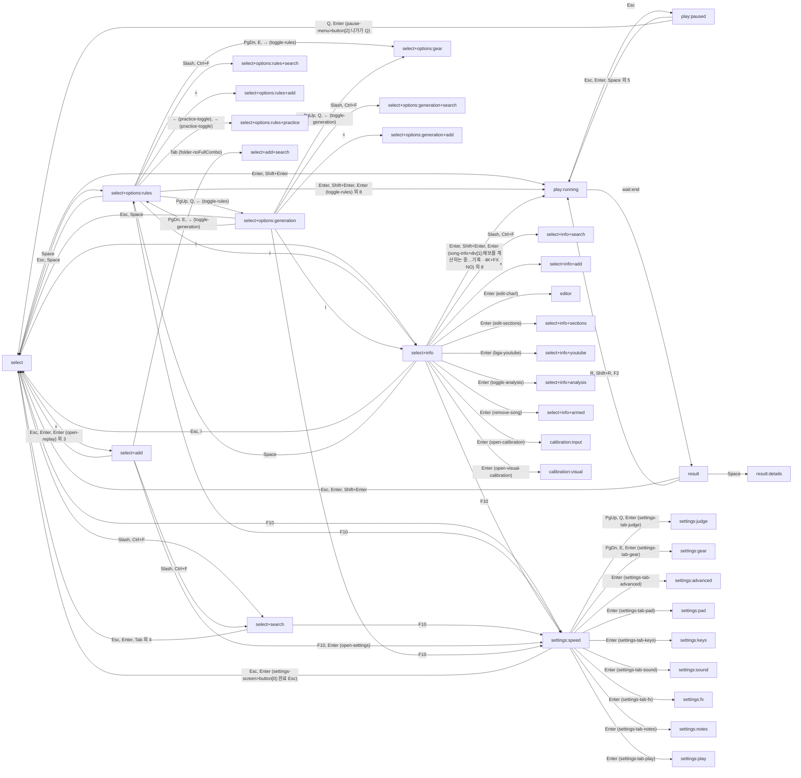
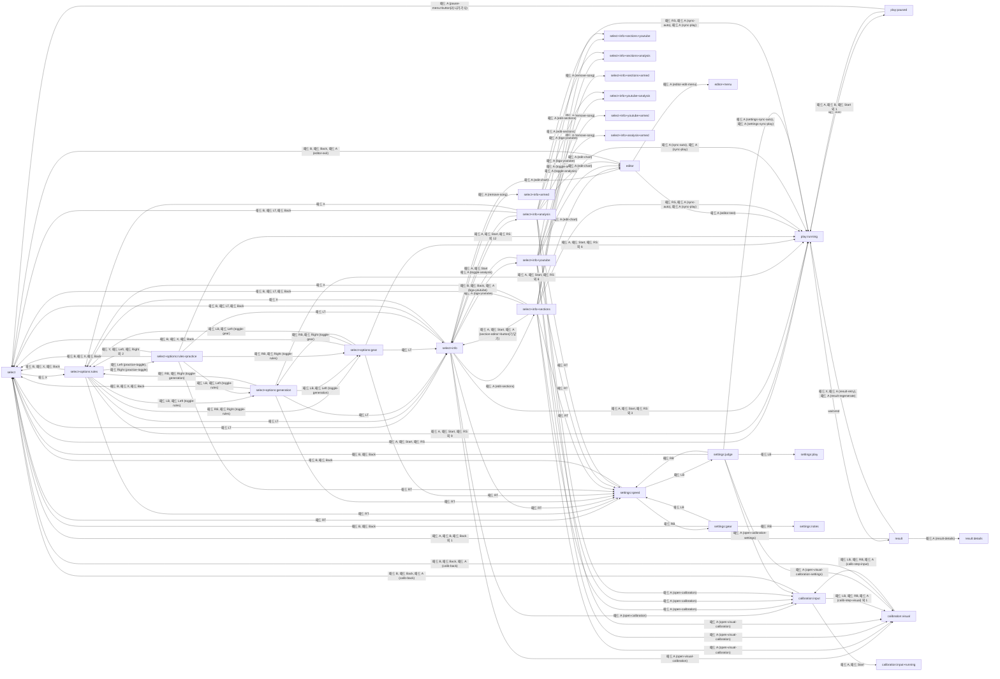

# 화면 전환 그래프와 그 검사

`client/audit/graph.audit.ts`가 게임을 직접 눌러 가며 만든 것입니다 (키보드만으로 한 번, 패드만으로 한 번). 원본: `data/graph.kb.json`, `data/graph.pad.json`.

## 키보드

상태 36개, 입력 974번. 이 가운데 키보드만으로는 가지 못하고 포인터로만 간 상태: 0개.

| 상태 | 가는 길 (처음 찾은 길) | 첫 포커스 | 항목 수 | 포커스가 닿은 항목 | 비고 |
|---|---|---|---|---|---|
| select | (시작) | (none) | 33 | 0 |  |
| play:running | Enter | (none) | 0 | 0 |  |
| select+options:rules | Space | rule-placement | 41 | 10 |  |
| select+info | I | song-info>div[1]:채보 정보노트 85롱노트 9평균 / 최대 N | 52 | 31 |  |
| select+search | Slash | song-search | 33 | 1 |  |
| select+add | + | upload-button | 39 | 12 |  |
| settings:speed | F10 | opt-hi-speed | 18 | 18 |  |
| play:paused | Enter Esc | pause-menu>button[0]:계속하기 Esc | 3 | 3 |  |
| result | Enter wait:end | result-back | 7 | 1 | could not get back to it |
| select+options:generation | Space PgUp | style-balanced | 53 | 15 |  |
| select+options:gear | Space PgDn | quick-speed | 38 | 1 |  |
| select+options:rules+search | Space Slash | song-search | 41 | 1 |  |
| select+options:rules+add | Space + | upload-button | 46 | 1 |  |
| select+options:rules+practice | Space ↓ ↓ ↓ ↓ ↓ ↓ ↓ ↓ ← | practice-toggle | 46 | 1 |  |
| select+info+search | I Slash | song-search | 53 | 1 |  |
| select+info+add | I + | upload-button | 58 | 1 |  |
| editor | I ↑ Enter | (none) | 11 | 0 |  |
| select+info+sections | I ↑ ↓ ↓ ↓ ↓ ↓ ↓ Enter | edit-sections | 63 | 1 |  |
| select+info+youtube | I ↑ ↓ ↓ ↓ ↓ ↓ → Enter | bga-youtube-input | 55 | 1 |  |
| select+info+analysis | I ↑ ↓ ↓ ↓ ↓ ↓ ↓ ↓ Enter | toggle-analysis | 53 | 1 |  |
| select+info+armed | I ↑ ↓ ↓ ↓ ↓ ↓ ↓ ↓ → Enter | remove-song | 53 | 1 |  |
| calibration:input | I ↑ ↓ ↓ ↓ ↓ ↓ ↓ ↓ ↓ → → Enter | calib-start | 5 | 1 |  |
| calibration:visual | I ↑ ↓ ↓ ↓ ↓ ↓ ↓ ↓ ↓ → → → Enter | calib-visual-save | 4 | 1 |  |
| select+add+search | + ↑ Tab Tab Tab Tab Tab Tab Tab | song-search | 39 | 1 |  |
| settings:judge | F10 PgUp | opt-judgement | 21 | 1 |  |
| settings:gear | F10 PgDn | opt-deck-style | 20 | 1 |  |
| settings:advanced | F10 Shift+Tab Enter | settings-tab-advanced | 13 | 1 |  |
| settings:pad | F10 Shift+Tab Shift+Tab Enter | settings-tab-pad | 92 | 1 |  |
| settings:keys | F10 Shift+Tab Shift+Tab Shift+Tab Enter | settings-tab-keys | 140 | 1 |  |
| settings:sound | F10 Shift+Tab Shift+Tab Shift+Tab Shift+Tab Enter | settings-tab-sound | 15 | 1 |  |
| settings:fx | F10 Shift+Tab Shift+Tab Shift+Tab Shift+Tab Shift+Tab Enter | settings-tab-fx | 16 | 1 |  |
| settings:notes | F10 Shift+Tab Shift+Tab Shift+Tab Shift+Tab Shift+Tab Shift+Tab Enter | settings-tab-notes | 24 | 1 |  |
| settings:play | F10 Shift+Tab Shift+Tab Shift+Tab Shift+Tab Shift+Tab Shift+Tab Shift+Tab Shift+Tab Shift+Tab Shift+Tab Enter | settings-tab-play | 18 | 1 |  |
| result:details | Enter wait:end Space | result-back | 9 | 1 |  |
| select+options:generation+search | Space PgUp Slash | song-search | 53 | 1 |  |
| select+options:generation+add | Space PgUp + | upload-button | 58 | 1 |  |

### 막다른 곳

| 상태 |
|---|
| select+options:gear |
| select+options:rules+search |
| select+options:rules+add |
| select+options:rules+practice |
| select+info+search |
| select+info+add |
| editor |
| select+info+sections |
| select+info+youtube |
| select+info+analysis |
| select+info+armed |
| calibration:input |
| calibration:visual |
| select+add+search |
| settings:judge |
| settings:gear |
| settings:advanced |
| settings:pad |
| settings:keys |
| settings:sound |
| settings:fx |
| settings:notes |
| settings:play |
| result:details |
| select+options:generation+search |
| select+options:generation+add |

### 키보드로 닿지 않는 항목

걸어 본 상태의 항목 1247개 가운데 포커스가 닿지도 않고 같은 일을 하는 키도 없는 것: **1142개**. (포인터로 누른 결과와 같은 결과를 내는 키가 그 상태에 있으면 닿는 것으로 셉니다.)

| 상태 | 항목 | 키 | 포인터로 누르면 |
|---|---|---|---|
| select | 곡 추가 + | add-menu | (누르지 않음: 라이브러리를 바꾸거나 파일을 받음) |
| select | 설정 F10 | open-settings | (누르지 않음: 라이브러리를 바꾸거나 파일을 받음) |
| select | 전체 1 | folder-all | (누르지 않음: 라이브러리를 바꾸거나 파일을 받음) |
| select | 즐겨찾기 0 | folder-favorites | (누르지 않음: 라이브러리를 바꾸거나 파일을 받음) |
| select | 미플레이 1 | folder-unplayed | (누르지 않음: 라이브러리를 바꾸거나 파일을 받음) |
| select | 미클리어 0 | folder-uncleared | (누르지 않음: 라이브러리를 바꾸거나 파일을 받음) |
| select | 풀콤 미달 0 | folder-noFullCombo | (누르지 않음: 라이브러리를 바꾸거나 파일을 받음) |
| select | 곡 검색 | song-search | (누르지 않음: 라이브러리를 바꾸거나 파일을 받음) |
| select | 추가순 F4 | song-sort | (누르지 않음: 라이브러리를 바꾸거나 파일을 받음) |
| select | Demo Groove 128Generative Rhythm (합성 데모)2581111 | song-item#51e0 | (누르지 않음: 라이브러리를 바꾸거나 파일을 받음) |
| select | 오토 플레이 Shift+Enter | autoplay-button | (누르지 않음: 라이브러리를 바꾸거나 파일을 받음) |
| select | 즐겨찾기 F3 | favorite-toggle | (누르지 않음: 라이브러리를 바꾸거나 파일을 받음) |
| select | 정보·도구 I | open-song-info | (누르지 않음: 라이브러리를 바꾸거나 파일을 받음) |
| select | 4K | body>button[0]:4K | (누르지 않음: 라이브러리를 바꾸거나 파일을 받음) |
| select | 4K+FX | body>button[1]:4K+FX | (누르지 않음: 라이브러리를 바꾸거나 파일을 받음) |
| select | 5K | body>button[2]:5K | (누르지 않음: 라이브러리를 바꾸거나 파일을 받음) |
| select | 6K | body>button[3]:6K | (누르지 않음: 라이브러리를 바꾸거나 파일을 받음) |
| select | 6K+FX | body>button[4]:6K+FX | (누르지 않음: 라이브러리를 바꾸거나 파일을 받음) |
| select | 7K+1S | body>button[5]:7K+1S | (누르지 않음: 라이브러리를 바꾸거나 파일을 받음) |
| select | 8K | body>button[6]:8K | (누르지 않음: 라이브러리를 바꾸거나 파일을 받음) |
| select | EASYEZLv.250 노트기록 없음 | difficulty-row>button[0]:EASYEZLv.250 노트기록 없음 | (누르지 않음: 라이브러리를 바꾸거나 파일을 받음) |
| select | NORMALNMLv.585 노트기록 없음 | difficulty-row>button[1]:NORMALNMLv.585 노트기록 없음 | (누르지 않음: 라이브러리를 바꾸거나 파일을 받음) |
| select | HARDHDLv.8132 노트기록 없음 | difficulty-row>button[2]:HARDHDLv.8132 노트기록 없음 | (누르지 않음: 라이브러리를 바꾸거나 파일을 받음) |
| select | EXPERTEXLv.11214 노트기록 없음 | difficulty-row>button[3]:EXPERTEXLv.11214 노트기록 없음 | (누르지 않음: 라이브러리를 바꾸거나 파일을 받음) |
| select | MASTERMXLv.11242 노트기록 없음 | difficulty-row>button[4]:MASTERMXLv.11242 노트기록 없음 | (누르지 않음: 라이브러리를 바꾸거나 파일을 받음) |
| select | 플레이 옵션 | play-options-button | (누르지 않음: 라이브러리를 바꾸거나 파일을 받음) |
| select | 새 패턴 F5 | generate-button | (누르지 않음: 라이브러리를 바꾸거나 파일을 받음) |
| select | 플레이 Enter | play-button | (누르지 않음: 라이브러리를 바꾸거나 파일을 받음) |
| select+options:rules | 곡 추가 + | add-menu | (누르지 않음: 라이브러리를 바꾸거나 파일을 받음) |
| select+options:rules | 설정 F10 | open-settings | (누르지 않음: 라이브러리를 바꾸거나 파일을 받음) |
| select+options:rules | 전체 1 | folder-all | (누르지 않음: 라이브러리를 바꾸거나 파일을 받음) |
| select+options:rules | 즐겨찾기 0 | folder-favorites | (누르지 않음: 라이브러리를 바꾸거나 파일을 받음) |
| select+options:rules | 미플레이 1 | folder-unplayed | (누르지 않음: 라이브러리를 바꾸거나 파일을 받음) |
| select+options:rules | 미클리어 0 | folder-uncleared | (누르지 않음: 라이브러리를 바꾸거나 파일을 받음) |
| select+options:rules | 풀콤 미달 0 | folder-noFullCombo | (누르지 않음: 라이브러리를 바꾸거나 파일을 받음) |
| select+options:rules | 곡 검색 | song-search | (누르지 않음: 라이브러리를 바꾸거나 파일을 받음) |
| select+options:rules | 추가순 F4 | song-sort | (누르지 않음: 라이브러리를 바꾸거나 파일을 받음) |
| select+options:rules | Demo Groove 128Generative Rhythm (합성 데모)2581111 | song-item#51e0 | (누르지 않음: 라이브러리를 바꾸거나 파일을 받음) |
| select+options:rules | 속도·기어 | toggle-gear | (누르지 않음: 라이브러리를 바꾸거나 파일을 받음) |
| select+options:rules | 생성 옵션 | toggle-generation | (누르지 않음: 라이브러리를 바꾸거나 파일을 받음) |
| select+options:rules | 닫기 Esc | play-options>button[0]:닫기 Esc | (누르지 않음: 라이브러리를 바꾸거나 파일을 받음) |
| select+options:rules | 4K | body>button[19]:4K | (누르지 않음: 라이브러리를 바꾸거나 파일을 받음) |
| select+options:rules | 4K+FX | body>button[20]:4K+FX | (누르지 않음: 라이브러리를 바꾸거나 파일을 받음) |
| select+options:rules | 5K | body>button[21]:5K | (누르지 않음: 라이브러리를 바꾸거나 파일을 받음) |
| select+options:rules | 6K | body>button[22]:6K | (누르지 않음: 라이브러리를 바꾸거나 파일을 받음) |
| select+options:rules | 6K+FX | body>button[23]:6K+FX | (누르지 않음: 라이브러리를 바꾸거나 파일을 받음) |
| select+options:rules | 7K+1S | body>button[24]:7K+1S | (누르지 않음: 라이브러리를 바꾸거나 파일을 받음) |
| select+options:rules | 8K | body>button[25]:8K | (누르지 않음: 라이브러리를 바꾸거나 파일을 받음) |
| select+options:rules | EASY Lv.2 | difficulty-row>button[0]:EASY Lv.2 | (누르지 않음: 라이브러리를 바꾸거나 파일을 받음) |
| select+options:rules | NORMAL Lv.5 | difficulty-row>button[1]:NORMAL Lv.5 | (누르지 않음: 라이브러리를 바꾸거나 파일을 받음) |
| select+options:rules | HARD Lv.8 | difficulty-row>button[2]:HARD Lv.8 | (누르지 않음: 라이브러리를 바꾸거나 파일을 받음) |
| select+options:rules | EXPERT Lv.11 | difficulty-row>button[3]:EXPERT Lv.11 | (누르지 않음: 라이브러리를 바꾸거나 파일을 받음) |
| select+options:rules | MASTER Lv.11 | difficulty-row>button[4]:MASTER Lv.11 | (누르지 않음: 라이브러리를 바꾸거나 파일을 받음) |
| select+options:rules | 플레이 옵션 | play-options-button | (누르지 않음: 라이브러리를 바꾸거나 파일을 받음) |
| select+options:rules | 새 패턴 F5 | generate-button | (누르지 않음: 라이브러리를 바꾸거나 파일을 받음) |
| select+options:rules | 플레이 Enter | play-button | (누르지 않음: 라이브러리를 바꾸거나 파일을 받음) |
| select+info | 곡 추가 + | add-menu | (누르지 않음: 라이브러리를 바꾸거나 파일을 받음) |
| select+info | 설정 F10 | open-settings | (누르지 않음: 라이브러리를 바꾸거나 파일을 받음) |
| select+info | 전체 1 | folder-all | (누르지 않음: 라이브러리를 바꾸거나 파일을 받음) |
| select+info | 즐겨찾기 0 | folder-favorites | (누르지 않음: 라이브러리를 바꾸거나 파일을 받음) |
| select+info | 미플레이 1 | folder-unplayed | (누르지 않음: 라이브러리를 바꾸거나 파일을 받음) |
| select+info | 미클리어 0 | folder-uncleared | (누르지 않음: 라이브러리를 바꾸거나 파일을 받음) |
| select+info | 풀콤 미달 0 | folder-noFullCombo | (누르지 않음: 라이브러리를 바꾸거나 파일을 받음) |
| select+info | 곡 검색 | song-search | (누르지 않음: 라이브러리를 바꾸거나 파일을 받음) |
| select+info | 추가순 F4 | song-sort | (누르지 않음: 라이브러리를 바꾸거나 파일을 받음) |
| select+info | Demo Groove 128Generative Rhythm (합성 데모)2581111 | song-item#51e0 | (누르지 않음: 라이브러리를 바꾸거나 파일을 받음) |
| select+info | 닫기 Esc | song-info>button[0]:닫기 Esc | (누르지 않음: 라이브러리를 바꾸거나 파일을 받음) |
| select+info | 4K | body>button[10]:4K | (누르지 않음: 라이브러리를 바꾸거나 파일을 받음) |
| select+info | 4K+FX | body>button[11]:4K+FX | (누르지 않음: 라이브러리를 바꾸거나 파일을 받음) |
| select+info | 5K | body>button[12]:5K | (누르지 않음: 라이브러리를 바꾸거나 파일을 받음) |
| select+info | 6K | body>button[13]:6K | (누르지 않음: 라이브러리를 바꾸거나 파일을 받음) |
| select+info | 6K+FX | body>button[14]:6K+FX | (누르지 않음: 라이브러리를 바꾸거나 파일을 받음) |
| select+info | 7K+1S | body>button[15]:7K+1S | (누르지 않음: 라이브러리를 바꾸거나 파일을 받음) |
| select+info | 8K | body>button[16]:8K | (누르지 않음: 라이브러리를 바꾸거나 파일을 받음) |
| select+info | EASY Lv.2 | difficulty-row>button[0]:EASY Lv.2 | (누르지 않음: 라이브러리를 바꾸거나 파일을 받음) |
| select+info | NORMAL Lv.5 | difficulty-row>button[1]:NORMAL Lv.5 | (누르지 않음: 라이브러리를 바꾸거나 파일을 받음) |
| select+info | HARD Lv.8 | difficulty-row>button[2]:HARD Lv.8 | (누르지 않음: 라이브러리를 바꾸거나 파일을 받음) |
| select+info | EXPERT Lv.11 | difficulty-row>button[3]:EXPERT Lv.11 | (누르지 않음: 라이브러리를 바꾸거나 파일을 받음) |
| select+info | MASTER Lv.11 | difficulty-row>button[4]:MASTER Lv.11 | (누르지 않음: 라이브러리를 바꾸거나 파일을 받음) |
| select+info | 플레이 옵션 | play-options-button | (누르지 않음: 라이브러리를 바꾸거나 파일을 받음) |
| select+info | 새 패턴 F5 | generate-button | (누르지 않음: 라이브러리를 바꾸거나 파일을 받음) |
| select+info | 플레이 Enter | play-button | (누르지 않음: 라이브러리를 바꾸거나 파일을 받음) |
| select+search | 곡 추가 + | add-menu | (누르지 않음: 라이브러리를 바꾸거나 파일을 받음) |
| select+search | 설정 F10 | open-settings | (누르지 않음: 라이브러리를 바꾸거나 파일을 받음) |
| select+search | 전체 1 | folder-all | (누르지 않음: 라이브러리를 바꾸거나 파일을 받음) |
| select+search | 즐겨찾기 0 | folder-favorites | (누르지 않음: 라이브러리를 바꾸거나 파일을 받음) |
| select+search | 미플레이 1 | folder-unplayed | (누르지 않음: 라이브러리를 바꾸거나 파일을 받음) |
| select+search | 미클리어 0 | folder-uncleared | (누르지 않음: 라이브러리를 바꾸거나 파일을 받음) |
| select+search | 풀콤 미달 0 | folder-noFullCombo | (누르지 않음: 라이브러리를 바꾸거나 파일을 받음) |
| select+search | 추가순 F4 | song-sort | (누르지 않음: 라이브러리를 바꾸거나 파일을 받음) |
| select+search | Demo Groove 128Generative Rhythm (합성 데모)2581111 | song-item#51e0 | (누르지 않음: 라이브러리를 바꾸거나 파일을 받음) |
| select+search | 오토 플레이 Shift+Enter | autoplay-button | (누르지 않음: 라이브러리를 바꾸거나 파일을 받음) |
| select+search | 즐겨찾기 F3 | favorite-toggle | (누르지 않음: 라이브러리를 바꾸거나 파일을 받음) |
| select+search | 정보·도구 I | open-song-info | (누르지 않음: 라이브러리를 바꾸거나 파일을 받음) |
| select+search | 4K | body>button[0]:4K | (누르지 않음: 라이브러리를 바꾸거나 파일을 받음) |
| select+search | 4K+FX | body>button[1]:4K+FX | (누르지 않음: 라이브러리를 바꾸거나 파일을 받음) |
| select+search | 5K | body>button[2]:5K | (누르지 않음: 라이브러리를 바꾸거나 파일을 받음) |
| select+search | 6K | body>button[3]:6K | (누르지 않음: 라이브러리를 바꾸거나 파일을 받음) |
| select+search | 6K+FX | body>button[4]:6K+FX | (누르지 않음: 라이브러리를 바꾸거나 파일을 받음) |
| select+search | 7K+1S | body>button[5]:7K+1S | (누르지 않음: 라이브러리를 바꾸거나 파일을 받음) |
| select+search | 8K | body>button[6]:8K | (누르지 않음: 라이브러리를 바꾸거나 파일을 받음) |
| select+search | EASYEZLv.250 노트기록 없음 | difficulty-row>button[0]:EASYEZLv.250 노트기록 없음 | (누르지 않음: 라이브러리를 바꾸거나 파일을 받음) |
| select+search | NORMALNMLv.585 노트기록 없음 | difficulty-row>button[1]:NORMALNMLv.585 노트기록 없음 | (누르지 않음: 라이브러리를 바꾸거나 파일을 받음) |
| select+search | HARDHDLv.8132 노트기록 없음 | difficulty-row>button[2]:HARDHDLv.8132 노트기록 없음 | (누르지 않음: 라이브러리를 바꾸거나 파일을 받음) |
| select+search | EXPERTEXLv.11214 노트기록 없음 | difficulty-row>button[3]:EXPERTEXLv.11214 노트기록 없음 | (누르지 않음: 라이브러리를 바꾸거나 파일을 받음) |
| select+search | MASTERMXLv.11242 노트기록 없음 | difficulty-row>button[4]:MASTERMXLv.11242 노트기록 없음 | (누르지 않음: 라이브러리를 바꾸거나 파일을 받음) |
| select+search | 플레이 옵션 | play-options-button | (누르지 않음: 라이브러리를 바꾸거나 파일을 받음) |
| select+search | 새 패턴 F5 | generate-button | (누르지 않음: 라이브러리를 바꾸거나 파일을 받음) |
| select+search | 플레이 Enter | play-button | (누르지 않음: 라이브러리를 바꾸거나 파일을 받음) |
| select+add | 곡 검색 | song-search | (누르지 않음: 라이브러리를 바꾸거나 파일을 받음) |
| select+add | 추가순 F4 | song-sort | (누르지 않음: 라이브러리를 바꾸거나 파일을 받음) |
| select+add | Demo Groove 128Generative Rhythm (합성 데모)2581111 | song-item#51e0 | (누르지 않음: 라이브러리를 바꾸거나 파일을 받음) |
| select+add | 오토 플레이 Shift+Enter | autoplay-button | (누르지 않음: 라이브러리를 바꾸거나 파일을 받음) |
| select+add | 즐겨찾기 F3 | favorite-toggle | (누르지 않음: 라이브러리를 바꾸거나 파일을 받음) |
| select+add | 정보·도구 I | open-song-info | (누르지 않음: 라이브러리를 바꾸거나 파일을 받음) |
| select+add | 4K | body>button[0]:4K | (누르지 않음: 라이브러리를 바꾸거나 파일을 받음) |
| select+add | 4K+FX | body>button[1]:4K+FX | (누르지 않음: 라이브러리를 바꾸거나 파일을 받음) |
| select+add | 5K | body>button[2]:5K | (누르지 않음: 라이브러리를 바꾸거나 파일을 받음) |
| select+add | 6K | body>button[3]:6K | (누르지 않음: 라이브러리를 바꾸거나 파일을 받음) |
| select+add | 6K+FX | body>button[4]:6K+FX | (누르지 않음: 라이브러리를 바꾸거나 파일을 받음) |
| select+add | 7K+1S | body>button[5]:7K+1S | (누르지 않음: 라이브러리를 바꾸거나 파일을 받음) |
| select+add | 8K | body>button[6]:8K | (누르지 않음: 라이브러리를 바꾸거나 파일을 받음) |
| select+add | EASYEZLv.250 노트기록 없음 | difficulty-row>button[0]:EASYEZLv.250 노트기록 없음 | (누르지 않음: 라이브러리를 바꾸거나 파일을 받음) |
| select+add | NORMALNMLv.585 노트기록 없음 | difficulty-row>button[1]:NORMALNMLv.585 노트기록 없음 | (누르지 않음: 라이브러리를 바꾸거나 파일을 받음) |
| select+add | HARDHDLv.8132 노트기록 없음 | difficulty-row>button[2]:HARDHDLv.8132 노트기록 없음 | (누르지 않음: 라이브러리를 바꾸거나 파일을 받음) |
| select+add | EXPERTEXLv.11214 노트기록 없음 | difficulty-row>button[3]:EXPERTEXLv.11214 노트기록 없음 | (누르지 않음: 라이브러리를 바꾸거나 파일을 받음) |
| select+add | MASTERMXLv.11242 노트기록 없음 | difficulty-row>button[4]:MASTERMXLv.11242 노트기록 없음 | (누르지 않음: 라이브러리를 바꾸거나 파일을 받음) |
| select+add | 플레이 옵션 | play-options-button | (누르지 않음: 라이브러리를 바꾸거나 파일을 받음) |
| select+add | 새 패턴 F5 | generate-button | (누르지 않음: 라이브러리를 바꾸거나 파일을 받음) |
| select+add | 플레이 Enter | play-button | (누르지 않음: 라이브러리를 바꾸거나 파일을 받음) |
| select+options:generation | 곡 추가 + | add-menu | (누르지 않음: 라이브러리를 바꾸거나 파일을 받음) |
| select+options:generation | 설정 F10 | open-settings | (누르지 않음: 라이브러리를 바꾸거나 파일을 받음) |
| select+options:generation | 전체 1 | folder-all | (누르지 않음: 라이브러리를 바꾸거나 파일을 받음) |
| select+options:generation | 즐겨찾기 0 | folder-favorites | (누르지 않음: 라이브러리를 바꾸거나 파일을 받음) |
| select+options:generation | 미플레이 0 | folder-unplayed | (누르지 않음: 라이브러리를 바꾸거나 파일을 받음) |
| select+options:generation | 미클리어 1 | folder-uncleared | (누르지 않음: 라이브러리를 바꾸거나 파일을 받음) |
| select+options:generation | 풀콤 미달 0 | folder-noFullCombo | (누르지 않음: 라이브러리를 바꾸거나 파일을 받음) |
| select+options:generation | 곡 검색 | song-search | (누르지 않음: 라이브러리를 바꾸거나 파일을 받음) |
| select+options:generation | 추가순 F4 | song-sort | (누르지 않음: 라이브러리를 바꾸거나 파일을 받음) |
| select+options:generation | Demo Groove 128Generative Rhythm (합성 데모)2581111 | song-item#51e0 | (누르지 않음: 라이브러리를 바꾸거나 파일을 받음) |
| select+options:generation | 플레이 규칙 | toggle-rules | (누르지 않음: 라이브러리를 바꾸거나 파일을 받음) |
| select+options:generation | 속도·기어 | toggle-gear | (누르지 않음: 라이브러리를 바꾸거나 파일을 받음) |
| select+options:generation | 닫기 Esc | play-options>button[0]:닫기 Esc | (누르지 않음: 라이브러리를 바꾸거나 파일을 받음) |
| select+options:generation | 스트림 | style-stream | (누르지 않음: 라이브러리를 바꾸거나 파일을 받음) |
| select+options:generation | 동치 | style-chord | (누르지 않음: 라이브러리를 바꾸거나 파일을 받음) |
| select+options:generation | 연타 | style-jack | (누르지 않음: 라이브러리를 바꾸거나 파일을 받음) |
| select+options:generation | 롱노트 | style-longnote | (누르지 않음: 라이브러리를 바꾸거나 파일을 받음) |
| select+options:generation | 테크니컬 | style-technical | (누르지 않음: 라이브러리를 바꾸거나 파일을 받음) |
| select+options:generation | 드럼 | generation-options>button[1]:드럼 | (누르지 않음: 라이브러리를 바꾸거나 파일을 받음) |
| select+options:generation | 베이스 | generation-options>button[2]:베이스 | (누르지 않음: 라이브러리를 바꾸거나 파일을 받음) |
| select+options:generation | 멜로디 | generation-options>button[3]:멜로디 | (누르지 않음: 라이브러리를 바꾸거나 파일을 받음) |
| select+options:generation | 악구·패턴 | pattern-engine-designer | (누르지 않음: 라이브러리를 바꾸거나 파일을 받음) |
| select+options:generation | 4K | body>button[11]:4K | (누르지 않음: 라이브러리를 바꾸거나 파일을 받음) |
| select+options:generation | 4K+FX | body>button[12]:4K+FX | (누르지 않음: 라이브러리를 바꾸거나 파일을 받음) |
| select+options:generation | 5K | body>button[13]:5K | (누르지 않음: 라이브러리를 바꾸거나 파일을 받음) |
| select+options:generation | 6K | body>button[14]:6K | (누르지 않음: 라이브러리를 바꾸거나 파일을 받음) |
| select+options:generation | 6K+FX | body>button[15]:6K+FX | (누르지 않음: 라이브러리를 바꾸거나 파일을 받음) |
| select+options:generation | 7K+1S | body>button[16]:7K+1S | (누르지 않음: 라이브러리를 바꾸거나 파일을 받음) |
| select+options:generation | 8K | body>button[17]:8K | (누르지 않음: 라이브러리를 바꾸거나 파일을 받음) |
| select+options:generation | EASY Lv.2 | difficulty-row>button[0]:EASY Lv.2 | (누르지 않음: 라이브러리를 바꾸거나 파일을 받음) |
| select+options:generation | NORMAL Lv.5 · FAILED | difficulty-row>button[1]:NORMAL Lv.5 · FAILED | (누르지 않음: 라이브러리를 바꾸거나 파일을 받음) |
| select+options:generation | HARD Lv.8 | difficulty-row>button[2]:HARD Lv.8 | (누르지 않음: 라이브러리를 바꾸거나 파일을 받음) |
| select+options:generation | EXPERT Lv.11 | difficulty-row>button[3]:EXPERT Lv.11 | (누르지 않음: 라이브러리를 바꾸거나 파일을 받음) |
| select+options:generation | MASTER Lv.11 | difficulty-row>button[4]:MASTER Lv.11 | (누르지 않음: 라이브러리를 바꾸거나 파일을 받음) |
| select+options:generation | 플레이 옵션 | play-options-button | (누르지 않음: 라이브러리를 바꾸거나 파일을 받음) |
| select+options:generation | 새 패턴 F5 | generate-button | (누르지 않음: 라이브러리를 바꾸거나 파일을 받음) |
| select+options:generation | 플레이 Enter | play-button | (누르지 않음: 라이브러리를 바꾸거나 파일을 받음) |
| select+options:gear | 곡 추가 + | add-menu | (누르지 않음: 라이브러리를 바꾸거나 파일을 받음) |
| select+options:gear | 설정 F10 | open-settings | (누르지 않음: 라이브러리를 바꾸거나 파일을 받음) |
| select+options:gear | 전체 1 | folder-all | (누르지 않음: 라이브러리를 바꾸거나 파일을 받음) |
| select+options:gear | 즐겨찾기 0 | folder-favorites | (누르지 않음: 라이브러리를 바꾸거나 파일을 받음) |
| select+options:gear | 미플레이 0 | folder-unplayed | (누르지 않음: 라이브러리를 바꾸거나 파일을 받음) |
| select+options:gear | 미클리어 1 | folder-uncleared | (누르지 않음: 라이브러리를 바꾸거나 파일을 받음) |
| select+options:gear | 풀콤 미달 0 | folder-noFullCombo | (누르지 않음: 라이브러리를 바꾸거나 파일을 받음) |
| select+options:gear | 곡 검색 | song-search | (누르지 않음: 라이브러리를 바꾸거나 파일을 받음) |
| select+options:gear | 추가순 F4 | song-sort | (누르지 않음: 라이브러리를 바꾸거나 파일을 받음) |
| select+options:gear | Demo Groove 128Generative Rhythm (합성 데모)2581111 | song-item#51e0 | (누르지 않음: 라이브러리를 바꾸거나 파일을 받음) |
| select+options:gear | 플레이 규칙 | toggle-rules | (누르지 않음: 라이브러리를 바꾸거나 파일을 받음) |
| select+options:gear | 속도·기어 | toggle-gear | (누르지 않음: 라이브러리를 바꾸거나 파일을 받음) |
| select+options:gear | 생성 옵션 | toggle-generation | (누르지 않음: 라이브러리를 바꾸거나 파일을 받음) |
| select+options:gear | 닫기 Esc | play-options>button[0]:닫기 Esc | (누르지 않음: 라이브러리를 바꾸거나 파일을 받음) |
| select+options:gear | 노트 등장 위치 | quick-sudden | (누르지 않음: 라이브러리를 바꾸거나 파일을 받음) |
| select+options:gear | 노트 사라짐 위치 | quick-hidden | (누르지 않음: 라이브러리를 바꾸거나 파일을 받음) |
| select+options:gear | 판정선 위치 | quick-lift | (누르지 않음: 라이브러리를 바꾸거나 파일을 받음) |
| select+options:gear | 카메라 | quick-camera | (누르지 않음: 라이브러리를 바꾸거나 파일을 받음) |
| select+options:gear | 키 빔 길이 | quick-key-beam | (누르지 않음: 라이브러리를 바꾸거나 파일을 받음) |
| select+options:gear | 4K | body>button[13]:4K | (누르지 않음: 라이브러리를 바꾸거나 파일을 받음) |
| select+options:gear | 4K+FX | body>button[14]:4K+FX | (누르지 않음: 라이브러리를 바꾸거나 파일을 받음) |
| select+options:gear | 5K | body>button[15]:5K | (누르지 않음: 라이브러리를 바꾸거나 파일을 받음) |
| select+options:gear | 6K | body>button[16]:6K | (누르지 않음: 라이브러리를 바꾸거나 파일을 받음) |
| select+options:gear | 6K+FX | body>button[17]:6K+FX | (누르지 않음: 라이브러리를 바꾸거나 파일을 받음) |
| select+options:gear | 7K+1S | body>button[18]:7K+1S | (누르지 않음: 라이브러리를 바꾸거나 파일을 받음) |
| select+options:gear | 8K | body>button[19]:8K | (누르지 않음: 라이브러리를 바꾸거나 파일을 받음) |
| select+options:gear | EASY Lv.2 | difficulty-row>button[0]:EASY Lv.2 | (누르지 않음: 라이브러리를 바꾸거나 파일을 받음) |
| select+options:gear | NORMAL Lv.5 · FAILED | difficulty-row>button[1]:NORMAL Lv.5 · FAILED | (누르지 않음: 라이브러리를 바꾸거나 파일을 받음) |
| select+options:gear | HARD Lv.8 | difficulty-row>button[2]:HARD Lv.8 | (누르지 않음: 라이브러리를 바꾸거나 파일을 받음) |
| select+options:gear | EXPERT Lv.11 | difficulty-row>button[3]:EXPERT Lv.11 | (누르지 않음: 라이브러리를 바꾸거나 파일을 받음) |
| select+options:gear | MASTER Lv.11 | difficulty-row>button[4]:MASTER Lv.11 | (누르지 않음: 라이브러리를 바꾸거나 파일을 받음) |
| select+options:gear | 플레이 옵션 | play-options-button | (누르지 않음: 라이브러리를 바꾸거나 파일을 받음) |
| select+options:gear | 새 패턴 F5 | generate-button | (누르지 않음: 라이브러리를 바꾸거나 파일을 받음) |
| select+options:gear | 플레이 Enter | play-button | (누르지 않음: 라이브러리를 바꾸거나 파일을 받음) |
| select+options:rules+search | 곡 추가 + | add-menu | (누르지 않음: 라이브러리를 바꾸거나 파일을 받음) |
| select+options:rules+search | 설정 F10 | open-settings | (누르지 않음: 라이브러리를 바꾸거나 파일을 받음) |
| select+options:rules+search | 전체 1 | folder-all | (누르지 않음: 라이브러리를 바꾸거나 파일을 받음) |
| select+options:rules+search | 즐겨찾기 0 | folder-favorites | (누르지 않음: 라이브러리를 바꾸거나 파일을 받음) |
| select+options:rules+search | 미플레이 0 | folder-unplayed | (누르지 않음: 라이브러리를 바꾸거나 파일을 받음) |
| select+options:rules+search | 미클리어 1 | folder-uncleared | (누르지 않음: 라이브러리를 바꾸거나 파일을 받음) |
| select+options:rules+search | 풀콤 미달 0 | folder-noFullCombo | (누르지 않음: 라이브러리를 바꾸거나 파일을 받음) |
| select+options:rules+search | 추가순 F4 | song-sort | (누르지 않음: 라이브러리를 바꾸거나 파일을 받음) |
| select+options:rules+search | Demo Groove 128Generative Rhythm (합성 데모)2581111 | song-item#51e0 | (누르지 않음: 라이브러리를 바꾸거나 파일을 받음) |
| select+options:rules+search | 플레이 규칙 | toggle-rules | (누르지 않음: 라이브러리를 바꾸거나 파일을 받음) |
| select+options:rules+search | 속도·기어 | toggle-gear | (누르지 않음: 라이브러리를 바꾸거나 파일을 받음) |
| select+options:rules+search | 생성 옵션 | toggle-generation | (누르지 않음: 라이브러리를 바꾸거나 파일을 받음) |
| select+options:rules+search | 닫기 Esc | play-options>button[0]:닫기 Esc | (누르지 않음: 라이브러리를 바꾸거나 파일을 받음) |
| select+options:rules+search | 배치 | rule-placement | (누르지 않음: 라이브러리를 바꾸거나 파일을 받음) |
| select+options:rules+search | 게이지 | rule-gauge | (누르지 않음: 라이브러리를 바꾸거나 파일을 받음) |
| select+options:rules+search | FEVER | rule-fever | (누르지 않음: 라이브러리를 바꾸거나 파일을 받음) |
| select+options:rules+search | 페이스메이커 | rule-pacemaker | (누르지 않음: 라이브러리를 바꾸거나 파일을 받음) |
| select+options:rules+search | 판정 | rule-judgement | (누르지 않음: 라이브러리를 바꾸거나 파일을 받음) |
| select+options:rules+search | 점수 규칙 | rule-ruleset | (누르지 않음: 라이브러리를 바꾸거나 파일을 받음) |
| select+options:rules+search | 오토 플레이 | autoplay-toggle | (누르지 않음: 라이브러리를 바꾸거나 파일을 받음) |
| select+options:rules+search | 목표 레벨 | target-level | (누르지 않음: 라이브러리를 바꾸거나 파일을 받음) |
| select+options:rules+search | 연습 모드 | practice-toggle | (누르지 않음: 라이브러리를 바꾸거나 파일을 받음) |
| select+options:rules+search | 4K | body>button[19]:4K | (누르지 않음: 라이브러리를 바꾸거나 파일을 받음) |
| select+options:rules+search | 4K+FX | body>button[20]:4K+FX | (누르지 않음: 라이브러리를 바꾸거나 파일을 받음) |
| select+options:rules+search | 5K | body>button[21]:5K | (누르지 않음: 라이브러리를 바꾸거나 파일을 받음) |
| select+options:rules+search | 6K | body>button[22]:6K | (누르지 않음: 라이브러리를 바꾸거나 파일을 받음) |
| select+options:rules+search | 6K+FX | body>button[23]:6K+FX | (누르지 않음: 라이브러리를 바꾸거나 파일을 받음) |
| select+options:rules+search | 7K+1S | body>button[24]:7K+1S | (누르지 않음: 라이브러리를 바꾸거나 파일을 받음) |
| select+options:rules+search | 8K | body>button[25]:8K | (누르지 않음: 라이브러리를 바꾸거나 파일을 받음) |
| select+options:rules+search | EASY Lv.2 | difficulty-row>button[0]:EASY Lv.2 | (누르지 않음: 라이브러리를 바꾸거나 파일을 받음) |
| select+options:rules+search | NORMAL Lv.5 · FAILED | difficulty-row>button[1]:NORMAL Lv.5 · FAILED | (누르지 않음: 라이브러리를 바꾸거나 파일을 받음) |
| select+options:rules+search | HARD Lv.8 | difficulty-row>button[2]:HARD Lv.8 | (누르지 않음: 라이브러리를 바꾸거나 파일을 받음) |
| select+options:rules+search | EXPERT Lv.11 | difficulty-row>button[3]:EXPERT Lv.11 | (누르지 않음: 라이브러리를 바꾸거나 파일을 받음) |
| select+options:rules+search | MASTER Lv.11 | difficulty-row>button[4]:MASTER Lv.11 | (누르지 않음: 라이브러리를 바꾸거나 파일을 받음) |
| select+options:rules+search | 플레이 옵션 | play-options-button | (누르지 않음: 라이브러리를 바꾸거나 파일을 받음) |
| select+options:rules+search | 새 패턴 F5 | generate-button | (누르지 않음: 라이브러리를 바꾸거나 파일을 받음) |
| select+options:rules+search | 플레이 Enter | play-button | (누르지 않음: 라이브러리를 바꾸거나 파일을 받음) |
| select+options:rules+add | 곡 추가 + | add-menu | (누르지 않음: 라이브러리를 바꾸거나 파일을 받음) |
| select+options:rules+add | 데모 곡합성한 128 BPM 곡 | demo-button | (누르지 않음: 라이브러리를 바꾸거나 파일을 받음) |
| select+options:rules+add | 채보 가져오기 · 파일.osz · .zip · .osu · .bms · .bmson | import-button | (누르지 않음: 라이브러리를 바꾸거나 파일을 받음) |
| select+options:rules+add | 채보 가져오기 · 폴더BMS · bmson 폴더 (키음 포함) | import-folder-button | (누르지 않음: 라이브러리를 바꾸거나 파일을 받음) |
| select+options:rules+add | 리플레이 파일 보기결과 화면에서 내보낸 .grgreplay.json | open-replay | (누르지 않음: 라이브러리를 바꾸거나 파일을 받음) |
| select+options:rules+add | 설정 F10 | open-settings | (누르지 않음: 라이브러리를 바꾸거나 파일을 받음) |
| select+options:rules+add | 전체 1 | folder-all | (누르지 않음: 라이브러리를 바꾸거나 파일을 받음) |
| select+options:rules+add | 즐겨찾기 0 | folder-favorites | (누르지 않음: 라이브러리를 바꾸거나 파일을 받음) |
| select+options:rules+add | 미플레이 0 | folder-unplayed | (누르지 않음: 라이브러리를 바꾸거나 파일을 받음) |
| select+options:rules+add | 미클리어 1 | folder-uncleared | (누르지 않음: 라이브러리를 바꾸거나 파일을 받음) |
| select+options:rules+add | 풀콤 미달 0 | folder-noFullCombo | (누르지 않음: 라이브러리를 바꾸거나 파일을 받음) |
| select+options:rules+add | 곡 검색 | song-search | (누르지 않음: 라이브러리를 바꾸거나 파일을 받음) |
| select+options:rules+add | 추가순 F4 | song-sort | (누르지 않음: 라이브러리를 바꾸거나 파일을 받음) |
| select+options:rules+add | Demo Groove 128Generative Rhythm (합성 데모)2581111 | song-item#51e0 | (누르지 않음: 라이브러리를 바꾸거나 파일을 받음) |
| select+options:rules+add | 플레이 규칙 | toggle-rules | (누르지 않음: 라이브러리를 바꾸거나 파일을 받음) |
| select+options:rules+add | 속도·기어 | toggle-gear | (누르지 않음: 라이브러리를 바꾸거나 파일을 받음) |
| select+options:rules+add | 생성 옵션 | toggle-generation | (누르지 않음: 라이브러리를 바꾸거나 파일을 받음) |
| select+options:rules+add | 닫기 Esc | play-options>button[0]:닫기 Esc | (누르지 않음: 라이브러리를 바꾸거나 파일을 받음) |
| select+options:rules+add | 배치 | rule-placement | (누르지 않음: 라이브러리를 바꾸거나 파일을 받음) |
| select+options:rules+add | 게이지 | rule-gauge | (누르지 않음: 라이브러리를 바꾸거나 파일을 받음) |
| select+options:rules+add | FEVER | rule-fever | (누르지 않음: 라이브러리를 바꾸거나 파일을 받음) |
| select+options:rules+add | 페이스메이커 | rule-pacemaker | (누르지 않음: 라이브러리를 바꾸거나 파일을 받음) |
| select+options:rules+add | 판정 | rule-judgement | (누르지 않음: 라이브러리를 바꾸거나 파일을 받음) |
| select+options:rules+add | 점수 규칙 | rule-ruleset | (누르지 않음: 라이브러리를 바꾸거나 파일을 받음) |
| select+options:rules+add | 오토 플레이 | autoplay-toggle | (누르지 않음: 라이브러리를 바꾸거나 파일을 받음) |
| select+options:rules+add | 목표 레벨 | target-level | (누르지 않음: 라이브러리를 바꾸거나 파일을 받음) |
| select+options:rules+add | 연습 모드 | practice-toggle | (누르지 않음: 라이브러리를 바꾸거나 파일을 받음) |
| select+options:rules+add | 4K | body>button[19]:4K | (누르지 않음: 라이브러리를 바꾸거나 파일을 받음) |
| select+options:rules+add | 4K+FX | body>button[20]:4K+FX | (누르지 않음: 라이브러리를 바꾸거나 파일을 받음) |
| select+options:rules+add | 5K | body>button[21]:5K | (누르지 않음: 라이브러리를 바꾸거나 파일을 받음) |
| select+options:rules+add | 6K | body>button[22]:6K | (누르지 않음: 라이브러리를 바꾸거나 파일을 받음) |
| select+options:rules+add | 6K+FX | body>button[23]:6K+FX | (누르지 않음: 라이브러리를 바꾸거나 파일을 받음) |
| select+options:rules+add | 7K+1S | body>button[24]:7K+1S | (누르지 않음: 라이브러리를 바꾸거나 파일을 받음) |
| select+options:rules+add | 8K | body>button[25]:8K | (누르지 않음: 라이브러리를 바꾸거나 파일을 받음) |
| select+options:rules+add | EASY Lv.2 | difficulty-row>button[0]:EASY Lv.2 | (누르지 않음: 라이브러리를 바꾸거나 파일을 받음) |
| select+options:rules+add | NORMAL Lv.5 · FAILED | difficulty-row>button[1]:NORMAL Lv.5 · FAILED | (누르지 않음: 라이브러리를 바꾸거나 파일을 받음) |
| select+options:rules+add | HARD Lv.8 | difficulty-row>button[2]:HARD Lv.8 | (누르지 않음: 라이브러리를 바꾸거나 파일을 받음) |
| select+options:rules+add | EXPERT Lv.11 | difficulty-row>button[3]:EXPERT Lv.11 | (누르지 않음: 라이브러리를 바꾸거나 파일을 받음) |
| select+options:rules+add | MASTER Lv.11 | difficulty-row>button[4]:MASTER Lv.11 | (누르지 않음: 라이브러리를 바꾸거나 파일을 받음) |
| select+options:rules+add | 플레이 옵션 | play-options-button | (누르지 않음: 라이브러리를 바꾸거나 파일을 받음) |
| select+options:rules+add | 새 패턴 F5 | generate-button | (누르지 않음: 라이브러리를 바꾸거나 파일을 받음) |
| select+options:rules+add | 플레이 Enter | play-button | (누르지 않음: 라이브러리를 바꾸거나 파일을 받음) |
| select+options:rules+practice | 곡 추가 + | add-menu | (누르지 않음: 라이브러리를 바꾸거나 파일을 받음) |
| select+options:rules+practice | 설정 F10 | open-settings | (누르지 않음: 라이브러리를 바꾸거나 파일을 받음) |
| select+options:rules+practice | 전체 1 | folder-all | (누르지 않음: 라이브러리를 바꾸거나 파일을 받음) |
| select+options:rules+practice | 즐겨찾기 0 | folder-favorites | (누르지 않음: 라이브러리를 바꾸거나 파일을 받음) |
| select+options:rules+practice | 미플레이 0 | folder-unplayed | (누르지 않음: 라이브러리를 바꾸거나 파일을 받음) |
| select+options:rules+practice | 미클리어 1 | folder-uncleared | (누르지 않음: 라이브러리를 바꾸거나 파일을 받음) |
| select+options:rules+practice | 풀콤 미달 0 | folder-noFullCombo | (누르지 않음: 라이브러리를 바꾸거나 파일을 받음) |
| select+options:rules+practice | 곡 검색 | song-search | (누르지 않음: 라이브러리를 바꾸거나 파일을 받음) |
| select+options:rules+practice | 추가순 F4 | song-sort | (누르지 않음: 라이브러리를 바꾸거나 파일을 받음) |
| select+options:rules+practice | Demo Groove 128Generative Rhythm (합성 데모)2681111 | song-item#51e0 | (누르지 않음: 라이브러리를 바꾸거나 파일을 받음) |
| select+options:rules+practice | 플레이 규칙 | toggle-rules | (누르지 않음: 라이브러리를 바꾸거나 파일을 받음) |
| select+options:rules+practice | 속도·기어 | toggle-gear | (누르지 않음: 라이브러리를 바꾸거나 파일을 받음) |
| select+options:rules+practice | 생성 옵션 | toggle-generation | (누르지 않음: 라이브러리를 바꾸거나 파일을 받음) |
| select+options:rules+practice | 닫기 Esc | play-options>button[0]:닫기 Esc | (누르지 않음: 라이브러리를 바꾸거나 파일을 받음) |
| select+options:rules+practice | 배치 | rule-placement | (누르지 않음: 라이브러리를 바꾸거나 파일을 받음) |
| select+options:rules+practice | 게이지 | rule-gauge | (누르지 않음: 라이브러리를 바꾸거나 파일을 받음) |
| select+options:rules+practice | FEVER | rule-fever | (누르지 않음: 라이브러리를 바꾸거나 파일을 받음) |
| select+options:rules+practice | 페이스메이커 | rule-pacemaker | (누르지 않음: 라이브러리를 바꾸거나 파일을 받음) |
| select+options:rules+practice | 판정 | rule-judgement | (누르지 않음: 라이브러리를 바꾸거나 파일을 받음) |
| select+options:rules+practice | 점수 규칙 | rule-ruleset | (누르지 않음: 라이브러리를 바꾸거나 파일을 받음) |
| select+options:rules+practice | 오토 플레이 | autoplay-toggle | (누르지 않음: 라이브러리를 바꾸거나 파일을 받음) |
| select+options:rules+practice | 목표 레벨 | target-level | (누르지 않음: 라이브러리를 바꾸거나 파일을 받음) |
| select+options:rules+practice | 재생 속도 | practice-rate | (누르지 않음: 라이브러리를 바꾸거나 파일을 받음) |
| select+options:rules+practice | 구간 반복 | practice-loop | (누르지 않음: 라이브러리를 바꾸거나 파일을 받음) |
| select+options:rules+practice | 연습 구간 | chart-minimap | (누르지 않음: 라이브러리를 바꾸거나 파일을 받음) |
| select+options:rules+practice | 인트로 A | minimap-sections>button[0]:인트로 A | (누르지 않음: 라이브러리를 바꾸거나 파일을 받음) |
| select+options:rules+practice | 아웃트로 B | minimap-sections>button[1]:아웃트로 B | (누르지 않음: 라이브러리를 바꾸거나 파일을 받음) |
| select+options:rules+practice | 4K | body>button[25]:4K | (누르지 않음: 라이브러리를 바꾸거나 파일을 받음) |
| select+options:rules+practice | 4K+FX | body>button[26]:4K+FX | (누르지 않음: 라이브러리를 바꾸거나 파일을 받음) |
| select+options:rules+practice | 5K | body>button[27]:5K | (누르지 않음: 라이브러리를 바꾸거나 파일을 받음) |
| select+options:rules+practice | 6K | body>button[28]:6K | (누르지 않음: 라이브러리를 바꾸거나 파일을 받음) |
| select+options:rules+practice | 6K+FX | body>button[29]:6K+FX | (누르지 않음: 라이브러리를 바꾸거나 파일을 받음) |
| select+options:rules+practice | 7K+1S | body>button[30]:7K+1S | (누르지 않음: 라이브러리를 바꾸거나 파일을 받음) |
| select+options:rules+practice | 8K | body>button[31]:8K | (누르지 않음: 라이브러리를 바꾸거나 파일을 받음) |
| select+options:rules+practice | EASY Lv.2 | difficulty-row>button[0]:EASY Lv.2 | (누르지 않음: 라이브러리를 바꾸거나 파일을 받음) |
| select+options:rules+practice | NORMAL Lv.6 | difficulty-row>button[1]:NORMAL Lv.6 | (누르지 않음: 라이브러리를 바꾸거나 파일을 받음) |
| select+options:rules+practice | HARD Lv.8 | difficulty-row>button[2]:HARD Lv.8 | (누르지 않음: 라이브러리를 바꾸거나 파일을 받음) |
| select+options:rules+practice | EXPERT Lv.11 | difficulty-row>button[3]:EXPERT Lv.11 | (누르지 않음: 라이브러리를 바꾸거나 파일을 받음) |
| select+options:rules+practice | MASTER Lv.11 | difficulty-row>button[4]:MASTER Lv.11 | (누르지 않음: 라이브러리를 바꾸거나 파일을 받음) |
| select+options:rules+practice | 플레이 옵션 | play-options-button | (누르지 않음: 라이브러리를 바꾸거나 파일을 받음) |
| select+options:rules+practice | 새 패턴 F5 | generate-button | (누르지 않음: 라이브러리를 바꾸거나 파일을 받음) |
| select+options:rules+practice | 연습 시작 Enter | play-button | (누르지 않음: 라이브러리를 바꾸거나 파일을 받음) |
| select+info+search | 곡 추가 + | add-menu | (누르지 않음: 라이브러리를 바꾸거나 파일을 받음) |
| select+info+search | 설정 F10 | open-settings | (누르지 않음: 라이브러리를 바꾸거나 파일을 받음) |
| select+info+search | 전체 1 | folder-all | (누르지 않음: 라이브러리를 바꾸거나 파일을 받음) |
| select+info+search | 즐겨찾기 0 | folder-favorites | (누르지 않음: 라이브러리를 바꾸거나 파일을 받음) |
| select+info+search | 미플레이 0 | folder-unplayed | (누르지 않음: 라이브러리를 바꾸거나 파일을 받음) |
| select+info+search | 미클리어 1 | folder-uncleared | (누르지 않음: 라이브러리를 바꾸거나 파일을 받음) |
| select+info+search | 풀콤 미달 0 | folder-noFullCombo | (누르지 않음: 라이브러리를 바꾸거나 파일을 받음) |
| select+info+search | 추가순 F4 | song-sort | (누르지 않음: 라이브러리를 바꾸거나 파일을 받음) |
| select+info+search | Demo Groove 128Generative Rhythm (합성 데모)2581111 | song-item#51e0 | (누르지 않음: 라이브러리를 바꾸거나 파일을 받음) |
| select+info+search | 닫기 Esc | song-info>button[0]:닫기 Esc | (누르지 않음: 라이브러리를 바꾸거나 파일을 받음) |
| select+info+search | 채보 편집 | edit-chart | (누르지 않음: 라이브러리를 바꾸거나 파일을 받음) |
| select+info+search | 최고 기록 리플레이 | watch-best | (누르지 않음: 라이브러리를 바꾸거나 파일을 받음) |
| select+info+search | osu!mania | export-osu | (누르지 않음: 라이브러리를 바꾸거나 파일을 받음) |
| select+info+search | ×2 | song-info>button[2]:×2 | (누르지 않음: 라이브러리를 바꾸거나 파일을 받음) |
| select+info+search | ÷2 | song-info>button[3]:÷2 | (누르지 않음: 라이브러리를 바꾸거나 파일을 받음) |
| select+info+search | BPM | song-info>input[4]:BPM | (누르지 않음: 라이브러리를 바꾸거나 파일을 받음) |
| select+info+search | -5ms | song-offset-minus5 | (누르지 않음: 라이브러리를 바꾸거나 파일을 받음) |
| select+info+search | -1ms | song-offset-minus1 | (누르지 않음: 라이브러리를 바꾸거나 파일을 받음) |
| select+info+search | +1ms | song-offset-plus1 | (누르지 않음: 라이브러리를 바꾸거나 파일을 받음) |
| select+info+search | +5ms | song-offset-plus5 | (누르지 않음: 라이브러리를 바꾸거나 파일을 받음) |
| select+info+search | -10ms | song-info>button[6]:-10ms | (누르지 않음: 라이브러리를 바꾸거나 파일을 받음) |
| select+info+search | -1ms | song-info>button[7]:-1ms | (누르지 않음: 라이브러리를 바꾸거나 파일을 받음) |
| select+info+search | +1ms | song-info>button[8]:+1ms | (누르지 않음: 라이브러리를 바꾸거나 파일을 받음) |
| select+info+search | +10ms | song-info>button[9]:+10ms | (누르지 않음: 라이브러리를 바꾸거나 파일을 받음) |
| select+info+search | 커버 이미지 고르기 | cover-upload | (누르지 않음: 라이브러리를 바꾸거나 파일을 받음) |
| select+info+search | 영상 고르기 (mp4·webm) | bga-upload | (누르지 않음: 라이브러리를 바꾸거나 파일을 받음) |
| select+info+search | 유튜브 링크 | bga-youtube | (누르지 않음: 라이브러리를 바꾸거나 파일을 받음) |
| select+info+search | 구간 편집 | edit-sections | (누르지 않음: 라이브러리를 바꾸거나 파일을 받음) |
| select+info+search | 분석 보기 | toggle-analysis | (누르지 않음: 라이브러리를 바꾸거나 파일을 받음) |
| select+info+search | 라이브러리에서 삭제 | remove-song | (누르지 않음: 라이브러리를 바꾸거나 파일을 받음) |
| select+info+search | 싱크 테스트 | sync-auto | (누르지 않음: 라이브러리를 바꾸거나 파일을 받음) |
| select+info+search | 싱크 테스트 · 직접 치기 | sync-play | (누르지 않음: 라이브러리를 바꾸거나 파일을 받음) |
| select+info+search | 판정 오프셋 측정 | open-calibration | (누르지 않음: 라이브러리를 바꾸거나 파일을 받음) |
| select+info+search | 표시 오프셋 맞추기 | open-visual-calibration | (누르지 않음: 라이브러리를 바꾸거나 파일을 받음) |
| select+info+search | 4K | body>button[10]:4K | (누르지 않음: 라이브러리를 바꾸거나 파일을 받음) |
| select+info+search | 4K+FX | body>button[11]:4K+FX | (누르지 않음: 라이브러리를 바꾸거나 파일을 받음) |
| select+info+search | 5K | body>button[12]:5K | (누르지 않음: 라이브러리를 바꾸거나 파일을 받음) |
| select+info+search | 6K | body>button[13]:6K | (누르지 않음: 라이브러리를 바꾸거나 파일을 받음) |
| select+info+search | 6K+FX | body>button[14]:6K+FX | (누르지 않음: 라이브러리를 바꾸거나 파일을 받음) |
| select+info+search | 7K+1S | body>button[15]:7K+1S | (누르지 않음: 라이브러리를 바꾸거나 파일을 받음) |
| select+info+search | 8K | body>button[16]:8K | (누르지 않음: 라이브러리를 바꾸거나 파일을 받음) |
| select+info+search | EASY Lv.2 | difficulty-row>button[0]:EASY Lv.2 | (누르지 않음: 라이브러리를 바꾸거나 파일을 받음) |
| select+info+search | NORMAL Lv.5 · FAILED | difficulty-row>button[1]:NORMAL Lv.5 · FAILED | (누르지 않음: 라이브러리를 바꾸거나 파일을 받음) |
| select+info+search | HARD Lv.8 | difficulty-row>button[2]:HARD Lv.8 | (누르지 않음: 라이브러리를 바꾸거나 파일을 받음) |
| select+info+search | EXPERT Lv.11 | difficulty-row>button[3]:EXPERT Lv.11 | (누르지 않음: 라이브러리를 바꾸거나 파일을 받음) |
| select+info+search | MASTER Lv.11 | difficulty-row>button[4]:MASTER Lv.11 | (누르지 않음: 라이브러리를 바꾸거나 파일을 받음) |
| select+info+search | 플레이 옵션 | play-options-button | (누르지 않음: 라이브러리를 바꾸거나 파일을 받음) |
| select+info+search | 새 패턴 F5 | generate-button | (누르지 않음: 라이브러리를 바꾸거나 파일을 받음) |
| select+info+search | 플레이 Enter | play-button | (누르지 않음: 라이브러리를 바꾸거나 파일을 받음) |
| select+info+add | 곡 추가 + | add-menu | (누르지 않음: 라이브러리를 바꾸거나 파일을 받음) |
| select+info+add | 데모 곡합성한 128 BPM 곡 | demo-button | (누르지 않음: 라이브러리를 바꾸거나 파일을 받음) |
| select+info+add | 채보 가져오기 · 파일.osz · .zip · .osu · .bms · .bmson | import-button | (누르지 않음: 라이브러리를 바꾸거나 파일을 받음) |
| select+info+add | 채보 가져오기 · 폴더BMS · bmson 폴더 (키음 포함) | import-folder-button | (누르지 않음: 라이브러리를 바꾸거나 파일을 받음) |
| select+info+add | 리플레이 파일 보기결과 화면에서 내보낸 .grgreplay.json | open-replay | (누르지 않음: 라이브러리를 바꾸거나 파일을 받음) |
| select+info+add | 설정 F10 | open-settings | (누르지 않음: 라이브러리를 바꾸거나 파일을 받음) |
| select+info+add | 전체 1 | folder-all | (누르지 않음: 라이브러리를 바꾸거나 파일을 받음) |
| select+info+add | 즐겨찾기 0 | folder-favorites | (누르지 않음: 라이브러리를 바꾸거나 파일을 받음) |
| select+info+add | 미플레이 0 | folder-unplayed | (누르지 않음: 라이브러리를 바꾸거나 파일을 받음) |
| select+info+add | 미클리어 1 | folder-uncleared | (누르지 않음: 라이브러리를 바꾸거나 파일을 받음) |
| select+info+add | 풀콤 미달 0 | folder-noFullCombo | (누르지 않음: 라이브러리를 바꾸거나 파일을 받음) |
| select+info+add | 곡 검색 | song-search | (누르지 않음: 라이브러리를 바꾸거나 파일을 받음) |
| select+info+add | 추가순 F4 | song-sort | (누르지 않음: 라이브러리를 바꾸거나 파일을 받음) |
| select+info+add | Demo Groove 128Generative Rhythm (합성 데모)2581111 | song-item#51e0 | (누르지 않음: 라이브러리를 바꾸거나 파일을 받음) |
| select+info+add | 닫기 Esc | song-info>button[0]:닫기 Esc | (누르지 않음: 라이브러리를 바꾸거나 파일을 받음) |
| select+info+add | 채보 편집 | edit-chart | (누르지 않음: 라이브러리를 바꾸거나 파일을 받음) |
| select+info+add | 최고 기록 리플레이 | watch-best | (누르지 않음: 라이브러리를 바꾸거나 파일을 받음) |
| select+info+add | osu!mania | export-osu | (누르지 않음: 라이브러리를 바꾸거나 파일을 받음) |
| select+info+add | ×2 | song-info>button[2]:×2 | (누르지 않음: 라이브러리를 바꾸거나 파일을 받음) |
| select+info+add | ÷2 | song-info>button[3]:÷2 | (누르지 않음: 라이브러리를 바꾸거나 파일을 받음) |
| select+info+add | BPM | song-info>input[4]:BPM | (누르지 않음: 라이브러리를 바꾸거나 파일을 받음) |
| select+info+add | -5ms | song-offset-minus5 | (누르지 않음: 라이브러리를 바꾸거나 파일을 받음) |
| select+info+add | -1ms | song-offset-minus1 | (누르지 않음: 라이브러리를 바꾸거나 파일을 받음) |
| select+info+add | +1ms | song-offset-plus1 | (누르지 않음: 라이브러리를 바꾸거나 파일을 받음) |
| select+info+add | +5ms | song-offset-plus5 | (누르지 않음: 라이브러리를 바꾸거나 파일을 받음) |
| select+info+add | -10ms | song-info>button[6]:-10ms | (누르지 않음: 라이브러리를 바꾸거나 파일을 받음) |
| select+info+add | -1ms | song-info>button[7]:-1ms | (누르지 않음: 라이브러리를 바꾸거나 파일을 받음) |
| select+info+add | +1ms | song-info>button[8]:+1ms | (누르지 않음: 라이브러리를 바꾸거나 파일을 받음) |
| select+info+add | +10ms | song-info>button[9]:+10ms | (누르지 않음: 라이브러리를 바꾸거나 파일을 받음) |
| select+info+add | 커버 이미지 고르기 | cover-upload | (누르지 않음: 라이브러리를 바꾸거나 파일을 받음) |
| select+info+add | 영상 고르기 (mp4·webm) | bga-upload | (누르지 않음: 라이브러리를 바꾸거나 파일을 받음) |
| select+info+add | 유튜브 링크 | bga-youtube | (누르지 않음: 라이브러리를 바꾸거나 파일을 받음) |
| select+info+add | 구간 편집 | edit-sections | (누르지 않음: 라이브러리를 바꾸거나 파일을 받음) |
| select+info+add | 분석 보기 | toggle-analysis | (누르지 않음: 라이브러리를 바꾸거나 파일을 받음) |
| select+info+add | 라이브러리에서 삭제 | remove-song | (누르지 않음: 라이브러리를 바꾸거나 파일을 받음) |
| select+info+add | 싱크 테스트 | sync-auto | (누르지 않음: 라이브러리를 바꾸거나 파일을 받음) |
| select+info+add | 싱크 테스트 · 직접 치기 | sync-play | (누르지 않음: 라이브러리를 바꾸거나 파일을 받음) |
| select+info+add | 판정 오프셋 측정 | open-calibration | (누르지 않음: 라이브러리를 바꾸거나 파일을 받음) |
| select+info+add | 표시 오프셋 맞추기 | open-visual-calibration | (누르지 않음: 라이브러리를 바꾸거나 파일을 받음) |
| select+info+add | 4K | body>button[10]:4K | (누르지 않음: 라이브러리를 바꾸거나 파일을 받음) |
| select+info+add | 4K+FX | body>button[11]:4K+FX | (누르지 않음: 라이브러리를 바꾸거나 파일을 받음) |
| select+info+add | 5K | body>button[12]:5K | (누르지 않음: 라이브러리를 바꾸거나 파일을 받음) |
| select+info+add | 6K | body>button[13]:6K | (누르지 않음: 라이브러리를 바꾸거나 파일을 받음) |
| select+info+add | 6K+FX | body>button[14]:6K+FX | (누르지 않음: 라이브러리를 바꾸거나 파일을 받음) |
| select+info+add | 7K+1S | body>button[15]:7K+1S | (누르지 않음: 라이브러리를 바꾸거나 파일을 받음) |
| select+info+add | 8K | body>button[16]:8K | (누르지 않음: 라이브러리를 바꾸거나 파일을 받음) |
| select+info+add | EASY Lv.2 | difficulty-row>button[0]:EASY Lv.2 | (누르지 않음: 라이브러리를 바꾸거나 파일을 받음) |
| select+info+add | NORMAL Lv.5 · FAILED | difficulty-row>button[1]:NORMAL Lv.5 · FAILED | (누르지 않음: 라이브러리를 바꾸거나 파일을 받음) |
| select+info+add | HARD Lv.8 | difficulty-row>button[2]:HARD Lv.8 | (누르지 않음: 라이브러리를 바꾸거나 파일을 받음) |
| select+info+add | EXPERT Lv.11 | difficulty-row>button[3]:EXPERT Lv.11 | (누르지 않음: 라이브러리를 바꾸거나 파일을 받음) |
| select+info+add | MASTER Lv.11 | difficulty-row>button[4]:MASTER Lv.11 | (누르지 않음: 라이브러리를 바꾸거나 파일을 받음) |
| select+info+add | 플레이 옵션 | play-options-button | (누르지 않음: 라이브러리를 바꾸거나 파일을 받음) |
| select+info+add | 새 패턴 F5 | generate-button | (누르지 않음: 라이브러리를 바꾸거나 파일을 받음) |
| select+info+add | 플레이 Enter | play-button | (누르지 않음: 라이브러리를 바꾸거나 파일을 받음) |
| editor | ← 나가기 Esc | editor-exit | (누르지 않음: 라이브러리를 바꾸거나 파일을 받음) |
| editor | 저장 Ctrl+S | editor-save | (누르지 않음: 라이브러리를 바꾸거나 파일을 받음) |
| editor | 이름 | editor-screen>input[0]:이름 | (누르지 않음: 라이브러리를 바꾸거나 파일을 받음) |
| editor | select | editor-snap | (누르지 않음: 라이브러리를 바꾸거나 파일을 받음) |
| editor | − | editor-screen>button[1]:− | (누르지 않음: 라이브러리를 바꾸거나 파일을 받음) |
| editor | + | editor-screen>button[2]:+ | (누르지 않음: 라이브러리를 바꾸거나 파일을 받음) |
| editor | 재생 Space | editor-play | (누르지 않음: 라이브러리를 바꾸거나 파일을 받음) |
| editor | 실시간 입력 | editor-record | (누르지 않음: 라이브러리를 바꾸거나 파일을 받음) |
| editor | 타격음 | editor-screen>input[3]:타격음 | (누르지 않음: 라이브러리를 바꾸거나 파일을 받음) |
| editor | 편집 | editor-edit-menu | (누르지 않음: 라이브러리를 바꾸거나 파일을 받음) |
| editor | 커서부터 테스트 T | editor-test | (누르지 않음: 라이브러리를 바꾸거나 파일을 받음) |
| select+info+sections | 곡 추가 + | add-menu | (누르지 않음: 라이브러리를 바꾸거나 파일을 받음) |
| select+info+sections | 설정 F10 | open-settings | (누르지 않음: 라이브러리를 바꾸거나 파일을 받음) |
| select+info+sections | 전체 1 | folder-all | (누르지 않음: 라이브러리를 바꾸거나 파일을 받음) |
| select+info+sections | 즐겨찾기 0 | folder-favorites | (누르지 않음: 라이브러리를 바꾸거나 파일을 받음) |
| select+info+sections | 미플레이 0 | folder-unplayed | (누르지 않음: 라이브러리를 바꾸거나 파일을 받음) |
| select+info+sections | 미클리어 1 | folder-uncleared | (누르지 않음: 라이브러리를 바꾸거나 파일을 받음) |
| select+info+sections | 풀콤 미달 0 | folder-noFullCombo | (누르지 않음: 라이브러리를 바꾸거나 파일을 받음) |
| select+info+sections | 곡 검색 | song-search | (누르지 않음: 라이브러리를 바꾸거나 파일을 받음) |
| select+info+sections | 추가순 F4 | song-sort | (누르지 않음: 라이브러리를 바꾸거나 파일을 받음) |
| select+info+sections | Demo Groove 128Generative Rhythm (합성 데모)2581111 | song-item#51e0 | (누르지 않음: 라이브러리를 바꾸거나 파일을 받음) |
| select+info+sections | 닫기 Esc | song-info>button[0]:닫기 Esc | (누르지 않음: 라이브러리를 바꾸거나 파일을 받음) |
| select+info+sections | 채보 편집 | edit-chart | (누르지 않음: 라이브러리를 바꾸거나 파일을 받음) |
| select+info+sections | 최고 기록 리플레이 | watch-best | (누르지 않음: 라이브러리를 바꾸거나 파일을 받음) |
| select+info+sections | osu!mania | export-osu | (누르지 않음: 라이브러리를 바꾸거나 파일을 받음) |
| select+info+sections | ×2 | song-info>button[2]:×2 | (누르지 않음: 라이브러리를 바꾸거나 파일을 받음) |
| select+info+sections | ÷2 | song-info>button[3]:÷2 | (누르지 않음: 라이브러리를 바꾸거나 파일을 받음) |
| select+info+sections | BPM | song-info>input[4]:BPM | (누르지 않음: 라이브러리를 바꾸거나 파일을 받음) |
| select+info+sections | -5ms | song-offset-minus5 | (누르지 않음: 라이브러리를 바꾸거나 파일을 받음) |
| select+info+sections | -1ms | song-offset-minus1 | (누르지 않음: 라이브러리를 바꾸거나 파일을 받음) |
| select+info+sections | +1ms | song-offset-plus1 | (누르지 않음: 라이브러리를 바꾸거나 파일을 받음) |
| select+info+sections | +5ms | song-offset-plus5 | (누르지 않음: 라이브러리를 바꾸거나 파일을 받음) |
| select+info+sections | 초기화 | song-offset-reset | (누르지 않음: 라이브러리를 바꾸거나 파일을 받음) |
| select+info+sections | -10ms | song-info>button[6]:-10ms | (누르지 않음: 라이브러리를 바꾸거나 파일을 받음) |
| select+info+sections | -1ms | song-info>button[7]:-1ms | (누르지 않음: 라이브러리를 바꾸거나 파일을 받음) |
| select+info+sections | +1ms | song-info>button[8]:+1ms | (누르지 않음: 라이브러리를 바꾸거나 파일을 받음) |
| select+info+sections | +10ms | song-info>button[9]:+10ms | (누르지 않음: 라이브러리를 바꾸거나 파일을 받음) |
| select+info+sections | 커버 이미지 고르기 | cover-upload | (누르지 않음: 라이브러리를 바꾸거나 파일을 받음) |
| select+info+sections | 영상 고르기 (mp4·webm) | bga-upload | (누르지 않음: 라이브러리를 바꾸거나 파일을 받음) |
| select+info+sections | 유튜브 링크 | bga-youtube | (누르지 않음: 라이브러리를 바꾸거나 파일을 받음) |
| select+info+sections | 구간 | section-row>select[0]:구간 | (누르지 않음: 라이브러리를 바꾸거나 파일을 받음) |
| select+info+sections | 반복 묶음 | section-row>select[1]:반복 묶음 | (누르지 않음: 라이브러리를 바꾸거나 파일을 받음) |
| select+info+sections | 시작 마디 | section-row>input[0]:시작 마디 | (누르지 않음: 라이브러리를 바꾸거나 파일을 받음) |
| select+info+sections | 구간 | section-row>select[1]:구간 | (누르지 않음: 라이브러리를 바꾸거나 파일을 받음) |
| select+info+sections | 반복 묶음 | section-row>select[2]:반복 묶음 | (누르지 않음: 라이브러리를 바꾸거나 파일을 받음) |
| select+info+sections | 빼기 | section-row>button[3]:빼기 | (누르지 않음: 라이브러리를 바꾸거나 파일을 받음) |
| select+info+sections | 구간 추가 | section-editor>button[6]:구간 추가 | (누르지 않음: 라이브러리를 바꾸거나 파일을 받음) |
| select+info+sections | 저장 | save-sections | (누르지 않음: 라이브러리를 바꾸거나 파일을 받음) |
| select+info+sections | 닫기 | section-editor>button[7]:닫기 | (누르지 않음: 라이브러리를 바꾸거나 파일을 받음) |
| select+info+sections | 분석 보기 | toggle-analysis | (누르지 않음: 라이브러리를 바꾸거나 파일을 받음) |
| select+info+sections | 라이브러리에서 삭제 | remove-song | (누르지 않음: 라이브러리를 바꾸거나 파일을 받음) |
| select+info+sections | 싱크 테스트 | sync-auto | (누르지 않음: 라이브러리를 바꾸거나 파일을 받음) |
| select+info+sections | 싱크 테스트 · 직접 치기 | sync-play | (누르지 않음: 라이브러리를 바꾸거나 파일을 받음) |
| select+info+sections | 판정 오프셋 측정 | open-calibration | (누르지 않음: 라이브러리를 바꾸거나 파일을 받음) |
| select+info+sections | 표시 오프셋 맞추기 | open-visual-calibration | (누르지 않음: 라이브러리를 바꾸거나 파일을 받음) |
| select+info+sections | 4K | body>button[18]:4K | (누르지 않음: 라이브러리를 바꾸거나 파일을 받음) |
| select+info+sections | 4K+FX | body>button[19]:4K+FX | (누르지 않음: 라이브러리를 바꾸거나 파일을 받음) |
| select+info+sections | 5K | body>button[20]:5K | (누르지 않음: 라이브러리를 바꾸거나 파일을 받음) |
| select+info+sections | 6K | body>button[21]:6K | (누르지 않음: 라이브러리를 바꾸거나 파일을 받음) |
| select+info+sections | 6K+FX | body>button[22]:6K+FX | (누르지 않음: 라이브러리를 바꾸거나 파일을 받음) |
| select+info+sections | 7K+1S | body>button[23]:7K+1S | (누르지 않음: 라이브러리를 바꾸거나 파일을 받음) |
| select+info+sections | 8K | body>button[24]:8K | (누르지 않음: 라이브러리를 바꾸거나 파일을 받음) |
| select+info+sections | EASY Lv.2 | difficulty-row>button[0]:EASY Lv.2 | (누르지 않음: 라이브러리를 바꾸거나 파일을 받음) |
| select+info+sections | NORMAL Lv.5 · FAILED | difficulty-row>button[1]:NORMAL Lv.5 · FAILED | (누르지 않음: 라이브러리를 바꾸거나 파일을 받음) |
| select+info+sections | HARD Lv.8 | difficulty-row>button[2]:HARD Lv.8 | (누르지 않음: 라이브러리를 바꾸거나 파일을 받음) |
| select+info+sections | EXPERT Lv.11 | difficulty-row>button[3]:EXPERT Lv.11 | (누르지 않음: 라이브러리를 바꾸거나 파일을 받음) |
| select+info+sections | MASTER Lv.11 | difficulty-row>button[4]:MASTER Lv.11 | (누르지 않음: 라이브러리를 바꾸거나 파일을 받음) |
| select+info+sections | 플레이 옵션 | play-options-button | (누르지 않음: 라이브러리를 바꾸거나 파일을 받음) |
| select+info+sections | 새 패턴 F5 | generate-button | (누르지 않음: 라이브러리를 바꾸거나 파일을 받음) |
| select+info+sections | 플레이 Enter | play-button | (누르지 않음: 라이브러리를 바꾸거나 파일을 받음) |
| select+info+youtube | 곡 추가 + | add-menu | (누르지 않음: 라이브러리를 바꾸거나 파일을 받음) |
| select+info+youtube | 설정 F10 | open-settings | (누르지 않음: 라이브러리를 바꾸거나 파일을 받음) |
| select+info+youtube | 전체 1 | folder-all | (누르지 않음: 라이브러리를 바꾸거나 파일을 받음) |
| select+info+youtube | 즐겨찾기 0 | folder-favorites | (누르지 않음: 라이브러리를 바꾸거나 파일을 받음) |
| select+info+youtube | 미플레이 0 | folder-unplayed | (누르지 않음: 라이브러리를 바꾸거나 파일을 받음) |
| select+info+youtube | 미클리어 1 | folder-uncleared | (누르지 않음: 라이브러리를 바꾸거나 파일을 받음) |
| select+info+youtube | 풀콤 미달 0 | folder-noFullCombo | (누르지 않음: 라이브러리를 바꾸거나 파일을 받음) |
| select+info+youtube | 곡 검색 | song-search | (누르지 않음: 라이브러리를 바꾸거나 파일을 받음) |
| select+info+youtube | 추가순 F4 | song-sort | (누르지 않음: 라이브러리를 바꾸거나 파일을 받음) |
| select+info+youtube | Demo Groove 128Generative Rhythm (합성 데모)2581111 | song-item#51e0 | (누르지 않음: 라이브러리를 바꾸거나 파일을 받음) |
| select+info+youtube | 닫기 Esc | song-info>button[0]:닫기 Esc | (누르지 않음: 라이브러리를 바꾸거나 파일을 받음) |
| select+info+youtube | 채보 편집 | edit-chart | (누르지 않음: 라이브러리를 바꾸거나 파일을 받음) |
| select+info+youtube | 최고 기록 리플레이 | watch-best | (누르지 않음: 라이브러리를 바꾸거나 파일을 받음) |
| select+info+youtube | osu!mania | export-osu | (누르지 않음: 라이브러리를 바꾸거나 파일을 받음) |
| select+info+youtube | ×2 | song-info>button[2]:×2 | (누르지 않음: 라이브러리를 바꾸거나 파일을 받음) |
| select+info+youtube | ÷2 | song-info>button[3]:÷2 | (누르지 않음: 라이브러리를 바꾸거나 파일을 받음) |
| select+info+youtube | BPM | song-info>input[4]:BPM | (누르지 않음: 라이브러리를 바꾸거나 파일을 받음) |
| select+info+youtube | -5ms | song-offset-minus5 | (누르지 않음: 라이브러리를 바꾸거나 파일을 받음) |
| select+info+youtube | -1ms | song-offset-minus1 | (누르지 않음: 라이브러리를 바꾸거나 파일을 받음) |
| select+info+youtube | +1ms | song-offset-plus1 | (누르지 않음: 라이브러리를 바꾸거나 파일을 받음) |
| select+info+youtube | +5ms | song-offset-plus5 | (누르지 않음: 라이브러리를 바꾸거나 파일을 받음) |
| select+info+youtube | -10ms | song-info>button[6]:-10ms | (누르지 않음: 라이브러리를 바꾸거나 파일을 받음) |
| select+info+youtube | -1ms | song-info>button[7]:-1ms | (누르지 않음: 라이브러리를 바꾸거나 파일을 받음) |
| select+info+youtube | +1ms | song-info>button[8]:+1ms | (누르지 않음: 라이브러리를 바꾸거나 파일을 받음) |
| select+info+youtube | +10ms | song-info>button[9]:+10ms | (누르지 않음: 라이브러리를 바꾸거나 파일을 받음) |
| select+info+youtube | 커버 이미지 고르기 | cover-upload | (누르지 않음: 라이브러리를 바꾸거나 파일을 받음) |
| select+info+youtube | 영상 고르기 (mp4·webm) | bga-upload | (누르지 않음: 라이브러리를 바꾸거나 파일을 받음) |
| select+info+youtube | 유튜브 링크 | bga-youtube | (누르지 않음: 라이브러리를 바꾸거나 파일을 받음) |
| select+info+youtube | 취소 | bga-youtube-form>button[0]:취소 | (누르지 않음: 라이브러리를 바꾸거나 파일을 받음) |
| select+info+youtube | 구간 편집 | edit-sections | (누르지 않음: 라이브러리를 바꾸거나 파일을 받음) |
| select+info+youtube | 분석 보기 | toggle-analysis | (누르지 않음: 라이브러리를 바꾸거나 파일을 받음) |
| select+info+youtube | 라이브러리에서 삭제 | remove-song | (누르지 않음: 라이브러리를 바꾸거나 파일을 받음) |
| select+info+youtube | 싱크 테스트 | sync-auto | (누르지 않음: 라이브러리를 바꾸거나 파일을 받음) |
| select+info+youtube | 싱크 테스트 · 직접 치기 | sync-play | (누르지 않음: 라이브러리를 바꾸거나 파일을 받음) |
| select+info+youtube | 판정 오프셋 측정 | open-calibration | (누르지 않음: 라이브러리를 바꾸거나 파일을 받음) |
| select+info+youtube | 표시 오프셋 맞추기 | open-visual-calibration | (누르지 않음: 라이브러리를 바꾸거나 파일을 받음) |
| select+info+youtube | 4K | body>button[11]:4K | (누르지 않음: 라이브러리를 바꾸거나 파일을 받음) |
| select+info+youtube | 4K+FX | body>button[12]:4K+FX | (누르지 않음: 라이브러리를 바꾸거나 파일을 받음) |
| select+info+youtube | 5K | body>button[13]:5K | (누르지 않음: 라이브러리를 바꾸거나 파일을 받음) |
| select+info+youtube | 6K | body>button[14]:6K | (누르지 않음: 라이브러리를 바꾸거나 파일을 받음) |
| select+info+youtube | 6K+FX | body>button[15]:6K+FX | (누르지 않음: 라이브러리를 바꾸거나 파일을 받음) |
| select+info+youtube | 7K+1S | body>button[16]:7K+1S | (누르지 않음: 라이브러리를 바꾸거나 파일을 받음) |
| select+info+youtube | 8K | body>button[17]:8K | (누르지 않음: 라이브러리를 바꾸거나 파일을 받음) |
| select+info+youtube | EASY Lv.2 | difficulty-row>button[0]:EASY Lv.2 | (누르지 않음: 라이브러리를 바꾸거나 파일을 받음) |
| select+info+youtube | NORMAL Lv.5 · FAILED | difficulty-row>button[1]:NORMAL Lv.5 · FAILED | (누르지 않음: 라이브러리를 바꾸거나 파일을 받음) |
| select+info+youtube | HARD Lv.8 | difficulty-row>button[2]:HARD Lv.8 | (누르지 않음: 라이브러리를 바꾸거나 파일을 받음) |
| select+info+youtube | EXPERT Lv.11 | difficulty-row>button[3]:EXPERT Lv.11 | (누르지 않음: 라이브러리를 바꾸거나 파일을 받음) |
| select+info+youtube | MASTER Lv.11 | difficulty-row>button[4]:MASTER Lv.11 | (누르지 않음: 라이브러리를 바꾸거나 파일을 받음) |
| select+info+youtube | 플레이 옵션 | play-options-button | (누르지 않음: 라이브러리를 바꾸거나 파일을 받음) |
| select+info+youtube | 새 패턴 F5 | generate-button | (누르지 않음: 라이브러리를 바꾸거나 파일을 받음) |
| select+info+youtube | 플레이 Enter | play-button | (누르지 않음: 라이브러리를 바꾸거나 파일을 받음) |
| select+info+analysis | 곡 추가 + | add-menu | (누르지 않음: 라이브러리를 바꾸거나 파일을 받음) |
| select+info+analysis | 설정 F10 | open-settings | (누르지 않음: 라이브러리를 바꾸거나 파일을 받음) |
| select+info+analysis | 전체 1 | folder-all | (누르지 않음: 라이브러리를 바꾸거나 파일을 받음) |
| select+info+analysis | 즐겨찾기 0 | folder-favorites | (누르지 않음: 라이브러리를 바꾸거나 파일을 받음) |
| select+info+analysis | 미플레이 0 | folder-unplayed | (누르지 않음: 라이브러리를 바꾸거나 파일을 받음) |
| select+info+analysis | 미클리어 1 | folder-uncleared | (누르지 않음: 라이브러리를 바꾸거나 파일을 받음) |
| select+info+analysis | 풀콤 미달 0 | folder-noFullCombo | (누르지 않음: 라이브러리를 바꾸거나 파일을 받음) |
| select+info+analysis | 곡 검색 | song-search | (누르지 않음: 라이브러리를 바꾸거나 파일을 받음) |
| select+info+analysis | 추가순 F4 | song-sort | (누르지 않음: 라이브러리를 바꾸거나 파일을 받음) |
| select+info+analysis | Demo Groove 128Generative Rhythm (합성 데모)2581111 | song-item#51e0 | (누르지 않음: 라이브러리를 바꾸거나 파일을 받음) |
| select+info+analysis | 닫기 Esc | song-info>button[0]:닫기 Esc | (누르지 않음: 라이브러리를 바꾸거나 파일을 받음) |
| select+info+analysis | 채보 편집 | edit-chart | (누르지 않음: 라이브러리를 바꾸거나 파일을 받음) |
| select+info+analysis | 최고 기록 리플레이 | watch-best | (누르지 않음: 라이브러리를 바꾸거나 파일을 받음) |
| select+info+analysis | osu!mania | export-osu | (누르지 않음: 라이브러리를 바꾸거나 파일을 받음) |
| select+info+analysis | ×2 | song-info>button[2]:×2 | (누르지 않음: 라이브러리를 바꾸거나 파일을 받음) |
| select+info+analysis | ÷2 | song-info>button[3]:÷2 | (누르지 않음: 라이브러리를 바꾸거나 파일을 받음) |
| select+info+analysis | BPM | song-info>input[4]:BPM | (누르지 않음: 라이브러리를 바꾸거나 파일을 받음) |
| select+info+analysis | -5ms | song-offset-minus5 | (누르지 않음: 라이브러리를 바꾸거나 파일을 받음) |
| select+info+analysis | -1ms | song-offset-minus1 | (누르지 않음: 라이브러리를 바꾸거나 파일을 받음) |
| select+info+analysis | +1ms | song-offset-plus1 | (누르지 않음: 라이브러리를 바꾸거나 파일을 받음) |
| select+info+analysis | +5ms | song-offset-plus5 | (누르지 않음: 라이브러리를 바꾸거나 파일을 받음) |
| select+info+analysis | -10ms | song-info>button[6]:-10ms | (누르지 않음: 라이브러리를 바꾸거나 파일을 받음) |
| select+info+analysis | -1ms | song-info>button[7]:-1ms | (누르지 않음: 라이브러리를 바꾸거나 파일을 받음) |
| select+info+analysis | +1ms | song-info>button[8]:+1ms | (누르지 않음: 라이브러리를 바꾸거나 파일을 받음) |
| select+info+analysis | +10ms | song-info>button[9]:+10ms | (누르지 않음: 라이브러리를 바꾸거나 파일을 받음) |
| select+info+analysis | 커버 이미지 고르기 | cover-upload | (누르지 않음: 라이브러리를 바꾸거나 파일을 받음) |
| select+info+analysis | 영상 고르기 (mp4·webm) | bga-upload | (누르지 않음: 라이브러리를 바꾸거나 파일을 받음) |
| select+info+analysis | 유튜브 링크 | bga-youtube | (누르지 않음: 라이브러리를 바꾸거나 파일을 받음) |
| select+info+analysis | 구간 편집 | edit-sections | (누르지 않음: 라이브러리를 바꾸거나 파일을 받음) |
| select+info+analysis | 라이브러리에서 삭제 | remove-song | (누르지 않음: 라이브러리를 바꾸거나 파일을 받음) |
| select+info+analysis | 싱크 테스트 | sync-auto | (누르지 않음: 라이브러리를 바꾸거나 파일을 받음) |
| select+info+analysis | 싱크 테스트 · 직접 치기 | sync-play | (누르지 않음: 라이브러리를 바꾸거나 파일을 받음) |
| select+info+analysis | 판정 오프셋 측정 | open-calibration | (누르지 않음: 라이브러리를 바꾸거나 파일을 받음) |
| select+info+analysis | 표시 오프셋 맞추기 | open-visual-calibration | (누르지 않음: 라이브러리를 바꾸거나 파일을 받음) |
| select+info+analysis | 4K | body>button[10]:4K | (누르지 않음: 라이브러리를 바꾸거나 파일을 받음) |
| select+info+analysis | 4K+FX | body>button[11]:4K+FX | (누르지 않음: 라이브러리를 바꾸거나 파일을 받음) |
| select+info+analysis | 5K | body>button[12]:5K | (누르지 않음: 라이브러리를 바꾸거나 파일을 받음) |
| select+info+analysis | 6K | body>button[13]:6K | (누르지 않음: 라이브러리를 바꾸거나 파일을 받음) |
| select+info+analysis | 6K+FX | body>button[14]:6K+FX | (누르지 않음: 라이브러리를 바꾸거나 파일을 받음) |
| select+info+analysis | 7K+1S | body>button[15]:7K+1S | (누르지 않음: 라이브러리를 바꾸거나 파일을 받음) |
| select+info+analysis | 8K | body>button[16]:8K | (누르지 않음: 라이브러리를 바꾸거나 파일을 받음) |
| select+info+analysis | EASY Lv.2 | difficulty-row>button[0]:EASY Lv.2 | (누르지 않음: 라이브러리를 바꾸거나 파일을 받음) |
| select+info+analysis | NORMAL Lv.5 · FAILED | difficulty-row>button[1]:NORMAL Lv.5 · FAILED | (누르지 않음: 라이브러리를 바꾸거나 파일을 받음) |
| select+info+analysis | HARD Lv.8 | difficulty-row>button[2]:HARD Lv.8 | (누르지 않음: 라이브러리를 바꾸거나 파일을 받음) |
| select+info+analysis | EXPERT Lv.11 | difficulty-row>button[3]:EXPERT Lv.11 | (누르지 않음: 라이브러리를 바꾸거나 파일을 받음) |
| select+info+analysis | MASTER Lv.11 | difficulty-row>button[4]:MASTER Lv.11 | (누르지 않음: 라이브러리를 바꾸거나 파일을 받음) |
| select+info+analysis | 플레이 옵션 | play-options-button | (누르지 않음: 라이브러리를 바꾸거나 파일을 받음) |
| select+info+analysis | 새 패턴 F5 | generate-button | (누르지 않음: 라이브러리를 바꾸거나 파일을 받음) |
| select+info+analysis | 플레이 Enter | play-button | (누르지 않음: 라이브러리를 바꾸거나 파일을 받음) |
| select+info+armed | 곡 추가 + | add-menu | (누르지 않음: 라이브러리를 바꾸거나 파일을 받음) |
| select+info+armed | 설정 F10 | open-settings | (누르지 않음: 라이브러리를 바꾸거나 파일을 받음) |
| select+info+armed | 전체 1 | folder-all | (누르지 않음: 라이브러리를 바꾸거나 파일을 받음) |
| select+info+armed | 즐겨찾기 0 | folder-favorites | (누르지 않음: 라이브러리를 바꾸거나 파일을 받음) |
| select+info+armed | 미플레이 0 | folder-unplayed | (누르지 않음: 라이브러리를 바꾸거나 파일을 받음) |
| select+info+armed | 미클리어 1 | folder-uncleared | (누르지 않음: 라이브러리를 바꾸거나 파일을 받음) |
| select+info+armed | 풀콤 미달 0 | folder-noFullCombo | (누르지 않음: 라이브러리를 바꾸거나 파일을 받음) |
| select+info+armed | 곡 검색 | song-search | (누르지 않음: 라이브러리를 바꾸거나 파일을 받음) |
| select+info+armed | 추가순 F4 | song-sort | (누르지 않음: 라이브러리를 바꾸거나 파일을 받음) |
| select+info+armed | Demo Groove 128Generative Rhythm (합성 데모)2581111 | song-item#51e0 | (누르지 않음: 라이브러리를 바꾸거나 파일을 받음) |
| select+info+armed | 닫기 Esc | song-info>button[0]:닫기 Esc | (누르지 않음: 라이브러리를 바꾸거나 파일을 받음) |
| select+info+armed | 채보 편집 | edit-chart | (누르지 않음: 라이브러리를 바꾸거나 파일을 받음) |
| select+info+armed | 최고 기록 리플레이 | watch-best | (누르지 않음: 라이브러리를 바꾸거나 파일을 받음) |
| select+info+armed | osu!mania | export-osu | (누르지 않음: 라이브러리를 바꾸거나 파일을 받음) |
| select+info+armed | ×2 | song-info>button[2]:×2 | (누르지 않음: 라이브러리를 바꾸거나 파일을 받음) |
| select+info+armed | ÷2 | song-info>button[3]:÷2 | (누르지 않음: 라이브러리를 바꾸거나 파일을 받음) |
| select+info+armed | BPM | song-info>input[4]:BPM | (누르지 않음: 라이브러리를 바꾸거나 파일을 받음) |
| select+info+armed | -5ms | song-offset-minus5 | (누르지 않음: 라이브러리를 바꾸거나 파일을 받음) |
| select+info+armed | -1ms | song-offset-minus1 | (누르지 않음: 라이브러리를 바꾸거나 파일을 받음) |
| select+info+armed | +1ms | song-offset-plus1 | (누르지 않음: 라이브러리를 바꾸거나 파일을 받음) |
| select+info+armed | +5ms | song-offset-plus5 | (누르지 않음: 라이브러리를 바꾸거나 파일을 받음) |
| select+info+armed | -10ms | song-info>button[6]:-10ms | (누르지 않음: 라이브러리를 바꾸거나 파일을 받음) |
| select+info+armed | -1ms | song-info>button[7]:-1ms | (누르지 않음: 라이브러리를 바꾸거나 파일을 받음) |
| select+info+armed | +1ms | song-info>button[8]:+1ms | (누르지 않음: 라이브러리를 바꾸거나 파일을 받음) |
| select+info+armed | +10ms | song-info>button[9]:+10ms | (누르지 않음: 라이브러리를 바꾸거나 파일을 받음) |
| select+info+armed | 커버 이미지 고르기 | cover-upload | (누르지 않음: 라이브러리를 바꾸거나 파일을 받음) |
| select+info+armed | 영상 고르기 (mp4·webm) | bga-upload | (누르지 않음: 라이브러리를 바꾸거나 파일을 받음) |
| select+info+armed | 유튜브 링크 | bga-youtube | (누르지 않음: 라이브러리를 바꾸거나 파일을 받음) |
| select+info+armed | 구간 편집 | edit-sections | (누르지 않음: 라이브러리를 바꾸거나 파일을 받음) |
| select+info+armed | 분석 보기 | toggle-analysis | (누르지 않음: 라이브러리를 바꾸거나 파일을 받음) |
| select+info+armed | 싱크 테스트 | sync-auto | (누르지 않음: 라이브러리를 바꾸거나 파일을 받음) |
| select+info+armed | 싱크 테스트 · 직접 치기 | sync-play | (누르지 않음: 라이브러리를 바꾸거나 파일을 받음) |
| select+info+armed | 판정 오프셋 측정 | open-calibration | (누르지 않음: 라이브러리를 바꾸거나 파일을 받음) |
| select+info+armed | 표시 오프셋 맞추기 | open-visual-calibration | (누르지 않음: 라이브러리를 바꾸거나 파일을 받음) |
| select+info+armed | 4K | body>button[10]:4K | (누르지 않음: 라이브러리를 바꾸거나 파일을 받음) |
| select+info+armed | 4K+FX | body>button[11]:4K+FX | (누르지 않음: 라이브러리를 바꾸거나 파일을 받음) |
| select+info+armed | 5K | body>button[12]:5K | (누르지 않음: 라이브러리를 바꾸거나 파일을 받음) |
| select+info+armed | 6K | body>button[13]:6K | (누르지 않음: 라이브러리를 바꾸거나 파일을 받음) |
| select+info+armed | 6K+FX | body>button[14]:6K+FX | (누르지 않음: 라이브러리를 바꾸거나 파일을 받음) |
| select+info+armed | 7K+1S | body>button[15]:7K+1S | (누르지 않음: 라이브러리를 바꾸거나 파일을 받음) |
| select+info+armed | 8K | body>button[16]:8K | (누르지 않음: 라이브러리를 바꾸거나 파일을 받음) |
| select+info+armed | EASY Lv.2 | difficulty-row>button[0]:EASY Lv.2 | (누르지 않음: 라이브러리를 바꾸거나 파일을 받음) |
| select+info+armed | NORMAL Lv.5 · FAILED | difficulty-row>button[1]:NORMAL Lv.5 · FAILED | (누르지 않음: 라이브러리를 바꾸거나 파일을 받음) |
| select+info+armed | HARD Lv.8 | difficulty-row>button[2]:HARD Lv.8 | (누르지 않음: 라이브러리를 바꾸거나 파일을 받음) |
| select+info+armed | EXPERT Lv.11 | difficulty-row>button[3]:EXPERT Lv.11 | (누르지 않음: 라이브러리를 바꾸거나 파일을 받음) |
| select+info+armed | MASTER Lv.11 | difficulty-row>button[4]:MASTER Lv.11 | (누르지 않음: 라이브러리를 바꾸거나 파일을 받음) |
| select+info+armed | 플레이 옵션 | play-options-button | (누르지 않음: 라이브러리를 바꾸거나 파일을 받음) |
| select+info+armed | 새 패턴 F5 | generate-button | (누르지 않음: 라이브러리를 바꾸거나 파일을 받음) |
| select+info+armed | 플레이 Enter | play-button | (누르지 않음: 라이브러리를 바꾸거나 파일을 받음) |
| calibration:input | 1. 판정 오프셋 측정 | calib-step-input | (누르지 않음: 라이브러리를 바꾸거나 파일을 받음) |
| calibration:input | 2. 표시 오프셋 맞추기 | calib-step-visual | (누르지 않음: 라이브러리를 바꾸거나 파일을 받음) |
| calibration:input | 다음: 표시 오프셋 맞추기 | calib-next | (누르지 않음: 라이브러리를 바꾸거나 파일을 받음) |
| calibration:input | 돌아가기 Esc | calib-back | (누르지 않음: 라이브러리를 바꾸거나 파일을 받음) |
| calibration:visual | 1. 판정 오프셋 측정 | calib-step-input | (누르지 않음: 라이브러리를 바꾸거나 파일을 받음) |
| calibration:visual | 2. 표시 오프셋 맞추기 | calib-step-visual | (누르지 않음: 라이브러리를 바꾸거나 파일을 받음) |
| calibration:visual | 돌아가기 Esc | calib-back | (누르지 않음: 라이브러리를 바꾸거나 파일을 받음) |
| select+add+search | 곡 추가 + | add-menu | (누르지 않음: 라이브러리를 바꾸거나 파일을 받음) |
| select+add+search | 음악 파일mp3 · ogg · wav · flac · m4a | upload-button | (누르지 않음: 라이브러리를 바꾸거나 파일을 받음) |
| select+add+search | 데모 곡합성한 128 BPM 곡 | demo-button | (누르지 않음: 라이브러리를 바꾸거나 파일을 받음) |
| select+add+search | 채보 가져오기 · 파일.osz · .zip · .osu · .bms · .bmson | import-button | (누르지 않음: 라이브러리를 바꾸거나 파일을 받음) |
| select+add+search | 채보 가져오기 · 폴더BMS · bmson 폴더 (키음 포함) | import-folder-button | (누르지 않음: 라이브러리를 바꾸거나 파일을 받음) |
| select+add+search | 리플레이 파일 보기결과 화면에서 내보낸 .grgreplay.json | open-replay | (누르지 않음: 라이브러리를 바꾸거나 파일을 받음) |
| select+add+search | 설정 F10 | open-settings | (누르지 않음: 라이브러리를 바꾸거나 파일을 받음) |
| select+add+search | 전체 1 | folder-all | (누르지 않음: 라이브러리를 바꾸거나 파일을 받음) |
| select+add+search | 즐겨찾기 0 | folder-favorites | (누르지 않음: 라이브러리를 바꾸거나 파일을 받음) |
| select+add+search | 미플레이 0 | folder-unplayed | (누르지 않음: 라이브러리를 바꾸거나 파일을 받음) |
| select+add+search | 미클리어 1 | folder-uncleared | (누르지 않음: 라이브러리를 바꾸거나 파일을 받음) |
| select+add+search | 풀콤 미달 0 | folder-noFullCombo | (누르지 않음: 라이브러리를 바꾸거나 파일을 받음) |
| select+add+search | 추가순 F4 | song-sort | (누르지 않음: 라이브러리를 바꾸거나 파일을 받음) |
| select+add+search | Demo Groove 128Generative Rhythm (합성 데모)2581111 | song-item#51e0 | (누르지 않음: 라이브러리를 바꾸거나 파일을 받음) |
| select+add+search | 오토 플레이 Shift+Enter | autoplay-button | (누르지 않음: 라이브러리를 바꾸거나 파일을 받음) |
| select+add+search | 즐겨찾기 F3 | favorite-toggle | (누르지 않음: 라이브러리를 바꾸거나 파일을 받음) |
| select+add+search | 정보·도구 I | open-song-info | (누르지 않음: 라이브러리를 바꾸거나 파일을 받음) |
| select+add+search | 4K | body>button[0]:4K | (누르지 않음: 라이브러리를 바꾸거나 파일을 받음) |
| select+add+search | 4K+FX | body>button[1]:4K+FX | (누르지 않음: 라이브러리를 바꾸거나 파일을 받음) |
| select+add+search | 5K | body>button[2]:5K | (누르지 않음: 라이브러리를 바꾸거나 파일을 받음) |
| select+add+search | 6K | body>button[3]:6K | (누르지 않음: 라이브러리를 바꾸거나 파일을 받음) |
| select+add+search | 6K+FX | body>button[4]:6K+FX | (누르지 않음: 라이브러리를 바꾸거나 파일을 받음) |
| select+add+search | 7K+1S | body>button[5]:7K+1S | (누르지 않음: 라이브러리를 바꾸거나 파일을 받음) |
| select+add+search | 8K | body>button[6]:8K | (누르지 않음: 라이브러리를 바꾸거나 파일을 받음) |
| select+add+search | EASYEZLv.250 노트기록 없음 | difficulty-row>button[0]:EASYEZLv.250 노트기록 없음 | (누르지 않음: 라이브러리를 바꾸거나 파일을 받음) |
| select+add+search | NORMALNMLv.585 노트FAILED0.00%MAX COMBO 0 | difficulty-row>button[1]:NORMALNMLv.585 노트FAILED0 | (누르지 않음: 라이브러리를 바꾸거나 파일을 받음) |
| select+add+search | HARDHDLv.8132 노트기록 없음 | difficulty-row>button[2]:HARDHDLv.8132 노트기록 없음 | (누르지 않음: 라이브러리를 바꾸거나 파일을 받음) |
| select+add+search | EXPERTEXLv.11214 노트기록 없음 | difficulty-row>button[3]:EXPERTEXLv.11214 노트기록 없음 | (누르지 않음: 라이브러리를 바꾸거나 파일을 받음) |
| select+add+search | MASTERMXLv.11242 노트기록 없음 | difficulty-row>button[4]:MASTERMXLv.11242 노트기록 없음 | (누르지 않음: 라이브러리를 바꾸거나 파일을 받음) |
| select+add+search | 플레이 옵션 | play-options-button | (누르지 않음: 라이브러리를 바꾸거나 파일을 받음) |
| select+add+search | 새 패턴 F5 | generate-button | (누르지 않음: 라이브러리를 바꾸거나 파일을 받음) |
| select+add+search | 플레이 Enter | play-button | (누르지 않음: 라이브러리를 바꾸거나 파일을 받음) |
| settings:judge | 완료 Esc | settings-screen>button[0]:완료 Esc | (누르지 않음: 라이브러리를 바꾸거나 파일을 받음) |
| settings:judge | 플레이 | settings-tab-play | (누르지 않음: 라이브러리를 바꾸거나 파일을 받음) |
| settings:judge | 판정·싱크 | settings-tab-judge | (누르지 않음: 라이브러리를 바꾸거나 파일을 받음) |
| settings:judge | 속도·커버 | settings-tab-speed | (누르지 않음: 라이브러리를 바꾸거나 파일을 받음) |
| settings:judge | 기어 | settings-tab-gear | (누르지 않음: 라이브러리를 바꾸거나 파일을 받음) |
| settings:judge | 노트 | settings-tab-notes | (누르지 않음: 라이브러리를 바꾸거나 파일을 받음) |
| settings:judge | 연출·배경 | settings-tab-fx | (누르지 않음: 라이브러리를 바꾸거나 파일을 받음) |
| settings:judge | 소리 | settings-tab-sound | (누르지 않음: 라이브러리를 바꾸거나 파일을 받음) |
| settings:judge | 키 설정 | settings-tab-keys | (누르지 않음: 라이브러리를 바꾸거나 파일을 받음) |
| settings:judge | 게임패드 | settings-tab-pad | (누르지 않음: 라이브러리를 바꾸거나 파일을 받음) |
| settings:judge | 고급 | settings-tab-advanced | (누르지 않음: 라이브러리를 바꾸거나 파일을 받음) |
| settings:judge | 판정 오프셋 | opt-input-offset | (누르지 않음: 라이브러리를 바꾸거나 파일을 받음) |
| settings:judge | 판정 오프셋 측정열기 | open-calibration-settings | (누르지 않음: 라이브러리를 바꾸거나 파일을 받음) |
| settings:judge | 표시 오프셋 | opt-visual-offset | (누르지 않음: 라이브러리를 바꾸거나 파일을 받음) |
| settings:judge | 표시 오프셋 맞추기열기 | open-visual-calibration-settings | (누르지 않음: 라이브러리를 바꾸거나 파일을 받음) |
| settings:judge | 싱크 테스트 · 오토보기 | settings-sync-auto | (누르지 않음: 라이브러리를 바꾸거나 파일을 받음) |
| settings:judge | 싱크 테스트 · 직접 치기시작 | settings-sync-play | (누르지 않음: 라이브러리를 바꾸거나 파일을 받음) |
| settings:judge | 판정 ms 오차 표시 | opt-error-ms | (누르지 않음: 라이브러리를 바꾸거나 파일을 받음) |
| settings:judge | 판정 오차 막대 | opt-error-bar | (누르지 않음: 라이브러리를 바꾸거나 파일을 받음) |
| settings:judge | 판정 카운터 | opt-judge-counter | (누르지 않음: 라이브러리를 바꾸거나 파일을 받음) |
| settings:gear | 완료 Esc | settings-screen>button[0]:완료 Esc | (누르지 않음: 라이브러리를 바꾸거나 파일을 받음) |
| settings:gear | 플레이 | settings-tab-play | (누르지 않음: 라이브러리를 바꾸거나 파일을 받음) |
| settings:gear | 판정·싱크 | settings-tab-judge | (누르지 않음: 라이브러리를 바꾸거나 파일을 받음) |
| settings:gear | 속도·커버 | settings-tab-speed | (누르지 않음: 라이브러리를 바꾸거나 파일을 받음) |
| settings:gear | 기어 | settings-tab-gear | (누르지 않음: 라이브러리를 바꾸거나 파일을 받음) |
| settings:gear | 노트 | settings-tab-notes | (누르지 않음: 라이브러리를 바꾸거나 파일을 받음) |
| settings:gear | 연출·배경 | settings-tab-fx | (누르지 않음: 라이브러리를 바꾸거나 파일을 받음) |
| settings:gear | 소리 | settings-tab-sound | (누르지 않음: 라이브러리를 바꾸거나 파일을 받음) |
| settings:gear | 키 설정 | settings-tab-keys | (누르지 않음: 라이브러리를 바꾸거나 파일을 받음) |
| settings:gear | 게임패드 | settings-tab-pad | (누르지 않음: 라이브러리를 바꾸거나 파일을 받음) |
| settings:gear | 고급 | settings-tab-advanced | (누르지 않음: 라이브러리를 바꾸거나 파일을 받음) |
| settings:gear | 판정·콤보 글꼴 | opt-hud-type | (누르지 않음: 라이브러리를 바꾸거나 파일을 받음) |
| settings:gear | 타격 효과 | opt-hit-style | (누르지 않음: 라이브러리를 바꾸거나 파일을 받음) |
| settings:gear | 카메라 | opt-camera | (누르지 않음: 라이브러리를 바꾸거나 파일을 받음) |
| settings:gear | 레인 폭 | opt-lane-width | (누르지 않음: 라이브러리를 바꾸거나 파일을 받음) |
| settings:gear | 키 빔 길이 | opt-key-beam | (누르지 않음: 라이브러리를 바꾸거나 파일을 받음) |
| settings:gear | 판정 표시 위치 | opt-judge-position | (누르지 않음: 라이브러리를 바꾸거나 파일을 받음) |
| settings:gear | 판정·콤보 불투명도 | opt-judge-opacity | (누르지 않음: 라이브러리를 바꾸거나 파일을 받음) |
| settings:gear | 마디선 | bar-lines | (누르지 않음: 라이브러리를 바꾸거나 파일을 받음) |
| settings:advanced | 완료 Esc | settings-screen>button[0]:완료 Esc | (누르지 않음: 라이브러리를 바꾸거나 파일을 받음) |
| settings:advanced | 플레이 | settings-tab-play | (누르지 않음: 라이브러리를 바꾸거나 파일을 받음) |
| settings:advanced | 판정·싱크 | settings-tab-judge | (누르지 않음: 라이브러리를 바꾸거나 파일을 받음) |
| settings:advanced | 속도·커버 | settings-tab-speed | (누르지 않음: 라이브러리를 바꾸거나 파일을 받음) |
| settings:advanced | 기어 | settings-tab-gear | (누르지 않음: 라이브러리를 바꾸거나 파일을 받음) |
| settings:advanced | 노트 | settings-tab-notes | (누르지 않음: 라이브러리를 바꾸거나 파일을 받음) |
| settings:advanced | 연출·배경 | settings-tab-fx | (누르지 않음: 라이브러리를 바꾸거나 파일을 받음) |
| settings:advanced | 소리 | settings-tab-sound | (누르지 않음: 라이브러리를 바꾸거나 파일을 받음) |
| settings:advanced | 키 설정 | settings-tab-keys | (누르지 않음: 라이브러리를 바꾸거나 파일을 받음) |
| settings:advanced | 게임패드 | settings-tab-pad | (누르지 않음: 라이브러리를 바꾸거나 파일을 받음) |
| settings:advanced | 화면 모드 | opt-display-mode | (누르지 않음: 라이브러리를 바꾸거나 파일을 받음) |
| settings:advanced | 모두 초기화 | reset-all | (누르지 않음: 라이브러리를 바꾸거나 파일을 받음) |
| settings:pad | 완료 Esc | settings-screen>button[0]:완료 Esc | (누르지 않음: 라이브러리를 바꾸거나 파일을 받음) |
| settings:pad | 플레이 | settings-tab-play | (누르지 않음: 라이브러리를 바꾸거나 파일을 받음) |
| settings:pad | 판정·싱크 | settings-tab-judge | (누르지 않음: 라이브러리를 바꾸거나 파일을 받음) |
| settings:pad | 속도·커버 | settings-tab-speed | (누르지 않음: 라이브러리를 바꾸거나 파일을 받음) |
| settings:pad | 기어 | settings-tab-gear | (누르지 않음: 라이브러리를 바꾸거나 파일을 받음) |
| settings:pad | 노트 | settings-tab-notes | (누르지 않음: 라이브러리를 바꾸거나 파일을 받음) |
| settings:pad | 연출·배경 | settings-tab-fx | (누르지 않음: 라이브러리를 바꾸거나 파일을 받음) |
| settings:pad | 소리 | settings-tab-sound | (누르지 않음: 라이브러리를 바꾸거나 파일을 받음) |
| settings:pad | 키 설정 | settings-tab-keys | (누르지 않음: 라이브러리를 바꾸거나 파일을 받음) |
| settings:pad | 고급 | settings-tab-advanced | (누르지 않음: 라이브러리를 바꾸거나 파일을 받음) |
| settings:pad | 턴테이블 감도 | opt-tt-steps | (누르지 않음: 라이브러리를 바꾸거나 파일을 받음) |
| settings:pad | 턴테이블 정지 판정 | opt-tt-release | (누르지 않음: 라이브러리를 바꾸거나 파일을 받음) |
| settings:pad | pad-4K-0 | pad-4K-0 | (누르지 않음: 라이브러리를 바꾸거나 파일을 받음) |
| settings:pad | pad-4K-1 | pad-4K-1 | (누르지 않음: 라이브러리를 바꾸거나 파일을 받음) |
| settings:pad | pad-4K-2 | pad-4K-2 | (누르지 않음: 라이브러리를 바꾸거나 파일을 받음) |
| settings:pad | pad-4K-3 | pad-4K-3 | (누르지 않음: 라이브러리를 바꾸거나 파일을 받음) |
| settings:pad | 차례로 지정 | pad-run-4K | (누르지 않음: 라이브러리를 바꾸거나 파일을 받음) |
| settings:pad | 지우기 | gamepad-settings>button[4]:지우기 | (누르지 않음: 라이브러리를 바꾸거나 파일을 받음) |
| settings:pad | 입력 확인 | pad-test-4K | (누르지 않음: 라이브러리를 바꾸거나 파일을 받음) |
| settings:pad | pad-4K+FX-0 | pad-4K+FX-0 | (누르지 않음: 라이브러리를 바꾸거나 파일을 받음) |
| settings:pad | pad-4K+FX-1 | pad-4K+FX-1 | (누르지 않음: 라이브러리를 바꾸거나 파일을 받음) |
| settings:pad | pad-4K+FX-2 | pad-4K+FX-2 | (누르지 않음: 라이브러리를 바꾸거나 파일을 받음) |
| settings:pad | pad-4K+FX-3 | pad-4K+FX-3 | (누르지 않음: 라이브러리를 바꾸거나 파일을 받음) |
| settings:pad | pad-4K+FX-4 | pad-4K+FX-4 | (누르지 않음: 라이브러리를 바꾸거나 파일을 받음) |
| settings:pad | pad-4K+FX-5 | pad-4K+FX-5 | (누르지 않음: 라이브러리를 바꾸거나 파일을 받음) |
| settings:pad | 차례로 지정 | pad-run-4K+FX | (누르지 않음: 라이브러리를 바꾸거나 파일을 받음) |
| settings:pad | 지우기 | gamepad-settings>button[5]:지우기 | (누르지 않음: 라이브러리를 바꾸거나 파일을 받음) |
| settings:pad | 입력 확인 | pad-test-4K+FX | (누르지 않음: 라이브러리를 바꾸거나 파일을 받음) |
| settings:pad | pad-5K-0 | pad-5K-0 | (누르지 않음: 라이브러리를 바꾸거나 파일을 받음) |
| settings:pad | pad-5K-1 | pad-5K-1 | (누르지 않음: 라이브러리를 바꾸거나 파일을 받음) |
| settings:pad | pad-5K-2 | pad-5K-2 | (누르지 않음: 라이브러리를 바꾸거나 파일을 받음) |
| settings:pad | pad-5K-3 | pad-5K-3 | (누르지 않음: 라이브러리를 바꾸거나 파일을 받음) |
| settings:pad | pad-5K-4 | pad-5K-4 | (누르지 않음: 라이브러리를 바꾸거나 파일을 받음) |
| settings:pad | 차례로 지정 | pad-run-5K | (누르지 않음: 라이브러리를 바꾸거나 파일을 받음) |
| settings:pad | 지우기 | gamepad-settings>button[6]:지우기 | (누르지 않음: 라이브러리를 바꾸거나 파일을 받음) |
| settings:pad | 입력 확인 | pad-test-5K | (누르지 않음: 라이브러리를 바꾸거나 파일을 받음) |
| settings:pad | pad-6K-0 | pad-6K-0 | (누르지 않음: 라이브러리를 바꾸거나 파일을 받음) |
| settings:pad | pad-6K-1 | pad-6K-1 | (누르지 않음: 라이브러리를 바꾸거나 파일을 받음) |
| settings:pad | pad-6K-2 | pad-6K-2 | (누르지 않음: 라이브러리를 바꾸거나 파일을 받음) |
| settings:pad | pad-6K-3 | pad-6K-3 | (누르지 않음: 라이브러리를 바꾸거나 파일을 받음) |
| settings:pad | pad-6K-4 | pad-6K-4 | (누르지 않음: 라이브러리를 바꾸거나 파일을 받음) |
| settings:pad | pad-6K-5 | pad-6K-5 | (누르지 않음: 라이브러리를 바꾸거나 파일을 받음) |
| settings:pad | 차례로 지정 | pad-run-6K | (누르지 않음: 라이브러리를 바꾸거나 파일을 받음) |
| settings:pad | 지우기 | gamepad-settings>button[7]:지우기 | (누르지 않음: 라이브러리를 바꾸거나 파일을 받음) |
| settings:pad | 입력 확인 | pad-test-6K | (누르지 않음: 라이브러리를 바꾸거나 파일을 받음) |
| settings:pad | pad-6K+FX-0 | pad-6K+FX-0 | (누르지 않음: 라이브러리를 바꾸거나 파일을 받음) |
| settings:pad | pad-6K+FX-1 | pad-6K+FX-1 | (누르지 않음: 라이브러리를 바꾸거나 파일을 받음) |
| settings:pad | pad-6K+FX-2 | pad-6K+FX-2 | (누르지 않음: 라이브러리를 바꾸거나 파일을 받음) |
| settings:pad | pad-6K+FX-3 | pad-6K+FX-3 | (누르지 않음: 라이브러리를 바꾸거나 파일을 받음) |
| settings:pad | pad-6K+FX-4 | pad-6K+FX-4 | (누르지 않음: 라이브러리를 바꾸거나 파일을 받음) |
| settings:pad | pad-6K+FX-5 | pad-6K+FX-5 | (누르지 않음: 라이브러리를 바꾸거나 파일을 받음) |
| settings:pad | pad-6K+FX-6 | pad-6K+FX-6 | (누르지 않음: 라이브러리를 바꾸거나 파일을 받음) |
| settings:pad | pad-6K+FX-7 | pad-6K+FX-7 | (누르지 않음: 라이브러리를 바꾸거나 파일을 받음) |
| settings:pad | 차례로 지정 | pad-run-6K+FX | (누르지 않음: 라이브러리를 바꾸거나 파일을 받음) |
| settings:pad | 지우기 | gamepad-settings>button[8]:지우기 | (누르지 않음: 라이브러리를 바꾸거나 파일을 받음) |
| settings:pad | 입력 확인 | pad-test-6K+FX | (누르지 않음: 라이브러리를 바꾸거나 파일을 받음) |
| settings:pad | pad-7K+1S-0 | pad-7K+1S-0 | (누르지 않음: 라이브러리를 바꾸거나 파일을 받음) |
| settings:pad | pad-7K+1S-1 | pad-7K+1S-1 | (누르지 않음: 라이브러리를 바꾸거나 파일을 받음) |
| settings:pad | pad-7K+1S-2 | pad-7K+1S-2 | (누르지 않음: 라이브러리를 바꾸거나 파일을 받음) |
| settings:pad | pad-7K+1S-3 | pad-7K+1S-3 | (누르지 않음: 라이브러리를 바꾸거나 파일을 받음) |
| settings:pad | pad-7K+1S-4 | pad-7K+1S-4 | (누르지 않음: 라이브러리를 바꾸거나 파일을 받음) |
| settings:pad | pad-7K+1S-5 | pad-7K+1S-5 | (누르지 않음: 라이브러리를 바꾸거나 파일을 받음) |
| settings:pad | pad-7K+1S-6 | pad-7K+1S-6 | (누르지 않음: 라이브러리를 바꾸거나 파일을 받음) |
| settings:pad | pad-7K+1S-7 | pad-7K+1S-7 | (누르지 않음: 라이브러리를 바꾸거나 파일을 받음) |
| settings:pad | 차례로 지정 | pad-run-7K+1S | (누르지 않음: 라이브러리를 바꾸거나 파일을 받음) |
| settings:pad | 지우기 | gamepad-settings>button[9]:지우기 | (누르지 않음: 라이브러리를 바꾸거나 파일을 받음) |
| settings:pad | 입력 확인 | pad-test-7K+1S | (누르지 않음: 라이브러리를 바꾸거나 파일을 받음) |
| settings:pad | pad-8K-0 | pad-8K-0 | (누르지 않음: 라이브러리를 바꾸거나 파일을 받음) |
| settings:pad | pad-8K-1 | pad-8K-1 | (누르지 않음: 라이브러리를 바꾸거나 파일을 받음) |
| settings:pad | pad-8K-2 | pad-8K-2 | (누르지 않음: 라이브러리를 바꾸거나 파일을 받음) |
| settings:pad | pad-8K-3 | pad-8K-3 | (누르지 않음: 라이브러리를 바꾸거나 파일을 받음) |
| settings:pad | pad-8K-4 | pad-8K-4 | (누르지 않음: 라이브러리를 바꾸거나 파일을 받음) |
| settings:pad | pad-8K-5 | pad-8K-5 | (누르지 않음: 라이브러리를 바꾸거나 파일을 받음) |
| settings:pad | pad-8K-6 | pad-8K-6 | (누르지 않음: 라이브러리를 바꾸거나 파일을 받음) |
| settings:pad | pad-8K-7 | pad-8K-7 | (누르지 않음: 라이브러리를 바꾸거나 파일을 받음) |
| settings:pad | 차례로 지정 | pad-run-8K | (누르지 않음: 라이브러리를 바꾸거나 파일을 받음) |
| settings:pad | 지우기 | gamepad-settings>button[10]:지우기 | (누르지 않음: 라이브러리를 바꾸거나 파일을 받음) |
| settings:pad | 입력 확인 | pad-test-8K | (누르지 않음: 라이브러리를 바꾸거나 파일을 받음) |
| settings:pad | 버튼 9 | pad-play-start | (누르지 않음: 라이브러리를 바꾸거나 파일을 받음) |
| settings:pad | 버튼 8 | pad-play-select | (누르지 않음: 라이브러리를 바꾸거나 파일을 받음) |
| settings:pad | pad-play-fever | pad-play-fever | (누르지 않음: 라이브러리를 바꾸거나 파일을 받음) |
| settings:pad | 기본값 | pad-play-default | (누르지 않음: 라이브러리를 바꾸거나 파일을 받음) |
| settings:pad | 버튼 0 | pad-menu-ok | (누르지 않음: 라이브러리를 바꾸거나 파일을 받음) |
| settings:pad | 버튼 1 | pad-menu-back | (누르지 않음: 라이브러리를 바꾸거나 파일을 받음) |
| settings:pad | pad-menu-up | pad-menu-up | (누르지 않음: 라이브러리를 바꾸거나 파일을 받음) |
| settings:pad | pad-menu-down | pad-menu-down | (누르지 않음: 라이브러리를 바꾸거나 파일을 받음) |
| settings:pad | pad-menu-left | pad-menu-left | (누르지 않음: 라이브러리를 바꾸거나 파일을 받음) |
| settings:pad | pad-menu-right | pad-menu-right | (누르지 않음: 라이브러리를 바꾸거나 파일을 받음) |
| settings:pad | pad-menu-options | pad-menu-options | (누르지 않음: 라이브러리를 바꾸거나 파일을 받음) |
| settings:pad | pad-menu-retry | pad-menu-retry | (누르지 않음: 라이브러리를 바꾸거나 파일을 받음) |
| settings:pad | 레인에서 정하기 | pad-menu-default | (누르지 않음: 라이브러리를 바꾸거나 파일을 받음) |
| settings:keys | 완료 Esc | settings-screen>button[0]:완료 Esc | (누르지 않음: 라이브러리를 바꾸거나 파일을 받음) |
| settings:keys | 플레이 | settings-tab-play | (누르지 않음: 라이브러리를 바꾸거나 파일을 받음) |
| settings:keys | 판정·싱크 | settings-tab-judge | (누르지 않음: 라이브러리를 바꾸거나 파일을 받음) |
| settings:keys | 속도·커버 | settings-tab-speed | (누르지 않음: 라이브러리를 바꾸거나 파일을 받음) |
| settings:keys | 기어 | settings-tab-gear | (누르지 않음: 라이브러리를 바꾸거나 파일을 받음) |
| settings:keys | 노트 | settings-tab-notes | (누르지 않음: 라이브러리를 바꾸거나 파일을 받음) |
| settings:keys | 연출·배경 | settings-tab-fx | (누르지 않음: 라이브러리를 바꾸거나 파일을 받음) |
| settings:keys | 소리 | settings-tab-sound | (누르지 않음: 라이브러리를 바꾸거나 파일을 받음) |
| settings:keys | 게임패드 | settings-tab-pad | (누르지 않음: 라이브러리를 바꾸거나 파일을 받음) |
| settings:keys | 고급 | settings-tab-advanced | (누르지 않음: 라이브러리를 바꾸거나 파일을 받음) |
| settings:keys | D | key-4K-0 | (누르지 않음: 라이브러리를 바꾸거나 파일을 받음) |
| settings:keys | F | key-4K-1 | (누르지 않음: 라이브러리를 바꾸거나 파일을 받음) |
| settings:keys | J | key-4K-2 | (누르지 않음: 라이브러리를 바꾸거나 파일을 받음) |
| settings:keys | K | key-4K-3 | (누르지 않음: 라이브러리를 바꾸거나 파일을 받음) |
| settings:keys | key2-4K-0 | key2-4K-0 | (누르지 않음: 라이브러리를 바꾸거나 파일을 받음) |
| settings:keys | key2-4K-1 | key2-4K-1 | (누르지 않음: 라이브러리를 바꾸거나 파일을 받음) |
| settings:keys | key2-4K-2 | key2-4K-2 | (누르지 않음: 라이브러리를 바꾸거나 파일을 받음) |
| settings:keys | key2-4K-3 | key2-4K-3 | (누르지 않음: 라이브러리를 바꾸거나 파일을 받음) |
| settings:keys | 차례로 지정 | keys-run-4K | (누르지 않음: 라이브러리를 바꾸거나 파일을 받음) |
| settings:keys | 기본값 | keys-default-4K | (누르지 않음: 라이브러리를 바꾸거나 파일을 받음) |
| settings:keys | 동시 입력 테스트 | ghost-4K | (누르지 않음: 라이브러리를 바꾸거나 파일을 받음) |
| settings:keys | L-Shift | key-4K+FX-0 | (누르지 않음: 라이브러리를 바꾸거나 파일을 받음) |
| settings:keys | D | key-4K+FX-1 | (누르지 않음: 라이브러리를 바꾸거나 파일을 받음) |
| settings:keys | F | key-4K+FX-2 | (누르지 않음: 라이브러리를 바꾸거나 파일을 받음) |
| settings:keys | J | key-4K+FX-3 | (누르지 않음: 라이브러리를 바꾸거나 파일을 받음) |
| settings:keys | K | key-4K+FX-4 | (누르지 않음: 라이브러리를 바꾸거나 파일을 받음) |
| settings:keys | R-Shift | key-4K+FX-5 | (누르지 않음: 라이브러리를 바꾸거나 파일을 받음) |
| settings:keys | key2-4K+FX-0 | key2-4K+FX-0 | (누르지 않음: 라이브러리를 바꾸거나 파일을 받음) |
| settings:keys | key2-4K+FX-1 | key2-4K+FX-1 | (누르지 않음: 라이브러리를 바꾸거나 파일을 받음) |
| settings:keys | key2-4K+FX-2 | key2-4K+FX-2 | (누르지 않음: 라이브러리를 바꾸거나 파일을 받음) |
| settings:keys | key2-4K+FX-3 | key2-4K+FX-3 | (누르지 않음: 라이브러리를 바꾸거나 파일을 받음) |
| settings:keys | key2-4K+FX-4 | key2-4K+FX-4 | (누르지 않음: 라이브러리를 바꾸거나 파일을 받음) |
| settings:keys | key2-4K+FX-5 | key2-4K+FX-5 | (누르지 않음: 라이브러리를 바꾸거나 파일을 받음) |
| settings:keys | 차례로 지정 | keys-run-4K+FX | (누르지 않음: 라이브러리를 바꾸거나 파일을 받음) |
| settings:keys | 기본값 | keys-default-4K+FX | (누르지 않음: 라이브러리를 바꾸거나 파일을 받음) |
| settings:keys | 동시 입력 테스트 | ghost-4K+FX | (누르지 않음: 라이브러리를 바꾸거나 파일을 받음) |
| settings:keys | D | key-5K-0 | (누르지 않음: 라이브러리를 바꾸거나 파일을 받음) |
| settings:keys | F | key-5K-1 | (누르지 않음: 라이브러리를 바꾸거나 파일을 받음) |
| settings:keys | Space | key-5K-2 | (누르지 않음: 라이브러리를 바꾸거나 파일을 받음) |
| settings:keys | J | key-5K-3 | (누르지 않음: 라이브러리를 바꾸거나 파일을 받음) |
| settings:keys | K | key-5K-4 | (누르지 않음: 라이브러리를 바꾸거나 파일을 받음) |
| settings:keys | key2-5K-0 | key2-5K-0 | (누르지 않음: 라이브러리를 바꾸거나 파일을 받음) |
| settings:keys | key2-5K-1 | key2-5K-1 | (누르지 않음: 라이브러리를 바꾸거나 파일을 받음) |
| settings:keys | key2-5K-2 | key2-5K-2 | (누르지 않음: 라이브러리를 바꾸거나 파일을 받음) |
| settings:keys | key2-5K-3 | key2-5K-3 | (누르지 않음: 라이브러리를 바꾸거나 파일을 받음) |
| settings:keys | key2-5K-4 | key2-5K-4 | (누르지 않음: 라이브러리를 바꾸거나 파일을 받음) |
| settings:keys | 차례로 지정 | keys-run-5K | (누르지 않음: 라이브러리를 바꾸거나 파일을 받음) |
| settings:keys | 기본값 | keys-default-5K | (누르지 않음: 라이브러리를 바꾸거나 파일을 받음) |
| settings:keys | 동시 입력 테스트 | ghost-5K | (누르지 않음: 라이브러리를 바꾸거나 파일을 받음) |
| settings:keys | S | key-6K-0 | (누르지 않음: 라이브러리를 바꾸거나 파일을 받음) |
| settings:keys | D | key-6K-1 | (누르지 않음: 라이브러리를 바꾸거나 파일을 받음) |
| settings:keys | F | key-6K-2 | (누르지 않음: 라이브러리를 바꾸거나 파일을 받음) |
| settings:keys | K | key-6K-3 | (누르지 않음: 라이브러리를 바꾸거나 파일을 받음) |
| settings:keys | L | key-6K-4 | (누르지 않음: 라이브러리를 바꾸거나 파일을 받음) |
| settings:keys | ; | key-6K-5 | (누르지 않음: 라이브러리를 바꾸거나 파일을 받음) |
| settings:keys | key2-6K-0 | key2-6K-0 | (누르지 않음: 라이브러리를 바꾸거나 파일을 받음) |
| settings:keys | key2-6K-1 | key2-6K-1 | (누르지 않음: 라이브러리를 바꾸거나 파일을 받음) |
| settings:keys | key2-6K-2 | key2-6K-2 | (누르지 않음: 라이브러리를 바꾸거나 파일을 받음) |
| settings:keys | key2-6K-3 | key2-6K-3 | (누르지 않음: 라이브러리를 바꾸거나 파일을 받음) |
| settings:keys | key2-6K-4 | key2-6K-4 | (누르지 않음: 라이브러리를 바꾸거나 파일을 받음) |
| settings:keys | key2-6K-5 | key2-6K-5 | (누르지 않음: 라이브러리를 바꾸거나 파일을 받음) |
| settings:keys | 차례로 지정 | keys-run-6K | (누르지 않음: 라이브러리를 바꾸거나 파일을 받음) |
| settings:keys | 기본값 | keys-default-6K | (누르지 않음: 라이브러리를 바꾸거나 파일을 받음) |
| settings:keys | 동시 입력 테스트 | ghost-6K | (누르지 않음: 라이브러리를 바꾸거나 파일을 받음) |
| settings:keys | L-Shift | key-6K+FX-0 | (누르지 않음: 라이브러리를 바꾸거나 파일을 받음) |
| settings:keys | S | key-6K+FX-1 | (누르지 않음: 라이브러리를 바꾸거나 파일을 받음) |
| settings:keys | D | key-6K+FX-2 | (누르지 않음: 라이브러리를 바꾸거나 파일을 받음) |
| settings:keys | F | key-6K+FX-3 | (누르지 않음: 라이브러리를 바꾸거나 파일을 받음) |
| settings:keys | K | key-6K+FX-4 | (누르지 않음: 라이브러리를 바꾸거나 파일을 받음) |
| settings:keys | L | key-6K+FX-5 | (누르지 않음: 라이브러리를 바꾸거나 파일을 받음) |
| settings:keys | ; | key-6K+FX-6 | (누르지 않음: 라이브러리를 바꾸거나 파일을 받음) |
| settings:keys | R-Shift | key-6K+FX-7 | (누르지 않음: 라이브러리를 바꾸거나 파일을 받음) |
| settings:keys | key2-6K+FX-0 | key2-6K+FX-0 | (누르지 않음: 라이브러리를 바꾸거나 파일을 받음) |
| settings:keys | key2-6K+FX-1 | key2-6K+FX-1 | (누르지 않음: 라이브러리를 바꾸거나 파일을 받음) |
| settings:keys | key2-6K+FX-2 | key2-6K+FX-2 | (누르지 않음: 라이브러리를 바꾸거나 파일을 받음) |
| settings:keys | key2-6K+FX-3 | key2-6K+FX-3 | (누르지 않음: 라이브러리를 바꾸거나 파일을 받음) |
| settings:keys | key2-6K+FX-4 | key2-6K+FX-4 | (누르지 않음: 라이브러리를 바꾸거나 파일을 받음) |
| settings:keys | key2-6K+FX-5 | key2-6K+FX-5 | (누르지 않음: 라이브러리를 바꾸거나 파일을 받음) |
| settings:keys | key2-6K+FX-6 | key2-6K+FX-6 | (누르지 않음: 라이브러리를 바꾸거나 파일을 받음) |
| settings:keys | key2-6K+FX-7 | key2-6K+FX-7 | (누르지 않음: 라이브러리를 바꾸거나 파일을 받음) |
| settings:keys | 차례로 지정 | keys-run-6K+FX | (누르지 않음: 라이브러리를 바꾸거나 파일을 받음) |
| settings:keys | 기본값 | keys-default-6K+FX | (누르지 않음: 라이브러리를 바꾸거나 파일을 받음) |
| settings:keys | 동시 입력 테스트 | ghost-6K+FX | (누르지 않음: 라이브러리를 바꾸거나 파일을 받음) |
| settings:keys | L-Shift | key-7K+1S-0 | (누르지 않음: 라이브러리를 바꾸거나 파일을 받음) |
| settings:keys | S | key-7K+1S-1 | (누르지 않음: 라이브러리를 바꾸거나 파일을 받음) |
| settings:keys | D | key-7K+1S-2 | (누르지 않음: 라이브러리를 바꾸거나 파일을 받음) |
| settings:keys | F | key-7K+1S-3 | (누르지 않음: 라이브러리를 바꾸거나 파일을 받음) |
| settings:keys | Space | key-7K+1S-4 | (누르지 않음: 라이브러리를 바꾸거나 파일을 받음) |
| settings:keys | J | key-7K+1S-5 | (누르지 않음: 라이브러리를 바꾸거나 파일을 받음) |
| settings:keys | K | key-7K+1S-6 | (누르지 않음: 라이브러리를 바꾸거나 파일을 받음) |
| settings:keys | L | key-7K+1S-7 | (누르지 않음: 라이브러리를 바꾸거나 파일을 받음) |
| settings:keys | key2-7K+1S-0 | key2-7K+1S-0 | (누르지 않음: 라이브러리를 바꾸거나 파일을 받음) |
| settings:keys | key2-7K+1S-1 | key2-7K+1S-1 | (누르지 않음: 라이브러리를 바꾸거나 파일을 받음) |
| settings:keys | key2-7K+1S-2 | key2-7K+1S-2 | (누르지 않음: 라이브러리를 바꾸거나 파일을 받음) |
| settings:keys | key2-7K+1S-3 | key2-7K+1S-3 | (누르지 않음: 라이브러리를 바꾸거나 파일을 받음) |
| settings:keys | key2-7K+1S-4 | key2-7K+1S-4 | (누르지 않음: 라이브러리를 바꾸거나 파일을 받음) |
| settings:keys | key2-7K+1S-5 | key2-7K+1S-5 | (누르지 않음: 라이브러리를 바꾸거나 파일을 받음) |
| settings:keys | key2-7K+1S-6 | key2-7K+1S-6 | (누르지 않음: 라이브러리를 바꾸거나 파일을 받음) |
| settings:keys | key2-7K+1S-7 | key2-7K+1S-7 | (누르지 않음: 라이브러리를 바꾸거나 파일을 받음) |
| settings:keys | 차례로 지정 | keys-run-7K+1S | (누르지 않음: 라이브러리를 바꾸거나 파일을 받음) |
| settings:keys | BMS 배치 | keys-7K+1S>button[0]:BMS 배치 | (누르지 않음: 라이브러리를 바꾸거나 파일을 받음) |
| settings:keys | 기본값 | keys-default-7K+1S | (누르지 않음: 라이브러리를 바꾸거나 파일을 받음) |
| settings:keys | 동시 입력 테스트 | ghost-7K+1S | (누르지 않음: 라이브러리를 바꾸거나 파일을 받음) |
| settings:keys | A | key-8K-0 | (누르지 않음: 라이브러리를 바꾸거나 파일을 받음) |
| settings:keys | S | key-8K-1 | (누르지 않음: 라이브러리를 바꾸거나 파일을 받음) |
| settings:keys | D | key-8K-2 | (누르지 않음: 라이브러리를 바꾸거나 파일을 받음) |
| settings:keys | F | key-8K-3 | (누르지 않음: 라이브러리를 바꾸거나 파일을 받음) |
| settings:keys | J | key-8K-4 | (누르지 않음: 라이브러리를 바꾸거나 파일을 받음) |
| settings:keys | K | key-8K-5 | (누르지 않음: 라이브러리를 바꾸거나 파일을 받음) |
| settings:keys | L | key-8K-6 | (누르지 않음: 라이브러리를 바꾸거나 파일을 받음) |
| settings:keys | ; | key-8K-7 | (누르지 않음: 라이브러리를 바꾸거나 파일을 받음) |
| settings:keys | key2-8K-0 | key2-8K-0 | (누르지 않음: 라이브러리를 바꾸거나 파일을 받음) |
| settings:keys | key2-8K-1 | key2-8K-1 | (누르지 않음: 라이브러리를 바꾸거나 파일을 받음) |
| settings:keys | key2-8K-2 | key2-8K-2 | (누르지 않음: 라이브러리를 바꾸거나 파일을 받음) |
| settings:keys | key2-8K-3 | key2-8K-3 | (누르지 않음: 라이브러리를 바꾸거나 파일을 받음) |
| settings:keys | key2-8K-4 | key2-8K-4 | (누르지 않음: 라이브러리를 바꾸거나 파일을 받음) |
| settings:keys | key2-8K-5 | key2-8K-5 | (누르지 않음: 라이브러리를 바꾸거나 파일을 받음) |
| settings:keys | key2-8K-6 | key2-8K-6 | (누르지 않음: 라이브러리를 바꾸거나 파일을 받음) |
| settings:keys | key2-8K-7 | key2-8K-7 | (누르지 않음: 라이브러리를 바꾸거나 파일을 받음) |
| settings:keys | 차례로 지정 | keys-run-8K | (누르지 않음: 라이브러리를 바꾸거나 파일을 받음) |
| settings:keys | 기본값 | keys-default-8K | (누르지 않음: 라이브러리를 바꾸거나 파일을 받음) |
| settings:keys | 동시 입력 테스트 | ghost-8K | (누르지 않음: 라이브러리를 바꾸거나 파일을 받음) |
| settings:keys | ↓ | play-key-speedDown | (누르지 않음: 라이브러리를 바꾸거나 파일을 받음) |
| settings:keys | ↑ | play-key-speedUp | (누르지 않음: 라이브러리를 바꾸거나 파일을 받음) |
| settings:keys | Shift+↓ | play-key-speedDownBig | (누르지 않음: 라이브러리를 바꾸거나 파일을 받음) |
| settings:keys | Shift+↑ | play-key-speedUpBig | (누르지 않음: 라이브러리를 바꾸거나 파일을 받음) |
| settings:keys | PgUp | play-key-suddenDown | (누르지 않음: 라이브러리를 바꾸거나 파일을 받음) |
| settings:keys | PgDn | play-key-suddenUp | (누르지 않음: 라이브러리를 바꾸거나 파일을 받음) |
| settings:keys | Alt+PgUp | play-key-liftDown | (누르지 않음: 라이브러리를 바꾸거나 파일을 받음) |
| settings:keys | Alt+PgDn | play-key-liftUp | (누르지 않음: 라이브러리를 바꾸거나 파일을 받음) |
| settings:keys | - | play-key-offsetDown | (누르지 않음: 라이브러리를 바꾸거나 파일을 받음) |
| settings:keys | = | play-key-offsetUp | (누르지 않음: 라이브러리를 바꾸거나 파일을 받음) |
| settings:keys | Shift+- | play-key-offsetDownBig | (누르지 않음: 라이브러리를 바꾸거나 파일을 받음) |
| settings:keys | Shift+= | play-key-offsetUpBig | (누르지 않음: 라이브러리를 바꾸거나 파일을 받음) |
| settings:keys | Home | play-key-covers | (누르지 않음: 라이브러리를 바꾸거나 파일을 받음) |
| settings:keys | F2 | play-key-retry | (누르지 않음: 라이브러리를 바꾸거나 파일을 받음) |
| settings:keys | Enter | play-key-skip | (누르지 않음: 라이브러리를 바꾸거나 파일을 받음) |
| settings:keys | Enter | play-key-fever | (누르지 않음: 라이브러리를 바꾸거나 파일을 받음) |
| settings:keys | 기본값 | play-keys-default | (누르지 않음: 라이브러리를 바꾸거나 파일을 받음) |
| settings:sound | 완료 Esc | settings-screen>button[0]:완료 Esc | (누르지 않음: 라이브러리를 바꾸거나 파일을 받음) |
| settings:sound | 플레이 | settings-tab-play | (누르지 않음: 라이브러리를 바꾸거나 파일을 받음) |
| settings:sound | 판정·싱크 | settings-tab-judge | (누르지 않음: 라이브러리를 바꾸거나 파일을 받음) |
| settings:sound | 속도·커버 | settings-tab-speed | (누르지 않음: 라이브러리를 바꾸거나 파일을 받음) |
| settings:sound | 기어 | settings-tab-gear | (누르지 않음: 라이브러리를 바꾸거나 파일을 받음) |
| settings:sound | 노트 | settings-tab-notes | (누르지 않음: 라이브러리를 바꾸거나 파일을 받음) |
| settings:sound | 연출·배경 | settings-tab-fx | (누르지 않음: 라이브러리를 바꾸거나 파일을 받음) |
| settings:sound | 키 설정 | settings-tab-keys | (누르지 않음: 라이브러리를 바꾸거나 파일을 받음) |
| settings:sound | 게임패드 | settings-tab-pad | (누르지 않음: 라이브러리를 바꾸거나 파일을 받음) |
| settings:sound | 고급 | settings-tab-advanced | (누르지 않음: 라이브러리를 바꾸거나 파일을 받음) |
| settings:sound | 음악 | opt-music-volume | (누르지 않음: 라이브러리를 바꾸거나 파일을 받음) |
| settings:sound | 효과음 | opt-sfx-volume | (누르지 않음: 라이브러리를 바꾸거나 파일을 받음) |
| settings:sound | 타격음 | opt-hit-sound | (누르지 않음: 라이브러리를 바꾸거나 파일을 받음) |
| settings:sound | 키음 | keysound-toggle | (누르지 않음: 라이브러리를 바꾸거나 파일을 받음) |
| settings:fx | 완료 Esc | settings-screen>button[0]:완료 Esc | (누르지 않음: 라이브러리를 바꾸거나 파일을 받음) |
| settings:fx | 플레이 | settings-tab-play | (누르지 않음: 라이브러리를 바꾸거나 파일을 받음) |
| settings:fx | 판정·싱크 | settings-tab-judge | (누르지 않음: 라이브러리를 바꾸거나 파일을 받음) |
| settings:fx | 속도·커버 | settings-tab-speed | (누르지 않음: 라이브러리를 바꾸거나 파일을 받음) |
| settings:fx | 기어 | settings-tab-gear | (누르지 않음: 라이브러리를 바꾸거나 파일을 받음) |
| settings:fx | 노트 | settings-tab-notes | (누르지 않음: 라이브러리를 바꾸거나 파일을 받음) |
| settings:fx | 소리 | settings-tab-sound | (누르지 않음: 라이브러리를 바꾸거나 파일을 받음) |
| settings:fx | 키 설정 | settings-tab-keys | (누르지 않음: 라이브러리를 바꾸거나 파일을 받음) |
| settings:fx | 게임패드 | settings-tab-pad | (누르지 않음: 라이브러리를 바꾸거나 파일을 받음) |
| settings:fx | 고급 | settings-tab-advanced | (누르지 않음: 라이브러리를 바꾸거나 파일을 받음) |
| settings:fx | 카메라 연출 | camera-fx | (누르지 않음: 라이브러리를 바꾸거나 파일을 받음) |
| settings:fx | 타격 효과 크기 | opt-hit-effect | (누르지 않음: 라이브러리를 바꾸거나 파일을 받음) |
| settings:fx | 번쩍임 줄이기 | opt-reduced-flash | (누르지 않음: 라이브러리를 바꾸거나 파일을 받음) |
| settings:fx | 배경 밝기 | opt-bg-brightness | (누르지 않음: 라이브러리를 바꾸거나 파일을 받음) |
| settings:fx | 배경 영상 (BGA) | opt-bga | (누르지 않음: 라이브러리를 바꾸거나 파일을 받음) |
| settings:notes | 완료 Esc | settings-screen>button[0]:완료 Esc | (누르지 않음: 라이브러리를 바꾸거나 파일을 받음) |
| settings:notes | 플레이 | settings-tab-play | (누르지 않음: 라이브러리를 바꾸거나 파일을 받음) |
| settings:notes | 판정·싱크 | settings-tab-judge | (누르지 않음: 라이브러리를 바꾸거나 파일을 받음) |
| settings:notes | 속도·커버 | settings-tab-speed | (누르지 않음: 라이브러리를 바꾸거나 파일을 받음) |
| settings:notes | 기어 | settings-tab-gear | (누르지 않음: 라이브러리를 바꾸거나 파일을 받음) |
| settings:notes | 연출·배경 | settings-tab-fx | (누르지 않음: 라이브러리를 바꾸거나 파일을 받음) |
| settings:notes | 소리 | settings-tab-sound | (누르지 않음: 라이브러리를 바꾸거나 파일을 받음) |
| settings:notes | 키 설정 | settings-tab-keys | (누르지 않음: 라이브러리를 바꾸거나 파일을 받음) |
| settings:notes | 게임패드 | settings-tab-pad | (누르지 않음: 라이브러리를 바꾸거나 파일을 받음) |
| settings:notes | 고급 | settings-tab-advanced | (누르지 않음: 라이브러리를 바꾸거나 파일을 받음) |
| settings:notes | 노트 | opt-note-style | (누르지 않음: 라이브러리를 바꾸거나 파일을 받음) |
| settings:notes | 사이드 노트 | opt-side-style | (누르지 않음: 라이브러리를 바꾸거나 파일을 받음) |
| settings:notes | 프리셋 | opt-color-preset | (누르지 않음: 라이브러리를 바꾸거나 파일을 받음) |
| settings:notes | 키 모드 | opt-color-mode | (누르지 않음: 라이브러리를 바꾸거나 파일을 받음) |
| settings:notes | 1번 레인 #eaf6ff | color-lane-0 | (누르지 않음: 라이브러리를 바꾸거나 파일을 받음) |
| settings:notes | 2번 레인 #4fc3ff | color-lane-1 | (누르지 않음: 라이브러리를 바꾸거나 파일을 받음) |
| settings:notes | 3번 레인 #4fc3ff | color-lane-2 | (누르지 않음: 라이브러리를 바꾸거나 파일을 받음) |
| settings:notes | 4번 레인 #eaf6ff | color-lane-3 | (누르지 않음: 라이브러리를 바꾸거나 파일을 받음) |
| settings:notes | 1번 레인의 색 (#rrggbb) | color-hex | (누르지 않음: 라이브러리를 바꾸거나 파일을 받음) |
| settings:notes | 색상 | opt-color-hue | (누르지 않음: 라이브러리를 바꾸거나 파일을 받음) |
| settings:notes | 채도 | opt-color-saturation | (누르지 않음: 라이브러리를 바꾸거나 파일을 받음) |
| settings:notes | 밝기 | opt-color-value | (누르지 않음: 라이브러리를 바꾸거나 파일을 받음) |
| settings:notes | 새 프리셋으로 저장 | color-preset-new | (누르지 않음: 라이브러리를 바꾸거나 파일을 받음) |
| settings:play | 완료 Esc | settings-screen>button[0]:완료 Esc | (누르지 않음: 라이브러리를 바꾸거나 파일을 받음) |
| settings:play | 판정·싱크 | settings-tab-judge | (누르지 않음: 라이브러리를 바꾸거나 파일을 받음) |
| settings:play | 속도·커버 | settings-tab-speed | (누르지 않음: 라이브러리를 바꾸거나 파일을 받음) |
| settings:play | 기어 | settings-tab-gear | (누르지 않음: 라이브러리를 바꾸거나 파일을 받음) |
| settings:play | 노트 | settings-tab-notes | (누르지 않음: 라이브러리를 바꾸거나 파일을 받음) |
| settings:play | 연출·배경 | settings-tab-fx | (누르지 않음: 라이브러리를 바꾸거나 파일을 받음) |
| settings:play | 소리 | settings-tab-sound | (누르지 않음: 라이브러리를 바꾸거나 파일을 받음) |
| settings:play | 키 설정 | settings-tab-keys | (누르지 않음: 라이브러리를 바꾸거나 파일을 받음) |
| settings:play | 게임패드 | settings-tab-pad | (누르지 않음: 라이브러리를 바꾸거나 파일을 받음) |
| settings:play | 고급 | settings-tab-advanced | (누르지 않음: 라이브러리를 바꾸거나 파일을 받음) |
| settings:play | 난이도 기준 | opt-system | (누르지 않음: 라이브러리를 바꾸거나 파일을 받음) |
| settings:play | 점수 규칙 | opt-ruleset | (누르지 않음: 라이브러리를 바꾸거나 파일을 받음) |
| settings:play | 게이지 | opt-gauge | (누르지 않음: 라이브러리를 바꾸거나 파일을 받음) |
| settings:play | FEVER | opt-fever | (누르지 않음: 라이브러리를 바꾸거나 파일을 받음) |
| settings:play | 배치 | opt-placement | (누르지 않음: 라이브러리를 바꾸거나 파일을 받음) |
| settings:play | 페이스메이커 | opt-pacemaker | (누르지 않음: 라이브러리를 바꾸거나 파일을 받음) |
| settings:play | 창을 벗어나면 일시정지 | opt-pause-on-blur | (누르지 않음: 라이브러리를 바꾸거나 파일을 받음) |
| result:details | 리플레이 파일로 내보내기 F7 | download-replay | (누르지 않음: 라이브러리를 바꾸거나 파일을 받음) |
| result:details | 리플레이 보기 | watch-replay | (누르지 않음: 라이브러리를 바꾸거나 파일을 받음) |
| result:details | osu!mania | result-export-osu | (누르지 않음: 라이브러리를 바꾸거나 파일을 받음) |
| result:details | 다시 하기 R | result-retry | (누르지 않음: 라이브러리를 바꾸거나 파일을 받음) |
| result:details | 새 패턴 F5 | result-regenerate | (누르지 않음: 라이브러리를 바꾸거나 파일을 받음) |
| result:details | 상세 Space | result-details | (누르지 않음: 라이브러리를 바꾸거나 파일을 받음) |
| select+options:generation+search | 곡 추가 + | add-menu | (누르지 않음: 라이브러리를 바꾸거나 파일을 받음) |
| select+options:generation+search | 설정 F10 | open-settings | (누르지 않음: 라이브러리를 바꾸거나 파일을 받음) |
| select+options:generation+search | 전체 1 | folder-all | (누르지 않음: 라이브러리를 바꾸거나 파일을 받음) |
| select+options:generation+search | 즐겨찾기 0 | folder-favorites | (누르지 않음: 라이브러리를 바꾸거나 파일을 받음) |
| select+options:generation+search | 미플레이 0 | folder-unplayed | (누르지 않음: 라이브러리를 바꾸거나 파일을 받음) |
| select+options:generation+search | 미클리어 1 | folder-uncleared | (누르지 않음: 라이브러리를 바꾸거나 파일을 받음) |
| select+options:generation+search | 풀콤 미달 0 | folder-noFullCombo | (누르지 않음: 라이브러리를 바꾸거나 파일을 받음) |
| select+options:generation+search | 추가순 F4 | song-sort | (누르지 않음: 라이브러리를 바꾸거나 파일을 받음) |
| select+options:generation+search | Demo Groove 128Generative Rhythm (합성 데모)–5––– | song-item#51e0 | (누르지 않음: 라이브러리를 바꾸거나 파일을 받음) |
| select+options:generation+search | 플레이 규칙 | toggle-rules | (누르지 않음: 라이브러리를 바꾸거나 파일을 받음) |
| select+options:generation+search | 속도·기어 | toggle-gear | (누르지 않음: 라이브러리를 바꾸거나 파일을 받음) |
| select+options:generation+search | 생성 옵션 | toggle-generation | (누르지 않음: 라이브러리를 바꾸거나 파일을 받음) |
| select+options:generation+search | 닫기 Esc | play-options>button[0]:닫기 Esc | (누르지 않음: 라이브러리를 바꾸거나 파일을 받음) |
| select+options:generation+search | 균형 | style-balanced | (누르지 않음: 라이브러리를 바꾸거나 파일을 받음) |
| select+options:generation+search | 스트림 | style-stream | (누르지 않음: 라이브러리를 바꾸거나 파일을 받음) |
| select+options:generation+search | 동치 | style-chord | (누르지 않음: 라이브러리를 바꾸거나 파일을 받음) |
| select+options:generation+search | 연타 | style-jack | (누르지 않음: 라이브러리를 바꾸거나 파일을 받음) |
| select+options:generation+search | 롱노트 | style-longnote | (누르지 않음: 라이브러리를 바꾸거나 파일을 받음) |
| select+options:generation+search | 테크니컬 | style-technical | (누르지 않음: 라이브러리를 바꾸거나 파일을 받음) |
| select+options:generation+search | 멜로디 | style-melody | (누르지 않음: 라이브러리를 바꾸거나 파일을 받음) |
| select+options:generation+search | 자동 | generation-options>button[0]:자동 | (누르지 않음: 라이브러리를 바꾸거나 파일을 받음) |
| select+options:generation+search | 드럼 | generation-options>button[1]:드럼 | (누르지 않음: 라이브러리를 바꾸거나 파일을 받음) |
| select+options:generation+search | 베이스 | generation-options>button[2]:베이스 | (누르지 않음: 라이브러리를 바꾸거나 파일을 받음) |
| select+options:generation+search | 멜로디 | generation-options>button[3]:멜로디 | (누르지 않음: 라이브러리를 바꾸거나 파일을 받음) |
| select+options:generation+search | 보컬 | generation-options>button[4]:보컬 | (누르지 않음: 라이브러리를 바꾸거나 파일을 받음) |
| select+options:generation+search | 자동 | generation-options>input[5]:자동 | (누르지 않음: 라이브러리를 바꾸거나 파일을 받음) |
| select+options:generation+search | 자동 | generation-options>input[6]:자동 | (누르지 않음: 라이브러리를 바꾸거나 파일을 받음) |
| select+options:generation+search | 자동 | generation-options>input[7]:자동 | (누르지 않음: 라이브러리를 바꾸거나 파일을 받음) |
| select+options:generation+search | range | instrument-mapping | (누르지 않음: 라이브러리를 바꾸거나 파일을 받음) |
| select+options:generation+search | 구간·루프 | pattern-engine-sectioned | (누르지 않음: 라이브러리를 바꾸거나 파일을 받음) |
| select+options:generation+search | 악구·패턴 | pattern-engine-designer | (누르지 않음: 라이브러리를 바꾸거나 파일을 받음) |
| select+options:generation+search | 이전 방식 | pattern-engine-classic | (누르지 않음: 라이브러리를 바꾸거나 파일을 받음) |
| select+options:generation+search | 같은 후렴·절이 다시 나오면 같은 패턴을 씁니다 | generation-options>input[8]:같은 후렴·절이 다시 나오면 같은 패턴을 씁 | (누르지 않음: 라이브러리를 바꾸거나 파일을 받음) |
| select+options:generation+search | 생성 옵션 초기화 | generation-options>button[9]:생성 옵션 초기화 | (누르지 않음: 라이브러리를 바꾸거나 파일을 받음) |
| select+options:generation+search | 4K | body>button[11]:4K | (누르지 않음: 라이브러리를 바꾸거나 파일을 받음) |
| select+options:generation+search | 4K+FX | body>button[12]:4K+FX | (누르지 않음: 라이브러리를 바꾸거나 파일을 받음) |
| select+options:generation+search | 5K | body>button[13]:5K | (누르지 않음: 라이브러리를 바꾸거나 파일을 받음) |
| select+options:generation+search | 6K | body>button[14]:6K | (누르지 않음: 라이브러리를 바꾸거나 파일을 받음) |
| select+options:generation+search | 6K+FX | body>button[15]:6K+FX | (누르지 않음: 라이브러리를 바꾸거나 파일을 받음) |
| select+options:generation+search | 7K+1S | body>button[16]:7K+1S | (누르지 않음: 라이브러리를 바꾸거나 파일을 받음) |
| select+options:generation+search | 8K | body>button[17]:8K | (누르지 않음: 라이브러리를 바꾸거나 파일을 받음) |
| select+options:generation+search | EASY | difficulty-row>button[0]:EASY | (누르지 않음: 라이브러리를 바꾸거나 파일을 받음) |
| select+options:generation+search | NORMAL · FAILED | difficulty-row>button[1]:NORMAL · FAILED | (누르지 않음: 라이브러리를 바꾸거나 파일을 받음) |
| select+options:generation+search | HARD | difficulty-row>button[2]:HARD | (누르지 않음: 라이브러리를 바꾸거나 파일을 받음) |
| select+options:generation+search | EXPERT | difficulty-row>button[3]:EXPERT | (누르지 않음: 라이브러리를 바꾸거나 파일을 받음) |
| select+options:generation+search | MASTER | difficulty-row>button[4]:MASTER | (누르지 않음: 라이브러리를 바꾸거나 파일을 받음) |
| select+options:generation+search | 플레이 옵션 | play-options-button | (누르지 않음: 라이브러리를 바꾸거나 파일을 받음) |
| select+options:generation+search | 새 패턴 F5 | generate-button | (누르지 않음: 라이브러리를 바꾸거나 파일을 받음) |
| select+options:generation+search | 플레이 Enter | play-button | (누르지 않음: 라이브러리를 바꾸거나 파일을 받음) |
| select+options:generation+add | 곡 추가 + | add-menu | (누르지 않음: 라이브러리를 바꾸거나 파일을 받음) |
| select+options:generation+add | 데모 곡합성한 128 BPM 곡 | demo-button | (누르지 않음: 라이브러리를 바꾸거나 파일을 받음) |
| select+options:generation+add | 채보 가져오기 · 파일.osz · .zip · .osu · .bms · .bmson | import-button | (누르지 않음: 라이브러리를 바꾸거나 파일을 받음) |
| select+options:generation+add | 채보 가져오기 · 폴더BMS · bmson 폴더 (키음 포함) | import-folder-button | (누르지 않음: 라이브러리를 바꾸거나 파일을 받음) |
| select+options:generation+add | 리플레이 파일 보기결과 화면에서 내보낸 .grgreplay.json | open-replay | (누르지 않음: 라이브러리를 바꾸거나 파일을 받음) |
| select+options:generation+add | 설정 F10 | open-settings | (누르지 않음: 라이브러리를 바꾸거나 파일을 받음) |
| select+options:generation+add | 전체 1 | folder-all | (누르지 않음: 라이브러리를 바꾸거나 파일을 받음) |
| select+options:generation+add | 즐겨찾기 0 | folder-favorites | (누르지 않음: 라이브러리를 바꾸거나 파일을 받음) |
| select+options:generation+add | 미플레이 0 | folder-unplayed | (누르지 않음: 라이브러리를 바꾸거나 파일을 받음) |
| select+options:generation+add | 미클리어 1 | folder-uncleared | (누르지 않음: 라이브러리를 바꾸거나 파일을 받음) |
| select+options:generation+add | 풀콤 미달 0 | folder-noFullCombo | (누르지 않음: 라이브러리를 바꾸거나 파일을 받음) |
| select+options:generation+add | 곡 검색 | song-search | (누르지 않음: 라이브러리를 바꾸거나 파일을 받음) |
| select+options:generation+add | 추가순 F4 | song-sort | (누르지 않음: 라이브러리를 바꾸거나 파일을 받음) |
| select+options:generation+add | Demo Groove 128Generative Rhythm (합성 데모)–5––– | song-item#51e0 | (누르지 않음: 라이브러리를 바꾸거나 파일을 받음) |
| select+options:generation+add | 플레이 규칙 | toggle-rules | (누르지 않음: 라이브러리를 바꾸거나 파일을 받음) |
| select+options:generation+add | 속도·기어 | toggle-gear | (누르지 않음: 라이브러리를 바꾸거나 파일을 받음) |
| select+options:generation+add | 생성 옵션 | toggle-generation | (누르지 않음: 라이브러리를 바꾸거나 파일을 받음) |
| select+options:generation+add | 닫기 Esc | play-options>button[0]:닫기 Esc | (누르지 않음: 라이브러리를 바꾸거나 파일을 받음) |
| select+options:generation+add | 균형 | style-balanced | (누르지 않음: 라이브러리를 바꾸거나 파일을 받음) |
| select+options:generation+add | 스트림 | style-stream | (누르지 않음: 라이브러리를 바꾸거나 파일을 받음) |
| select+options:generation+add | 동치 | style-chord | (누르지 않음: 라이브러리를 바꾸거나 파일을 받음) |
| select+options:generation+add | 연타 | style-jack | (누르지 않음: 라이브러리를 바꾸거나 파일을 받음) |
| select+options:generation+add | 롱노트 | style-longnote | (누르지 않음: 라이브러리를 바꾸거나 파일을 받음) |
| select+options:generation+add | 테크니컬 | style-technical | (누르지 않음: 라이브러리를 바꾸거나 파일을 받음) |
| select+options:generation+add | 멜로디 | style-melody | (누르지 않음: 라이브러리를 바꾸거나 파일을 받음) |
| select+options:generation+add | 자동 | generation-options>button[0]:자동 | (누르지 않음: 라이브러리를 바꾸거나 파일을 받음) |
| select+options:generation+add | 드럼 | generation-options>button[1]:드럼 | (누르지 않음: 라이브러리를 바꾸거나 파일을 받음) |
| select+options:generation+add | 베이스 | generation-options>button[2]:베이스 | (누르지 않음: 라이브러리를 바꾸거나 파일을 받음) |
| select+options:generation+add | 멜로디 | generation-options>button[3]:멜로디 | (누르지 않음: 라이브러리를 바꾸거나 파일을 받음) |
| select+options:generation+add | 보컬 | generation-options>button[4]:보컬 | (누르지 않음: 라이브러리를 바꾸거나 파일을 받음) |
| select+options:generation+add | 자동 | generation-options>input[5]:자동 | (누르지 않음: 라이브러리를 바꾸거나 파일을 받음) |
| select+options:generation+add | 자동 | generation-options>input[6]:자동 | (누르지 않음: 라이브러리를 바꾸거나 파일을 받음) |
| select+options:generation+add | 자동 | generation-options>input[7]:자동 | (누르지 않음: 라이브러리를 바꾸거나 파일을 받음) |
| select+options:generation+add | range | instrument-mapping | (누르지 않음: 라이브러리를 바꾸거나 파일을 받음) |
| select+options:generation+add | 구간·루프 | pattern-engine-sectioned | (누르지 않음: 라이브러리를 바꾸거나 파일을 받음) |
| select+options:generation+add | 악구·패턴 | pattern-engine-designer | (누르지 않음: 라이브러리를 바꾸거나 파일을 받음) |
| select+options:generation+add | 이전 방식 | pattern-engine-classic | (누르지 않음: 라이브러리를 바꾸거나 파일을 받음) |
| select+options:generation+add | 같은 후렴·절이 다시 나오면 같은 패턴을 씁니다 | generation-options>input[8]:같은 후렴·절이 다시 나오면 같은 패턴을 씁 | (누르지 않음: 라이브러리를 바꾸거나 파일을 받음) |
| select+options:generation+add | 생성 옵션 초기화 | generation-options>button[9]:생성 옵션 초기화 | (누르지 않음: 라이브러리를 바꾸거나 파일을 받음) |
| select+options:generation+add | 4K | body>button[11]:4K | (누르지 않음: 라이브러리를 바꾸거나 파일을 받음) |
| select+options:generation+add | 4K+FX | body>button[12]:4K+FX | (누르지 않음: 라이브러리를 바꾸거나 파일을 받음) |
| select+options:generation+add | 5K | body>button[13]:5K | (누르지 않음: 라이브러리를 바꾸거나 파일을 받음) |
| select+options:generation+add | 6K | body>button[14]:6K | (누르지 않음: 라이브러리를 바꾸거나 파일을 받음) |
| select+options:generation+add | 6K+FX | body>button[15]:6K+FX | (누르지 않음: 라이브러리를 바꾸거나 파일을 받음) |
| select+options:generation+add | 7K+1S | body>button[16]:7K+1S | (누르지 않음: 라이브러리를 바꾸거나 파일을 받음) |
| select+options:generation+add | 8K | body>button[17]:8K | (누르지 않음: 라이브러리를 바꾸거나 파일을 받음) |
| select+options:generation+add | EASY | difficulty-row>button[0]:EASY | (누르지 않음: 라이브러리를 바꾸거나 파일을 받음) |
| select+options:generation+add | NORMAL · FAILED | difficulty-row>button[1]:NORMAL · FAILED | (누르지 않음: 라이브러리를 바꾸거나 파일을 받음) |
| select+options:generation+add | HARD | difficulty-row>button[2]:HARD | (누르지 않음: 라이브러리를 바꾸거나 파일을 받음) |
| select+options:generation+add | EXPERT | difficulty-row>button[3]:EXPERT | (누르지 않음: 라이브러리를 바꾸거나 파일을 받음) |
| select+options:generation+add | MASTER | difficulty-row>button[4]:MASTER | (누르지 않음: 라이브러리를 바꾸거나 파일을 받음) |
| select+options:generation+add | 플레이 옵션 | play-options-button | (누르지 않음: 라이브러리를 바꾸거나 파일을 받음) |
| select+options:generation+add | 새 패턴 F5 | generate-button | (누르지 않음: 라이브러리를 바꾸거나 파일을 받음) |
| select+options:generation+add | 플레이 Enter | play-button | (누르지 않음: 라이브러리를 바꾸거나 파일을 받음) |

### 뒤로 가기 (Esc)

다른 상태로 간 입력 79번에 대해 곧바로 뒤로 가기를 눌렀습니다. 원래 상태로 돌아오지 않음: **61번**, 상태는 돌아왔지만 포커스가 다른 곳: **16번**.

| 떠난 상태 | 입력 | 간 곳 | 뒤로 가면 |
|---|---|---|---|
| select+options:rules | Space | select | select |
| select+options:rules | PgUp | select+options:generation | select |
| select+options:rules | PgDn | select+options:gear | select |
| select+options:rules | Q | select+options:generation | select |
| select+options:rules | E | select+options:gear | select |
| select+options:rules | I | select+info | select |
| select+options:rules | F10 | settings:speed | select |
| select+options:rules | ← (toggle-rules) | select+options:generation | select |
| select+options:rules | → (toggle-rules) | select+options:gear | select |
| select+options:rules | ← (practice-toggle) | select+options:rules+practice | select |
| select+options:rules | → (practice-toggle) | select+options:rules+practice | select |
| select+info | Space | select+options:rules | select |
| select+info | I | select | select |
| select+info | F10 | settings:speed | select |
| select+info | Enter (edit-chart) | editor | select |
| select+info | Enter (edit-sections) | select+info+sections | select |
| select+info | Enter (toggle-analysis) | select+info+analysis | select |
| select+info | Enter (remove-song) | select+info+armed | select |
| select+info | Enter (open-calibration) | calibration:input | select |
| select+info | Enter (open-visual-calibration) | calibration:visual | select |
| select+search | Enter | select | select |
| select+search | Tab | select | select |
| select+search | Shift+Tab | select | select |
| select+search | Shift+Enter | select | select |
| select+search | F10 | settings:speed | select |
| select+search | Tab (song-search) | select | select |
| select+search | Shift+Tab (song-search) | select | select |
| select+add | Enter | select | select |
| select+add | Slash | select+search | select |
| select+add | Ctrl+F | select+search | select |
| select+add | F10 | settings:speed | select |
| select+add | Enter (open-replay) | select | select |
| select+add | Enter (add-menu) | select | select |
| select+add | Enter (import-folder-button) | select | select |
| select+add | Enter (open-settings) | settings:speed | select |
| select+add | Enter (import-button) | select | select |
| settings:speed | PgUp | settings:judge | select |
| settings:speed | PgDn | settings:gear | select |
| settings:speed | Q | settings:judge | select |
| settings:speed | E | settings:gear | select |
| settings:speed | Enter (settings-tab-advanced) | settings:advanced | select |
| settings:speed | Enter (settings-tab-pad) | settings:pad | select |
| settings:speed | Enter (settings-tab-keys) | settings:keys | select |
| settings:speed | Enter (settings-tab-sound) | settings:sound | select |
| settings:speed | Enter (settings-tab-fx) | settings:fx | select |
| settings:speed | Enter (settings-tab-notes) | settings:notes | select |
| settings:speed | Enter (settings-tab-gear) | settings:gear | select |
| settings:speed | Enter (settings-tab-judge) | settings:judge | select |
| settings:speed | Enter (settings-tab-play) | settings:play | select |
| settings:speed | Enter (settings-screen>button[0]:완료 Esc) | select | select |
| result | Enter | select | select |
| result | Shift+Enter | select | select |
| select+options:generation | Space | select | select |
| select+options:generation | PgUp | select+options:gear | select |
| select+options:generation | PgDn | select+options:rules | select |
| select+options:generation | Q | select+options:gear | select |
| select+options:generation | E | select+options:rules | select |
| select+options:generation | I | select+info | select |
| select+options:generation | F10 | settings:speed | select |
| select+options:generation | ← (toggle-generation) | select+options:gear | select |
| select+options:generation | → (toggle-generation) | select+options:rules | select |

| 상태 | 입력 | 간 곳 | 떠날 때 포커스 | 돌아온 포커스 |
|---|---|---|---|---|
| select | Space | select+options:rules | (none) | song-item#51e0 |
| select | I | select+info | (none) | song-item#51e0 |
| select | Slash | select+search | (none) | song-item#51e0 |
| select | + | select+add | (none) | add-menu |
| select | Ctrl+F | select+search | (none) | song-item#51e0 |
| select+options:rules | Slash | select+options:rules+search | rule-placement | song-item#51e0 |
| select+options:rules | + | select+options:rules+add | rule-placement | add-menu |
| select+options:rules | Ctrl+F | select+options:rules+search | rule-placement | song-item#51e0 |
| select+info | Slash | select+info+search | song-info>div[1]:채보 정보노트 85롱노트 9평균 / 최대 N | song-item#51e0 |
| select+info | + | select+info+add | song-info>div[1]:채보 정보노트 85롱노트 9평균 / 최대 N | add-menu |
| select+info | Ctrl+F | select+info+search | song-info>div[1]:채보 정보노트 85롱노트 9평균 / 최대 N | song-item#51e0 |
| select+info | Enter | select+info+youtube | bga-youtube | (none) |
| select+add | Tab | select+add+search | folder-noFullCombo | song-item#51e0 |
| select+options:generation | Slash | select+options:generation+search | style-balanced | song-item#51e0 |
| select+options:generation | + | select+options:generation+add | style-balanced | add-menu |
| select+options:generation | Ctrl+F | select+options:generation+search | style-balanced | song-item#51e0 |

## 패드

상태 30개, 입력 1254번. 이 가운데 패드만으로는 가지 못하고 포인터로만 간 상태: 0개.

| 상태 | 가는 길 (처음 찾은 길) | 첫 포커스 | 항목 수 | 포커스가 닿은 항목 | 비고 |
|---|---|---|---|---|---|
| select | (시작) | (none) | 33 | 0 |  |
| play:running | 패드 A | (none) | 0 | 0 |  |
| select+options:rules | 패드 X | rule-placement | 41 | 10 |  |
| select+info | 패드 LT | song-info>div[1]:채보 정보노트 85롱노트 9평균 / 최대 N | 52 | 25 |  |
| settings:speed | 패드 RT | opt-hi-speed | 18 | 7 |  |
| play:paused | 패드 A 패드 Start | pause-menu>button[0]:계속하기 Esc | 3 | 3 |  |
| result | 패드 A wait:end | result-back | 5 | 5 |  |
| select+options:generation | 패드 X 패드 LB | style-balanced | 53 | 14 |  |
| select+options:gear | 패드 X 패드 RB | quick-speed | 38 | 7 |  |
| select+options:rules+practice | 패드 X 패드 Down 패드 Down 패드 Down 패드 Down 패드 Down 패드 Down 패드 Down 패드 Down 패드 Left | practice-toggle | 46 | 15 |  |
| editor | 패드 LT 패드 Up 패드 A | (none) | 11 | 11 |  |
| select+info+sections | 패드 LT 패드 Up 패드 Down 패드 Down 패드 Down 패드 Down 패드 Down 패드 Down 패드 A | edit-sections | 62 | 33 |  |
| select+info+youtube | 패드 LT 패드 Up 패드 Down 패드 Down 패드 Down 패드 Down 패드 Down 패드 Right 패드 A | bga-youtube-input | 55 | 26 |  |
| select+info+analysis | 패드 LT 패드 Up 패드 Down 패드 Down 패드 Down 패드 Down 패드 Down 패드 Down 패드 Down 패드 A | toggle-analysis | 53 | 24 |  |
| select+info+armed | 패드 LT 패드 Up 패드 Down 패드 Down 패드 Down 패드 Down 패드 Down 패드 Down 패드 Down 패드 Right 패드 A | remove-song | 53 | 1 | ends by itself |
| calibration:input | 패드 LT 패드 Up 패드 Down 패드 Down 패드 Down 패드 Down 패드 Down 패드 Down 패드 Down 패드 Down 패드 Right 패드 Right 패드 A | calib-start | 5 | 5 |  |
| calibration:visual | 패드 LT 패드 Up 패드 Down 패드 Down 패드 Down 패드 Down 패드 Down 패드 Down 패드 Down 패드 Down 패드 Right 패드 Right 패드 Right 패드 A | calib-visual-save | 4 | 4 |  |
| settings:judge | 패드 RT 패드 LB | opt-judgement | 21 | 10 |  |
| settings:gear | 패드 RT 패드 RB | opt-deck-style | 20 | 9 |  |
| result:details | 패드 A wait:end 패드 Up 패드 Up 패드 A | result-back | 7 | 1 |  |
| editor+menu | 패드 LT 패드 Up 패드 A 패드 Left 패드 Left 패드 A | editor-mirror | 12 | 1 |  |
| select+info+sections+youtube | 패드 LT 패드 Up 패드 Down 패드 Down 패드 Down 패드 Down 패드 Down 패드 Down 패드 A 패드 Up 패드 Right 패드 A | bga-youtube-input | 64 | 1 |  |
| select+info+sections+analysis | 패드 LT 패드 Up 패드 Down 패드 Down 패드 Down 패드 Down 패드 Down 패드 Down 패드 A 패드 Down 패드 Down 패드 Down 패드 Down 패드 Down 패드 Down 패드 Down 패드 Down 패드 A | toggle-analysis | 63 | 1 |  |
| select+info+sections+armed | 패드 LT 패드 Up 패드 Down 패드 Down 패드 Down 패드 Down 패드 Down 패드 Down 패드 A 패드 Down 패드 Down 패드 Down 패드 Down 패드 Down 패드 Down 패드 Down 패드 Down 패드 Right 패드 A | remove-song | 62 | 1 |  |
| select+info+youtube+analysis | 패드 LT 패드 Up 패드 Down 패드 Down 패드 Down 패드 Down 패드 Down 패드 Right 패드 A 패드 Down 패드 Down 패드 Down 패드 A | toggle-analysis | 55 | 1 |  |
| select+info+youtube+armed | 패드 LT 패드 Up 패드 Down 패드 Down 패드 Down 패드 Down 패드 Down 패드 Right 패드 A 패드 Down 패드 Down 패드 Down 패드 Right 패드 A | remove-song | 55 | 1 |  |
| select+info+analysis+armed | 패드 LT 패드 Up 패드 Down 패드 Down 패드 Down 패드 Down 패드 Down 패드 Down 패드 Down 패드 A 패드 Right 패드 A | remove-song | 53 | 1 |  |
| calibration:input+running | 패드 LT 패드 Up 패드 Down 패드 Down 패드 Down 패드 Down 패드 Down 패드 Down 패드 Down 패드 Down 패드 Right 패드 Right 패드 A 패드 A | (none) | 1 | 0 |  |
| settings:play | 패드 RT 패드 LB 패드 LB | opt-system | 18 | 1 |  |
| settings:notes | 패드 RT 패드 RB 패드 RB | opt-note-style | 24 | 1 |  |

### 막다른 곳

| 상태 |
|---|
| result:details |
| editor+menu |
| select+info+sections+youtube |
| select+info+sections+analysis |
| select+info+sections+armed |
| select+info+youtube+analysis |
| select+info+youtube+armed |
| select+info+analysis+armed |
| calibration:input+running |
| settings:play |
| settings:notes |

### 패드로 닿지 않는 항목

걸어 본 상태의 항목 887개 가운데 포커스가 닿지도 않고 같은 일을 하는 키도 없는 것: **671개**. (포인터로 누른 결과와 같은 결과를 내는 키가 그 상태에 있으면 닿는 것으로 셉니다.)

| 상태 | 항목 | 키 | 포인터로 누르면 |
|---|---|---|---|
| select | 곡 추가 + | add-menu | (누르지 않음: 라이브러리를 바꾸거나 파일을 받음) |
| select | 설정 F10 | open-settings | (누르지 않음: 라이브러리를 바꾸거나 파일을 받음) |
| select | 전체 1 | folder-all | (누르지 않음: 라이브러리를 바꾸거나 파일을 받음) |
| select | 즐겨찾기 0 | folder-favorites | (누르지 않음: 라이브러리를 바꾸거나 파일을 받음) |
| select | 미플레이 1 | folder-unplayed | (누르지 않음: 라이브러리를 바꾸거나 파일을 받음) |
| select | 미클리어 0 | folder-uncleared | (누르지 않음: 라이브러리를 바꾸거나 파일을 받음) |
| select | 풀콤 미달 0 | folder-noFullCombo | (누르지 않음: 라이브러리를 바꾸거나 파일을 받음) |
| select | 곡 검색 | song-search | (누르지 않음: 라이브러리를 바꾸거나 파일을 받음) |
| select | 추가순 F4 | song-sort | (누르지 않음: 라이브러리를 바꾸거나 파일을 받음) |
| select | Demo Groove 128Generative Rhythm (합성 데모)2581111 | song-item#51e0 | (누르지 않음: 라이브러리를 바꾸거나 파일을 받음) |
| select | 오토 플레이 Shift+Enter | autoplay-button | (누르지 않음: 라이브러리를 바꾸거나 파일을 받음) |
| select | 즐겨찾기 F3 | favorite-toggle | (누르지 않음: 라이브러리를 바꾸거나 파일을 받음) |
| select | 정보·도구 I | open-song-info | (누르지 않음: 라이브러리를 바꾸거나 파일을 받음) |
| select | 4K | body>button[0]:4K | (누르지 않음: 라이브러리를 바꾸거나 파일을 받음) |
| select | 4K+FX | body>button[1]:4K+FX | (누르지 않음: 라이브러리를 바꾸거나 파일을 받음) |
| select | 5K | body>button[2]:5K | (누르지 않음: 라이브러리를 바꾸거나 파일을 받음) |
| select | 6K | body>button[3]:6K | (누르지 않음: 라이브러리를 바꾸거나 파일을 받음) |
| select | 6K+FX | body>button[4]:6K+FX | (누르지 않음: 라이브러리를 바꾸거나 파일을 받음) |
| select | 7K+1S | body>button[5]:7K+1S | (누르지 않음: 라이브러리를 바꾸거나 파일을 받음) |
| select | 8K | body>button[6]:8K | (누르지 않음: 라이브러리를 바꾸거나 파일을 받음) |
| select | EASYEZLv.250 노트기록 없음 | difficulty-row>button[0]:EASYEZLv.250 노트기록 없음 | (누르지 않음: 라이브러리를 바꾸거나 파일을 받음) |
| select | NORMALNMLv.585 노트기록 없음 | difficulty-row>button[1]:NORMALNMLv.585 노트기록 없음 | (누르지 않음: 라이브러리를 바꾸거나 파일을 받음) |
| select | HARDHDLv.8132 노트기록 없음 | difficulty-row>button[2]:HARDHDLv.8132 노트기록 없음 | (누르지 않음: 라이브러리를 바꾸거나 파일을 받음) |
| select | EXPERTEXLv.11214 노트기록 없음 | difficulty-row>button[3]:EXPERTEXLv.11214 노트기록 없음 | (누르지 않음: 라이브러리를 바꾸거나 파일을 받음) |
| select | MASTERMXLv.11242 노트기록 없음 | difficulty-row>button[4]:MASTERMXLv.11242 노트기록 없음 | (누르지 않음: 라이브러리를 바꾸거나 파일을 받음) |
| select | 플레이 옵션 | play-options-button | (누르지 않음: 라이브러리를 바꾸거나 파일을 받음) |
| select | 새 패턴 F5 | generate-button | (누르지 않음: 라이브러리를 바꾸거나 파일을 받음) |
| select | 플레이 Enter | play-button | (누르지 않음: 라이브러리를 바꾸거나 파일을 받음) |
| select+options:rules | 곡 추가 + | add-menu | (누르지 않음: 라이브러리를 바꾸거나 파일을 받음) |
| select+options:rules | 설정 F10 | open-settings | (누르지 않음: 라이브러리를 바꾸거나 파일을 받음) |
| select+options:rules | 전체 1 | folder-all | (누르지 않음: 라이브러리를 바꾸거나 파일을 받음) |
| select+options:rules | 즐겨찾기 0 | folder-favorites | (누르지 않음: 라이브러리를 바꾸거나 파일을 받음) |
| select+options:rules | 미플레이 1 | folder-unplayed | (누르지 않음: 라이브러리를 바꾸거나 파일을 받음) |
| select+options:rules | 미클리어 0 | folder-uncleared | (누르지 않음: 라이브러리를 바꾸거나 파일을 받음) |
| select+options:rules | 풀콤 미달 0 | folder-noFullCombo | (누르지 않음: 라이브러리를 바꾸거나 파일을 받음) |
| select+options:rules | 곡 검색 | song-search | (누르지 않음: 라이브러리를 바꾸거나 파일을 받음) |
| select+options:rules | 추가순 F4 | song-sort | (누르지 않음: 라이브러리를 바꾸거나 파일을 받음) |
| select+options:rules | Demo Groove 128Generative Rhythm (합성 데모)2581111 | song-item#51e0 | (누르지 않음: 라이브러리를 바꾸거나 파일을 받음) |
| select+options:rules | 속도·기어 | toggle-gear | (누르지 않음: 라이브러리를 바꾸거나 파일을 받음) |
| select+options:rules | 생성 옵션 | toggle-generation | (누르지 않음: 라이브러리를 바꾸거나 파일을 받음) |
| select+options:rules | 닫기 Esc | play-options>button[0]:닫기 Esc | (누르지 않음: 라이브러리를 바꾸거나 파일을 받음) |
| select+options:rules | 4K | body>button[19]:4K | (누르지 않음: 라이브러리를 바꾸거나 파일을 받음) |
| select+options:rules | 4K+FX | body>button[20]:4K+FX | (누르지 않음: 라이브러리를 바꾸거나 파일을 받음) |
| select+options:rules | 5K | body>button[21]:5K | (누르지 않음: 라이브러리를 바꾸거나 파일을 받음) |
| select+options:rules | 6K | body>button[22]:6K | (누르지 않음: 라이브러리를 바꾸거나 파일을 받음) |
| select+options:rules | 6K+FX | body>button[23]:6K+FX | (누르지 않음: 라이브러리를 바꾸거나 파일을 받음) |
| select+options:rules | 7K+1S | body>button[24]:7K+1S | (누르지 않음: 라이브러리를 바꾸거나 파일을 받음) |
| select+options:rules | 8K | body>button[25]:8K | (누르지 않음: 라이브러리를 바꾸거나 파일을 받음) |
| select+options:rules | EASY Lv.2 | difficulty-row>button[0]:EASY Lv.2 | (누르지 않음: 라이브러리를 바꾸거나 파일을 받음) |
| select+options:rules | NORMAL Lv.5 | difficulty-row>button[1]:NORMAL Lv.5 | (누르지 않음: 라이브러리를 바꾸거나 파일을 받음) |
| select+options:rules | HARD Lv.8 | difficulty-row>button[2]:HARD Lv.8 | (누르지 않음: 라이브러리를 바꾸거나 파일을 받음) |
| select+options:rules | EXPERT Lv.11 | difficulty-row>button[3]:EXPERT Lv.11 | (누르지 않음: 라이브러리를 바꾸거나 파일을 받음) |
| select+options:rules | MASTER Lv.11 | difficulty-row>button[4]:MASTER Lv.11 | (누르지 않음: 라이브러리를 바꾸거나 파일을 받음) |
| select+options:rules | 플레이 옵션 | play-options-button | (누르지 않음: 라이브러리를 바꾸거나 파일을 받음) |
| select+options:rules | 새 패턴 F5 | generate-button | (누르지 않음: 라이브러리를 바꾸거나 파일을 받음) |
| select+options:rules | 플레이 Enter | play-button | (누르지 않음: 라이브러리를 바꾸거나 파일을 받음) |
| select+info | 곡 추가 + | add-menu | (누르지 않음: 라이브러리를 바꾸거나 파일을 받음) |
| select+info | 설정 F10 | open-settings | (누르지 않음: 라이브러리를 바꾸거나 파일을 받음) |
| select+info | 전체 1 | folder-all | (누르지 않음: 라이브러리를 바꾸거나 파일을 받음) |
| select+info | 즐겨찾기 0 | folder-favorites | (누르지 않음: 라이브러리를 바꾸거나 파일을 받음) |
| select+info | 미플레이 1 | folder-unplayed | (누르지 않음: 라이브러리를 바꾸거나 파일을 받음) |
| select+info | 미클리어 0 | folder-uncleared | (누르지 않음: 라이브러리를 바꾸거나 파일을 받음) |
| select+info | 풀콤 미달 0 | folder-noFullCombo | (누르지 않음: 라이브러리를 바꾸거나 파일을 받음) |
| select+info | 곡 검색 | song-search | (누르지 않음: 라이브러리를 바꾸거나 파일을 받음) |
| select+info | 추가순 F4 | song-sort | (누르지 않음: 라이브러리를 바꾸거나 파일을 받음) |
| select+info | Demo Groove 128Generative Rhythm (합성 데모)2581111 | song-item#51e0 | (누르지 않음: 라이브러리를 바꾸거나 파일을 받음) |
| select+info | 닫기 Esc | song-info>button[0]:닫기 Esc | (누르지 않음: 라이브러리를 바꾸거나 파일을 받음) |
| select+info | 4K | body>button[10]:4K | (누르지 않음: 라이브러리를 바꾸거나 파일을 받음) |
| select+info | 4K+FX | body>button[11]:4K+FX | (누르지 않음: 라이브러리를 바꾸거나 파일을 받음) |
| select+info | 5K | body>button[12]:5K | (누르지 않음: 라이브러리를 바꾸거나 파일을 받음) |
| select+info | 6K | body>button[13]:6K | (누르지 않음: 라이브러리를 바꾸거나 파일을 받음) |
| select+info | 6K+FX | body>button[14]:6K+FX | (누르지 않음: 라이브러리를 바꾸거나 파일을 받음) |
| select+info | 7K+1S | body>button[15]:7K+1S | (누르지 않음: 라이브러리를 바꾸거나 파일을 받음) |
| select+info | 8K | body>button[16]:8K | (누르지 않음: 라이브러리를 바꾸거나 파일을 받음) |
| select+info | EASY Lv.2 | difficulty-row>button[0]:EASY Lv.2 | (누르지 않음: 라이브러리를 바꾸거나 파일을 받음) |
| select+info | NORMAL Lv.5 | difficulty-row>button[1]:NORMAL Lv.5 | (누르지 않음: 라이브러리를 바꾸거나 파일을 받음) |
| select+info | HARD Lv.8 | difficulty-row>button[2]:HARD Lv.8 | (누르지 않음: 라이브러리를 바꾸거나 파일을 받음) |
| select+info | EXPERT Lv.11 | difficulty-row>button[3]:EXPERT Lv.11 | (누르지 않음: 라이브러리를 바꾸거나 파일을 받음) |
| select+info | MASTER Lv.11 | difficulty-row>button[4]:MASTER Lv.11 | (누르지 않음: 라이브러리를 바꾸거나 파일을 받음) |
| select+info | 플레이 옵션 | play-options-button | (누르지 않음: 라이브러리를 바꾸거나 파일을 받음) |
| select+info | 새 패턴 F5 | generate-button | (누르지 않음: 라이브러리를 바꾸거나 파일을 받음) |
| select+info | 플레이 Enter | play-button | (누르지 않음: 라이브러리를 바꾸거나 파일을 받음) |
| settings:speed | 완료 Esc | settings-screen>button[0]:완료 Esc | (누르지 않음: 라이브러리를 바꾸거나 파일을 받음) |
| settings:speed | 플레이 | settings-tab-play | (누르지 않음: 라이브러리를 바꾸거나 파일을 받음) |
| settings:speed | 판정·싱크 | settings-tab-judge | (누르지 않음: 라이브러리를 바꾸거나 파일을 받음) |
| settings:speed | 속도·커버 | settings-tab-speed | (누르지 않음: 라이브러리를 바꾸거나 파일을 받음) |
| settings:speed | 기어 | settings-tab-gear | (누르지 않음: 라이브러리를 바꾸거나 파일을 받음) |
| settings:speed | 노트 | settings-tab-notes | (누르지 않음: 라이브러리를 바꾸거나 파일을 받음) |
| settings:speed | 연출·배경 | settings-tab-fx | (누르지 않음: 라이브러리를 바꾸거나 파일을 받음) |
| settings:speed | 소리 | settings-tab-sound | (누르지 않음: 라이브러리를 바꾸거나 파일을 받음) |
| settings:speed | 키 설정 | settings-tab-keys | (누르지 않음: 라이브러리를 바꾸거나 파일을 받음) |
| settings:speed | 게임패드 | settings-tab-pad | (누르지 않음: 라이브러리를 바꾸거나 파일을 받음) |
| settings:speed | 고급 | settings-tab-advanced | (누르지 않음: 라이브러리를 바꾸거나 파일을 받음) |
| select+options:generation | 곡 추가 + | add-menu | (누르지 않음: 라이브러리를 바꾸거나 파일을 받음) |
| select+options:generation | 설정 F10 | open-settings | (누르지 않음: 라이브러리를 바꾸거나 파일을 받음) |
| select+options:generation | 전체 1 | folder-all | (누르지 않음: 라이브러리를 바꾸거나 파일을 받음) |
| select+options:generation | 즐겨찾기 0 | folder-favorites | (누르지 않음: 라이브러리를 바꾸거나 파일을 받음) |
| select+options:generation | 미플레이 0 | folder-unplayed | (누르지 않음: 라이브러리를 바꾸거나 파일을 받음) |
| select+options:generation | 미클리어 1 | folder-uncleared | (누르지 않음: 라이브러리를 바꾸거나 파일을 받음) |
| select+options:generation | 풀콤 미달 0 | folder-noFullCombo | (누르지 않음: 라이브러리를 바꾸거나 파일을 받음) |
| select+options:generation | 곡 검색 | song-search | (누르지 않음: 라이브러리를 바꾸거나 파일을 받음) |
| select+options:generation | 추가순 F4 | song-sort | (누르지 않음: 라이브러리를 바꾸거나 파일을 받음) |
| select+options:generation | Demo Groove 128Generative Rhythm (합성 데모)2581111 | song-item#51e0 | (누르지 않음: 라이브러리를 바꾸거나 파일을 받음) |
| select+options:generation | 플레이 규칙 | toggle-rules | (누르지 않음: 라이브러리를 바꾸거나 파일을 받음) |
| select+options:generation | 속도·기어 | toggle-gear | (누르지 않음: 라이브러리를 바꾸거나 파일을 받음) |
| select+options:generation | 닫기 Esc | play-options>button[0]:닫기 Esc | (누르지 않음: 라이브러리를 바꾸거나 파일을 받음) |
| select+options:generation | 동치 | style-chord | (누르지 않음: 라이브러리를 바꾸거나 파일을 받음) |
| select+options:generation | 연타 | style-jack | (누르지 않음: 라이브러리를 바꾸거나 파일을 받음) |
| select+options:generation | 롱노트 | style-longnote | (누르지 않음: 라이브러리를 바꾸거나 파일을 받음) |
| select+options:generation | 테크니컬 | style-technical | (누르지 않음: 라이브러리를 바꾸거나 파일을 받음) |
| select+options:generation | 드럼 | generation-options>button[1]:드럼 | (누르지 않음: 라이브러리를 바꾸거나 파일을 받음) |
| select+options:generation | 베이스 | generation-options>button[2]:베이스 | (누르지 않음: 라이브러리를 바꾸거나 파일을 받음) |
| select+options:generation | 멜로디 | generation-options>button[3]:멜로디 | (누르지 않음: 라이브러리를 바꾸거나 파일을 받음) |
| select+options:generation | 악구·패턴 | pattern-engine-designer | (누르지 않음: 라이브러리를 바꾸거나 파일을 받음) |
| select+options:generation | 4K | body>button[11]:4K | (누르지 않음: 라이브러리를 바꾸거나 파일을 받음) |
| select+options:generation | 4K+FX | body>button[12]:4K+FX | (누르지 않음: 라이브러리를 바꾸거나 파일을 받음) |
| select+options:generation | 5K | body>button[13]:5K | (누르지 않음: 라이브러리를 바꾸거나 파일을 받음) |
| select+options:generation | 6K | body>button[14]:6K | (누르지 않음: 라이브러리를 바꾸거나 파일을 받음) |
| select+options:generation | 6K+FX | body>button[15]:6K+FX | (누르지 않음: 라이브러리를 바꾸거나 파일을 받음) |
| select+options:generation | 7K+1S | body>button[16]:7K+1S | (누르지 않음: 라이브러리를 바꾸거나 파일을 받음) |
| select+options:generation | 8K | body>button[17]:8K | (누르지 않음: 라이브러리를 바꾸거나 파일을 받음) |
| select+options:generation | EASY Lv.2 | difficulty-row>button[0]:EASY Lv.2 | (누르지 않음: 라이브러리를 바꾸거나 파일을 받음) |
| select+options:generation | NORMAL Lv.5 · FAILED | difficulty-row>button[1]:NORMAL Lv.5 · FAILED | (누르지 않음: 라이브러리를 바꾸거나 파일을 받음) |
| select+options:generation | HARD Lv.8 | difficulty-row>button[2]:HARD Lv.8 | (누르지 않음: 라이브러리를 바꾸거나 파일을 받음) |
| select+options:generation | EXPERT Lv.11 | difficulty-row>button[3]:EXPERT Lv.11 | (누르지 않음: 라이브러리를 바꾸거나 파일을 받음) |
| select+options:generation | MASTER Lv.11 | difficulty-row>button[4]:MASTER Lv.11 | (누르지 않음: 라이브러리를 바꾸거나 파일을 받음) |
| select+options:generation | 플레이 옵션 | play-options-button | (누르지 않음: 라이브러리를 바꾸거나 파일을 받음) |
| select+options:generation | 새 패턴 F5 | generate-button | (누르지 않음: 라이브러리를 바꾸거나 파일을 받음) |
| select+options:generation | 플레이 Enter | play-button | (누르지 않음: 라이브러리를 바꾸거나 파일을 받음) |
| select+options:gear | 곡 추가 + | add-menu | (누르지 않음: 라이브러리를 바꾸거나 파일을 받음) |
| select+options:gear | 설정 F10 | open-settings | (누르지 않음: 라이브러리를 바꾸거나 파일을 받음) |
| select+options:gear | 전체 1 | folder-all | (누르지 않음: 라이브러리를 바꾸거나 파일을 받음) |
| select+options:gear | 즐겨찾기 0 | folder-favorites | (누르지 않음: 라이브러리를 바꾸거나 파일을 받음) |
| select+options:gear | 미플레이 0 | folder-unplayed | (누르지 않음: 라이브러리를 바꾸거나 파일을 받음) |
| select+options:gear | 미클리어 1 | folder-uncleared | (누르지 않음: 라이브러리를 바꾸거나 파일을 받음) |
| select+options:gear | 풀콤 미달 0 | folder-noFullCombo | (누르지 않음: 라이브러리를 바꾸거나 파일을 받음) |
| select+options:gear | 곡 검색 | song-search | (누르지 않음: 라이브러리를 바꾸거나 파일을 받음) |
| select+options:gear | 추가순 F4 | song-sort | (누르지 않음: 라이브러리를 바꾸거나 파일을 받음) |
| select+options:gear | Demo Groove 128Generative Rhythm (합성 데모)2581111 | song-item#51e0 | (누르지 않음: 라이브러리를 바꾸거나 파일을 받음) |
| select+options:gear | 플레이 규칙 | toggle-rules | (누르지 않음: 라이브러리를 바꾸거나 파일을 받음) |
| select+options:gear | 생성 옵션 | toggle-generation | (누르지 않음: 라이브러리를 바꾸거나 파일을 받음) |
| select+options:gear | 닫기 Esc | play-options>button[0]:닫기 Esc | (누르지 않음: 라이브러리를 바꾸거나 파일을 받음) |
| select+options:gear | 4K | body>button[13]:4K | (누르지 않음: 라이브러리를 바꾸거나 파일을 받음) |
| select+options:gear | 4K+FX | body>button[14]:4K+FX | (누르지 않음: 라이브러리를 바꾸거나 파일을 받음) |
| select+options:gear | 5K | body>button[15]:5K | (누르지 않음: 라이브러리를 바꾸거나 파일을 받음) |
| select+options:gear | 6K | body>button[16]:6K | (누르지 않음: 라이브러리를 바꾸거나 파일을 받음) |
| select+options:gear | 6K+FX | body>button[17]:6K+FX | (누르지 않음: 라이브러리를 바꾸거나 파일을 받음) |
| select+options:gear | 7K+1S | body>button[18]:7K+1S | (누르지 않음: 라이브러리를 바꾸거나 파일을 받음) |
| select+options:gear | 8K | body>button[19]:8K | (누르지 않음: 라이브러리를 바꾸거나 파일을 받음) |
| select+options:gear | EASY Lv.2 | difficulty-row>button[0]:EASY Lv.2 | (누르지 않음: 라이브러리를 바꾸거나 파일을 받음) |
| select+options:gear | NORMAL Lv.5 · FAILED | difficulty-row>button[1]:NORMAL Lv.5 · FAILED | (누르지 않음: 라이브러리를 바꾸거나 파일을 받음) |
| select+options:gear | HARD Lv.8 | difficulty-row>button[2]:HARD Lv.8 | (누르지 않음: 라이브러리를 바꾸거나 파일을 받음) |
| select+options:gear | EXPERT Lv.11 | difficulty-row>button[3]:EXPERT Lv.11 | (누르지 않음: 라이브러리를 바꾸거나 파일을 받음) |
| select+options:gear | MASTER Lv.11 | difficulty-row>button[4]:MASTER Lv.11 | (누르지 않음: 라이브러리를 바꾸거나 파일을 받음) |
| select+options:gear | 플레이 옵션 | play-options-button | (누르지 않음: 라이브러리를 바꾸거나 파일을 받음) |
| select+options:gear | 새 패턴 F5 | generate-button | (누르지 않음: 라이브러리를 바꾸거나 파일을 받음) |
| select+options:gear | 플레이 Enter | play-button | (누르지 않음: 라이브러리를 바꾸거나 파일을 받음) |
| select+options:rules+practice | 곡 추가 + | add-menu | (누르지 않음: 라이브러리를 바꾸거나 파일을 받음) |
| select+options:rules+practice | 설정 F10 | open-settings | (누르지 않음: 라이브러리를 바꾸거나 파일을 받음) |
| select+options:rules+practice | 전체 1 | folder-all | (누르지 않음: 라이브러리를 바꾸거나 파일을 받음) |
| select+options:rules+practice | 즐겨찾기 0 | folder-favorites | (누르지 않음: 라이브러리를 바꾸거나 파일을 받음) |
| select+options:rules+practice | 미플레이 0 | folder-unplayed | (누르지 않음: 라이브러리를 바꾸거나 파일을 받음) |
| select+options:rules+practice | 미클리어 1 | folder-uncleared | (누르지 않음: 라이브러리를 바꾸거나 파일을 받음) |
| select+options:rules+practice | 풀콤 미달 0 | folder-noFullCombo | (누르지 않음: 라이브러리를 바꾸거나 파일을 받음) |
| select+options:rules+practice | 곡 검색 | song-search | (누르지 않음: 라이브러리를 바꾸거나 파일을 받음) |
| select+options:rules+practice | 추가순 F4 | song-sort | (누르지 않음: 라이브러리를 바꾸거나 파일을 받음) |
| select+options:rules+practice | Demo Groove 128Generative Rhythm (합성 데모)2681111 | song-item#51e0 | (누르지 않음: 라이브러리를 바꾸거나 파일을 받음) |
| select+options:rules+practice | 속도·기어 | toggle-gear | (누르지 않음: 라이브러리를 바꾸거나 파일을 받음) |
| select+options:rules+practice | 생성 옵션 | toggle-generation | (누르지 않음: 라이브러리를 바꾸거나 파일을 받음) |
| select+options:rules+practice | 닫기 Esc | play-options>button[0]:닫기 Esc | (누르지 않음: 라이브러리를 바꾸거나 파일을 받음) |
| select+options:rules+practice | 4K | body>button[25]:4K | (누르지 않음: 라이브러리를 바꾸거나 파일을 받음) |
| select+options:rules+practice | 4K+FX | body>button[26]:4K+FX | (누르지 않음: 라이브러리를 바꾸거나 파일을 받음) |
| select+options:rules+practice | 5K | body>button[27]:5K | (누르지 않음: 라이브러리를 바꾸거나 파일을 받음) |
| select+options:rules+practice | 6K | body>button[28]:6K | (누르지 않음: 라이브러리를 바꾸거나 파일을 받음) |
| select+options:rules+practice | 6K+FX | body>button[29]:6K+FX | (누르지 않음: 라이브러리를 바꾸거나 파일을 받음) |
| select+options:rules+practice | 7K+1S | body>button[30]:7K+1S | (누르지 않음: 라이브러리를 바꾸거나 파일을 받음) |
| select+options:rules+practice | 8K | body>button[31]:8K | (누르지 않음: 라이브러리를 바꾸거나 파일을 받음) |
| select+options:rules+practice | EASY Lv.2 | difficulty-row>button[0]:EASY Lv.2 | (누르지 않음: 라이브러리를 바꾸거나 파일을 받음) |
| select+options:rules+practice | NORMAL Lv.6 | difficulty-row>button[1]:NORMAL Lv.6 | (누르지 않음: 라이브러리를 바꾸거나 파일을 받음) |
| select+options:rules+practice | HARD Lv.8 | difficulty-row>button[2]:HARD Lv.8 | (누르지 않음: 라이브러리를 바꾸거나 파일을 받음) |
| select+options:rules+practice | EXPERT Lv.11 | difficulty-row>button[3]:EXPERT Lv.11 | (누르지 않음: 라이브러리를 바꾸거나 파일을 받음) |
| select+options:rules+practice | MASTER Lv.11 | difficulty-row>button[4]:MASTER Lv.11 | (누르지 않음: 라이브러리를 바꾸거나 파일을 받음) |
| select+options:rules+practice | 플레이 옵션 | play-options-button | (누르지 않음: 라이브러리를 바꾸거나 파일을 받음) |
| select+options:rules+practice | 새 패턴 F5 | generate-button | (누르지 않음: 라이브러리를 바꾸거나 파일을 받음) |
| select+options:rules+practice | 연습 시작 Enter | play-button | (누르지 않음: 라이브러리를 바꾸거나 파일을 받음) |
| select+info+sections | 곡 추가 + | add-menu | (누르지 않음: 라이브러리를 바꾸거나 파일을 받음) |
| select+info+sections | 설정 F10 | open-settings | (누르지 않음: 라이브러리를 바꾸거나 파일을 받음) |
| select+info+sections | 전체 1 | folder-all | (누르지 않음: 라이브러리를 바꾸거나 파일을 받음) |
| select+info+sections | 즐겨찾기 0 | folder-favorites | (누르지 않음: 라이브러리를 바꾸거나 파일을 받음) |
| select+info+sections | 미플레이 0 | folder-unplayed | (누르지 않음: 라이브러리를 바꾸거나 파일을 받음) |
| select+info+sections | 미클리어 1 | folder-uncleared | (누르지 않음: 라이브러리를 바꾸거나 파일을 받음) |
| select+info+sections | 풀콤 미달 0 | folder-noFullCombo | (누르지 않음: 라이브러리를 바꾸거나 파일을 받음) |
| select+info+sections | 곡 검색 | song-search | (누르지 않음: 라이브러리를 바꾸거나 파일을 받음) |
| select+info+sections | 추가순 F4 | song-sort | (누르지 않음: 라이브러리를 바꾸거나 파일을 받음) |
| select+info+sections | Demo Groove 128Generative Rhythm (합성 데모)2581111 | song-item#51e0 | (누르지 않음: 라이브러리를 바꾸거나 파일을 받음) |
| select+info+sections | 닫기 Esc | song-info>button[0]:닫기 Esc | (누르지 않음: 라이브러리를 바꾸거나 파일을 받음) |
| select+info+sections | 4K | body>button[18]:4K | (누르지 않음: 라이브러리를 바꾸거나 파일을 받음) |
| select+info+sections | 4K+FX | body>button[19]:4K+FX | (누르지 않음: 라이브러리를 바꾸거나 파일을 받음) |
| select+info+sections | 5K | body>button[20]:5K | (누르지 않음: 라이브러리를 바꾸거나 파일을 받음) |
| select+info+sections | 6K | body>button[21]:6K | (누르지 않음: 라이브러리를 바꾸거나 파일을 받음) |
| select+info+sections | 6K+FX | body>button[22]:6K+FX | (누르지 않음: 라이브러리를 바꾸거나 파일을 받음) |
| select+info+sections | 7K+1S | body>button[23]:7K+1S | (누르지 않음: 라이브러리를 바꾸거나 파일을 받음) |
| select+info+sections | 8K | body>button[24]:8K | (누르지 않음: 라이브러리를 바꾸거나 파일을 받음) |
| select+info+sections | EASY Lv.2 | difficulty-row>button[0]:EASY Lv.2 | (누르지 않음: 라이브러리를 바꾸거나 파일을 받음) |
| select+info+sections | NORMAL Lv.5 · FAILED | difficulty-row>button[1]:NORMAL Lv.5 · FAILED | (누르지 않음: 라이브러리를 바꾸거나 파일을 받음) |
| select+info+sections | HARD Lv.8 | difficulty-row>button[2]:HARD Lv.8 | (누르지 않음: 라이브러리를 바꾸거나 파일을 받음) |
| select+info+sections | EXPERT Lv.11 | difficulty-row>button[3]:EXPERT Lv.11 | (누르지 않음: 라이브러리를 바꾸거나 파일을 받음) |
| select+info+sections | MASTER Lv.11 | difficulty-row>button[4]:MASTER Lv.11 | (누르지 않음: 라이브러리를 바꾸거나 파일을 받음) |
| select+info+sections | 플레이 옵션 | play-options-button | (누르지 않음: 라이브러리를 바꾸거나 파일을 받음) |
| select+info+sections | 새 패턴 F5 | generate-button | (누르지 않음: 라이브러리를 바꾸거나 파일을 받음) |
| select+info+sections | 플레이 Enter | play-button | (누르지 않음: 라이브러리를 바꾸거나 파일을 받음) |
| select+info+youtube | 곡 추가 + | add-menu | (누르지 않음: 라이브러리를 바꾸거나 파일을 받음) |
| select+info+youtube | 설정 F10 | open-settings | (누르지 않음: 라이브러리를 바꾸거나 파일을 받음) |
| select+info+youtube | 전체 1 | folder-all | (누르지 않음: 라이브러리를 바꾸거나 파일을 받음) |
| select+info+youtube | 즐겨찾기 0 | folder-favorites | (누르지 않음: 라이브러리를 바꾸거나 파일을 받음) |
| select+info+youtube | 미플레이 0 | folder-unplayed | (누르지 않음: 라이브러리를 바꾸거나 파일을 받음) |
| select+info+youtube | 미클리어 1 | folder-uncleared | (누르지 않음: 라이브러리를 바꾸거나 파일을 받음) |
| select+info+youtube | 풀콤 미달 0 | folder-noFullCombo | (누르지 않음: 라이브러리를 바꾸거나 파일을 받음) |
| select+info+youtube | 곡 검색 | song-search | (누르지 않음: 라이브러리를 바꾸거나 파일을 받음) |
| select+info+youtube | 추가순 F4 | song-sort | (누르지 않음: 라이브러리를 바꾸거나 파일을 받음) |
| select+info+youtube | Demo Groove 128Generative Rhythm (합성 데모)2581111 | song-item#51e0 | (누르지 않음: 라이브러리를 바꾸거나 파일을 받음) |
| select+info+youtube | 닫기 Esc | song-info>button[0]:닫기 Esc | (누르지 않음: 라이브러리를 바꾸거나 파일을 받음) |
| select+info+youtube | 4K | body>button[11]:4K | (누르지 않음: 라이브러리를 바꾸거나 파일을 받음) |
| select+info+youtube | 4K+FX | body>button[12]:4K+FX | (누르지 않음: 라이브러리를 바꾸거나 파일을 받음) |
| select+info+youtube | 5K | body>button[13]:5K | (누르지 않음: 라이브러리를 바꾸거나 파일을 받음) |
| select+info+youtube | 6K | body>button[14]:6K | (누르지 않음: 라이브러리를 바꾸거나 파일을 받음) |
| select+info+youtube | 6K+FX | body>button[15]:6K+FX | (누르지 않음: 라이브러리를 바꾸거나 파일을 받음) |
| select+info+youtube | 7K+1S | body>button[16]:7K+1S | (누르지 않음: 라이브러리를 바꾸거나 파일을 받음) |
| select+info+youtube | 8K | body>button[17]:8K | (누르지 않음: 라이브러리를 바꾸거나 파일을 받음) |
| select+info+youtube | EASY Lv.2 | difficulty-row>button[0]:EASY Lv.2 | (누르지 않음: 라이브러리를 바꾸거나 파일을 받음) |
| select+info+youtube | NORMAL Lv.5 · FAILED | difficulty-row>button[1]:NORMAL Lv.5 · FAILED | (누르지 않음: 라이브러리를 바꾸거나 파일을 받음) |
| select+info+youtube | HARD Lv.8 | difficulty-row>button[2]:HARD Lv.8 | (누르지 않음: 라이브러리를 바꾸거나 파일을 받음) |
| select+info+youtube | EXPERT Lv.11 | difficulty-row>button[3]:EXPERT Lv.11 | (누르지 않음: 라이브러리를 바꾸거나 파일을 받음) |
| select+info+youtube | MASTER Lv.11 | difficulty-row>button[4]:MASTER Lv.11 | (누르지 않음: 라이브러리를 바꾸거나 파일을 받음) |
| select+info+youtube | 플레이 옵션 | play-options-button | (누르지 않음: 라이브러리를 바꾸거나 파일을 받음) |
| select+info+youtube | 새 패턴 F5 | generate-button | (누르지 않음: 라이브러리를 바꾸거나 파일을 받음) |
| select+info+youtube | 플레이 Enter | play-button | (누르지 않음: 라이브러리를 바꾸거나 파일을 받음) |
| select+info+analysis | 곡 추가 + | add-menu | (누르지 않음: 라이브러리를 바꾸거나 파일을 받음) |
| select+info+analysis | 설정 F10 | open-settings | (누르지 않음: 라이브러리를 바꾸거나 파일을 받음) |
| select+info+analysis | 전체 1 | folder-all | (누르지 않음: 라이브러리를 바꾸거나 파일을 받음) |
| select+info+analysis | 즐겨찾기 0 | folder-favorites | (누르지 않음: 라이브러리를 바꾸거나 파일을 받음) |
| select+info+analysis | 미플레이 0 | folder-unplayed | (누르지 않음: 라이브러리를 바꾸거나 파일을 받음) |
| select+info+analysis | 미클리어 1 | folder-uncleared | (누르지 않음: 라이브러리를 바꾸거나 파일을 받음) |
| select+info+analysis | 풀콤 미달 0 | folder-noFullCombo | (누르지 않음: 라이브러리를 바꾸거나 파일을 받음) |
| select+info+analysis | 곡 검색 | song-search | (누르지 않음: 라이브러리를 바꾸거나 파일을 받음) |
| select+info+analysis | 추가순 F4 | song-sort | (누르지 않음: 라이브러리를 바꾸거나 파일을 받음) |
| select+info+analysis | Demo Groove 128Generative Rhythm (합성 데모)2581111 | song-item#51e0 | (누르지 않음: 라이브러리를 바꾸거나 파일을 받음) |
| select+info+analysis | 닫기 Esc | song-info>button[0]:닫기 Esc | (누르지 않음: 라이브러리를 바꾸거나 파일을 받음) |
| select+info+analysis | 4K | body>button[10]:4K | (누르지 않음: 라이브러리를 바꾸거나 파일을 받음) |
| select+info+analysis | 4K+FX | body>button[11]:4K+FX | (누르지 않음: 라이브러리를 바꾸거나 파일을 받음) |
| select+info+analysis | 5K | body>button[12]:5K | (누르지 않음: 라이브러리를 바꾸거나 파일을 받음) |
| select+info+analysis | 6K | body>button[13]:6K | (누르지 않음: 라이브러리를 바꾸거나 파일을 받음) |
| select+info+analysis | 6K+FX | body>button[14]:6K+FX | (누르지 않음: 라이브러리를 바꾸거나 파일을 받음) |
| select+info+analysis | 7K+1S | body>button[15]:7K+1S | (누르지 않음: 라이브러리를 바꾸거나 파일을 받음) |
| select+info+analysis | 8K | body>button[16]:8K | (누르지 않음: 라이브러리를 바꾸거나 파일을 받음) |
| select+info+analysis | EASY Lv.2 | difficulty-row>button[0]:EASY Lv.2 | (누르지 않음: 라이브러리를 바꾸거나 파일을 받음) |
| select+info+analysis | NORMAL Lv.5 · FAILED | difficulty-row>button[1]:NORMAL Lv.5 · FAILED | (누르지 않음: 라이브러리를 바꾸거나 파일을 받음) |
| select+info+analysis | HARD Lv.8 | difficulty-row>button[2]:HARD Lv.8 | (누르지 않음: 라이브러리를 바꾸거나 파일을 받음) |
| select+info+analysis | EXPERT Lv.11 | difficulty-row>button[3]:EXPERT Lv.11 | (누르지 않음: 라이브러리를 바꾸거나 파일을 받음) |
| select+info+analysis | MASTER Lv.11 | difficulty-row>button[4]:MASTER Lv.11 | (누르지 않음: 라이브러리를 바꾸거나 파일을 받음) |
| select+info+analysis | 플레이 옵션 | play-options-button | (누르지 않음: 라이브러리를 바꾸거나 파일을 받음) |
| select+info+analysis | 새 패턴 F5 | generate-button | (누르지 않음: 라이브러리를 바꾸거나 파일을 받음) |
| select+info+analysis | 플레이 Enter | play-button | (누르지 않음: 라이브러리를 바꾸거나 파일을 받음) |
| settings:judge | 완료 Esc | settings-screen>button[0]:완료 Esc | (누르지 않음: 라이브러리를 바꾸거나 파일을 받음) |
| settings:judge | 플레이 | settings-tab-play | (누르지 않음: 라이브러리를 바꾸거나 파일을 받음) |
| settings:judge | 판정·싱크 | settings-tab-judge | (누르지 않음: 라이브러리를 바꾸거나 파일을 받음) |
| settings:judge | 속도·커버 | settings-tab-speed | (누르지 않음: 라이브러리를 바꾸거나 파일을 받음) |
| settings:judge | 기어 | settings-tab-gear | (누르지 않음: 라이브러리를 바꾸거나 파일을 받음) |
| settings:judge | 노트 | settings-tab-notes | (누르지 않음: 라이브러리를 바꾸거나 파일을 받음) |
| settings:judge | 연출·배경 | settings-tab-fx | (누르지 않음: 라이브러리를 바꾸거나 파일을 받음) |
| settings:judge | 소리 | settings-tab-sound | (누르지 않음: 라이브러리를 바꾸거나 파일을 받음) |
| settings:judge | 키 설정 | settings-tab-keys | (누르지 않음: 라이브러리를 바꾸거나 파일을 받음) |
| settings:judge | 게임패드 | settings-tab-pad | (누르지 않음: 라이브러리를 바꾸거나 파일을 받음) |
| settings:judge | 고급 | settings-tab-advanced | (누르지 않음: 라이브러리를 바꾸거나 파일을 받음) |
| settings:gear | 완료 Esc | settings-screen>button[0]:완료 Esc | (누르지 않음: 라이브러리를 바꾸거나 파일을 받음) |
| settings:gear | 플레이 | settings-tab-play | (누르지 않음: 라이브러리를 바꾸거나 파일을 받음) |
| settings:gear | 판정·싱크 | settings-tab-judge | (누르지 않음: 라이브러리를 바꾸거나 파일을 받음) |
| settings:gear | 속도·커버 | settings-tab-speed | (누르지 않음: 라이브러리를 바꾸거나 파일을 받음) |
| settings:gear | 기어 | settings-tab-gear | (누르지 않음: 라이브러리를 바꾸거나 파일을 받음) |
| settings:gear | 노트 | settings-tab-notes | (누르지 않음: 라이브러리를 바꾸거나 파일을 받음) |
| settings:gear | 연출·배경 | settings-tab-fx | (누르지 않음: 라이브러리를 바꾸거나 파일을 받음) |
| settings:gear | 소리 | settings-tab-sound | (누르지 않음: 라이브러리를 바꾸거나 파일을 받음) |
| settings:gear | 키 설정 | settings-tab-keys | (누르지 않음: 라이브러리를 바꾸거나 파일을 받음) |
| settings:gear | 게임패드 | settings-tab-pad | (누르지 않음: 라이브러리를 바꾸거나 파일을 받음) |
| settings:gear | 고급 | settings-tab-advanced | (누르지 않음: 라이브러리를 바꾸거나 파일을 받음) |
| result:details | 리플레이 파일로 내보내기 F7 | download-replay | (누르지 않음: 라이브러리를 바꾸거나 파일을 받음) |
| result:details | 리플레이 보기 | watch-replay | (누르지 않음: 라이브러리를 바꾸거나 파일을 받음) |
| result:details | osu!mania | result-export-osu | (누르지 않음: 라이브러리를 바꾸거나 파일을 받음) |
| result:details | 다시 하기 X | result-retry | (누르지 않음: 라이브러리를 바꾸거나 파일을 받음) |
| result:details | 새 패턴 F5 | result-regenerate | (누르지 않음: 라이브러리를 바꾸거나 파일을 받음) |
| result:details | 상세 Space | result-details | (누르지 않음: 라이브러리를 바꾸거나 파일을 받음) |
| editor+menu | ← 나가기 Esc | editor-exit | (누르지 않음: 라이브러리를 바꾸거나 파일을 받음) |
| editor+menu | 저장 Ctrl+S | editor-save | (누르지 않음: 라이브러리를 바꾸거나 파일을 받음) |
| editor+menu | 이름 | editor-screen>input[0]:이름 | (누르지 않음: 라이브러리를 바꾸거나 파일을 받음) |
| editor+menu | select | editor-snap | (누르지 않음: 라이브러리를 바꾸거나 파일을 받음) |
| editor+menu | − | editor-screen>button[1]:− | (누르지 않음: 라이브러리를 바꾸거나 파일을 받음) |
| editor+menu | + | editor-screen>button[2]:+ | (누르지 않음: 라이브러리를 바꾸거나 파일을 받음) |
| editor+menu | 재생 Space | editor-play | (누르지 않음: 라이브러리를 바꾸거나 파일을 받음) |
| editor+menu | 실시간 입력 | editor-record | (누르지 않음: 라이브러리를 바꾸거나 파일을 받음) |
| editor+menu | 타격음 | editor-screen>input[3]:타격음 | (누르지 않음: 라이브러리를 바꾸거나 파일을 받음) |
| editor+menu | 편집 | editor-edit-menu | (누르지 않음: 라이브러리를 바꾸거나 파일을 받음) |
| editor+menu | 커서부터 테스트 T | editor-test | (누르지 않음: 라이브러리를 바꾸거나 파일을 받음) |
| select+info+sections+youtube | 곡 추가 + | add-menu | (누르지 않음: 라이브러리를 바꾸거나 파일을 받음) |
| select+info+sections+youtube | 설정 F10 | open-settings | (누르지 않음: 라이브러리를 바꾸거나 파일을 받음) |
| select+info+sections+youtube | 전체 1 | folder-all | (누르지 않음: 라이브러리를 바꾸거나 파일을 받음) |
| select+info+sections+youtube | 즐겨찾기 0 | folder-favorites | (누르지 않음: 라이브러리를 바꾸거나 파일을 받음) |
| select+info+sections+youtube | 미플레이 0 | folder-unplayed | (누르지 않음: 라이브러리를 바꾸거나 파일을 받음) |
| select+info+sections+youtube | 미클리어 1 | folder-uncleared | (누르지 않음: 라이브러리를 바꾸거나 파일을 받음) |
| select+info+sections+youtube | 풀콤 미달 0 | folder-noFullCombo | (누르지 않음: 라이브러리를 바꾸거나 파일을 받음) |
| select+info+sections+youtube | 곡 검색 | song-search | (누르지 않음: 라이브러리를 바꾸거나 파일을 받음) |
| select+info+sections+youtube | 추가순 F4 | song-sort | (누르지 않음: 라이브러리를 바꾸거나 파일을 받음) |
| select+info+sections+youtube | Demo Groove 128Generative Rhythm (합성 데모)2581111 | song-item#51e0 | (누르지 않음: 라이브러리를 바꾸거나 파일을 받음) |
| select+info+sections+youtube | 닫기 Esc | song-info>button[0]:닫기 Esc | (누르지 않음: 라이브러리를 바꾸거나 파일을 받음) |
| select+info+sections+youtube | 채보 편집 | edit-chart | (누르지 않음: 라이브러리를 바꾸거나 파일을 받음) |
| select+info+sections+youtube | 최고 기록 리플레이 | watch-best | (누르지 않음: 라이브러리를 바꾸거나 파일을 받음) |
| select+info+sections+youtube | osu!mania | export-osu | (누르지 않음: 라이브러리를 바꾸거나 파일을 받음) |
| select+info+sections+youtube | ×2 | song-info>button[2]:×2 | (누르지 않음: 라이브러리를 바꾸거나 파일을 받음) |
| select+info+sections+youtube | ÷2 | song-info>button[3]:÷2 | (누르지 않음: 라이브러리를 바꾸거나 파일을 받음) |
| select+info+sections+youtube | BPM | song-info>input[4]:BPM | (누르지 않음: 라이브러리를 바꾸거나 파일을 받음) |
| select+info+sections+youtube | -5ms | song-offset-minus5 | (누르지 않음: 라이브러리를 바꾸거나 파일을 받음) |
| select+info+sections+youtube | -1ms | song-offset-minus1 | (누르지 않음: 라이브러리를 바꾸거나 파일을 받음) |
| select+info+sections+youtube | +1ms | song-offset-plus1 | (누르지 않음: 라이브러리를 바꾸거나 파일을 받음) |
| select+info+sections+youtube | +5ms | song-offset-plus5 | (누르지 않음: 라이브러리를 바꾸거나 파일을 받음) |
| select+info+sections+youtube | -10ms | song-info>button[6]:-10ms | (누르지 않음: 라이브러리를 바꾸거나 파일을 받음) |
| select+info+sections+youtube | -1ms | song-info>button[7]:-1ms | (누르지 않음: 라이브러리를 바꾸거나 파일을 받음) |
| select+info+sections+youtube | +1ms | song-info>button[8]:+1ms | (누르지 않음: 라이브러리를 바꾸거나 파일을 받음) |
| select+info+sections+youtube | +10ms | song-info>button[9]:+10ms | (누르지 않음: 라이브러리를 바꾸거나 파일을 받음) |
| select+info+sections+youtube | 커버 이미지 고르기 | cover-upload | (누르지 않음: 라이브러리를 바꾸거나 파일을 받음) |
| select+info+sections+youtube | 영상 고르기 (mp4·webm) | bga-upload | (누르지 않음: 라이브러리를 바꾸거나 파일을 받음) |
| select+info+sections+youtube | 유튜브 링크 | bga-youtube | (누르지 않음: 라이브러리를 바꾸거나 파일을 받음) |
| select+info+sections+youtube | 취소 | bga-youtube-form>button[0]:취소 | (누르지 않음: 라이브러리를 바꾸거나 파일을 받음) |
| select+info+sections+youtube | 구간 편집 닫기 | edit-sections | (누르지 않음: 라이브러리를 바꾸거나 파일을 받음) |
| select+info+sections+youtube | 구간 | section-row>select[0]:구간 | (누르지 않음: 라이브러리를 바꾸거나 파일을 받음) |
| select+info+sections+youtube | 반복 묶음 | section-row>select[1]:반복 묶음 | (누르지 않음: 라이브러리를 바꾸거나 파일을 받음) |
| select+info+sections+youtube | 시작 마디 | section-row>input[0]:시작 마디 | (누르지 않음: 라이브러리를 바꾸거나 파일을 받음) |
| select+info+sections+youtube | 구간 | section-row>select[1]:구간 | (누르지 않음: 라이브러리를 바꾸거나 파일을 받음) |
| select+info+sections+youtube | 반복 묶음 | section-row>select[2]:반복 묶음 | (누르지 않음: 라이브러리를 바꾸거나 파일을 받음) |
| select+info+sections+youtube | 빼기 | section-row>button[3]:빼기 | (누르지 않음: 라이브러리를 바꾸거나 파일을 받음) |
| select+info+sections+youtube | 구간 추가 | section-editor>button[6]:구간 추가 | (누르지 않음: 라이브러리를 바꾸거나 파일을 받음) |
| select+info+sections+youtube | 저장 | save-sections | (누르지 않음: 라이브러리를 바꾸거나 파일을 받음) |
| select+info+sections+youtube | 닫기 | section-editor>button[7]:닫기 | (누르지 않음: 라이브러리를 바꾸거나 파일을 받음) |
| select+info+sections+youtube | 분석 보기 | toggle-analysis | (누르지 않음: 라이브러리를 바꾸거나 파일을 받음) |
| select+info+sections+youtube | 라이브러리에서 삭제 | remove-song | (누르지 않음: 라이브러리를 바꾸거나 파일을 받음) |
| select+info+sections+youtube | 싱크 테스트 | sync-auto | (누르지 않음: 라이브러리를 바꾸거나 파일을 받음) |
| select+info+sections+youtube | 싱크 테스트 · 직접 치기 | sync-play | (누르지 않음: 라이브러리를 바꾸거나 파일을 받음) |
| select+info+sections+youtube | 판정 오프셋 측정 | open-calibration | (누르지 않음: 라이브러리를 바꾸거나 파일을 받음) |
| select+info+sections+youtube | 표시 오프셋 맞추기 | open-visual-calibration | (누르지 않음: 라이브러리를 바꾸거나 파일을 받음) |
| select+info+sections+youtube | 4K | body>button[19]:4K | (누르지 않음: 라이브러리를 바꾸거나 파일을 받음) |
| select+info+sections+youtube | 4K+FX | body>button[20]:4K+FX | (누르지 않음: 라이브러리를 바꾸거나 파일을 받음) |
| select+info+sections+youtube | 5K | body>button[21]:5K | (누르지 않음: 라이브러리를 바꾸거나 파일을 받음) |
| select+info+sections+youtube | 6K | body>button[22]:6K | (누르지 않음: 라이브러리를 바꾸거나 파일을 받음) |
| select+info+sections+youtube | 6K+FX | body>button[23]:6K+FX | (누르지 않음: 라이브러리를 바꾸거나 파일을 받음) |
| select+info+sections+youtube | 7K+1S | body>button[24]:7K+1S | (누르지 않음: 라이브러리를 바꾸거나 파일을 받음) |
| select+info+sections+youtube | 8K | body>button[25]:8K | (누르지 않음: 라이브러리를 바꾸거나 파일을 받음) |
| select+info+sections+youtube | EASY Lv.2 | difficulty-row>button[0]:EASY Lv.2 | (누르지 않음: 라이브러리를 바꾸거나 파일을 받음) |
| select+info+sections+youtube | NORMAL Lv.5 · FAILED | difficulty-row>button[1]:NORMAL Lv.5 · FAILED | (누르지 않음: 라이브러리를 바꾸거나 파일을 받음) |
| select+info+sections+youtube | HARD Lv.8 | difficulty-row>button[2]:HARD Lv.8 | (누르지 않음: 라이브러리를 바꾸거나 파일을 받음) |
| select+info+sections+youtube | EXPERT Lv.11 | difficulty-row>button[3]:EXPERT Lv.11 | (누르지 않음: 라이브러리를 바꾸거나 파일을 받음) |
| select+info+sections+youtube | MASTER Lv.11 | difficulty-row>button[4]:MASTER Lv.11 | (누르지 않음: 라이브러리를 바꾸거나 파일을 받음) |
| select+info+sections+youtube | 플레이 옵션 | play-options-button | (누르지 않음: 라이브러리를 바꾸거나 파일을 받음) |
| select+info+sections+youtube | 새 패턴 F5 | generate-button | (누르지 않음: 라이브러리를 바꾸거나 파일을 받음) |
| select+info+sections+youtube | 플레이 Enter | play-button | (누르지 않음: 라이브러리를 바꾸거나 파일을 받음) |
| select+info+sections+analysis | 곡 추가 + | add-menu | (누르지 않음: 라이브러리를 바꾸거나 파일을 받음) |
| select+info+sections+analysis | 설정 F10 | open-settings | (누르지 않음: 라이브러리를 바꾸거나 파일을 받음) |
| select+info+sections+analysis | 전체 1 | folder-all | (누르지 않음: 라이브러리를 바꾸거나 파일을 받음) |
| select+info+sections+analysis | 즐겨찾기 0 | folder-favorites | (누르지 않음: 라이브러리를 바꾸거나 파일을 받음) |
| select+info+sections+analysis | 미플레이 0 | folder-unplayed | (누르지 않음: 라이브러리를 바꾸거나 파일을 받음) |
| select+info+sections+analysis | 미클리어 1 | folder-uncleared | (누르지 않음: 라이브러리를 바꾸거나 파일을 받음) |
| select+info+sections+analysis | 풀콤 미달 0 | folder-noFullCombo | (누르지 않음: 라이브러리를 바꾸거나 파일을 받음) |
| select+info+sections+analysis | 곡 검색 | song-search | (누르지 않음: 라이브러리를 바꾸거나 파일을 받음) |
| select+info+sections+analysis | 추가순 F4 | song-sort | (누르지 않음: 라이브러리를 바꾸거나 파일을 받음) |
| select+info+sections+analysis | Demo Groove 128Generative Rhythm (합성 데모)2581111 | song-item#51e0 | (누르지 않음: 라이브러리를 바꾸거나 파일을 받음) |
| select+info+sections+analysis | 닫기 Esc | song-info>button[0]:닫기 Esc | (누르지 않음: 라이브러리를 바꾸거나 파일을 받음) |
| select+info+sections+analysis | 채보 편집 | edit-chart | (누르지 않음: 라이브러리를 바꾸거나 파일을 받음) |
| select+info+sections+analysis | 최고 기록 리플레이 | watch-best | (누르지 않음: 라이브러리를 바꾸거나 파일을 받음) |
| select+info+sections+analysis | osu!mania | export-osu | (누르지 않음: 라이브러리를 바꾸거나 파일을 받음) |
| select+info+sections+analysis | ×2 | song-info>button[2]:×2 | (누르지 않음: 라이브러리를 바꾸거나 파일을 받음) |
| select+info+sections+analysis | ÷2 | song-info>button[3]:÷2 | (누르지 않음: 라이브러리를 바꾸거나 파일을 받음) |
| select+info+sections+analysis | BPM | song-info>input[4]:BPM | (누르지 않음: 라이브러리를 바꾸거나 파일을 받음) |
| select+info+sections+analysis | -5ms | song-offset-minus5 | (누르지 않음: 라이브러리를 바꾸거나 파일을 받음) |
| select+info+sections+analysis | -1ms | song-offset-minus1 | (누르지 않음: 라이브러리를 바꾸거나 파일을 받음) |
| select+info+sections+analysis | +1ms | song-offset-plus1 | (누르지 않음: 라이브러리를 바꾸거나 파일을 받음) |
| select+info+sections+analysis | +5ms | song-offset-plus5 | (누르지 않음: 라이브러리를 바꾸거나 파일을 받음) |
| select+info+sections+analysis | 초기화 | song-offset-reset | (누르지 않음: 라이브러리를 바꾸거나 파일을 받음) |
| select+info+sections+analysis | -10ms | song-info>button[6]:-10ms | (누르지 않음: 라이브러리를 바꾸거나 파일을 받음) |
| select+info+sections+analysis | -1ms | song-info>button[7]:-1ms | (누르지 않음: 라이브러리를 바꾸거나 파일을 받음) |
| select+info+sections+analysis | +1ms | song-info>button[8]:+1ms | (누르지 않음: 라이브러리를 바꾸거나 파일을 받음) |
| select+info+sections+analysis | +10ms | song-info>button[9]:+10ms | (누르지 않음: 라이브러리를 바꾸거나 파일을 받음) |
| select+info+sections+analysis | 커버 이미지 고르기 | cover-upload | (누르지 않음: 라이브러리를 바꾸거나 파일을 받음) |
| select+info+sections+analysis | 영상 고르기 (mp4·webm) | bga-upload | (누르지 않음: 라이브러리를 바꾸거나 파일을 받음) |
| select+info+sections+analysis | 유튜브 링크 | bga-youtube | (누르지 않음: 라이브러리를 바꾸거나 파일을 받음) |
| select+info+sections+analysis | 구간 편집 닫기 | edit-sections | (누르지 않음: 라이브러리를 바꾸거나 파일을 받음) |
| select+info+sections+analysis | 구간 | section-row>select[0]:구간 | (누르지 않음: 라이브러리를 바꾸거나 파일을 받음) |
| select+info+sections+analysis | 반복 묶음 | section-row>select[1]:반복 묶음 | (누르지 않음: 라이브러리를 바꾸거나 파일을 받음) |
| select+info+sections+analysis | 시작 마디 | section-row>input[0]:시작 마디 | (누르지 않음: 라이브러리를 바꾸거나 파일을 받음) |
| select+info+sections+analysis | 구간 | section-row>select[1]:구간 | (누르지 않음: 라이브러리를 바꾸거나 파일을 받음) |
| select+info+sections+analysis | 반복 묶음 | section-row>select[2]:반복 묶음 | (누르지 않음: 라이브러리를 바꾸거나 파일을 받음) |
| select+info+sections+analysis | 빼기 | section-row>button[3]:빼기 | (누르지 않음: 라이브러리를 바꾸거나 파일을 받음) |
| select+info+sections+analysis | 구간 추가 | section-editor>button[6]:구간 추가 | (누르지 않음: 라이브러리를 바꾸거나 파일을 받음) |
| select+info+sections+analysis | 저장 | save-sections | (누르지 않음: 라이브러리를 바꾸거나 파일을 받음) |
| select+info+sections+analysis | 닫기 | section-editor>button[7]:닫기 | (누르지 않음: 라이브러리를 바꾸거나 파일을 받음) |
| select+info+sections+analysis | 라이브러리에서 삭제 | remove-song | (누르지 않음: 라이브러리를 바꾸거나 파일을 받음) |
| select+info+sections+analysis | 싱크 테스트 | sync-auto | (누르지 않음: 라이브러리를 바꾸거나 파일을 받음) |
| select+info+sections+analysis | 싱크 테스트 · 직접 치기 | sync-play | (누르지 않음: 라이브러리를 바꾸거나 파일을 받음) |
| select+info+sections+analysis | 판정 오프셋 측정 | open-calibration | (누르지 않음: 라이브러리를 바꾸거나 파일을 받음) |
| select+info+sections+analysis | 표시 오프셋 맞추기 | open-visual-calibration | (누르지 않음: 라이브러리를 바꾸거나 파일을 받음) |
| select+info+sections+analysis | 4K | body>button[18]:4K | (누르지 않음: 라이브러리를 바꾸거나 파일을 받음) |
| select+info+sections+analysis | 4K+FX | body>button[19]:4K+FX | (누르지 않음: 라이브러리를 바꾸거나 파일을 받음) |
| select+info+sections+analysis | 5K | body>button[20]:5K | (누르지 않음: 라이브러리를 바꾸거나 파일을 받음) |
| select+info+sections+analysis | 6K | body>button[21]:6K | (누르지 않음: 라이브러리를 바꾸거나 파일을 받음) |
| select+info+sections+analysis | 6K+FX | body>button[22]:6K+FX | (누르지 않음: 라이브러리를 바꾸거나 파일을 받음) |
| select+info+sections+analysis | 7K+1S | body>button[23]:7K+1S | (누르지 않음: 라이브러리를 바꾸거나 파일을 받음) |
| select+info+sections+analysis | 8K | body>button[24]:8K | (누르지 않음: 라이브러리를 바꾸거나 파일을 받음) |
| select+info+sections+analysis | EASY Lv.2 | difficulty-row>button[0]:EASY Lv.2 | (누르지 않음: 라이브러리를 바꾸거나 파일을 받음) |
| select+info+sections+analysis | NORMAL Lv.5 · FAILED | difficulty-row>button[1]:NORMAL Lv.5 · FAILED | (누르지 않음: 라이브러리를 바꾸거나 파일을 받음) |
| select+info+sections+analysis | HARD Lv.8 | difficulty-row>button[2]:HARD Lv.8 | (누르지 않음: 라이브러리를 바꾸거나 파일을 받음) |
| select+info+sections+analysis | EXPERT Lv.11 | difficulty-row>button[3]:EXPERT Lv.11 | (누르지 않음: 라이브러리를 바꾸거나 파일을 받음) |
| select+info+sections+analysis | MASTER Lv.11 | difficulty-row>button[4]:MASTER Lv.11 | (누르지 않음: 라이브러리를 바꾸거나 파일을 받음) |
| select+info+sections+analysis | 플레이 옵션 | play-options-button | (누르지 않음: 라이브러리를 바꾸거나 파일을 받음) |
| select+info+sections+analysis | 새 패턴 F5 | generate-button | (누르지 않음: 라이브러리를 바꾸거나 파일을 받음) |
| select+info+sections+analysis | 플레이 Enter | play-button | (누르지 않음: 라이브러리를 바꾸거나 파일을 받음) |
| select+info+sections+armed | 곡 추가 + | add-menu | (누르지 않음: 라이브러리를 바꾸거나 파일을 받음) |
| select+info+sections+armed | 설정 F10 | open-settings | (누르지 않음: 라이브러리를 바꾸거나 파일을 받음) |
| select+info+sections+armed | 전체 1 | folder-all | (누르지 않음: 라이브러리를 바꾸거나 파일을 받음) |
| select+info+sections+armed | 즐겨찾기 0 | folder-favorites | (누르지 않음: 라이브러리를 바꾸거나 파일을 받음) |
| select+info+sections+armed | 미플레이 0 | folder-unplayed | (누르지 않음: 라이브러리를 바꾸거나 파일을 받음) |
| select+info+sections+armed | 미클리어 1 | folder-uncleared | (누르지 않음: 라이브러리를 바꾸거나 파일을 받음) |
| select+info+sections+armed | 풀콤 미달 0 | folder-noFullCombo | (누르지 않음: 라이브러리를 바꾸거나 파일을 받음) |
| select+info+sections+armed | 곡 검색 | song-search | (누르지 않음: 라이브러리를 바꾸거나 파일을 받음) |
| select+info+sections+armed | 추가순 F4 | song-sort | (누르지 않음: 라이브러리를 바꾸거나 파일을 받음) |
| select+info+sections+armed | Demo Groove 128Generative Rhythm (합성 데모)2581111 | song-item#51e0 | (누르지 않음: 라이브러리를 바꾸거나 파일을 받음) |
| select+info+sections+armed | 닫기 Esc | song-info>button[0]:닫기 Esc | (누르지 않음: 라이브러리를 바꾸거나 파일을 받음) |
| select+info+sections+armed | 채보 편집 | edit-chart | (누르지 않음: 라이브러리를 바꾸거나 파일을 받음) |
| select+info+sections+armed | 최고 기록 리플레이 | watch-best | (누르지 않음: 라이브러리를 바꾸거나 파일을 받음) |
| select+info+sections+armed | osu!mania | export-osu | (누르지 않음: 라이브러리를 바꾸거나 파일을 받음) |
| select+info+sections+armed | ×2 | song-info>button[2]:×2 | (누르지 않음: 라이브러리를 바꾸거나 파일을 받음) |
| select+info+sections+armed | ÷2 | song-info>button[3]:÷2 | (누르지 않음: 라이브러리를 바꾸거나 파일을 받음) |
| select+info+sections+armed | BPM | song-info>input[4]:BPM | (누르지 않음: 라이브러리를 바꾸거나 파일을 받음) |
| select+info+sections+armed | -5ms | song-offset-minus5 | (누르지 않음: 라이브러리를 바꾸거나 파일을 받음) |
| select+info+sections+armed | -1ms | song-offset-minus1 | (누르지 않음: 라이브러리를 바꾸거나 파일을 받음) |
| select+info+sections+armed | +1ms | song-offset-plus1 | (누르지 않음: 라이브러리를 바꾸거나 파일을 받음) |
| select+info+sections+armed | +5ms | song-offset-plus5 | (누르지 않음: 라이브러리를 바꾸거나 파일을 받음) |
| select+info+sections+armed | -10ms | song-info>button[6]:-10ms | (누르지 않음: 라이브러리를 바꾸거나 파일을 받음) |
| select+info+sections+armed | -1ms | song-info>button[7]:-1ms | (누르지 않음: 라이브러리를 바꾸거나 파일을 받음) |
| select+info+sections+armed | +1ms | song-info>button[8]:+1ms | (누르지 않음: 라이브러리를 바꾸거나 파일을 받음) |
| select+info+sections+armed | +10ms | song-info>button[9]:+10ms | (누르지 않음: 라이브러리를 바꾸거나 파일을 받음) |
| select+info+sections+armed | 커버 이미지 고르기 | cover-upload | (누르지 않음: 라이브러리를 바꾸거나 파일을 받음) |
| select+info+sections+armed | 영상 고르기 (mp4·webm) | bga-upload | (누르지 않음: 라이브러리를 바꾸거나 파일을 받음) |
| select+info+sections+armed | 유튜브 링크 | bga-youtube | (누르지 않음: 라이브러리를 바꾸거나 파일을 받음) |
| select+info+sections+armed | 구간 편집 닫기 | edit-sections | (누르지 않음: 라이브러리를 바꾸거나 파일을 받음) |
| select+info+sections+armed | 구간 | section-row>select[0]:구간 | (누르지 않음: 라이브러리를 바꾸거나 파일을 받음) |
| select+info+sections+armed | 반복 묶음 | section-row>select[1]:반복 묶음 | (누르지 않음: 라이브러리를 바꾸거나 파일을 받음) |
| select+info+sections+armed | 시작 마디 | section-row>input[0]:시작 마디 | (누르지 않음: 라이브러리를 바꾸거나 파일을 받음) |
| select+info+sections+armed | 구간 | section-row>select[1]:구간 | (누르지 않음: 라이브러리를 바꾸거나 파일을 받음) |
| select+info+sections+armed | 반복 묶음 | section-row>select[2]:반복 묶음 | (누르지 않음: 라이브러리를 바꾸거나 파일을 받음) |
| select+info+sections+armed | 빼기 | section-row>button[3]:빼기 | (누르지 않음: 라이브러리를 바꾸거나 파일을 받음) |
| select+info+sections+armed | 구간 추가 | section-editor>button[6]:구간 추가 | (누르지 않음: 라이브러리를 바꾸거나 파일을 받음) |
| select+info+sections+armed | 저장 | save-sections | (누르지 않음: 라이브러리를 바꾸거나 파일을 받음) |
| select+info+sections+armed | 닫기 | section-editor>button[7]:닫기 | (누르지 않음: 라이브러리를 바꾸거나 파일을 받음) |
| select+info+sections+armed | 분석 보기 | toggle-analysis | (누르지 않음: 라이브러리를 바꾸거나 파일을 받음) |
| select+info+sections+armed | 싱크 테스트 | sync-auto | (누르지 않음: 라이브러리를 바꾸거나 파일을 받음) |
| select+info+sections+armed | 싱크 테스트 · 직접 치기 | sync-play | (누르지 않음: 라이브러리를 바꾸거나 파일을 받음) |
| select+info+sections+armed | 판정 오프셋 측정 | open-calibration | (누르지 않음: 라이브러리를 바꾸거나 파일을 받음) |
| select+info+sections+armed | 표시 오프셋 맞추기 | open-visual-calibration | (누르지 않음: 라이브러리를 바꾸거나 파일을 받음) |
| select+info+sections+armed | 4K | body>button[18]:4K | (누르지 않음: 라이브러리를 바꾸거나 파일을 받음) |
| select+info+sections+armed | 4K+FX | body>button[19]:4K+FX | (누르지 않음: 라이브러리를 바꾸거나 파일을 받음) |
| select+info+sections+armed | 5K | body>button[20]:5K | (누르지 않음: 라이브러리를 바꾸거나 파일을 받음) |
| select+info+sections+armed | 6K | body>button[21]:6K | (누르지 않음: 라이브러리를 바꾸거나 파일을 받음) |
| select+info+sections+armed | 6K+FX | body>button[22]:6K+FX | (누르지 않음: 라이브러리를 바꾸거나 파일을 받음) |
| select+info+sections+armed | 7K+1S | body>button[23]:7K+1S | (누르지 않음: 라이브러리를 바꾸거나 파일을 받음) |
| select+info+sections+armed | 8K | body>button[24]:8K | (누르지 않음: 라이브러리를 바꾸거나 파일을 받음) |
| select+info+sections+armed | EASY Lv.2 | difficulty-row>button[0]:EASY Lv.2 | (누르지 않음: 라이브러리를 바꾸거나 파일을 받음) |
| select+info+sections+armed | NORMAL Lv.5 · FAILED | difficulty-row>button[1]:NORMAL Lv.5 · FAILED | (누르지 않음: 라이브러리를 바꾸거나 파일을 받음) |
| select+info+sections+armed | HARD Lv.8 | difficulty-row>button[2]:HARD Lv.8 | (누르지 않음: 라이브러리를 바꾸거나 파일을 받음) |
| select+info+sections+armed | EXPERT Lv.11 | difficulty-row>button[3]:EXPERT Lv.11 | (누르지 않음: 라이브러리를 바꾸거나 파일을 받음) |
| select+info+sections+armed | MASTER Lv.11 | difficulty-row>button[4]:MASTER Lv.11 | (누르지 않음: 라이브러리를 바꾸거나 파일을 받음) |
| select+info+sections+armed | 플레이 옵션 | play-options-button | (누르지 않음: 라이브러리를 바꾸거나 파일을 받음) |
| select+info+sections+armed | 새 패턴 F5 | generate-button | (누르지 않음: 라이브러리를 바꾸거나 파일을 받음) |
| select+info+sections+armed | 플레이 Enter | play-button | (누르지 않음: 라이브러리를 바꾸거나 파일을 받음) |
| select+info+youtube+analysis | 곡 추가 + | add-menu | (누르지 않음: 라이브러리를 바꾸거나 파일을 받음) |
| select+info+youtube+analysis | 설정 F10 | open-settings | (누르지 않음: 라이브러리를 바꾸거나 파일을 받음) |
| select+info+youtube+analysis | 전체 1 | folder-all | (누르지 않음: 라이브러리를 바꾸거나 파일을 받음) |
| select+info+youtube+analysis | 즐겨찾기 0 | folder-favorites | (누르지 않음: 라이브러리를 바꾸거나 파일을 받음) |
| select+info+youtube+analysis | 미플레이 0 | folder-unplayed | (누르지 않음: 라이브러리를 바꾸거나 파일을 받음) |
| select+info+youtube+analysis | 미클리어 1 | folder-uncleared | (누르지 않음: 라이브러리를 바꾸거나 파일을 받음) |
| select+info+youtube+analysis | 풀콤 미달 0 | folder-noFullCombo | (누르지 않음: 라이브러리를 바꾸거나 파일을 받음) |
| select+info+youtube+analysis | 곡 검색 | song-search | (누르지 않음: 라이브러리를 바꾸거나 파일을 받음) |
| select+info+youtube+analysis | 추가순 F4 | song-sort | (누르지 않음: 라이브러리를 바꾸거나 파일을 받음) |
| select+info+youtube+analysis | Demo Groove 128Generative Rhythm (합성 데모)2581111 | song-item#51e0 | (누르지 않음: 라이브러리를 바꾸거나 파일을 받음) |
| select+info+youtube+analysis | 닫기 Esc | song-info>button[0]:닫기 Esc | (누르지 않음: 라이브러리를 바꾸거나 파일을 받음) |
| select+info+youtube+analysis | 채보 편집 | edit-chart | (누르지 않음: 라이브러리를 바꾸거나 파일을 받음) |
| select+info+youtube+analysis | 최고 기록 리플레이 | watch-best | (누르지 않음: 라이브러리를 바꾸거나 파일을 받음) |
| select+info+youtube+analysis | osu!mania | export-osu | (누르지 않음: 라이브러리를 바꾸거나 파일을 받음) |
| select+info+youtube+analysis | ×2 | song-info>button[2]:×2 | (누르지 않음: 라이브러리를 바꾸거나 파일을 받음) |
| select+info+youtube+analysis | ÷2 | song-info>button[3]:÷2 | (누르지 않음: 라이브러리를 바꾸거나 파일을 받음) |
| select+info+youtube+analysis | BPM | song-info>input[4]:BPM | (누르지 않음: 라이브러리를 바꾸거나 파일을 받음) |
| select+info+youtube+analysis | -5ms | song-offset-minus5 | (누르지 않음: 라이브러리를 바꾸거나 파일을 받음) |
| select+info+youtube+analysis | -1ms | song-offset-minus1 | (누르지 않음: 라이브러리를 바꾸거나 파일을 받음) |
| select+info+youtube+analysis | +1ms | song-offset-plus1 | (누르지 않음: 라이브러리를 바꾸거나 파일을 받음) |
| select+info+youtube+analysis | +5ms | song-offset-plus5 | (누르지 않음: 라이브러리를 바꾸거나 파일을 받음) |
| select+info+youtube+analysis | -10ms | song-info>button[6]:-10ms | (누르지 않음: 라이브러리를 바꾸거나 파일을 받음) |
| select+info+youtube+analysis | -1ms | song-info>button[7]:-1ms | (누르지 않음: 라이브러리를 바꾸거나 파일을 받음) |
| select+info+youtube+analysis | +1ms | song-info>button[8]:+1ms | (누르지 않음: 라이브러리를 바꾸거나 파일을 받음) |
| select+info+youtube+analysis | +10ms | song-info>button[9]:+10ms | (누르지 않음: 라이브러리를 바꾸거나 파일을 받음) |
| select+info+youtube+analysis | 커버 이미지 고르기 | cover-upload | (누르지 않음: 라이브러리를 바꾸거나 파일을 받음) |
| select+info+youtube+analysis | 영상 고르기 (mp4·webm) | bga-upload | (누르지 않음: 라이브러리를 바꾸거나 파일을 받음) |
| select+info+youtube+analysis | 유튜브 링크 | bga-youtube | (누르지 않음: 라이브러리를 바꾸거나 파일을 받음) |
| select+info+youtube+analysis | 유튜브 영상 링크 | bga-youtube-input | (누르지 않음: 라이브러리를 바꾸거나 파일을 받음) |
| select+info+youtube+analysis | 취소 | bga-youtube-form>button[0]:취소 | (누르지 않음: 라이브러리를 바꾸거나 파일을 받음) |
| select+info+youtube+analysis | 구간 편집 | edit-sections | (누르지 않음: 라이브러리를 바꾸거나 파일을 받음) |
| select+info+youtube+analysis | 라이브러리에서 삭제 | remove-song | (누르지 않음: 라이브러리를 바꾸거나 파일을 받음) |
| select+info+youtube+analysis | 싱크 테스트 | sync-auto | (누르지 않음: 라이브러리를 바꾸거나 파일을 받음) |
| select+info+youtube+analysis | 싱크 테스트 · 직접 치기 | sync-play | (누르지 않음: 라이브러리를 바꾸거나 파일을 받음) |
| select+info+youtube+analysis | 판정 오프셋 측정 | open-calibration | (누르지 않음: 라이브러리를 바꾸거나 파일을 받음) |
| select+info+youtube+analysis | 표시 오프셋 맞추기 | open-visual-calibration | (누르지 않음: 라이브러리를 바꾸거나 파일을 받음) |
| select+info+youtube+analysis | 4K | body>button[11]:4K | (누르지 않음: 라이브러리를 바꾸거나 파일을 받음) |
| select+info+youtube+analysis | 4K+FX | body>button[12]:4K+FX | (누르지 않음: 라이브러리를 바꾸거나 파일을 받음) |
| select+info+youtube+analysis | 5K | body>button[13]:5K | (누르지 않음: 라이브러리를 바꾸거나 파일을 받음) |
| select+info+youtube+analysis | 6K | body>button[14]:6K | (누르지 않음: 라이브러리를 바꾸거나 파일을 받음) |
| select+info+youtube+analysis | 6K+FX | body>button[15]:6K+FX | (누르지 않음: 라이브러리를 바꾸거나 파일을 받음) |
| select+info+youtube+analysis | 7K+1S | body>button[16]:7K+1S | (누르지 않음: 라이브러리를 바꾸거나 파일을 받음) |
| select+info+youtube+analysis | 8K | body>button[17]:8K | (누르지 않음: 라이브러리를 바꾸거나 파일을 받음) |
| select+info+youtube+analysis | EASY Lv.2 | difficulty-row>button[0]:EASY Lv.2 | (누르지 않음: 라이브러리를 바꾸거나 파일을 받음) |
| select+info+youtube+analysis | NORMAL Lv.5 · FAILED | difficulty-row>button[1]:NORMAL Lv.5 · FAILED | (누르지 않음: 라이브러리를 바꾸거나 파일을 받음) |
| select+info+youtube+analysis | HARD Lv.8 | difficulty-row>button[2]:HARD Lv.8 | (누르지 않음: 라이브러리를 바꾸거나 파일을 받음) |
| select+info+youtube+analysis | EXPERT Lv.11 | difficulty-row>button[3]:EXPERT Lv.11 | (누르지 않음: 라이브러리를 바꾸거나 파일을 받음) |
| select+info+youtube+analysis | MASTER Lv.11 | difficulty-row>button[4]:MASTER Lv.11 | (누르지 않음: 라이브러리를 바꾸거나 파일을 받음) |
| select+info+youtube+analysis | 플레이 옵션 | play-options-button | (누르지 않음: 라이브러리를 바꾸거나 파일을 받음) |
| select+info+youtube+analysis | 새 패턴 F5 | generate-button | (누르지 않음: 라이브러리를 바꾸거나 파일을 받음) |
| select+info+youtube+analysis | 플레이 Enter | play-button | (누르지 않음: 라이브러리를 바꾸거나 파일을 받음) |
| select+info+youtube+armed | 곡 추가 + | add-menu | (누르지 않음: 라이브러리를 바꾸거나 파일을 받음) |
| select+info+youtube+armed | 설정 F10 | open-settings | (누르지 않음: 라이브러리를 바꾸거나 파일을 받음) |
| select+info+youtube+armed | 전체 1 | folder-all | (누르지 않음: 라이브러리를 바꾸거나 파일을 받음) |
| select+info+youtube+armed | 즐겨찾기 0 | folder-favorites | (누르지 않음: 라이브러리를 바꾸거나 파일을 받음) |
| select+info+youtube+armed | 미플레이 0 | folder-unplayed | (누르지 않음: 라이브러리를 바꾸거나 파일을 받음) |
| select+info+youtube+armed | 미클리어 1 | folder-uncleared | (누르지 않음: 라이브러리를 바꾸거나 파일을 받음) |
| select+info+youtube+armed | 풀콤 미달 0 | folder-noFullCombo | (누르지 않음: 라이브러리를 바꾸거나 파일을 받음) |
| select+info+youtube+armed | 곡 검색 | song-search | (누르지 않음: 라이브러리를 바꾸거나 파일을 받음) |
| select+info+youtube+armed | 추가순 F4 | song-sort | (누르지 않음: 라이브러리를 바꾸거나 파일을 받음) |
| select+info+youtube+armed | Demo Groove 128Generative Rhythm (합성 데모)2581111 | song-item#51e0 | (누르지 않음: 라이브러리를 바꾸거나 파일을 받음) |
| select+info+youtube+armed | 닫기 Esc | song-info>button[0]:닫기 Esc | (누르지 않음: 라이브러리를 바꾸거나 파일을 받음) |
| select+info+youtube+armed | 채보 편집 | edit-chart | (누르지 않음: 라이브러리를 바꾸거나 파일을 받음) |
| select+info+youtube+armed | 최고 기록 리플레이 | watch-best | (누르지 않음: 라이브러리를 바꾸거나 파일을 받음) |
| select+info+youtube+armed | osu!mania | export-osu | (누르지 않음: 라이브러리를 바꾸거나 파일을 받음) |
| select+info+youtube+armed | ×2 | song-info>button[2]:×2 | (누르지 않음: 라이브러리를 바꾸거나 파일을 받음) |
| select+info+youtube+armed | ÷2 | song-info>button[3]:÷2 | (누르지 않음: 라이브러리를 바꾸거나 파일을 받음) |
| select+info+youtube+armed | BPM | song-info>input[4]:BPM | (누르지 않음: 라이브러리를 바꾸거나 파일을 받음) |
| select+info+youtube+armed | -5ms | song-offset-minus5 | (누르지 않음: 라이브러리를 바꾸거나 파일을 받음) |
| select+info+youtube+armed | -1ms | song-offset-minus1 | (누르지 않음: 라이브러리를 바꾸거나 파일을 받음) |
| select+info+youtube+armed | +1ms | song-offset-plus1 | (누르지 않음: 라이브러리를 바꾸거나 파일을 받음) |
| select+info+youtube+armed | +5ms | song-offset-plus5 | (누르지 않음: 라이브러리를 바꾸거나 파일을 받음) |
| select+info+youtube+armed | -10ms | song-info>button[6]:-10ms | (누르지 않음: 라이브러리를 바꾸거나 파일을 받음) |
| select+info+youtube+armed | -1ms | song-info>button[7]:-1ms | (누르지 않음: 라이브러리를 바꾸거나 파일을 받음) |
| select+info+youtube+armed | +1ms | song-info>button[8]:+1ms | (누르지 않음: 라이브러리를 바꾸거나 파일을 받음) |
| select+info+youtube+armed | +10ms | song-info>button[9]:+10ms | (누르지 않음: 라이브러리를 바꾸거나 파일을 받음) |
| select+info+youtube+armed | 커버 이미지 고르기 | cover-upload | (누르지 않음: 라이브러리를 바꾸거나 파일을 받음) |
| select+info+youtube+armed | 영상 고르기 (mp4·webm) | bga-upload | (누르지 않음: 라이브러리를 바꾸거나 파일을 받음) |
| select+info+youtube+armed | 유튜브 링크 | bga-youtube | (누르지 않음: 라이브러리를 바꾸거나 파일을 받음) |
| select+info+youtube+armed | 유튜브 영상 링크 | bga-youtube-input | (누르지 않음: 라이브러리를 바꾸거나 파일을 받음) |
| select+info+youtube+armed | 취소 | bga-youtube-form>button[0]:취소 | (누르지 않음: 라이브러리를 바꾸거나 파일을 받음) |
| select+info+youtube+armed | 구간 편집 | edit-sections | (누르지 않음: 라이브러리를 바꾸거나 파일을 받음) |
| select+info+youtube+armed | 분석 보기 | toggle-analysis | (누르지 않음: 라이브러리를 바꾸거나 파일을 받음) |
| select+info+youtube+armed | 싱크 테스트 | sync-auto | (누르지 않음: 라이브러리를 바꾸거나 파일을 받음) |
| select+info+youtube+armed | 싱크 테스트 · 직접 치기 | sync-play | (누르지 않음: 라이브러리를 바꾸거나 파일을 받음) |
| select+info+youtube+armed | 판정 오프셋 측정 | open-calibration | (누르지 않음: 라이브러리를 바꾸거나 파일을 받음) |
| select+info+youtube+armed | 표시 오프셋 맞추기 | open-visual-calibration | (누르지 않음: 라이브러리를 바꾸거나 파일을 받음) |
| select+info+youtube+armed | 4K | body>button[11]:4K | (누르지 않음: 라이브러리를 바꾸거나 파일을 받음) |
| select+info+youtube+armed | 4K+FX | body>button[12]:4K+FX | (누르지 않음: 라이브러리를 바꾸거나 파일을 받음) |
| select+info+youtube+armed | 5K | body>button[13]:5K | (누르지 않음: 라이브러리를 바꾸거나 파일을 받음) |
| select+info+youtube+armed | 6K | body>button[14]:6K | (누르지 않음: 라이브러리를 바꾸거나 파일을 받음) |
| select+info+youtube+armed | 6K+FX | body>button[15]:6K+FX | (누르지 않음: 라이브러리를 바꾸거나 파일을 받음) |
| select+info+youtube+armed | 7K+1S | body>button[16]:7K+1S | (누르지 않음: 라이브러리를 바꾸거나 파일을 받음) |
| select+info+youtube+armed | 8K | body>button[17]:8K | (누르지 않음: 라이브러리를 바꾸거나 파일을 받음) |
| select+info+youtube+armed | EASY Lv.2 | difficulty-row>button[0]:EASY Lv.2 | (누르지 않음: 라이브러리를 바꾸거나 파일을 받음) |
| select+info+youtube+armed | NORMAL Lv.5 · FAILED | difficulty-row>button[1]:NORMAL Lv.5 · FAILED | (누르지 않음: 라이브러리를 바꾸거나 파일을 받음) |
| select+info+youtube+armed | HARD Lv.8 | difficulty-row>button[2]:HARD Lv.8 | (누르지 않음: 라이브러리를 바꾸거나 파일을 받음) |
| select+info+youtube+armed | EXPERT Lv.11 | difficulty-row>button[3]:EXPERT Lv.11 | (누르지 않음: 라이브러리를 바꾸거나 파일을 받음) |
| select+info+youtube+armed | MASTER Lv.11 | difficulty-row>button[4]:MASTER Lv.11 | (누르지 않음: 라이브러리를 바꾸거나 파일을 받음) |
| select+info+youtube+armed | 플레이 옵션 | play-options-button | (누르지 않음: 라이브러리를 바꾸거나 파일을 받음) |
| select+info+youtube+armed | 새 패턴 F5 | generate-button | (누르지 않음: 라이브러리를 바꾸거나 파일을 받음) |
| select+info+youtube+armed | 플레이 Enter | play-button | (누르지 않음: 라이브러리를 바꾸거나 파일을 받음) |
| select+info+analysis+armed | 곡 추가 + | add-menu | (누르지 않음: 라이브러리를 바꾸거나 파일을 받음) |
| select+info+analysis+armed | 설정 F10 | open-settings | (누르지 않음: 라이브러리를 바꾸거나 파일을 받음) |
| select+info+analysis+armed | 전체 1 | folder-all | (누르지 않음: 라이브러리를 바꾸거나 파일을 받음) |
| select+info+analysis+armed | 즐겨찾기 0 | folder-favorites | (누르지 않음: 라이브러리를 바꾸거나 파일을 받음) |
| select+info+analysis+armed | 미플레이 0 | folder-unplayed | (누르지 않음: 라이브러리를 바꾸거나 파일을 받음) |
| select+info+analysis+armed | 미클리어 1 | folder-uncleared | (누르지 않음: 라이브러리를 바꾸거나 파일을 받음) |
| select+info+analysis+armed | 풀콤 미달 0 | folder-noFullCombo | (누르지 않음: 라이브러리를 바꾸거나 파일을 받음) |
| select+info+analysis+armed | 곡 검색 | song-search | (누르지 않음: 라이브러리를 바꾸거나 파일을 받음) |
| select+info+analysis+armed | 추가순 F4 | song-sort | (누르지 않음: 라이브러리를 바꾸거나 파일을 받음) |
| select+info+analysis+armed | Demo Groove 128Generative Rhythm (합성 데모)2581111 | song-item#51e0 | (누르지 않음: 라이브러리를 바꾸거나 파일을 받음) |
| select+info+analysis+armed | 닫기 Esc | song-info>button[0]:닫기 Esc | (누르지 않음: 라이브러리를 바꾸거나 파일을 받음) |
| select+info+analysis+armed | 채보 편집 | edit-chart | (누르지 않음: 라이브러리를 바꾸거나 파일을 받음) |
| select+info+analysis+armed | 최고 기록 리플레이 | watch-best | (누르지 않음: 라이브러리를 바꾸거나 파일을 받음) |
| select+info+analysis+armed | osu!mania | export-osu | (누르지 않음: 라이브러리를 바꾸거나 파일을 받음) |
| select+info+analysis+armed | ×2 | song-info>button[2]:×2 | (누르지 않음: 라이브러리를 바꾸거나 파일을 받음) |
| select+info+analysis+armed | ÷2 | song-info>button[3]:÷2 | (누르지 않음: 라이브러리를 바꾸거나 파일을 받음) |
| select+info+analysis+armed | BPM | song-info>input[4]:BPM | (누르지 않음: 라이브러리를 바꾸거나 파일을 받음) |
| select+info+analysis+armed | -5ms | song-offset-minus5 | (누르지 않음: 라이브러리를 바꾸거나 파일을 받음) |
| select+info+analysis+armed | -1ms | song-offset-minus1 | (누르지 않음: 라이브러리를 바꾸거나 파일을 받음) |
| select+info+analysis+armed | +1ms | song-offset-plus1 | (누르지 않음: 라이브러리를 바꾸거나 파일을 받음) |
| select+info+analysis+armed | +5ms | song-offset-plus5 | (누르지 않음: 라이브러리를 바꾸거나 파일을 받음) |
| select+info+analysis+armed | -10ms | song-info>button[6]:-10ms | (누르지 않음: 라이브러리를 바꾸거나 파일을 받음) |
| select+info+analysis+armed | -1ms | song-info>button[7]:-1ms | (누르지 않음: 라이브러리를 바꾸거나 파일을 받음) |
| select+info+analysis+armed | +1ms | song-info>button[8]:+1ms | (누르지 않음: 라이브러리를 바꾸거나 파일을 받음) |
| select+info+analysis+armed | +10ms | song-info>button[9]:+10ms | (누르지 않음: 라이브러리를 바꾸거나 파일을 받음) |
| select+info+analysis+armed | 커버 이미지 고르기 | cover-upload | (누르지 않음: 라이브러리를 바꾸거나 파일을 받음) |
| select+info+analysis+armed | 영상 고르기 (mp4·webm) | bga-upload | (누르지 않음: 라이브러리를 바꾸거나 파일을 받음) |
| select+info+analysis+armed | 유튜브 링크 | bga-youtube | (누르지 않음: 라이브러리를 바꾸거나 파일을 받음) |
| select+info+analysis+armed | 구간 편집 | edit-sections | (누르지 않음: 라이브러리를 바꾸거나 파일을 받음) |
| select+info+analysis+armed | 분석 보기 닫기 | toggle-analysis | (누르지 않음: 라이브러리를 바꾸거나 파일을 받음) |
| select+info+analysis+armed | 싱크 테스트 | sync-auto | (누르지 않음: 라이브러리를 바꾸거나 파일을 받음) |
| select+info+analysis+armed | 싱크 테스트 · 직접 치기 | sync-play | (누르지 않음: 라이브러리를 바꾸거나 파일을 받음) |
| select+info+analysis+armed | 판정 오프셋 측정 | open-calibration | (누르지 않음: 라이브러리를 바꾸거나 파일을 받음) |
| select+info+analysis+armed | 표시 오프셋 맞추기 | open-visual-calibration | (누르지 않음: 라이브러리를 바꾸거나 파일을 받음) |
| select+info+analysis+armed | 4K | body>button[10]:4K | (누르지 않음: 라이브러리를 바꾸거나 파일을 받음) |
| select+info+analysis+armed | 4K+FX | body>button[11]:4K+FX | (누르지 않음: 라이브러리를 바꾸거나 파일을 받음) |
| select+info+analysis+armed | 5K | body>button[12]:5K | (누르지 않음: 라이브러리를 바꾸거나 파일을 받음) |
| select+info+analysis+armed | 6K | body>button[13]:6K | (누르지 않음: 라이브러리를 바꾸거나 파일을 받음) |
| select+info+analysis+armed | 6K+FX | body>button[14]:6K+FX | (누르지 않음: 라이브러리를 바꾸거나 파일을 받음) |
| select+info+analysis+armed | 7K+1S | body>button[15]:7K+1S | (누르지 않음: 라이브러리를 바꾸거나 파일을 받음) |
| select+info+analysis+armed | 8K | body>button[16]:8K | (누르지 않음: 라이브러리를 바꾸거나 파일을 받음) |
| select+info+analysis+armed | EASY Lv.2 | difficulty-row>button[0]:EASY Lv.2 | (누르지 않음: 라이브러리를 바꾸거나 파일을 받음) |
| select+info+analysis+armed | NORMAL Lv.5 · FAILED | difficulty-row>button[1]:NORMAL Lv.5 · FAILED | (누르지 않음: 라이브러리를 바꾸거나 파일을 받음) |
| select+info+analysis+armed | HARD Lv.8 | difficulty-row>button[2]:HARD Lv.8 | (누르지 않음: 라이브러리를 바꾸거나 파일을 받음) |
| select+info+analysis+armed | EXPERT Lv.11 | difficulty-row>button[3]:EXPERT Lv.11 | (누르지 않음: 라이브러리를 바꾸거나 파일을 받음) |
| select+info+analysis+armed | MASTER Lv.11 | difficulty-row>button[4]:MASTER Lv.11 | (누르지 않음: 라이브러리를 바꾸거나 파일을 받음) |
| select+info+analysis+armed | 플레이 옵션 | play-options-button | (누르지 않음: 라이브러리를 바꾸거나 파일을 받음) |
| select+info+analysis+armed | 새 패턴 F5 | generate-button | (누르지 않음: 라이브러리를 바꾸거나 파일을 받음) |
| select+info+analysis+armed | 플레이 Enter | play-button | (누르지 않음: 라이브러리를 바꾸거나 파일을 받음) |
| calibration:input+running | 돌아가기 Esc | calib-back | (누르지 않음: 라이브러리를 바꾸거나 파일을 받음) |
| settings:play | 완료 Esc | settings-screen>button[0]:완료 Esc | (누르지 않음: 라이브러리를 바꾸거나 파일을 받음) |
| settings:play | 플레이 | settings-tab-play | (누르지 않음: 라이브러리를 바꾸거나 파일을 받음) |
| settings:play | 판정·싱크 | settings-tab-judge | (누르지 않음: 라이브러리를 바꾸거나 파일을 받음) |
| settings:play | 속도·커버 | settings-tab-speed | (누르지 않음: 라이브러리를 바꾸거나 파일을 받음) |
| settings:play | 기어 | settings-tab-gear | (누르지 않음: 라이브러리를 바꾸거나 파일을 받음) |
| settings:play | 노트 | settings-tab-notes | (누르지 않음: 라이브러리를 바꾸거나 파일을 받음) |
| settings:play | 연출·배경 | settings-tab-fx | (누르지 않음: 라이브러리를 바꾸거나 파일을 받음) |
| settings:play | 소리 | settings-tab-sound | (누르지 않음: 라이브러리를 바꾸거나 파일을 받음) |
| settings:play | 키 설정 | settings-tab-keys | (누르지 않음: 라이브러리를 바꾸거나 파일을 받음) |
| settings:play | 게임패드 | settings-tab-pad | (누르지 않음: 라이브러리를 바꾸거나 파일을 받음) |
| settings:play | 고급 | settings-tab-advanced | (누르지 않음: 라이브러리를 바꾸거나 파일을 받음) |
| settings:play | 점수 규칙 | opt-ruleset | (누르지 않음: 라이브러리를 바꾸거나 파일을 받음) |
| settings:play | 게이지 | opt-gauge | (누르지 않음: 라이브러리를 바꾸거나 파일을 받음) |
| settings:play | FEVER | opt-fever | (누르지 않음: 라이브러리를 바꾸거나 파일을 받음) |
| settings:play | 배치 | opt-placement | (누르지 않음: 라이브러리를 바꾸거나 파일을 받음) |
| settings:play | 페이스메이커 | opt-pacemaker | (누르지 않음: 라이브러리를 바꾸거나 파일을 받음) |
| settings:play | 창을 벗어나면 일시정지 | opt-pause-on-blur | (누르지 않음: 라이브러리를 바꾸거나 파일을 받음) |
| settings:notes | 완료 Esc | settings-screen>button[0]:완료 Esc | (누르지 않음: 라이브러리를 바꾸거나 파일을 받음) |
| settings:notes | 플레이 | settings-tab-play | (누르지 않음: 라이브러리를 바꾸거나 파일을 받음) |
| settings:notes | 판정·싱크 | settings-tab-judge | (누르지 않음: 라이브러리를 바꾸거나 파일을 받음) |
| settings:notes | 속도·커버 | settings-tab-speed | (누르지 않음: 라이브러리를 바꾸거나 파일을 받음) |
| settings:notes | 기어 | settings-tab-gear | (누르지 않음: 라이브러리를 바꾸거나 파일을 받음) |
| settings:notes | 노트 | settings-tab-notes | (누르지 않음: 라이브러리를 바꾸거나 파일을 받음) |
| settings:notes | 연출·배경 | settings-tab-fx | (누르지 않음: 라이브러리를 바꾸거나 파일을 받음) |
| settings:notes | 소리 | settings-tab-sound | (누르지 않음: 라이브러리를 바꾸거나 파일을 받음) |
| settings:notes | 키 설정 | settings-tab-keys | (누르지 않음: 라이브러리를 바꾸거나 파일을 받음) |
| settings:notes | 게임패드 | settings-tab-pad | (누르지 않음: 라이브러리를 바꾸거나 파일을 받음) |
| settings:notes | 고급 | settings-tab-advanced | (누르지 않음: 라이브러리를 바꾸거나 파일을 받음) |
| settings:notes | 사이드 노트 | opt-side-style | (누르지 않음: 라이브러리를 바꾸거나 파일을 받음) |
| settings:notes | 프리셋 | opt-color-preset | (누르지 않음: 라이브러리를 바꾸거나 파일을 받음) |
| settings:notes | 키 모드 | opt-color-mode | (누르지 않음: 라이브러리를 바꾸거나 파일을 받음) |
| settings:notes | 1번 레인 #eaf6ff | color-lane-0 | (누르지 않음: 라이브러리를 바꾸거나 파일을 받음) |
| settings:notes | 2번 레인 #4fc3ff | color-lane-1 | (누르지 않음: 라이브러리를 바꾸거나 파일을 받음) |
| settings:notes | 3번 레인 #4fc3ff | color-lane-2 | (누르지 않음: 라이브러리를 바꾸거나 파일을 받음) |
| settings:notes | 4번 레인 #eaf6ff | color-lane-3 | (누르지 않음: 라이브러리를 바꾸거나 파일을 받음) |
| settings:notes | 1번 레인의 색 (#rrggbb) | color-hex | (누르지 않음: 라이브러리를 바꾸거나 파일을 받음) |
| settings:notes | 색상 | opt-color-hue | (누르지 않음: 라이브러리를 바꾸거나 파일을 받음) |
| settings:notes | 채도 | opt-color-saturation | (누르지 않음: 라이브러리를 바꾸거나 파일을 받음) |
| settings:notes | 밝기 | opt-color-value | (누르지 않음: 라이브러리를 바꾸거나 파일을 받음) |
| settings:notes | 새 프리셋으로 저장 | color-preset-new | (누르지 않음: 라이브러리를 바꾸거나 파일을 받음) |

### 뒤로 가기 (B)

다른 상태로 간 입력 118번에 대해 곧바로 뒤로 가기를 눌렀습니다. 원래 상태로 돌아오지 않음: **106번**, 상태는 돌아왔지만 포커스가 다른 곳: **6번**.

| 떠난 상태 | 입력 | 간 곳 | 뒤로 가면 |
|---|---|---|---|
| select+options:rules | 패드 X | select | select |
| select+options:rules | 패드 LB | select+options:generation | select |
| select+options:rules | 패드 RB | select+options:gear | select |
| select+options:rules | 패드 LT | select+info | select |
| select+options:rules | 패드 RT | settings:speed | select |
| select+options:rules | 패드 Back | select | select |
| select+options:rules | 패드 Left (toggle-rules) | select+options:generation | select |
| select+options:rules | 패드 Right (toggle-rules) | select+options:gear | select |
| select+options:rules | 패드 Left (practice-toggle) | select+options:rules+practice | select |
| select+options:rules | 패드 Right (practice-toggle) | select+options:rules+practice | select |
| select+info | 패드 X | select+options:rules | select |
| select+info | 패드 LT | select | select |
| select+info | 패드 RT | settings:speed | select |
| select+info | 패드 Back | select | select |
| select+info | 패드 A (edit-chart) | editor | select |
| select+info | 패드 A (edit-sections) | select+info+sections | select |
| select+info | 패드 A (toggle-analysis) | select+info+analysis | select |
| select+info | 패드 A (remove-song) | select+info+armed | select |
| select+info | 패드 A (open-calibration) | calibration:input | select |
| select+info | 패드 A (open-visual-calibration) | calibration:visual | select |
| settings:speed | 패드 LB | settings:judge | select |
| settings:speed | 패드 RB | settings:gear | select |
| settings:speed | 패드 Back | select | select |
| result | 패드 A | select | select |
| result | 패드 Back | select | select |
| result | 패드 Start | select | select |
| select+options:generation | 패드 X | select | select |
| select+options:generation | 패드 LB | select+options:gear | select |
| select+options:generation | 패드 RB | select+options:rules | select |
| select+options:generation | 패드 LT | select+info | select |
| select+options:generation | 패드 RT | settings:speed | select |
| select+options:generation | 패드 Back | select | select |
| select+options:generation | 패드 Left (toggle-generation) | select+options:gear | select |
| select+options:generation | 패드 Right (toggle-generation) | select+options:rules | select |
| select+options:gear | 패드 X | select | select |
| select+options:gear | 패드 LB | select+options:rules | select |
| select+options:gear | 패드 RB | select+options:generation | select |
| select+options:gear | 패드 LT | select+info | select |
| select+options:gear | 패드 RT | settings:speed | select |
| select+options:gear | 패드 Back | select | select |
| select+options:gear | 패드 Left (toggle-gear) | select+options:rules | select |
| select+options:gear | 패드 Right (toggle-gear) | select+options:generation | select |
| select+options:rules+practice | 패드 X | select | select |
| select+options:rules+practice | 패드 Y | select+options:rules | select |
| select+options:rules+practice | 패드 LB | select+options:generation | select |
| select+options:rules+practice | 패드 RB | select+options:gear | select |
| select+options:rules+practice | 패드 LT | select+info | select |
| select+options:rules+practice | 패드 RT | settings:speed | select |
| select+options:rules+practice | 패드 Back | select | select |
| select+options:rules+practice | 패드 Left | select+options:rules | select |
| select+options:rules+practice | 패드 Right | select+options:rules | select |
| select+options:rules+practice | 패드 Left (practice-toggle) | select+options:rules | select |
| select+options:rules+practice | 패드 Right (practice-toggle) | select+options:rules | select |
| select+options:rules+practice | 패드 Left (toggle-rules) | select+options:generation | select |
| select+options:rules+practice | 패드 Right (toggle-rules) | select+options:gear | select |
| editor | 패드 Back | select | select |
| editor | 패드 A (editor-exit) | select | select |
| select+info+sections | 패드 A | select+info | select |
| select+info+sections | 패드 X | select+options:rules | select |
| select+info+sections | 패드 LT | select | select |
| select+info+sections | 패드 RT | settings:speed | select |
| select+info+sections | 패드 Back | select | select |
| select+info+sections | 패드 Start | select+info | select |
| select+info+sections | 패드 A (edit-chart) | editor | select |
| select+info+sections | 패드 A (toggle-analysis) | select+info+sections+analysis | select |
| select+info+sections | 패드 A (remove-song) | select+info+sections+armed | select |
| select+info+sections | 패드 A (section-editor>button[7]:닫기) | select+info | select |
| select+info+sections | 패드 A (open-calibration) | calibration:input | select |
| select+info+sections | 패드 A (open-visual-calibration) | calibration:visual | select |
| select+info+youtube | 패드 RT | settings:speed | select |
| select+info+youtube | 패드 Back | select+info | select |
| select+info+youtube | 패드 A (bga-youtube) | select+info | select |
| select+info+youtube | 패드 A (edit-sections) | select+info+sections+youtube | select |
| select+info+youtube | 패드 A (toggle-analysis) | select+info+youtube+analysis | select |
| select+info+youtube | 패드 A (remove-song) | select+info+youtube+armed | select |
| select+info+youtube | 패드 A (edit-chart) | editor | select |
| select+info+youtube | 패드 A (open-calibration) | calibration:input | select |
| select+info+youtube | 패드 A (open-visual-calibration) | calibration:visual | select |
| select+info+analysis | 패드 A | select+info | select |
| select+info+analysis | 패드 X | select+options:rules | select |
| select+info+analysis | 패드 LT | select | select |
| select+info+analysis | 패드 RT | settings:speed | select |
| select+info+analysis | 패드 Back | select | select |
| select+info+analysis | 패드 Start | select+info | select |
| select+info+analysis | 패드 A (edit-sections) | select+info+sections+analysis | select |
| select+info+analysis | 패드 A (remove-song) | select+info+analysis+armed | select |
| select+info+analysis | 패드 A (open-calibration) | calibration:input | select |
| select+info+analysis | 패드 A (open-visual-calibration) | calibration:visual | select |
| select+info+analysis | 패드 A (edit-chart) | editor | select |
| calibration:input | 패드 LB | calibration:visual | select |
| calibration:input | 패드 RB | calibration:visual | select |
| calibration:input | 패드 Back | select | select |
| calibration:input | 패드 A (calib-step-visual) | calibration:visual | select |
| calibration:input | 패드 A (calib-next) | calibration:visual | select |
| calibration:input | 패드 A (calib-back) | select | select |
| calibration:visual | 패드 LB | calibration:input | select |
| calibration:visual | 패드 RB | calibration:input | select |
| calibration:visual | 패드 Back | select | select |
| calibration:visual | 패드 A (calib-back) | select | select |
| calibration:visual | 패드 A (calib-step-input) | calibration:input | select |
| settings:judge | 패드 LB | settings:play | select |
| settings:judge | 패드 RB | settings:speed | select |
| settings:judge | 패드 Back | select | select |
| settings:gear | 패드 LB | settings:speed | select |
| settings:gear | 패드 RB | settings:notes | select |
| settings:gear | 패드 Back | select | select |

| 상태 | 입력 | 간 곳 | 떠날 때 포커스 | 돌아온 포커스 |
|---|---|---|---|---|
| select | 패드 X | select+options:rules | (none) | song-item#51e0 |
| select | 패드 LT | select+info | (none) | song-item#51e0 |
| select+info | 패드 A | select+info+youtube | bga-youtube | (none) |
| result | 패드 A | result:details | result-details | result-back |
| select+info+sections | 패드 A | select+info+sections+youtube | bga-youtube | (none) |
| select+info+analysis | 패드 A | select+info+youtube+analysis | bga-youtube | (none) |

## 키보드로는 가는데 패드로는 가지 못하는 상태

| 상태 | 키보드의 길 |
|---|---|
| select+search | Slash |
| select+add | + |
| select+options:rules+search | Space Slash |
| select+options:rules+add | Space + |
| select+info+search | I Slash |
| select+info+add | I + |
| select+add+search | + ↑ Tab Tab Tab Tab Tab Tab Tab |
| settings:advanced | F10 Shift+Tab Enter |
| settings:pad | F10 Shift+Tab Shift+Tab Enter |
| settings:keys | F10 Shift+Tab Shift+Tab Shift+Tab Enter |
| settings:sound | F10 Shift+Tab Shift+Tab Shift+Tab Shift+Tab Enter |
| settings:fx | F10 Shift+Tab Shift+Tab Shift+Tab Shift+Tab Shift+Tab Enter |
| select+options:generation+search | Space PgUp Slash |
| select+options:generation+add | Space PgUp + |

## 패드로만 가는 상태

| 상태 |
|---|
| editor+menu |
| select+info+sections+youtube |
| select+info+sections+analysis |
| select+info+sections+armed |
| select+info+youtube+analysis |
| select+info+youtube+armed |
| select+info+analysis+armed |
| calibration:input+running |
